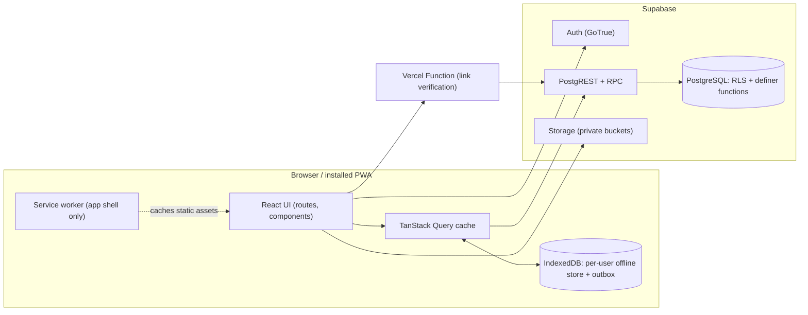

# GradPath — Project Architecture

GradPath is a single-page React application backed by Supabase (PostgreSQL, Auth, Storage, Row Level
Security) and hosted on Vercel, with an offline-capable PWA shell. There is no custom application
server: every privileged rule is enforced inside PostgreSQL (RLS policies, `SECURITY DEFINER` functions
and triggers), so the browser only ever holds the public anon key.



## Technology

| Layer | Choice | Notes |
|---|---|---|
| UI | React 19, TypeScript (strict), Vite 7 | Route-level code splitting with `React.lazy` |
| Styling | Tailwind CSS 4, shadcn-style components on Radix primitives, Lucide icons | Design tokens in `src/styles/index.css`; light and dark themes |
| Motion | Framer Motion | Used sparingly; honours `prefers-reduced-motion` |
| Routing | React Router 7 (library mode) | Protected and admin-only route guards |
| Server state | TanStack Query 5 | Query keys per domain; optimistic updates for notes/planner |
| Forms | React Hook Form + Zod | Same Zod schemas validate service inputs |
| Backend | Supabase Postgres, Auth, Storage | Migrations in `supabase/migrations`, seed in `supabase/seed.sql` |
| Serverless | Vercel Functions (`api/`) | Only for work a browser cannot do (cross-origin link checks) |
| PWA | vite-plugin-pwa (Workbox), IndexedDB via `idb` | Prompt-to-update service worker |
| Tests | Vitest + Testing Library (unit), Vitest + supabase-js against local Supabase (integration/RLS), Playwright (E2E) | |

## Source layout

```
src/
  app/            App bootstrap: providers, router, error boundary
  routes/         Route table and guards (ProtectedRoute, AdminRoute)
  pages/          One file per screen, thin: compose hooks + components
  components/
    ui/           Design-system primitives (Button, Card, Dialog, …)
    layout/       App shell, sidebar, mobile navigation, breadcrumbs
    <feature>/    Feature components (dashboard, courses, lessons, assessments, …)
  hooks/          Reusable React hooks (useAuth, useOnlineStatus, …)
  contexts/       React contexts (auth session, theme)
  services/       Data access per domain — the only code that talks to Supabase
  lib/            Pure, framework-free logic (scheduling, scoring, recommendations, content parsing)
  types/          Database and domain types
  utils/          Small helpers (dates, formatting)
  styles/         Tailwind entry and design tokens
content/          Curriculum source files (Markdown + YAML) — see docs/CONTENT_AUTHORING.md
scripts/          Content compiler, link verifier, icon generator
supabase/         config.toml, migrations, generated seed.sql
api/              Vercel Functions
tests/            unit / integration / e2e
```

Rules: pages never import the Supabase client directly; they call `services/*`. `lib/*` has no React
or network dependencies so it is fully unit-testable.

## Content model and provenance

Course content is authored as text files in `content/`, validated, and compiled into idempotent SQL
upserts with deterministic UUIDs (`scripts/build-content.ts`). Administrators can also create and edit
content in the admin console; both paths write the same tables.

Every content item carries a `source` that the UI displays:

| `source` | Meaning |
|---|---|
| `lecturer` | Material provided by a lecturer (uploaded by an administrator) |
| `institutional` | Verified institutional resource |
| `supplementary` | GradPath's original supplementary explanation (default for seeded lessons) |
| `ai_practice` | Generated practice questions (all seeded questions) |
| `student` | Created by the student (notes, own flashcards) |

## Data and security model

* **Shared content** (`courses`, `course_modules`, `lessons`, `lesson_resources`, `quizzes`,
  `quiz_questions`, `mock_exams`, `announcements`, curriculum `flashcards`): readable by authenticated
  users when published; writable only by administrators.
* **Answer keys** live in `question_keys`, which has RLS enabled and **no student policy**. Students
  receive questions through `start_attempt()` and keys only through `submit_attempt()` results, so
  answers cannot be read during a timed assessment.
* **Private records** (progress, attempts, notes, bookmarks, assignments, sessions, timetable,
  flashcards, revision items/reviews, notifications, preferences) are owned by `user_id` and protected
  by `user_id = auth.uid()` policies. Administrators have **no** policy granting access to other
  students' notes or private records.
* **Roles**: `user_roles` holds `student`/`admin`. `is_admin()` is a `SECURITY DEFINER` function that
  checks the table; it is used in policies and storage rules. Users cannot insert or modify roles;
  the first administrator is provisioned from the SQL editor (`select public.grant_admin('email')`),
  which is not executable by `anon`/`authenticated`.
* **Integrity rules in the database**: lesson completion is rejected unless the lesson's reading
  requirement (and quiz requirement, if configured) is met; attempts are scored server-side; attempts
  past their time limit are flagged; study-session occurrences are unique per timetable event and date.

## Courses and personal selection

* `courses.classification` (core, required, special topic, elective) and `courses.credit_slots` describe the shared
  programme. The Semester 1 listing is 8 courses and 20 credit slots.
* `course_enrolments` is each student's own selection (enrolled, to confirm, not taking). `enrol_default_courses()`
  adds every published compulsory course and offers each elective as "to confirm"; it runs at onboarding and on each
  visit, and never changes a status the student has set.
* `src/lib/curriculum.ts` (pure, unit-tested) and the `useMyCourses()` hook are the single source of "my courses"
  for every screen. Pickers offer only the courses a student takes (plus an older item's course when editing).
* CSIT 610 pages include a private seminar tracker (`seminar_presentations`): topic, stage, date with a "confirmed"
  flag, an 8-step preparation checklist, notes and feedback. GradPath sets no topics or dates.
* Personal timetable blocks (`timetable_events`) are the student's study plan; a lecture row there is an extra
  lecture the student entered themselves (`is_provisional` means awaiting confirmation).

## Official timetable

* Shared, read-only for students: `timetable_sources` (one row per published version, with source, programme, year,
  semester, `time_zone` fixed to Africa/Accra, version and update number) and `timetable_entries` (weekly sessions:
  course, day, start and end in Ghana local time, venue, status, attendance allocation). Entries reference
  `courses`, so course titles, classification, credit slots and colours come from the central course record.
* The 2026/2027 Semester 1 ITB timetable lives in `content/timetables/*.yaml`, is validated against the course codes
  and compiled into `seed.sql` with `on conflict do nothing`, so re-seeding never overwrites an administrator's change.
* Every insert or update is written by a trigger to `timetable_entry_changes` (before/after snapshot, reason, who,
  when); administrators must give a reason. Changes are visible at once and reach students as a notice when an
  administrator calls `publish_timetable_changes`, which bumps the update number and notifies the students who take an
  affected course. `import_timetable_version` adds a revised timetable as a new version and keeps the old one.
  Sessions are removed by status, never deleted.
* Private: `timetable_attendance` (each student's choice per session: awaiting, confirmed for my class, not assigned,
  cancelled) and `timetable_preferences` (lecture reminders, lead time, morning summary, change alerts, "only confirmed"
  view). `allocation` says who attends: `pending_confirmation` (nothing presented as compulsory), `all_students` or
  `group_specific`. A session confirmed for all students counts as confirmed for every student who takes the course
  until the student records another choice (`effectiveAttendance` in the app, `lecture_attendees` in the database).
  The 2026/2027 Semester 1 ITB sessions are `all_students` since the student confirmed them on 14 November 2026.
* Two start dates (`src/lib/semesterCalendar.ts`, `useSemesterCalendar`):
  * `timetable_sources.teaching_started_on` (migrations 14, 15): the day official lectures begin. No lecture is shown in
    the planner, named as the next session or reminded before it. 2026/2027 Semester 1: Monday 16 November 2026. A
    revised timetable version inherits it (trigger `carry_teaching_start`).
  * `profiles.study_started_on` (migration 15, Settings: "My studies started on"): the day the student's own studies
    began, which may be earlier. Every study week (planner, weekly totals and history, weekly pace, dashboard, day order
    on the timetable pages) starts on that weekday and is numbered from it ("Study week N"); without it, weeks follow
    the day lectures begin, else Monday. Only the grouping of dates changes; progress, attempts, sessions and streaks
    keep their own dates.
* After-lecture check-ins (migration 16, `/lectures`): private `lecture_logs`, one per student, session and Ghana
  date, recording attendance (attended, missed, cancelled), the lessons the lecture covered, the covered lessons the
  student wants to review (added to the revision queue) and a note. The `check_lecture_log` trigger takes the course
  from the session and rejects a day the session is not held, a day before lectures begin, lessons from another course
  and reviews of lessons not covered; a cancelled lecture keeps no lessons. `src/lib/lectureLog.ts` (pure,
  unit-tested) lists ended lectures from the last two weeks still waiting for a check-in, and compares each course's
  completed lessons with the furthest lesson any check-in covered: ahead, level, behind (with the lessons to catch up
  on) or unknown until the first check-in; before lectures begin every completed lesson counts as a head start. Shown
  on `/lectures`, a dashboard card and each course page.
* Reminders: `lecture_reminder_core` creates in-app notifications only for confirmed sessions (before the lecture,
  a check-in prompt in the three hours after it ends until the student checks in, plus a morning summary). It runs for the signed-in student from the app (`generate_lecture_notifications`) and for
  everyone every 15 minutes from `pg_cron`; devices that allow browser notifications receive them through the same
  push Edge Function as streak reminders.
* `src/lib/officialTimetable.ts` (Ghana-time formatting independent of the device, next session, overlap layout,
  filters, planner entries, CSV import parsing) and `src/lib/studyStrategy.ts` (the lecture-aligned study plan) are
  pure and unit-tested. Lecture time is never counted in study totals.

## Official marks and grades

* `course_marks` (migration 17, `/grades`): private rows, one per assessed component of a course (title, coursework or
  examination, weight in percent, mark and what it is out of once released, date, note). A trigger keeps each course's
  weights at 100% or less (a P0001 message the student sees).
* `src/lib/grades.ts` (pure, unit-tested) holds the University of Ghana Masters Regulations (July 2025) grading scale,
  Table 5 in section 3.24 (A 80–100 4.00, B+ 70–79 3.50, B 60–69 3.00, C 50–59 2.00, D 30–49 1.50, F 0–29 1.00), and
  computes a course's earned points, average so far, final mark once the marked weights reach 100, what the rest needs
  for each pass grade, and the grade point average (grade point × credits ÷ credits, 3.24.3) over finished courses
  and projected with current averages. Marks are never rounded up (the regulations give no rounding rule). Credits
  are the course's `credit_slots`. Coursework and examination weights are not in the regulations; the student enters
  them from each course outline.

## Assessment engine

`start_attempt(quiz_id)` selects questions (fixed set or random sample from a bank scope), records them
on the attempt and returns them without keys. `submit_attempt(attempt_id, answers)` scores objective
questions (MCQ/scenario by option, true/false, normalised short answers, matching with partial credit),
stores per-question results, computes per-learning-objective performance, records mastery against the
configurable threshold (default 80 %), queues weak lessons for revision, writes a notification and
returns feedback with explanations. Mixed revision tests (`kind = 'revision_test'`) draw 15 objective
questions from a whole course without a time limit; a mixed-course mock exam uses only the courses the student
takes. Essay and case-analysis questions are self-assessed against rubrics
and are never presented as official marks.

## Revision scheduling

`src/lib/scheduler.ts` implements an SM-2-style spaced-repetition scheduler (Again/Difficult/Good/Easy).
Revision items exist for lessons/topics and for flashcards; each review is stored in `revision_reviews`.

## Offline and sync

* The service worker precaches the application shell and static assets only.
* Published course content the student opens (or downloads for offline) is stored in IndexedDB, in a
  database namespaced by user id; it is deleted on sign-out so shared devices do not leak data.
* Writes made offline (notes, study sessions, assignments, flashcard reviews, lesson progress) are
  queued in an IndexedDB outbox with client-generated UUIDs and replayed as idempotent upserts on
  reconnection, so retries cannot create duplicates. Updates carry the `updated_at` they were based on;
  if the server copy is newer the server wins and the local version is kept in a conflict list for the
  student to review.
* Authentication, assessments (server-scored), external resources and videos require connectivity.

## Recommendations

`src/lib/recommendations.ts` is a deterministic rule engine over the student's own data (attempt scores
by objective, lesson progress, revision due dates, upcoming deadlines, study activity). Every
recommendation carries the reason it was generated. An optional AI assistant can be attached later
through `services/assistant` without changing the core flow.

See also [docs/CONTENT_AUTHORING.md](docs/CONTENT_AUTHORING.md), [IMPLEMENTATION_PLAN.md](IMPLEMENTATION_PLAN.md)
and [BUILD_STATUS.md](BUILD_STATUS.md).
