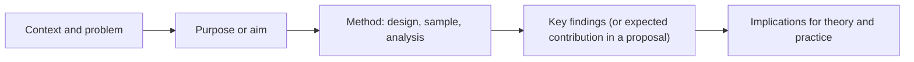

## Introduction

Good research can be undermined by poor writing. Examiners cannot reward insight they cannot find, and a methodology that is brilliantly designed but vaguely described looks weak on paper. Academic writing is not about long words or complicated sentences; it is about making a precise, evidence-based argument that a specialist reader can follow, check and evaluate. For many MSc IT for Business students, who may be accustomed to technical documentation or business reports, the shift to academic argument is one of the most important adjustments of postgraduate study.

This lesson explains the characteristics of academic writing, the difference between descriptive and critical writing, techniques for structuring paragraphs and arguments, and the conventions of academic tone, hedging and clarity. It then focuses on one of the most-read and most-neglected parts of any research document: the **abstract**. You will learn what an abstract must contain, how proposal and dissertation abstracts differ, and how to draft and revise one step by step.

## Learning Objectives

- Explain the defining characteristics of academic writing, including argument, evidence, precision and appropriate tone.
- Distinguish descriptive from critical writing and transform descriptive passages into critical ones.
- Apply paragraph structures such as point-evidence-analysis-link to build coherent arguments.
- Use hedging and precise language to make claims proportionate to evidence.
- Construct an informative abstract for a proposal and for a completed study, including purpose, method, findings and implications.

## Prerequisite Knowledge

- Familiarity with the literature review and synthesis (Module 3).
- Understanding of research objectives, questions and designs (Modules 2 and 4).
- General competence in written English; this lesson focuses on academic conventions rather than grammar basics.

## Key Terminology

- **Academic writing**: Formal, evidence-based writing that presents a reasoned argument to a scholarly audience and acknowledges sources.
- **Critical writing**: Writing that evaluates, compares and interprets evidence to support an argument, rather than merely reporting it.
- **Descriptive writing**: Writing that reports what sources say or what happened without analysis or evaluation.
- **Hedging**: Using cautious language (for example "suggests", "may", "appears to") so that claims match the strength of the evidence.
- **Topic sentence**: The sentence, usually first in a paragraph, that states the paragraph's main point.
- **Signposting**: Words and phrases that guide the reader through the structure of an argument.
- **Abstract**: A concise, self-contained summary of a research document's purpose, methods, findings and implications.
- **Structured abstract**: An abstract organised under explicit headings such as purpose, design/methodology/approach, findings and originality/value.

## Detailed Explanation

### Characteristics of academic writing

Academic writing differs from other genres in several ways:

1. **It argues.** Every chapter advances a position: that a problem matters, that a gap exists, that a design is appropriate, that findings mean something. Writing that merely collects information lacks this spine.
2. **It is evidence-based.** Claims are supported by data or by cited scholarship. "Mobile money has transformed retail in Ghana" needs a source or should be reframed.
3. **It is precise.** Vague words ("many", "a lot", "recently", "things") are replaced with specific terms, defined constructs and accurate descriptions.
4. **It is objective in tone, not necessarily impersonal.** Emotive language ("shocking", "amazing") is avoided. Use of "I" or "we" is increasingly accepted in some disciplines, particularly for describing what the researcher did, but you should follow your supervisor's and institution's guidance.
5. **It acknowledges sources.** Ideas, data and words from others are cited consistently (see the APA 7 lesson).
6. **It is structured.** Readers expect conventional sections, logical ordering and clear transitions.

### Descriptive versus critical writing

Compare two passages on the Technology Acceptance Model.

> *Descriptive:* Davis (1989) developed TAM. It has two constructs, perceived usefulness and perceived ease of use. Many studies have used TAM.

> *Critical:* Davis's (1989) Technology Acceptance Model remains attractive because its two core beliefs, perceived usefulness and perceived ease of use, are parsimonious and easy to measure. However, this parsimony is also its weakness: the model largely omits social and organisational influences, which may be decisive where adoption decisions are made by owners on behalf of employees, as in many Ghanaian SMEs. This limitation partly motivated extended models such as UTAUT (Venkatesh et al., 2003).

The critical version evaluates (strength and weakness), interprets (why it matters in context) and connects (to later work and to the study). A useful test is to ask of each paragraph: *so what?* If the paragraph does not answer that question, it is probably descriptive.

### Building paragraphs: PEAL

A reliable structure for academic paragraphs is **Point-Evidence-Analysis-Link (PEAL)**:

- **Point**: a topic sentence stating the claim.
- **Evidence**: data, examples or citations supporting the claim.
- **Analysis**: explanation of what the evidence shows, its limits and its significance.
- **Link**: a sentence connecting back to the argument or forward to the next paragraph.

Paragraphs should normally develop one main idea. Very long paragraphs often contain two arguments that should be separated; one-sentence paragraphs usually signal an undeveloped idea.

### Hedging and proportionate claims

Research rarely proves anything conclusively. Over-claiming ("This study proves that AI increases efficiency") invites criticism; under-claiming ("It might perhaps possibly be that...") obscures your contribution. Hedging aims for proportion:

| Strength of evidence | Example phrasing |
|---|---|
| Strong and consistent | "The results show...", "There is strong evidence that..." |
| Moderate | "The findings suggest...", "This indicates..." |
| Weak or tentative | "It is possible that...", "One explanation may be..." |
| Speculative | "Future research could examine whether..." |

### Clarity at sentence level

- Prefer active voice when it clarifies who did what ("The researcher interviewed twelve managers"), while recognising that passive voice is acceptable when the actor is unimportant ("Data were analysed using thematic analysis").
- Put the main point near the start of the sentence.
- Define acronyms on first use: "small and medium-sized enterprises (SMEs)".
- Use terms consistently: if you define "digital payment adoption", do not switch to "e-payment usage" without explanation.
- Avoid unsupported generalisations ("Everyone knows...", "It is obvious that...").

### Abstracts: purpose and content

The abstract is often the only part of a document that many readers, reviewers and examiners read first. It must stand alone, with no citations (in most cases), no undefined abbreviations and no information absent from the main text. Most guidance, including the APA *Publication Manual* (7th ed.), recommends a concise length; many universities and journals set a specific word limit, commonly in the range of 150-300 words, so always check your own requirement.

An informative abstract for a **completed study** answers five questions:

1. **Context and problem**: Why does the study matter?
2. **Purpose**: What did it aim to do?
3. **Method**: How was it done (design, sample, data, analysis)?
4. **Findings**: What were the main results?
5. **Implications**: What do the results mean for theory, practice or policy?

A **proposal abstract** follows the same logic but uses future tense for methods and replaces findings with **expected contributions**, since no data have been collected yet.

Some journals, including many Emerald publications, require **structured abstracts** with headings such as *Purpose*, *Design/methodology/approach*, *Findings*, *Research limitations/implications*, *Practical implications* and *Originality/value*. Even when unstructured abstracts are required, drafting under these headings first is a valuable discipline.

## Theories, Frameworks and Models

### The CARS model for introductions and abstracts

Swales's genre analysis of research introductions produced the **Create a Research Space (CARS)** model, explained in Swales and Feak's *Academic Writing for Graduate Students*. It describes three "moves":

1. **Establishing a territory**: showing that the research area is important.
2. **Establishing a niche**: identifying a gap, problem or question in existing work.
3. **Occupying the niche**: stating the purpose of the present study and how it fills the gap.

The opening sentences of a good abstract compress these moves into one or two sentences before moving on to method and findings.

### The writing process as iteration

Expert writers rarely produce polished prose in one draft. A practical model is: **plan** (outline the argument), **draft** (write freely without editing), **revise** (restructure for argument and flow), **edit** (sentence-level clarity) and **proofread** (errors and formatting). Separating these stages prevents the paralysis of trying to write perfect sentences before the argument is clear.

## Worked Example

**Illustrative scenario.** A student's first abstract draft for a completed study reads:

> "This study is about AI. AI is very important nowadays. SMEs in Ghana were studied. A questionnaire was used and the results were analysed. The results were interesting and showed many things. Recommendations are given."

**Step 1: Diagnose.** The draft lacks a specific problem, purpose, sample, analysis method, actual findings and implications. Words such as "very important", "interesting" and "many things" are vague.

**Step 2: Draft under structured headings.**

- *Context/problem*: Ghanaian SMEs increasingly encounter AI-enabled tools, yet evidence on whether adoption improves operational efficiency is limited.
- *Purpose*: Examine the relationship between AI adoption and perceived operational efficiency, and the role of organisational readiness.
- *Method*: Cross-sectional survey of SME owner-managers in Accra; stratified sample; regression analysis.
- *Findings*: (state the actual direction and nature of the main results).
- *Implications*: For SME owners, technology vendors and policy-makers.

**Step 3: Combine into prose (format example with placeholder findings).**

> "Although artificial intelligence (AI) tools are increasingly available to small and medium-sized enterprises (SMEs) in Ghana, little empirical evidence exists on whether their adoption improves operational efficiency. Drawing on the technology-organisation-environment framework, this study examined the relationship between AI adoption and perceived operational efficiency among SMEs in Accra, and whether organisational readiness moderates that relationship. A cross-sectional survey of owner-managers, selected through stratified random sampling by sector, was analysed using multiple regression. [State the principal findings here, for example the direction and significance of the main relationship and the moderating effect.] The findings contribute to technology adoption research by extending it to the SME context in Ghana and suggest that SMEs should invest in staff skills and data infrastructure alongside AI tools."

**Step 4: Check.** Does the abstract stand alone? Are abbreviations defined? Are all claims in the main text? Is it within the required word limit? Are findings stated rather than promised? (In a real abstract, the placeholder sentence must be replaced with the actual results.)

## Ghanaian Business Application

The skills in this lesson transfer directly into professional practice in Ghana. Managers in banks, telecommunications companies and public agencies routinely read executive summaries, which are close cousins of abstracts: a decision-maker at a Ghanaian ministry or a bank's board needs the problem, approach, findings and recommendations in a page or less. An MSc graduate who can write a precise, evidence-based summary is more persuasive in proposing an ERP upgrade, a cybersecurity investment or a digital payments strategy.

Students should also be aware of contextual writing challenges. Many Ghanaian students are multilingual and may be fluent in English while translating complex ideas from other languages or professional jargon. Common issues include over-long sentences, inconsistent tense, and borrowing phrases from sources to "sound academic", which risks patchwriting. Writing centres, peer review groups and supervisors can help; reading high-quality articles in your area and analysing how authors build arguments is one of the most effective ways to improve.

## International Case Study

### Structured abstracts in management and information systems publishing

Emerald Publishing, which publishes many management and information systems journals, has for many years required authors in most of its journals to submit structured abstracts under headings such as Purpose, Design/methodology/approach, Findings and Originality/value, with optional sections on limitations and implications. The rationale is that structured headings make abstracts more complete and easier to scan, and they prevent authors from omitting key information such as method or findings. Medical journals adopted structured abstracts earlier for similar reasons, and reporting guidelines in health research encourage complete reporting of methods and results in abstracts.

The lesson for MSc students is practical: even where your institution requires a single-paragraph abstract, drafting under structured headings first is a reliable way to ensure completeness. It also shows that writing conventions are not arbitrary; they evolve to help readers find, evaluate and use research efficiently.

## Diagram

Each box usually needs only one or two sentences; together they form a complete, self-contained abstract.

## Common Misconceptions

- **Misconception:** Academic writing means using complicated vocabulary and long sentences. **Correction:** Good academic writing is precise and clear; complexity should come from ideas, not from obscure wording.
- **Misconception:** The abstract is an introduction to the topic. **Correction:** An abstract summarises the whole study, including methods and findings, not just background.
- **Misconception:** Hedging shows weakness. **Correction:** Proportionate hedging shows that claims match the evidence, which examiners value.
- **Misconception:** Critical writing means criticising sources negatively. **Correction:** Critical writing evaluates strengths and weaknesses, compares and interprets; it can be positive.
- **Misconception:** The abstract should be written first and left unchanged. **Correction:** A draft abstract can guide writing, but the final abstract should be written or revised last so it reflects the finished document.

## Common Examination Mistakes

- Producing descriptive summaries of literature instead of evaluative arguments.
- Writing abstracts that omit the method or say "results will be discussed" instead of stating findings.
- Overstating conclusions, for example using "proves" for correlational survey data.
- Using undefined acronyms and inconsistent terms for the same construct.
- Ignoring stated word limits or required abstract formats.

## Critical Thinking Questions

1. Is it ever appropriate to use the first person ("I") in a methodology chapter? What are the arguments for and against?
2. How can a writer be critical of a highly cited, foundational model without appearing to dismiss it?
3. Does a strict abstract word limit improve research communication, or does it encourage oversimplification of complex findings?
4. How should multilingual writers balance natural expression with the conventions of academic English?

## Practical Exercises

1. **Descriptive to critical.** Take a descriptive paragraph from your own literature notes and rewrite it using the PEAL structure. *Expected output:* the original and revised paragraphs, with each PEAL element labelled.
2. **Hedging calibration.** Rewrite five over-claiming sentences (for example "The survey proves that trust causes adoption") so that they match the strength of the evidence. *Expected output:* five revised sentences with a brief justification for each choice.
3. **Proposal abstract.** Write a 200-250 word abstract for your own planned study using the five-part structure, with methods in the future tense and expected contributions instead of findings. *Expected output:* a complete, self-contained proposal abstract.

## Key Takeaways

- Academic writing is argued, evidence-based, precise, appropriately toned and properly referenced.
- Critical writing evaluates and interprets; always answer the "so what?" question.
- PEAL paragraphs and clear signposting create coherent arguments.
- Hedging makes claims proportionate to evidence.
- An abstract summarises context, purpose, method, findings and implications and must stand alone.

## Further Reading

- Swales, J. M., & Feak, C. B. (2012). *Academic writing for graduate students: Essential tasks and skills* (3rd ed.). University of Michigan Press.
- American Psychological Association. (2020). *Publication manual of the American Psychological Association* (7th ed.). American Psychological Association.
- Davis, F. D. (1989). Perceived usefulness, perceived ease of use, and user acceptance of information technology. *MIS Quarterly, 13*(3), 319-340.
- Saunders, M., Lewis, P., & Thornhill, A. (2019). *Research methods for business students* (8th ed.). Pearson.

## Video Resources

- [APA Style](https://apastyle.apa.org/): American Psychological Association. Official APA Style site with guidance on paper elements, including abstracts, and on clear, concise writing.
- [Purdue Online Writing Lab](https://owl.purdue.edu/): Purdue University. Official writing resource portal with guidance on academic writing, paragraphing and research writing.

## Revision Summary

Academic writing presents a precise, evidence-based argument to a specialist reader. It is critical rather than descriptive, structured through clear paragraphs and signposting, and careful to match claims to evidence through hedging. The abstract is a self-contained summary of the whole study.

- Answer "so what?" in every paragraph; evaluate, compare, interpret.
- Use PEAL: point, evidence, analysis, link.
- Hedge proportionately; never "prove" with correlational data.
- Abstract = context, purpose, method, findings (or expected contribution), implications.
- Check word limits and required formats; write or revise the abstract last.
- CARS moves: establish territory, establish niche, occupy niche.
