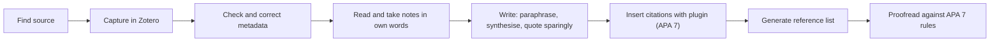

## Introduction

Referencing is how scholars show where their ideas, evidence and words come from. It allows readers to check claims, credits other researchers for their work, and demonstrates that your argument is built on a foundation of scholarship. Poor referencing, by contrast, damages credibility: missing citations suggest unsupported claims, inconsistent formatting suggests carelessness, and unacknowledged use of others' work is plagiarism, a serious breach of academic integrity.

This lesson teaches the essentials of **APA 7**, the referencing style set out in the *Publication Manual of the American Psychological Association* (7th ed., 2020) and widely used in business, information systems and social science research. It covers in-text citations and reference list formats for the most common source types, shows how to use **Zotero** to manage citations, and explains how to avoid plagiarism through good note-taking, paraphrasing and citation practice. The reference examples marked as format examples use clearly fictional authors and titles to illustrate structure; always check your own institution's referencing requirements, which may modify or replace APA conventions.

## Learning Objectives

- Explain the purposes of referencing and the principles of the APA 7 author–date system.
- Apply APA 7 rules to format narrative and parenthetical in-text citations for one, two, three or more, and group authors.
- Construct APA 7 reference list entries for journal articles, books, edited book chapters and webpages.
- Use Zotero to collect, organise and insert citations and generate a reference list.
- Distinguish quotation, paraphrase, summary, patchwriting and plagiarism, and evaluate whether a passage uses sources appropriately.

## Prerequisite Knowledge

- Experience of reading academic sources from the literature review module.
- Basic word-processing skills (Microsoft Word, LibreOffice or Google Docs).
- None beyond this regarding referencing; the lesson starts from first principles.

## Key Terminology

- **APA 7**: The seventh edition of the American Psychological Association's style, using an author–date citation system.
- **In-text citation**: A brief reference in the body of the text, giving author and year (and page for quotations), that points to the full reference list entry.
- **Narrative citation**: An in-text citation where the author's name forms part of the sentence, for example "Davis (1989) argued...".
- **Parenthetical citation**: An in-text citation placed in brackets, for example "(Davis, 1989)".
- **Reference list**: The alphabetical list at the end of a document giving full details of every source cited.
- **DOI (Digital Object Identifier)**: A persistent identifier for a digital object, presented in APA 7 as a URL beginning `https://doi.org/`.
- **Paraphrase**: Restating another author's idea in your own words and sentence structure, with a citation.
- **Patchwriting**: Copying source text and making superficial changes such as swapping synonyms, while keeping the original structure.
- **Plagiarism**: Presenting someone else's words, ideas, data or work as your own without proper acknowledgement.
- **Reference manager**: Software, such as Zotero, that stores source details and automatically formats citations and references.

## Detailed Explanation

### Why reference?

Referencing serves four purposes: **attribution** (credit to the original author), **verification** (readers can check your evidence), **positioning** (showing how your work relates to existing scholarship) and **integrity** (distinguishing your contribution from others'). You must cite whenever you use another person's ideas, findings, data, theories, figures or words, whether quoted or paraphrased. Common knowledge in your field, such as "Ghana is in West Africa", does not need a citation, but specific facts, statistics and arguments do.

### In-text citations in APA 7

APA 7 uses an author–date system. The table below shows the main patterns. The names are fictional format examples.

| Situation | Parenthetical | Narrative |
|---|---|---|
| One author | (Mensah, 2021) | Mensah (2021) |
| Two authors | (Mensah & Owusu, 2021) | Mensah and Owusu (2021) |
| Three or more authors | (Mensah et al., 2021) | Mensah et al. (2021) |
| Group author with abbreviation (first citation) | (Illustrative Statistics Agency [ISA], 2022) | Illustrative Statistics Agency (ISA, 2022) |
| Group author (later citations) | (ISA, 2022) | ISA (2022) |
| Direct quotation | (Mensah, 2021, p. 14) | Mensah (2021) stated that "..." (p. 14). |
| Several works in one bracket | (Asante, 2019; Mensah, 2021) | — |
| Same author, same year | (Owusu, 2020a, 2020b) | Owusu (2020a) |

Key rules:

- Use **"&"** inside parentheses and **"and"** in narrative text.
- For three or more authors, use **"et al."** from the first citation (a change from APA 6).
- Multiple works in one parenthesis are ordered **alphabetically** by first author, separated by semicolons.
- Direct quotations require a **page number** (p. or pp.) or, for unpaginated sources, another locator such as a paragraph number (para.).
- Quotations of 40 words or more are formatted as **block quotations**, indented, without quotation marks.

A real example: the Technology Acceptance Model was introduced by Davis (1989), or (Davis, 1989).

### Reference list formats

The reference list appears at the end, titled **References**, in alphabetical order by first author's surname, with a hanging indent and, in student papers, double spacing. APA 7 lists up to 20 authors in a reference entry. Publisher location is no longer included for books, and DOIs are written as `https://doi.org/...` without the label "DOI:".

**Journal article**

Pattern: Author, A. A., Author, B. B., & Author, C. C. (Year). Title of article in sentence case. *Title of Journal in Title Case, volume*(issue), page–page. https://doi.org/xxxxx

*Format example (fictional):*
Asante, K. M., & Boateng, E. A. (2021). Mobile money use and record keeping among market traders. *Journal of Illustrative Information Systems, 12*(3), 45–67. https://doi.org/10.0000/example.2021.003

*Real example:*
Davis, F. D. (1989). Perceived usefulness, perceived ease of use, and user acceptance of information technology. *MIS Quarterly, 13*(3), 319–340. https://doi.org/10.2307/249008

Note that the article title is in sentence case (only the first word, the first word after a colon and proper nouns capitalised) and not italicised, while the journal title and volume number are italicised; the issue number in brackets is not.

**Authored book**

Pattern: Author, A. A. (Year). *Title of book in sentence case: Subtitle also in sentence case* (edition if not first). Publisher. https://doi.org/xxxxx (if available)

*Format example (fictional):*
Owusu, J. K. (2020). *Digital transformation in West African enterprises* (2nd ed.). Illustrative Academic Press.

*Real example:*
Saunders, M., Lewis, P., & Thornhill, A. (2019). *Research methods for business students* (8th ed.). Pearson.

**Chapter in an edited book**

Pattern: Author, A. A. (Year). Title of chapter. In E. E. Editor & F. F. Editor (Eds.), *Title of book* (pp. xx–xx). Publisher. https://doi.org/xxxxx (if available)

*Format example (fictional):*
Mensah, A. B. (2019). Cybersecurity awareness in higher education. In C. D. Ofori & E. F. Darko (Eds.), *Information security in emerging economies* (pp. 101–125). Illustrative Academic Press.

Note that editors' initials come **before** their surnames in this position, and the book title, not the chapter title, is italicised.

**Webpage on a website**

Pattern: Author, A. A., or Group Name. (Year, Month Day). *Title of page*. Site Name. URL

*Format example (fictional):*
Illustrative Payments Association. (2023, March 14). *Guide to merchant digital payments*. https://www.example.org/merchant-guide

When the author and site name are the same, omit the site name. If there is no date, use (n.d.). Include a retrieval date only for pages that are designed to change over time.

**Legislation and official reports.** Legal materials such as Ghanaian Acts follow special legal citation conventions in APA. A common practical approach is to give the Act's name, year and number as it is officially styled, for example the Data Protection Act, 2012 (Act 843), but you should check your institution's guidance and APA's official advice on legal references.

### Citation management with Zotero

Zotero is a free, open-source reference manager. Its core workflow is:

1. **Install** Zotero desktop and the Zotero Connector for your browser.
2. **Capture**: while viewing an article on a publisher site, database or Google Scholar, click the Connector to save the reference and, where available, the PDF.
3. **Check metadata**: automated capture is not perfect. Verify author names, title capitalisation, journal title, volume, issue, pages and DOI.
4. **Organise** items into collections (for example by chapter or theme) and add tags and notes.
5. **Cite** using the word processor plugin for Microsoft Word, LibreOffice or Google Docs: insert citations as you write and select APA 7 as the style.
6. **Generate** the bibliography automatically; it updates as you add citations.
7. **Back up and sync** your library, for example with a Zotero account.

Alternatives include Mendeley and EndNote. Whichever you use, the software only formats what you give it: incorrect metadata produces incorrect references, so always proofread the final list.

### Avoiding plagiarism

Plagiarism takes several forms:

- **Direct copying** without quotation marks and citation.
- **Patchwriting**: rearranging or substituting words in a source passage while keeping its structure.
- **Paraphrasing without citation**: rewording an idea is still using it.
- **Self-plagiarism**: reusing your own previous assessed work without permission or acknowledgement.
- **Contract cheating** or submitting work written by someone else.
- **Unacknowledged use of AI-generated text** where your institution's rules require disclosure or forbid such use. Policies on generative AI vary and change, so check your own institution's current rules.

**Effective paraphrasing** follows a sequence: read and understand the passage; close the source; write the idea in your own words and structure; compare with the original to check accuracy and that you have not copied phrasing; add the citation.

*Original (fictional source text for practice):* "Small firms often adopt digital tools in response to customer demand rather than as part of a deliberate strategy."

*Patchwriting (unacceptable):* Small businesses frequently adopt digital tools because of customer demand instead of as part of a planned strategy (Owusu, 2020).

*Acceptable paraphrase:* Owusu (2020) suggests that customer expectations, more than strategic planning, tend to drive digital adoption in small enterprises.

### Similarity reports

Many institutions use text-matching software such as Turnitin. A **similarity report** shows text that matches other sources; it is not a plagiarism verdict. Properly quoted and cited material, common phrases and reference lists can produce matches, while poorly paraphrased material may not. Use the report to check your own practice, not to "game" a percentage.

## Theories, Frameworks and Models

### A decision model for using sources

| Your purpose | Technique | Citation needed? | Page number? |
|---|---|---|---|
| Exact wording is essential (definition, striking phrase) | Direct quotation | Yes | Yes |
| Convey a specific idea in your own words | Paraphrase | Yes | Encouraged, not required |
| Convey the main point of a whole work | Summary | Yes | No |
| Combine several sources to make a point | Synthesis | Yes, all sources | No |
| State common knowledge | Your own words | No | No |

Postgraduate writing should rely mainly on paraphrase and synthesis; heavy quotation suggests that the writer has not processed the ideas.

## Worked Example

**Illustrative scenario.** Correct the following student references and citations (all names are fictional format examples except Davis and Saunders et al.).

1. *In text:* "According to (Mensah, 2021), trust affects adoption."
   *Error:* narrative sentence uses parenthetical form. *Correct:* "According to Mensah (2021), trust affects adoption."
2. *In text:* "(Asante and Boateng, 2021)"
   *Error:* "and" inside parentheses. *Correct:* "(Asante & Boateng, 2021)".
3. *In text:* "(Ofori, Darko, and Mensah, 2022)" on first citation.
   *Error:* APA 7 uses et al. for three or more authors from the first citation. *Correct:* "(Ofori et al., 2022)".
4. *Reference:* "Davis, F. D. (1989). Perceived Usefulness, Perceived Ease Of Use, And User Acceptance Of Information Technology. MIS Quarterly, 13(3), 319-340."
   *Errors:* article title in title case; journal title and volume not italicised; hyphen instead of en dash; DOI missing where available. *Correct:* Davis, F. D. (1989). Perceived usefulness, perceived ease of use, and user acceptance of information technology. *MIS Quarterly, 13*(3), 319–340. https://doi.org/10.2307/249008
5. *Reference:* "Saunders, M., Lewis, P., & Thornhill, A. (2019). Research methods for business students. 8th edition. Harlow: Pearson."
   *Errors:* title not italicised; edition format; publisher location included. *Correct:* Saunders, M., Lewis, P., & Thornhill, A. (2019). *Research methods for business students* (8th ed.). Pearson.

## Ghanaian Business Application

Ghanaian IT-for-business research often draws on official and grey literature: reports and statistical releases from bodies such as the Bank of Ghana, the Ghana Statistical Service and the National Communications Authority, as well as legislation, company annual reports and industry publications. These should be cited as group-authored reports or webpages, with the organisation as author. Students should cite the original official document rather than a news article that summarises it, record the date accessed for pages that change, and keep a copy of key documents in their reference manager, since official web pages are sometimes reorganised.

In professional settings, the same discipline applies. Consultancy reports, board papers and policy briefs prepared in Ghanaian organisations gain credibility when sources are traceable. Copying content from vendor white papers or websites into a business case without attribution can create intellectual property and reputational risks, just as plagiarism does in academic work.

## International Case Study

### The Guttenberg doctoral plagiarism case

In 2011, Karl-Theodor zu Guttenberg, then Germany's Federal Minister of Defence and one of the country's most popular politicians, faced allegations that substantial parts of his doctoral thesis in law had been copied from other sources without proper attribution. Volunteers collaborating online documented numerous passages. The University of Bayreuth withdrew his doctorate in February 2011, and he resigned as minister at the beginning of March 2011.

The case illustrates several points relevant to MSc students. Plagiarism can be detected long after a degree is awarded, and consequences can be career-ending. Text-matching by many people working together found passages that had passed initial examination, showing that integrity cannot depend on whether software flags a passage. Finally, the case prompted wide public discussion in Germany about the standards of doctoral supervision and examination, reminding students that integrity is a shared responsibility of students, supervisors and institutions.

## Diagram

Good referencing begins at the note-taking stage: notes written in your own words, with source details captured immediately, are the best protection against accidental plagiarism.

## Common Misconceptions

- **Misconception:** Paraphrased ideas do not need citations. **Correction:** Any use of another person's ideas requires a citation, whether quoted or paraphrased.
- **Misconception:** A low similarity percentage proves there is no plagiarism. **Correction:** Similarity software detects matching text only; patchwriting, translated copying and idea theft may not be detected.
- **Misconception:** Reference managers always produce correct references. **Correction:** Output depends on the accuracy of captured metadata, which must be checked.
- **Misconception:** In APA 7, all authors are listed in the first in-text citation. **Correction:** For three or more authors, APA 7 uses "et al." from the first citation.
- **Misconception:** Changing a few words in a sentence makes it your own writing. **Correction:** This is patchwriting; genuine paraphrase changes both wording and structure and still needs a citation.

## Common Examination Mistakes

- Mixing referencing styles (for example Harvard and APA) in the same document.
- Citing sources in the text that are missing from the reference list, or vice versa.
- Using title case for article titles in APA 7 reference entries.
- Including publisher locations for books, or "Retrieved from" before URLs for stable sources.
- Relying on secondary citations ("as cited in") when the original source is readily available.

## Critical Thinking Questions

1. Why might a field prefer the author–date system of APA over numbered footnote systems? What does this suggest about how evidence is valued?
2. Where is the line between legitimate learning from a source's structure and patchwriting?
3. How should universities respond to generative AI tools that can paraphrase text automatically? What would a fair policy look like?
4. Is self-plagiarism a genuine integrity issue, or simply an administrative rule? Defend your view.

## Practical Exercises

1. **Format five references.** Choose five real sources from your literature search (two journal articles, one book, one edited chapter, one webpage) and format each in APA 7. *Expected output:* five correct reference entries plus one narrative and one parenthetical citation for each.
2. **Zotero set-up.** Install Zotero and the browser connector, create a collection for your proposal, capture ten sources, correct any metadata errors, and generate an APA 7 bibliography in a document. *Expected output:* a document with ten in-text citations and an automatically generated reference list, with notes on any corrections made.
3. **Paraphrase practice.** Select three short passages from sources you are using and write a genuine paraphrase and a summary of each. *Expected output:* three paraphrases and three summaries, each with an APA 7 citation, and a one-line note on how structure was changed.

## Key Takeaways

- Referencing provides attribution, verification, positioning and integrity.
- APA 7 in-text citations use author–date; use "&" in parentheses, "and" in narrative, and "et al." for three or more authors.
- Reference entries differ by source type; check sentence case, italics, edition, DOI format and the absence of publisher locations.
- Zotero automates citations but requires metadata checking and proofreading.
- Avoid plagiarism through notes in your own words, genuine paraphrase, consistent citation and honest use of tools.

## Further Reading

- American Psychological Association. (2020). *Publication manual of the American Psychological Association* (7th ed.). American Psychological Association.
- Swales, J. M., & Feak, C. B. (2012). *Academic writing for graduate students: Essential tasks and skills* (3rd ed.). University of Michigan Press.
- Davis, F. D. (1989). Perceived usefulness, perceived ease of use, and user acceptance of information technology. *MIS Quarterly, 13*(3), 319–340. <https://doi.org/10.2307/249008>
- American Psychological Association. (n.d.). *APA Style*. <https://apastyle.apa.org/>

## Video Resources

- [APA Style](https://apastyle.apa.org/) — American Psychological Association. Official APA Style site with references and in-text citation guidance, sample papers and instructional aids.
- [Zotero Documentation](https://www.zotero.org/support/) — Zotero. Official documentation and quick-start guides for capturing sources, using word processor plugins and generating bibliographies.
- [Purdue Online Writing Lab](https://owl.purdue.edu/) — Purdue University. Official writing resource portal with APA formatting guidance and advice on paraphrasing.

## Revision Summary

APA 7 is an author–date style that requires an in-text citation for every use of others' ideas or words and a matching, correctly formatted entry in an alphabetical reference list. Zotero and similar tools speed up referencing but require careful metadata checking. Plagiarism, including patchwriting and unacknowledged paraphrase, is avoided through good notes, genuine paraphrase and consistent citation.

- In text: (Author, Year); Author (Year); "&" in brackets; "et al." for 3+ authors; page numbers for quotations.
- Journal: Author. (Year). Sentence-case title. *Journal, vol*(issue), pages. https://doi.org/...
- Book: Author. (Year). *Title* (ed.). Publisher. (No location.)
- Chapter: Author. (Year). Chapter title. In E. Editor (Ed.), *Book* (pp. x–y). Publisher.
- Webpage: Author. (Year, Month Day). *Title*. Site. URL.
- Similarity reports are evidence to review, not verdicts.
