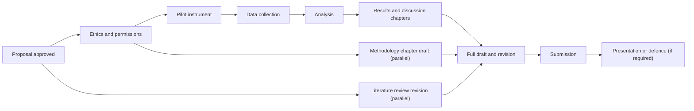

## Introduction

An MSc dissertation is usually the largest independent piece of work in the programme. Unlike taught modules, where lecturers set the pace, the dissertation requires the student to manage a project with many dependencies: approvals that take time, participants who are slow to respond, data that need cleaning, chapters that need several drafts, and a supervisor whose time is limited. Many dissertations that struggle do so not because the student lacks ability, but because planning, communication and time management broke down.

The dissertation also culminates, in many programmes, in a presentation or oral examination, sometimes called a defence or viva. Here the student must explain and justify the research to examiners who will probe its weaknesses. This lesson covers project planning techniques, working effectively with a supervisor, risk management, and preparing for presentations and defences. Requirements such as deadlines, word limits, submission procedures and whether an oral defence takes place vary between institutions and programmes; always follow your own programme's official guidance, which this lesson does not replace.

## Learning Objectives

- Explain the main stages of a dissertation project and the dependencies between them.
- Apply project planning tools, such as work breakdown structures and Gantt charts, to create a realistic dissertation schedule.
- Develop a risk register identifying threats to completion and appropriate mitigations.
- Construct a research presentation that communicates problem, method, findings and contribution clearly within a time limit.
- Evaluate likely examiner questions and prepare evidence-based responses for an oral defence.

## Prerequisite Knowledge

- Understanding of the full research process from problem formulation to analysis (Modules 1 to 6).
- Familiarity with proposal structure and writing (earlier lessons in this module).
- Basic project management concepts are helpful but not required.

## Key Terminology

- **Work breakdown structure (WBS)**: A hierarchical decomposition of a project into manageable tasks and deliverables.
- **Gantt chart**: A bar chart that shows tasks against time, including durations, overlaps and dependencies.
- **Critical path**: The sequence of dependent tasks that determines the minimum project duration; delay on any of them delays completion.
- **Milestone**: A significant checkpoint, such as ethics approval or submission of a full draft.
- **Risk register**: A table listing risks, their likelihood and impact, mitigation strategies and owners.
- **Supervisor**: The academic who guides, advises on and reviews the student's research; the student remains responsible for the work.
- **Oral defence (viva)**: An examination in which the student presents and defends the research before examiners.
- **Elevator pitch**: A very short summary of a study's problem, approach and contribution.

## Detailed Explanation

### Stages and dependencies

A typical dissertation proceeds through overlapping stages:

1. Topic selection and refinement.
2. Proposal writing and approval.
3. Ethical approval and gatekeeper permissions.
4. Instrument development and pilot testing.
5. Data collection.
6. Data analysis.
7. Writing chapters and revision.
8. Final editing, formatting and submission.
9. Presentation or defence (where required) and corrections.

Some tasks are **dependent**: you cannot collect data before ethical approval, nor analyse data before collecting them. Others can run **in parallel**: you can refine the literature review while waiting for approval, and draft the methodology chapter while collecting data. Recognising which tasks are on the **critical path** is the key to realistic planning. Ethical approval and data collection are frequently on the critical path, and both depend on other people, so they deserve early attention and contingency time.

### Building a work breakdown structure and Gantt chart

Begin with the final deadline and work backwards. Break each stage into tasks small enough to estimate (one to two weeks), assign durations, and mark dependencies. Add **buffer time**, commonly a meaningful proportion of the schedule, for delays outside your control. Spreadsheet software, free project tools or even a carefully drawn table can serve as a Gantt chart.

| Task | Weeks (illustrative) | Depends on |
|---|---|---|
| Finalise proposal | 1–3 | Supervisor feedback |
| Ethics application and approval | 3–7 | Final proposal, instruments |
| Pilot instrument | 6–7 | Draft instrument |
| Revise literature review | 4–9 | — (parallel) |
| Data collection | 8–13 | Ethics approval, gatekeeper permission |
| Draft methodology chapter | 8–11 | Final design |
| Data analysis | 13–16 | Data collection |
| Write results and discussion | 15–19 | Analysis |
| Full draft to supervisor | 20 | All chapters |
| Revisions, editing, formatting | 21–23 | Feedback |
| Submission | 24 | — |

The week numbers are illustrative; your programme's calendar and deadlines will differ.

### Working with your supervisor

Supervision is a professional relationship with responsibilities on both sides. Students who benefit most:

- **Prepare for meetings** with an agenda, specific questions and work sent in advance.
- **Record decisions** and action points after each meeting and share them by email.
- **Submit drafts regularly**, even imperfect ones, rather than waiting for a "perfect" chapter.
- **Act on feedback** or explain respectfully why they disagree, with evidence.
- **Communicate early** about problems such as low response rates or personal difficulties.
- **Take ownership**: the supervisor advises; decisions and the work are the student's.

### Risk management

Common risks to dissertation completion include delays in approvals, low response rates, loss of access to an organisation, data loss, scope creep, work and family pressures, and unfamiliarity with analysis software. A **risk register** makes these visible and prompts planning.

| Risk | Likelihood | Impact | Mitigation |
|---|---|---|---|
| Ethics approval delayed | Medium | High | Submit early; prepare complete documents; parallel work on literature |
| Low survey response | High | High | Multiple distribution channels; reminders; gatekeeper support; realistic sample targets |
| Organisation withdraws access | Low | High | Written permission; backup site identified |
| Data loss | Low | Very high | Encrypted cloud backup plus local copy; version control of drafts |
| Scope creep | Medium | Medium | Fix objectives with supervisor; record ideas for future research |

### Preparing a research presentation

Presentations, whether for a proposal panel or a final defence, are typically short, so focus is essential. A common structure for a 15–20 minute presentation is:

1. **Title and context** (1 slide): topic, why it matters.
2. **Problem and gap** (1–2 slides).
3. **Aim, objectives and questions** (1 slide).
4. **Theoretical or conceptual framework** (1 slide, visual).
5. **Methodology** (2 slides): design, sample, instruments, analysis, ethics.
6. **Findings** (3–4 slides) or, for a proposal, expected outcomes and work plan.
7. **Discussion and contribution** (1–2 slides).
8. **Limitations, recommendations and future research** (1 slide).
9. **Conclusion** (1 slide) and invitation for questions.

Design slides with minimal text, readable font sizes, clear charts and consistent formatting. Rehearse aloud, time yourself, and practise with peers who can ask challenging questions.

### Preparing for the oral defence

Examiners use questions to check that the work is the student's own, that the student understands the choices made, and that the student can reflect critically on limitations. Preparation strategies:

- **Know your study thoroughly**: re-read the whole dissertation shortly before the defence.
- **Anticipate questions** around each chapter, especially methodology.
- **Prepare short, evidence-based answers**, referring to specific pages or tables.
- **Acknowledge limitations honestly**; defending a weakness as a strength rarely convinces.
- **Listen fully** to each question, pause to think, and ask for clarification if needed.
- **Stay calm and professional** when challenged; examiners may test your reasoning rather than signal that something is wrong.

Typical questions include: Why this topic? Why this paradigm and design? How did you select your sample, and how representative is it? How did you ensure validity and reliability? What is your main contribution? What would you do differently? How do your findings compare with previous studies? What are the practical implications?

## Theories, Frameworks and Models

### Planning frameworks

- **SMART goals** (Specific, Measurable, Achievable, Relevant, Time-bound) help turn vague intentions ("work on the literature review") into actionable tasks ("synthesise ten studies on trust into a concept matrix by Friday").
- **Backward scheduling** starts from the deadline and works back, ensuring that critical tasks are given enough time.
- **Plan–Do–Check–Act (PDCA)**, from quality management, encourages regular review of progress against plan, with adjustment when slippage occurs.

### The "three-minute" summary

Being able to explain the research concisely is a powerful test of understanding. The Three Minute Thesis competition (discussed below) demonstrates that even complex research can be summarised for a non-specialist audience by focusing on the problem, the approach, the key finding and why it matters.

## Worked Example

**Illustrative scenario.** Esi is completing an MSc dissertation on cybersecurity awareness among university students while working full time. She has 24 weeks until submission (an illustrative timeline). Her first plan schedules data collection in week 4 and ethics approval "whenever it comes".

**Step 1 – Identify the dependency error.** Data collection cannot begin before ethical approval and permissions; the plan ignores the critical path.

**Step 2 – Rebuild the schedule backwards.** Submission week 24; full draft to supervisor week 20; analysis and results by week 17; data collection weeks 9–13; ethics approval targeted by week 8 with the application submitted in week 3; pilot in week 7.

**Step 3 – Add parallel tasks.** While waiting for approval, Esi revises her literature review and drafts her methodology chapter.

**Step 4 – Build a risk register.** Highest risks: low response rate during examination periods (mitigation: avoid exam weeks, use multiple faculties' official channels where permitted, send reminders) and limited time because of work (mitigation: fixed weekly writing blocks, short tasks, informing her supervisor early).

**Step 5 – Prepare for defence.** Esi writes ten likely examiner questions and practises answering them. For "How representative is your sample?", she prepares an honest answer: stratification by faculty improved coverage, but the single-institution design limits generalisability, which she discusses as a limitation and a direction for future research.

## Ghanaian Business Application

Many MSc IT for Business students in Ghana study while working in banks, telecommunications companies, public agencies, schools or their own businesses. This brings advantages, such as access to organisations and practical insight, but also challenges: limited time, competing deadlines and possible conflicts of interest. Planning that recognises real constraints, such as peak business periods, public holidays and organisational approval cycles, is more realistic than an idealised schedule. Gatekeeper permissions from Ghanaian organisations can take time, often requiring formal letters and internal approvals, so these should be requested early, in line with your institution's procedures.

The presentation and defence skills developed here transfer directly to the workplace. Presenting a business case to management, defending an IT investment proposal to a board, or explaining a cybersecurity risk assessment to non-specialists all require the same capabilities: clear structure, evidence-based argument, concise visuals and calm, honest handling of challenging questions.

## International Case Study

### The Three Minute Thesis (3MT)

The Three Minute Thesis competition was developed at the University of Queensland in Australia in 2008 and has since been adopted by universities in many countries. Research students present their research in three minutes or less, using a single static slide, to a non-specialist audience. Judges typically assess comprehension and content (did the presentation explain the research and its significance clearly?) and engagement and communication (did it capture attention and interest?).

The format is relevant to MSc students for two reasons. First, it shows that distilling research to its essence, the problem, the approach, the key finding and the significance, is a skill that can be learned and practised. Second, preparing a three-minute version of your study is an excellent defence rehearsal: if you cannot explain why your research matters in three minutes, examiners may struggle to see its contribution in thirty. Many students find that writing a 3MT-style script clarifies the argument of their dissertation itself.

## Diagram

The main chain (A to H) is the typical critical path; parallel work fills waiting periods without delaying it.

## Common Misconceptions

- **Misconception:** Writing should start only after all data are collected. **Correction:** Introduction, literature review and methodology chapters can and should be drafted earlier, in parallel.
- **Misconception:** The supervisor is responsible for the dissertation's success. **Correction:** The supervisor advises; the student owns the work, its decisions and its deadlines.
- **Misconception:** Admitting limitations in a defence will lead to failure. **Correction:** Examiners expect honest, critical reflection; defensive denial of obvious weaknesses is more damaging.
- **Misconception:** More slides make a more thorough presentation. **Correction:** Focused slides with clear visuals communicate better within time limits.
- **Misconception:** A plan, once made, should be followed rigidly. **Correction:** Plans should be reviewed and adjusted regularly as risks materialise.

## Common Examination Mistakes

- Planning timelines that ignore approval periods and dependencies.
- Presenting slides crowded with text read aloud verbatim.
- Answering defence questions with vague generalities instead of reference to the study's specific evidence.
- Failing to explain the study's contribution clearly when asked.
- Becoming defensive or argumentative when examiners probe weaknesses.

## Critical Thinking Questions

1. How should a working MSc student balance the benefits and risks of researching their own employer?
2. What is the appropriate response when a supervisor's advice conflicts with what the student believes is methodologically correct?
3. Is a three-minute summary of research a valuable discipline, or does it risk oversimplifying complex findings?
4. What makes an oral defence fair to students for whom English is a second or third language?

## Practical Exercises

1. **Gantt chart.** Create a Gantt chart for your own dissertation from today to your programme's submission date, showing dependencies, milestones and buffer time. *Expected output:* a chart (spreadsheet or table) with at least twelve tasks and the critical path highlighted.
2. **Risk register.** Identify at least six risks to your dissertation and record likelihood, impact, mitigation and early warning signs. *Expected output:* a completed six-row risk register.
3. **Defence rehearsal.** Write fifteen likely examiner questions about your study (at least five on methodology) and draft a 60–90 second answer to each. Practise with a peer. *Expected output:* a question-and-answer document and notes on which answers needed improvement.

## Key Takeaways

- Dissertation success depends heavily on planning around dependencies and the critical path.
- Work breakdown structures, Gantt charts and risk registers make planning concrete.
- Effective supervision depends on preparation, regular drafts and clear communication.
- Presentations should be focused, visual and rehearsed within time limits.
- Defences reward thorough knowledge of the study, evidence-based answers and honest reflection on limitations.

## Further Reading

- Saunders, M., Lewis, P., & Thornhill, A. (2019). *Research methods for business students* (8th ed.). Pearson.
- Creswell, J. W., & Creswell, J. D. (2018). *Research design: Qualitative, quantitative, and mixed methods approaches* (5th ed.). SAGE.
- Swales, J. M., & Feak, C. B. (2012). *Academic writing for graduate students: Essential tasks and skills* (3rd ed.). University of Michigan Press.

## Video Resources

- [Three Minute Thesis](https://threeminutethesis.uq.edu.au/) — The University of Queensland. Official 3MT site with information about the competition format and examples of research communication.
- [SAGE Research Methods](https://methods.sagepub.com/) — SAGE Publishing. Official research methods platform with resources on planning and completing research projects (access may depend on subscription).

## Revision Summary

A dissertation is a project with dependencies, risks and stakeholders, so it must be planned backwards from the deadline, with the critical path (especially ethics approval and data collection) protected by buffer time and parallel work. Effective supervision, focused presentations and well-prepared, honest defence answers complete the process.

- Stages: proposal, approvals, pilot, data collection, analysis, writing, submission, defence.
- Tools: WBS, Gantt chart, critical path, milestones, risk register, SMART goals.
- Supervision: prepare, record decisions, submit drafts, communicate early, own the work.
- Presentation: problem, objectives, framework, method, findings, contribution, limitations.
- Defence: know your study, anticipate questions, answer with evidence, acknowledge limitations.
