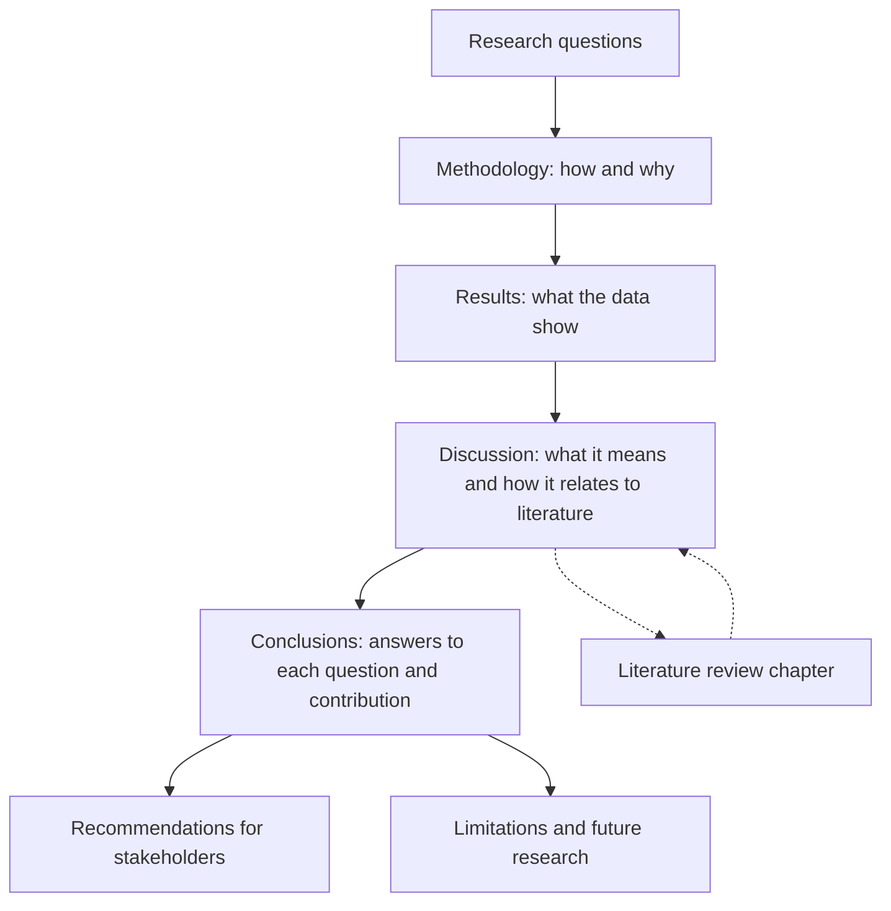

## Introduction

If the introduction and literature review argue that a study is worth doing, the methodology, results, discussion and conclusion chapters prove that it was done well and that its conclusions follow from its evidence. These chapters are where examiners look most closely for rigour. A vague methodology suggests a careless study; results that mix findings with opinion suggest bias; a discussion that never returns to the literature suggests a lack of scholarly engagement; and recommendations that are not grounded in findings suggest wishful thinking.

This lesson explains what each chapter must achieve, how they differ in purpose and tense, and how to write them so that the whole document forms a coherent, aligned argument. It uses both quantitative and qualitative examples, because MSc IT for Business students use surveys, interviews, case studies and mixed methods. As always, follow any chapter structure your institution or supervisor prescribes; the conventions here are widely used in business and information systems research.

## Learning Objectives

- Explain the purpose of the methodology, results, discussion and conclusion chapters and how they differ.
- Construct a methodology chapter that justifies each design decision and is detailed enough to be replicated or audited.
- Present quantitative and qualitative results accurately, without interpretation creeping into the results section.
- Analyse findings in a discussion chapter by comparing them with prior literature and theory and explaining agreements and contradictions.
- Formulate conclusions, recommendations, limitations and future research directions that are directly supported by the findings.

## Prerequisite Knowledge

- Research designs, sampling and data collection (Modules 4 and 5).
- Quantitative and qualitative analysis techniques and interpretation of findings (Module 6).
- Validity, reliability, bias and ethics (Module 7).

## Key Terminology

- **Methodology chapter**: The chapter that describes and justifies the research philosophy, design, population, sampling, instruments, procedures, analysis, quality measures and ethics.
- **Replicability**: The extent to which another researcher could repeat the study using the reported procedures.
- **Results (findings) chapter**: The chapter that reports what the data show, organised by objective or theme, without extended interpretation.
- **Discussion chapter**: The chapter that interprets findings, relates them to literature and theory, and explains their meaning and implications.
- **Effect size**: A measure of the magnitude of a relationship or difference, complementing statistical significance.
- **Recommendation**: A specific, actionable proposal for a stakeholder, derived from the findings.
- **Contribution to knowledge**: What the study adds to theory, method or practice.
- **Future research direction**: A justified suggestion for further study arising from the findings or limitations.

## Detailed Explanation

### The methodology chapter: justify, do not just describe

A common structure is:

1. **Research philosophy** (paradigm) and its implications.
2. **Research approach** (deductive, inductive or abductive).
3. **Research design or strategy** (survey, case study, experiment, mixed methods) and **time horizon** (cross-sectional or longitudinal).
4. **Population and sampling frame**.
5. **Sample size and sampling technique**, with justification.
6. **Data collection instruments** (questionnaire, interview guide), their sources and adaptation.
7. **Pilot testing** and resulting changes.
8. **Data collection procedure**.
9. **Data analysis**, mapped to each objective.
10. **Validity, reliability or trustworthiness**.
11. **Ethical considerations**.

The key verb is **justify**. For each decision, state what you chose, why it suits your research questions and context, and what alternative you rejected. For example, "A cross-sectional survey was adopted because the study tests hypothesised relationships among constructs across a large number of retailers at one point in time; a longitudinal design, though stronger for causal inference, was not feasible within the programme's timeframe."

**Tense.** In a proposal, the methodology is written in the future tense ("will be collected"). In the dissertation, it is written in the past tense ("were collected"). Mixing tenses is a common sign of an unrevised proposal.

**Detail for replicability.** Report enough that another researcher could repeat or audit the study: how participants were contacted, response rates, interview durations, recording and transcription methods, software used, coding procedures and decision rules.

### An analysis plan table

A powerful device in the methodology chapter is a table linking each objective to its data and analysis:

| Objective | Data source | Variables / focus | Analysis technique |
|---|---|---|---|
| 1. Examine the effect of perceived usefulness on intention | Questionnaire section B | PU (4 items), intention (3 items) | Multiple regression |
| 2. Assess the effect of cost on intention | Questionnaire section C | Cost (3 items), intention | Multiple regression |
| 3. Explore barriers experienced by non-adopters | Semi-structured interviews | Barriers, experiences | Thematic analysis |

### The results chapter: report accurately

The results chapter presents what the data show. Typical content includes:

- **Response rate and data screening** (missing data, outliers, assumption checks).
- **Respondent profile** (demographics, firm characteristics).
- **Measurement quality** (reliability coefficients, validity evidence).
- **Descriptive statistics** for key variables.
- **Inferential results**, organised by objective or hypothesis, with test statistics, degrees of freedom where relevant, p-values, confidence intervals and effect sizes.
- For qualitative studies, **themes and sub-themes**, each illustrated with carefully selected quotations attributed by pseudonym.

Use tables and figures purposefully, number and title them, and refer to them in the text: "As Table 4.3 shows, perceived usefulness was positively associated with intention." Do not repeat every number from a table in prose; highlight what matters. Report non-significant and unexpected results honestly.

Keep extended interpretation for the discussion. Statements such as "This proves that Ghanaian traders are conservative" do not belong in results; indeed, they probably do not belong anywhere unless strongly supported.

### The discussion chapter: interpret and connect

The discussion answers: *What do these findings mean, and how do they relate to what was already known?* A useful pattern for each key finding is:

1. **Restate** the finding briefly.
2. **Compare** it with prior studies and theory: does it agree, extend or contradict?
3. **Explain** why, considering context, method and theory. If results contradict earlier studies, offer plausible, evidence-based explanations (different population, measures, adoption stage, regulatory environment).
4. **Implications**: what the finding means for theory and practice.

The discussion is where the study's contribution becomes explicit. Good discussions also consider alternative explanations and acknowledge how limitations shape interpretation.

### Conclusions, recommendations and limitations

The **conclusion** summarises the answers to each research question, without new data or new literature. It states the study's contribution to knowledge clearly.

**Recommendations** must follow from findings and be specific: who should do what, and why. "Government should support SMEs" is weak; "Payment providers seeking merchant adoption in traditional markets should prioritise visible, low-cost transaction fee structures, given the strong negative association between perceived cost and intention found in this study" is strong.

**Limitations** explain how design choices and constraints affect interpretation and generalisability. **Future research** directions should flow from limitations and unanswered questions.

## Theories, Frameworks and Models

### The hourglass model of a dissertation

A helpful structural model is the **hourglass**. The introduction and literature review begin broad and narrow to a specific problem and framework. The methodology and results are the narrow neck, focused tightly on the study's own data. The discussion and conclusion broaden out again, connecting findings to literature, theory, practice and future research.

### Reporting guidelines as quality checklists

Health and social research communities have developed reporting guidelines to promote complete, transparent reporting. For example, the CONSORT statement guides reporting of randomised trials, and the Consolidated Criteria for Reporting Qualitative Research (COREQ) provide a checklist covering the research team, study design and analysis for interview and focus group studies (Tong, Sainsbury, & Craig, 2007). Although designed for health research, such checklists are useful self-audit tools for MSc students, especially those researching healthcare technology.

## Worked Example

**Illustrative scenario.** A student's study examined digital payment adoption intention among retailers. Regression results (illustrative figures for teaching purposes, not real data) were: perceived usefulness β = 0.41, p < .001; perceived cost β = −0.28, p = .002; trust β = 0.06, p = .41; R² = 0.37.

**Results paragraph (descriptive, accurate):**

> "Multiple regression analysis was conducted to examine the influence of perceived usefulness, perceived cost and trust on intention to accept digital payments (Table 4.6). Together the predictors explained 37% of the variance in intention. Perceived usefulness had a significant positive effect (β = 0.41, p < .001), and perceived cost had a significant negative effect (β = −0.28, p = .002). Trust was not a significant predictor (β = 0.06, p = .41). Hypotheses H1 and H2 were therefore supported, while H3 was not supported."

**Discussion paragraph (interpretive, connected):**

> "The strong positive effect of perceived usefulness is consistent with the core proposition of the Technology Acceptance Model (Davis, 1989) and with performance expectancy in UTAUT (Venkatesh et al., 2003). The non-significant effect of trust is more surprising, as trust is frequently emphasised in studies of consumer mobile banking. One plausible explanation is that retailers in this sample were already experienced mobile money users, so trust in the underlying service may have been established, leaving cost and usefulness as the differentiating factors. This interpretation should be treated with caution because adoption experience was not measured directly; future research could test whether experience moderates the role of trust."

**Recommendation (specific, grounded):**

> "Payment providers should communicate concrete business benefits, such as faster reconciliation and transaction records usable for credit applications, and review merchant fee structures, as perceived cost was the second strongest predictor of intention."

Notice how the results paragraph reports, the discussion interprets and compares, and the recommendation follows directly from findings. Note also the correct phrasing "not supported" rather than "rejected the hypothesis as false".

## Ghanaian Business Application

For Ghanaian IT-for-business dissertations, recommendations often target specific stakeholders: SME owners, banks and fintech firms, telecommunications operators, hospital management, universities, regulators and government agencies. Recommendations to public bodies should be realistic and framed as evidence-based suggestions rather than instructions, and they should not assume knowledge of internal policies the student has not verified. Where a study is conducted in a single organisation, recommendations may be detailed and practical for that organisation, but claims about the whole sector must be appropriately limited.

Methodology chapters in Ghanaian contexts should describe practical realities honestly: data collected in English or translated into local languages, interviews conducted in markets or offices, connectivity issues affecting online surveys, and gatekeeper permissions obtained. These details are not weaknesses to hide; they are part of the transparency that allows readers to judge the study and that makes the research credible.

## International Case Study

### Reporting standards and the qualitative COREQ checklist

In 2007, Tong, Sainsbury and Craig published the Consolidated Criteria for Reporting Qualitative Research (COREQ) in the *International Journal for Quality in Health Care*. Recognising that qualitative studies were often reported incompletely, they compiled a 32-item checklist organised into three domains: the research team and reflexivity (for example, the interviewer's characteristics and relationship with participants), study design (for example, sampling, setting and data collection), and analysis and findings (for example, how themes were derived and whether quotations were presented).

COREQ is widely used and requested by health journals. Its value for MSc students lies in demonstrating what "transparent reporting" means in concrete terms. A student writing up interviews with nurses about electronic health records can use COREQ to check whether the methodology reports who conducted the interviews, how participants were selected, where interviews took place, whether field notes were made, how many coders were involved and whether data saturation was discussed. Using a recognised checklist, and saying so in the methodology, signals rigour to examiners.

## Diagram

The dotted arrows show that the discussion must return explicitly to the literature reviewed earlier.

## Common Misconceptions

- **Misconception:** The methodology chapter is a textbook summary of research philosophies and designs. **Correction:** It should briefly explain concepts only to justify the specific choices made for this study.
- **Misconception:** Results and discussion are the same thing. **Correction:** Results report findings; discussion interprets them in relation to literature and theory, even when combined in one chapter.
- **Misconception:** Statistical significance means a finding is important. **Correction:** Significance indicates evidence against a null hypothesis; effect sizes and context determine practical importance.
- **Misconception:** Recommendations can include anything the student believes would help. **Correction:** Recommendations must be derived from the study's findings.
- **Misconception:** Limitations should be minimised to protect the grade. **Correction:** Thoughtful limitations demonstrate critical awareness and are expected.

## Common Examination Mistakes

- Writing the dissertation methodology in the future tense copied from the proposal.
- Stating "data were analysed using SPSS" without naming the analysis techniques linked to each objective.
- Introducing new literature or new data in the conclusion.
- Writing a discussion that restates results without comparing them to prior studies.
- Making causal claims from cross-sectional correlational data.

## Critical Thinking Questions

1. When might it be better to combine results and discussion into a single chapter, and what risks does this create?
2. How should a researcher discuss a finding that contradicts a well-established theory without appearing to dismiss either the theory or the finding?
3. To what extent can recommendations from a single-organisation case study be useful to other organisations?
4. Is replicability a meaningful standard for interpretivist qualitative research, or should auditability replace it?

## Practical Exercises

1. **Justify a design decision.** For your own study, write a justification paragraph for your sampling technique that states the choice, the reasons, the alternative rejected and the implications. *Expected output:* a 120-180 word paragraph containing all four elements.
2. **Analysis plan table.** Create an objective-by-objective analysis plan table for your study. *Expected output:* a table mapping each objective to data source, variables or focus and analysis technique.
3. **Results versus discussion.** Using the illustrative regression figures in this lesson, write one results paragraph and one discussion paragraph for the cost variable. *Expected output:* two clearly distinct paragraphs, with the discussion citing relevant theory.

## Key Takeaways

- Methodology chapters justify every design decision and provide enough detail for replication or audit.
- Results report accurately and completely, including non-significant findings.
- Discussions interpret findings and compare them explicitly with literature and theory.
- Conclusions answer each research question and state the contribution; recommendations must follow from findings.
- Limitations and future research show critical awareness and point the way forward.

## Further Reading

- Tong, A., Sainsbury, P., & Craig, J. (2007). Consolidated criteria for reporting qualitative research (COREQ): A 32-item checklist for interviews and focus groups. *International Journal for Quality in Health Care, 19*(6), 349-357.
- Field, A. (2018). *Discovering statistics using IBM SPSS Statistics* (5th ed.). SAGE.
- Braun, V., & Clarke, V. (2006). Using thematic analysis in psychology. *Qualitative Research in Psychology, 3*(2), 77-101.
- Saunders, M., Lewis, P., & Thornhill, A. (2019). *Research methods for business students* (8th ed.). Pearson.
- Creswell, J. W., & Creswell, J. D. (2018). *Research design: Qualitative, quantitative, and mixed methods approaches* (5th ed.). SAGE.

## Video Resources

- [EQUATOR Network](https://www.equator-network.org/): EQUATOR Network. Official site of the initiative that collects reporting guidelines such as CONSORT and COREQ, with training resources on transparent reporting.
- [SAGE Research Methods](https://methods.sagepub.com/): SAGE Publishing. Official research methods platform with guidance on writing up quantitative and qualitative research (access may depend on subscription).

## Revision Summary

The methodology chapter justifies how the study was done; the results chapter reports what the data show; the discussion explains what the findings mean relative to literature and theory; and the conclusion answers each research question, states the contribution and offers grounded recommendations, limitations and future research.

- Justify every methodological choice; use future tense in proposals and past tense in dissertations.
- Map each objective to data and analysis in a table.
- Report statistics fully, including effect sizes and non-significant results.
- Discussion: restate, compare, explain, imply.
- Recommendations must be specific and derived from findings.
- No new data or literature in the conclusion.
