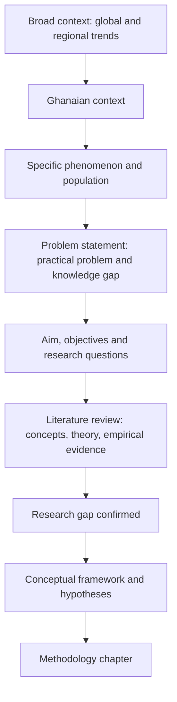

## Introduction

A research proposal is an argument that a particular study is worth doing, can be done, and will be done well. Supervisors and review panels use proposals to judge whether the problem is significant, the questions are researchable, the design is appropriate and the student is ready to begin. A dissertation later expands the proposal, so a well-structured proposal becomes the skeleton of the final document.

This lesson examines the typical structure of a postgraduate proposal and dissertation, then focuses on the two chapters that establish the case for the study: the **introduction** (background, problem, aims, questions, significance and scope) and the **literature review** (theoretical foundations, empirical evidence, gaps and conceptual framework). Exact chapter titles, lengths and formatting requirements vary between institutions and supervisors, so always check your own programme's guidance; the structure here reflects widely used conventions in business and information systems research.

## Learning Objectives

- Explain the purpose and typical components of a postgraduate research proposal.
- Apply the funnel structure to write a background that moves logically from broad context to a specific problem.
- Construct an introduction chapter in which problem, objectives, questions and significance are aligned.
- Organise a literature review chapter thematically and synthesise sources rather than summarising them one by one.
- Evaluate a draft introduction or literature review against common examiner criteria.

## Prerequisite Knowledge

- Problem statements, objectives, questions and hypotheses (Module 2).
- Literature searching, evaluation, synthesis and conceptual frameworks (Module 3).
- The academic writing conventions covered in the previous lesson.

## Key Terminology

- **Research proposal**: A document that sets out what a study will investigate, why, and how, so that its value and feasibility can be judged.
- **Background to the study**: The opening section that establishes the context and leads the reader to the research problem.
- **Funnel structure**: An organisation that moves from broad context to the specific problem the study addresses.
- **Significance of the study**: An explanation of who will benefit from the research and how it contributes to theory, practice or policy.
- **Thematic literature review**: A review organised around concepts, debates or variables rather than around individual authors.
- **Empirical review**: The part of the literature review that evaluates previous studies' findings, methods and contexts.
- **Conceptual framework**: A diagram and explanation of the key constructs and the expected relationships the study will examine.
- **Alignment**: Consistency between problem, objectives, questions, framework, methods and analysis.

## Detailed Explanation

### Typical structure of a proposal

| Section | Purpose | Guiding question |
|---|---|---|
| Title | Communicate topic, variables, population and context | Could a reader predict the study from the title? |
| Abstract (often required) | Summarise the proposal | Is the whole plan visible in one paragraph? |
| Introduction / Chapter 1 | Background, problem, aim, objectives, questions, hypotheses, significance, scope, organisation | Why does this study matter and what exactly will it do? |
| Literature review / Chapter 2 | Theoretical review, empirical review, gaps, conceptual framework | What is known, what is not, and how does this study fit? |
| Methodology / Chapter 3 | Philosophy, design, population, sampling, instruments, data collection, analysis, quality, ethics | How will the study be done, and why this way? |
| Work plan and budget | Timeline and resources | Is it feasible within the time available? |
| References | APA 7 list of all cited works | Can every citation be traced? |
| Appendices | Draft instruments, consent forms, permissions | Is the supporting material ready? |

A full dissertation typically adds Chapter 4 (results or findings), Chapter 5 (discussion) and a conclusions and recommendations chapter, though some institutions combine results and discussion.

### Writing the introduction chapter

**1. Background.** Use a funnel. Begin with the broad context (for example global and African trends in digital payments), narrow to the Ghanaian context (mobile money growth, policy initiatives, characteristics of retailers), then narrow again to the specific phenomenon (uneven merchant adoption among market retailers). Each paragraph should be supported by credible sources, and the funnel should end at the doorstep of the problem.

**2. Problem statement.** State precisely what is wrong, unknown or contested, the evidence that it matters, and the consequence of not addressing it. A strong problem statement includes both a **practical problem** (what is happening in the real world) and a **knowledge gap** (what research has not yet established).

**3. Purpose, objectives and questions.** The general aim follows from the problem; specific objectives use measurable verbs (examine, determine, assess, explore); research questions mirror the objectives one to one; hypotheses, where appropriate, state testable predictions.

**4. Significance.** Explain specifically who benefits and how: theory (extending a model to a new context), practice (guidance for SME owners or IT managers), policy (evidence for regulators) and future research. Avoid generic claims such as "this study will benefit everyone".

**5. Scope (delimitations) and limitations.** State the boundaries you have chosen (geographical area, population, time, variables) and anticipated weaknesses beyond your control.

**6. Organisation of the study.** Briefly outline the chapters.

### Writing the literature review chapter

The literature review chapter has several jobs: define key concepts, present the theories that underpin the study, evaluate empirical evidence, identify the gap and justify the conceptual framework. A common structure is:

1. **Introduction** to the chapter and its organisation.
2. **Conceptual review**: definitions of key constructs, with debates about meaning (for example, what counts as "AI adoption" in an SME).
3. **Theoretical review**: the theory or theories used (TAM, UTAUT, TOE, Diffusion of Innovations, DeLone and McLean IS success), why they were chosen, their strengths and criticisms.
4. **Empirical review**: organised by theme or by relationship (for example, "perceived usefulness and adoption intention"), comparing findings, methods and contexts across studies.
5. **Research gap**: a clear statement of what remains unknown, derived from the review.
6. **Conceptual framework and hypotheses**: a diagram linking constructs, each relationship justified from theory and evidence.
7. **Chapter summary**.

### Synthesis, not summary

The most frequent weakness in student literature reviews is the "author parade": one paragraph per study, each beginning "Author (Year) found..." This structure reports but does not synthesise. A thematic review instead groups studies by what they show:

> *Author parade:* Study A found that trust influenced mobile banking adoption. Study B found that trust influenced adoption. Study C found that trust was not significant.

> *Synthesis:* Evidence on trust is mixed. Several survey studies of consumers report a positive relationship between trust and mobile banking intention, whereas studies of experienced users find weaker effects, suggesting that trust matters most at the initial adoption stage. Few studies examine merchants rather than consumers, a gap this study addresses.

(In real writing, each claim is supported by citations to the actual studies; the placeholders above illustrate structure only.) Webster and Watson (2002) famously recommended a **concept-centric** rather than author-centric approach, often supported by a concept matrix that maps studies against the concepts they address.

## Theories, Frameworks and Models

### The alignment chain

The introduction and literature review must align with later chapters. A practical model is the **alignment chain**:

Problem → Aim → Objectives → Research questions → Hypotheses (if any) → Conceptual framework constructs → Instrument items → Analysis techniques → Findings → Conclusions.

Examiners often test alignment by picking one objective and tracing it through the document. If an objective has no corresponding question, construct or analysis, or if the conclusions discuss variables never measured, the chain is broken.

### Choosing theory deliberately

Theory should not be decoration. Justify your choice by explaining why the theory's constructs match your problem and context. For organisational adoption by SMEs, the technology–organisation–environment (TOE) framework of Tornatzky and Fleischer (1990) is often more suitable than TAM, which focuses on individual users. For consumer or employee adoption, TAM or UTAUT may fit better. Diffusion of Innovations (Rogers, 2003) helps explain adoption over time and attributes of innovations, while the DeLone and McLean model (2003) addresses information system success rather than adoption. Combining theories is acceptable when justified, not when used simply to include more variables.

## Worked Example

**Illustrative scenario.** A student's draft problem statement reads: "Digital payments are important. Many retailers in Ghana do not use them. This study will look at digital payments."

**Step 1 – Identify weaknesses.** No evidence of the problem, no consequences, no knowledge gap, no specific population.

**Step 2 – Revise using a three-part structure (ideal situation, reality, consequence and gap).**

> "Policy-makers and payment providers in Ghana have promoted digital payments as a means of improving transaction efficiency and financial inclusion, and mobile money is widely used for person-to-person transfers. However, many small retailers in traditional markets continue to rely mainly on cash for sales, which may expose them to theft, limit their access to transaction records that could support credit applications, and reduce the benefits of digital payment infrastructure. Existing adoption research has focused largely on consumers rather than on merchants operating in informal market settings, and the factors shaping retailers' acceptance of digital payments in this context remain insufficiently understood. This study therefore examines the factors influencing digital payment adoption among retailers in [named market or city]."

**Step 3 – Derive aligned objectives.**

1. To examine the influence of perceived usefulness on retailers' intention to accept digital payments.
2. To assess the effect of transaction costs on intention to accept digital payments.
3. To determine whether trust in payment providers influences intention to accept digital payments.

**Step 4 – Derive matching research questions** (for example, "What is the influence of perceived usefulness on retailers' intention to accept digital payments?") and, if the design is quantitative, hypotheses.

**Step 5 – Check significance.** Theory: extends adoption models to merchants in informal markets. Practice: informs payment providers' merchant onboarding. Policy: provides evidence for digital inclusion initiatives.

In a real proposal, every factual claim in the revised problem statement would be supported by citations to verifiable sources.

## Ghanaian Business Application

Proposals in Ghanaian IT-for-business contexts are strengthened by careful use of local evidence. Credible sources for background sections include official publications from bodies such as the Bank of Ghana, the Ghana Statistical Service, the National Communications Authority and relevant ministries, alongside peer-reviewed research on Ghana and comparable African economies. Students should cite the actual document and avoid repeating statistics found on blogs or in news articles without checking the original source.

The significance section should speak to real stakeholders: SME owners deciding whether to adopt AI tools, hospital administrators planning electronic health records, universities designing cybersecurity awareness programmes, or fintech firms seeking merchant adoption. A literature review grounded in Ghanaian and wider African studies, alongside international theory, demonstrates that the student understands both the global debate and the local context. Where Ghanaian evidence is thin, stating that clearly is itself a contribution, because it helps establish the research gap.

## International Case Study

### Webster and Watson's guidance in *MIS Quarterly*

In 2002, *MIS Quarterly*, one of the leading information systems journals, published an editorial by Jane Webster and Richard T. Watson titled "Analyzing the Past to Prepare for the Future: Writing a Literature Review". The authors observed that the field needed more high-quality review articles and set out practical guidance. Key recommendations included organising reviews around concepts rather than authors, using a concept matrix to track which studies address which concepts, identifying gaps systematically, and developing a conceptual model that leads to propositions for future research. They also advised structured searching, including searching leading journals and following citations backwards and forwards.

Although written for journal review articles, the guidance applies directly to MSc literature review chapters. A concept matrix built in a spreadsheet, with studies as rows and constructs, theories, methods and contexts as columns, quickly reveals patterns: which relationships are well established, where findings conflict, and which contexts (such as Ghanaian SMEs or informal retailers) are under-studied. That pattern-finding is the heart of synthesis.

## Diagram

The diagram shows the funnel of the introduction feeding into the literature review, which in turn justifies the conceptual framework and method.

## Common Misconceptions

- **Misconception:** The background should cover everything about the topic. **Correction:** The background is a focused funnel that leads to the specific problem; irrelevant history dilutes it.
- **Misconception:** A literature review is a list of summaries of all the studies found. **Correction:** It is a critical, thematic synthesis that builds an argument towards the gap and framework.
- **Misconception:** More theories make a stronger study. **Correction:** Theories should be selected for fit; combining them requires justification.
- **Misconception:** Significance means saying the study is important. **Correction:** Significance specifies who benefits and how, for theory, practice and policy.
- **Misconception:** The research gap is simply "no study has been done in Ghana". **Correction:** A context gap is valid only if context plausibly changes the relationships; argue why Ghana's conditions matter.

## Common Examination Mistakes

- Writing problem statements without evidence or without a knowledge gap.
- Listing objectives and questions that do not correspond one to one.
- Presenting a conceptual framework with constructs not discussed in the literature review.
- Using an "author parade" structure for the empirical review.
- Citing outdated or unverifiable statistics in the background.

## Critical Thinking Questions

1. When is a contextual gap ("not yet studied in Ghana") a sufficient justification for an MSc study, and when is it weak?
2. Should a literature review be completed before data collection, or should it continue to evolve during the study? What are the implications for qualitative research?
3. How can a student demonstrate critical engagement with a theory they ultimately adopt?
4. Is it possible to over-align a study, so that alignment becomes a rigid template that discourages unexpected findings?

## Practical Exercises

1. **Funnel background.** Write a five-paragraph background for a study of e-commerce adoption among small businesses, moving from global context to a specific problem. *Expected output:* five paragraphs, each with a stated function (global, regional, Ghanaian, phenomenon, problem lead-in) and placeholders for citations you would verify.
2. **Alignment table.** Create a table with columns for objective, research question, hypothesis, construct and analysis technique for your own study. *Expected output:* a completed table where each row is fully aligned.
3. **Concept matrix.** Build a concept matrix for at least eight real studies you have read, with studies as rows and constructs, theory, method and context as columns. *Expected output:* the matrix and a paragraph identifying one pattern and one gap.

## Key Takeaways

- A proposal argues that a study is worthwhile, feasible and well designed.
- The introduction uses a funnel to move from context to a specific, evidenced problem with aligned objectives and questions.
- Significance must name specific beneficiaries and contributions.
- The literature review is a thematic, critical synthesis leading to the gap and conceptual framework.
- Alignment from problem to analysis is a key examiner test.

## Further Reading

- Webster, J., & Watson, R. T. (2002). Analyzing the past to prepare for the future: Writing a literature review. *MIS Quarterly, 26*(2), xiii–xxiii.
- Tornatzky, L. G., & Fleischer, M. (1990). *The processes of technological innovation*. Lexington Books.
- Rogers, E. M. (2003). *Diffusion of innovations* (5th ed.). Free Press.
- DeLone, W. H., & McLean, E. R. (2003). The DeLone and McLean model of information systems success: A ten-year update. *Journal of Management Information Systems, 19*(4), 9–30.
- Creswell, J. W., & Creswell, J. D. (2018). *Research design: Qualitative, quantitative, and mixed methods approaches* (5th ed.). SAGE.

## Video Resources

- [SAGE Research Methods](https://methods.sagepub.com/) — SAGE Publishing. Official research methods platform with guidance on proposal writing and literature reviews (access may depend on subscription).
- [Purdue Online Writing Lab](https://owl.purdue.edu/) — Purdue University. Official writing resource portal including guidance on research proposals and literature reviews.

## Revision Summary

A research proposal argues that a study is significant, feasible and well designed. Its introduction moves through a funnel from context to an evidenced problem, aligned objectives and questions, significance and scope; its literature review synthesises concepts, theory and empirical evidence thematically to reveal a gap and justify a conceptual framework.

- Proposal: title, introduction, literature review, methodology, work plan, references, appendices.
- Problem statement = practical problem + knowledge gap + consequence.
- Objectives and questions map one to one.
- Review by concept, not by author; use a concept matrix.
- Theory chosen for fit (TOE for organisations, TAM/UTAUT for individuals).
- Test alignment by tracing one objective through every chapter.
