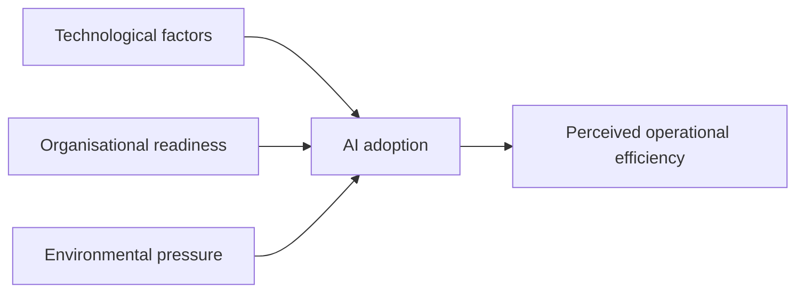

## Introduction

Students often understand each element of a proposal in isolation, problem statements, objectives, frameworks, sampling, yet struggle to make them fit together. The best way to see how a coherent proposal works is to study complete examples and trace the logic from problem to analysis. This lesson presents five worked mini-proposals on topics common in MSc IT for Business research in Ghana: AI adoption in SMEs, digital payments among retailers, cybersecurity awareness among students, e-commerce adoption among small businesses, and technology adoption in healthcare institutions.

Every example is an **illustrative scenario** written for teaching. The examples are deliberately compact and are not templates to copy: they contain no real data, any population figures are illustrative, and the background sections indicate where real, verified citations would be needed. Use them to see how design choices follow from questions, and then complete the exercises to develop your own proposal. Your own proposal must follow your institution's required structure and be developed with your supervisor.

## Learning Objectives

- Analyse how problem statements, objectives, questions and hypotheses align in a complete proposal.
- Compare quantitative, qualitative and mixed-methods proposal designs and justify which suits a given problem.
- Apply appropriate theories (TOE, UTAUT, Protection Motivation Theory, Diffusion of Innovations, DeLone and McLean) to construct conceptual frameworks.
- Evaluate the sampling, analysis and ethical choices in each example and identify their limitations.
- Construct an aligned mini-proposal for a topic of your own choosing.

## Prerequisite Knowledge

- All earlier modules of this course, especially problem development, frameworks, design, sampling, analysis and ethics.
- The proposal structure and writing lessons earlier in this module.

## Key Terminology

- **Mini-proposal**: A condensed proposal containing all essential elements of a full research proposal in summary form.
- **Alignment**: Consistency between the problem, objectives, questions, hypotheses, framework, methods and analysis.
- **Technology-organisation-environment (TOE) framework**: A framework explaining organisational technology adoption through technological, organisational and environmental contexts.
- **UTAUT**: The Unified Theory of Acceptance and Use of Technology, explaining intention and use through performance expectancy, effort expectancy, social influence and facilitating conditions.
- **Protection Motivation Theory**: A theory explaining protective behaviour through threat appraisal and coping appraisal.
- **Explanatory sequential design**: A mixed-methods design in which a quantitative phase is followed by a qualitative phase that explains its results.
- **Maximum variation sampling**: A purposive strategy that deliberately selects diverse cases to capture a range of perspectives.

## How to Read the Worked Examples

Each mini-proposal follows the same sequence: title; background; problem statement; objectives; research questions; hypotheses (where relevant); conceptual framework; methodology; sampling; analysis; ethics. As you read, test alignment by choosing one objective and tracing it to its question, hypothesis, construct and analysis technique. Notice also how the designs differ: proposals 1, 2 and 3 are mainly quantitative and deductive, proposal 4 is qualitative and exploratory, and proposal 5 uses mixed methods.

For quantitative examples, sample size is calculated with Cochran's formula for proportions, `n0 = z² × p × (1 − p) / e²`. With 95% confidence (z = 1.96), maximum variability (p = 0.5) and a 5% margin of error (e = 0.05): `n0 = 3.8416 × 0.25 / 0.0025 = 384.16`, rounded up to 385. For a known finite population N, the correction is `n = n0 / (1 + (n0 − 1) / N)`. Where a sampling frame is incomplete, as is common for Ghanaian SMEs, this limitation must be stated.

## Worked Proposal 1: AI Adoption and SME Operational Efficiency in Ghana

**Illustrative scenario.**

**Title:** The influence of artificial intelligence adoption on the operational efficiency of small and medium-sized enterprises in Accra, Ghana.

**Background:** AI-enabled tools, such as chatbots, automated bookkeeping, demand forecasting and AI features in common business software, have become more accessible to small firms. SMEs are widely recognised as important to Ghana's economy and employment, yet many face constraints in skills, finance and infrastructure. *(A real proposal would cite verified sources for each claim, such as official SME policy documents and peer-reviewed studies.)*

**Problem statement:** Vendors promote AI as a route to efficiency, but SMEs invest scarce resources without clear evidence of benefit in their context. Research on AI adoption has concentrated on large firms in advanced economies, leaving limited evidence on whether, and under what organisational conditions, AI adoption is associated with operational efficiency among Ghanaian SMEs.

**Objectives:** (1) To examine the effect of technological factors (relative advantage, compatibility) on AI adoption among SMEs. (2) To assess the effect of organisational readiness (skills, top management support) on AI adoption. (3) To determine the effect of environmental pressures (competition, customer expectations) on AI adoption. (4) To examine the relationship between AI adoption and perceived operational efficiency.

**Research questions:** RQ1-RQ4 mirror the objectives, for example RQ4: "What is the relationship between AI adoption and perceived operational efficiency among SMEs in Accra?"

**Hypotheses:** H1: Technological factors positively influence AI adoption. H2: Organisational readiness positively influences AI adoption. H3: Environmental pressure positively influences AI adoption. H4: AI adoption is positively associated with perceived operational efficiency.

**Conceptual framework (TOE; Tornatzky & Fleischer, 1990):** Technological factors, organisational readiness and environmental pressure → AI adoption → perceived operational efficiency.

**Methodology:** Positivist, deductive, cross-sectional survey of owner-managers using a structured questionnaire with items adapted from published TOE and efficiency scales and piloted with SMEs outside the sample.

**Sampling:** Target population: registered SMEs in Accra. Frame: membership lists of business associations, obtained with permission (acknowledging exclusion of informal firms). Stratified random sampling by sector (retail, services, manufacturing). Illustrative frame N = 1,200 gives `n = 384.16 / (1 + 383.16 / 1,200) ≈ 292`; the student would target more to allow for non-response.

**Analysis:** Data screening; descriptive statistics; Cronbach's alpha and validity checks; structural equation modelling (or multiple regression) to test H1-H4. Because the design is cross-sectional, findings indicate associations, not causation.

**Ethics:** Institutional ethical approval before data collection; informed consent; anonymous responses; no commercially sensitive figures requested; secure storage consistent with the principles of the Data Protection Act, 2012 (Act 843).

## Worked Proposal 2: Digital Payment Adoption among Ghanaian Retailers

**Illustrative scenario.**

**Title:** Determinants of digital payment acceptance among retailers in a traditional market in Kumasi, Ghana.

**Background:** Mobile money is widely used in Ghana, and policy initiatives have promoted digital and interoperable payments. Nevertheless, many retail transactions in traditional markets remain cash-based. *(Verified citations required.)*

**Problem statement:** Retailers who rely on cash face risks of theft and lack transaction records that could support access to credit, while payment providers struggle to increase merchant acceptance. Adoption studies have focused mostly on consumers; less is known about the factors driving merchants' acceptance in informal market settings.

**Objectives:** To examine the effects of (1) performance expectancy, (2) effort expectancy, (3) social influence, (4) facilitating conditions and (5) perceived transaction cost on retailers' intention to accept digital payments.

**Research questions:** For example, RQ5: "To what extent does perceived transaction cost influence retailers' intention to accept digital payments?"

**Hypotheses:** H1-H4: Performance expectancy, effort expectancy, social influence and facilitating conditions positively influence intention. H5: Perceived transaction cost negatively influences intention.

**Conceptual framework (UTAUT extended; Venkatesh et al., 2003):** Four UTAUT constructs plus perceived cost → intention to accept digital payments, with age and experience as control variables.

**Methodology:** Positivist, deductive cross-sectional survey. Interviewer-administered questionnaires in English or Twi, translated and back-translated, and piloted with traders in another market.

**Sampling:** No list of traders exists, so multi-stage cluster sampling is used: market sections (clusters) are randomly selected, then traders are chosen systematically (every kth stall) within each section. A target of approximately 385 respondents follows from Cochran's formula; the design effect of clustering is acknowledged.

**Analysis:** Descriptive statistics, reliability and validity tests, and multiple regression (or PLS-SEM) to test H1-H5, reporting coefficients, p-values, confidence intervals and R².

**Ethics:** Permission from market leadership as gatekeepers; verbal recorded consent where literacy varies; no recording of names or phone numbers; interviews arranged to avoid disrupting trade; institutional approval obtained beforehand.

## Worked Proposal 3: Cybersecurity Awareness among University Students

**Illustrative scenario.**

**Title:** Cybersecurity awareness and protective behaviour among undergraduate students at a Ghanaian university.

**Background:** Students use smartphones, mobile money, social media and university systems extensively, exposing them to phishing, account takeover and online fraud. *(Verified citations required.)*

**Problem statement:** Universities invest in network security, yet human behaviour remains a frequent point of failure. Evidence on students' actual security knowledge, as opposed to self-reported awareness, and on what motivates protective behaviour in Ghanaian universities is limited, constraining the design of effective awareness programmes.

**Objectives:** (1) To assess the level of cybersecurity knowledge among undergraduates. (2) To compare knowledge across faculties and levels of study. (3) To examine the influence of perceived severity, perceived vulnerability, response efficacy and self-efficacy on protective behaviour intention.

**Research questions:** RQ1: "What is the level of cybersecurity knowledge among undergraduates?" RQ2: "Does knowledge differ significantly across faculties?" RQ3: "To what extent do threat and coping appraisals influence protective behaviour intention?"

**Hypotheses:** H1: Knowledge differs significantly across faculties. H2-H5: Perceived severity, perceived vulnerability, response efficacy and self-efficacy positively influence protective behaviour intention.

**Conceptual framework (Protection Motivation Theory; Rogers, 1975):** Threat appraisal (severity, vulnerability) and coping appraisal (response efficacy, self-efficacy) → protective behaviour intention; knowledge score as a separate descriptive outcome.

**Methodology:** Descriptive and explanatory cross-sectional survey combining scenario-based knowledge questions (for example, identifying phishing messages) with Likert scales for PMT constructs, which reduces reliance on self-assessed awareness.

**Sampling:** Stratified random sampling by faculty and level, using student lists only if officially provided for research under institutional rules; otherwise distribution through official channels with quota targets per stratum, acknowledging the shift to non-probability sampling.

**Analysis:** Descriptive statistics for RQ1; one-way ANOVA (with post-hoc tests) for RQ2; multiple regression for RQ3.

**Ethics:** Anonymous online questionnaire; recruitment not conducted by lecturers who assess the students; no simulated phishing without explicit institutional authorisation and approval; a short guide to safe practices offered after completion.

## Worked Proposal 4: E-commerce Adoption among Ghanaian Small Businesses

**Illustrative scenario.**

**Title:** Exploring how small businesses in Accra adopt and sustain e-commerce: a qualitative study.

**Background:** Small businesses increasingly sell through social media, messaging apps and online marketplaces, often combining online orders with mobile money and informal delivery. *(Verified citations required.)*

**Problem statement:** Survey studies have identified adoption factors, but they explain little about *how* small business owners begin, adapt and sometimes abandon e-commerce in practice, particularly where trust, delivery and payment challenges are prominent. An in-depth understanding of these processes is needed to inform support programmes.

**Objectives:** (1) To explore how small business owners decide to begin selling online. (2) To examine the challenges they experience in sustaining e-commerce. (3) To explore the strategies they use to overcome these challenges.

**Research questions:** RQ1: "How do small business owners in Accra decide to begin selling online?" RQ2: "What challenges do they experience in sustaining e-commerce?" RQ3: "What strategies do they use to address these challenges?"

**Hypotheses:** Not applicable; the study is exploratory and inductive.

**Conceptual framework (sensitising, not tested):** Diffusion of Innovations attributes (Rogers, 2003): relative advantage, compatibility, complexity, trialability and observability, used to inform interview questions while allowing new themes to emerge.

**Methodology:** Interpretivist, inductive qualitative design using semi-structured interviews (45-60 minutes) and, with consent, review of businesses' public social media pages.

**Sampling:** Purposive maximum variation sampling of approximately 12-20 owners across sectors (fashion, food, electronics), business ages, and current and discontinued online sellers, recruited via business associations and referrals; final number guided by data saturation.

**Analysis:** Verbatim transcription; reflexive thematic analysis following Braun and Clarke (2006); second-coder review of a subset of transcripts; audit trail and reflexive memos.

**Ethics:** Written or recorded consent; pseudonyms; removal of identifying details such as shop names and locations; paraphrasing rather than quoting public posts verbatim; encrypted storage and defined deletion dates.

## Worked Proposal 5: Technology Adoption in Ghanaian Healthcare Institutions

**Illustrative scenario.**

**Title:** Factors influencing electronic health record use and perceived system success among clinicians in selected hospitals in Ghana: a mixed-methods study.

**Background:** Ghanaian health facilities increasingly use electronic systems for patient records, billing and reporting. Successful implementation depends not only on technology but on clinicians' acceptance and workflow fit. *(Verified citations required.)*

**Problem statement:** Hospitals that invest in electronic health records (EHRs) sometimes experience partial use, workarounds and continued reliance on paper. Evidence on which factors influence clinicians' EHR use and perceived system success in Ghanaian hospitals, and why, remains limited.

**Objectives:** (1) To examine the influence of performance expectancy, effort expectancy, facilitating conditions and system quality on clinicians' EHR use. (2) To assess the relationship between EHR use and perceived net benefits. (3) To explain the survey findings through clinicians' and administrators' experiences.

**Research questions:** RQ1 and RQ2 mirror the quantitative objectives; RQ3: "How do clinicians and administrators explain the patterns of EHR use identified in the survey?"

**Hypotheses:** H1-H4: Performance expectancy, effort expectancy, facilitating conditions and system quality positively influence EHR use. H5: EHR use is positively associated with perceived net benefits.

**Conceptual framework:** UTAUT constructs (Venkatesh et al., 2003) and system quality from the DeLone and McLean (2003) model → EHR use → perceived net benefits.

**Methodology:** Pragmatist explanatory sequential mixed-methods design: Phase 1 survey of clinicians (doctors, nurses, pharmacists); Phase 2 semi-structured interviews to explain significant and unexpected Phase 1 results.

**Sampling:** Phase 1: hospitals selected purposively (for example, one public and one private facility using EHRs), then staff stratified by professional group within each hospital. Phase 2: purposive selection of 10-15 participants, including high and low users identified anonymously through voluntary follow-up consent.

**Analysis:** Phase 1: reliability and validity tests, then multiple regression or SEM. Phase 2: thematic analysis. Integration: a joint display table comparing statistical results with explanatory themes.

**Ethics:** Institutional ethical approval plus any required health-sector ethics review (such as by the Ghana Health Service Ethics Review Committee where applicable) and written permission from each hospital; no access to patient records; interviews scheduled to avoid disrupting clinical duties; careful protection against deductive disclosure within small departments.

## Comparing the Five Designs

| Proposal | Paradigm and logic | Design | Theory | Sampling | Main analysis |
|---|---|---|---|---|---|
| 1 AI in SMEs | Positivist, deductive | Cross-sectional survey | TOE | Stratified random | SEM or regression |
| 2 Digital payments | Positivist, deductive | Cross-sectional survey | UTAUT extended | Multi-stage cluster and systematic | Regression or PLS-SEM |
| 3 Cybersecurity | Positivist, deductive | Descriptive and explanatory survey | Protection Motivation Theory | Stratified (or quota) | ANOVA, regression |
| 4 E-commerce | Interpretivist, inductive | Qualitative interviews | Diffusion of Innovations (sensitising) | Maximum variation purposive | Thematic analysis |
| 5 Healthcare EHR | Pragmatist | Explanatory sequential mixed methods | UTAUT and DeLone and McLean | Stratified, then purposive | Regression and thematic analysis |

The table shows that design follows the question: "to what extent" questions lead to surveys and hypothesis testing; "how" questions about processes lead to qualitative designs; and questions needing both measurement and explanation suggest mixed methods.

## Diagram

The diagram shows the conceptual framework for Worked Proposal 1. Each arrow corresponds to one hypothesis (H1 to H4), and each box to a construct measured by questionnaire items.

## Common Misconceptions

- **Misconception:** Every proposal needs hypotheses. **Correction:** Hypotheses suit deductive quantitative designs; exploratory qualitative studies use research questions only.
- **Misconception:** Cochran's 385 is the correct sample size for every survey. **Correction:** It assumes specific confidence, variability and margin of error, needs a finite population correction where N is known, and does not fix frame or non-response problems.
- **Misconception:** A theory in a qualitative proposal must be tested. **Correction:** In inductive studies, theory can serve as a sensitising framework that informs questions without constraining findings.
- **Misconception:** Mixed methods simply means using a questionnaire and interviews. **Correction:** Mixed methods requires a justified design and explicit integration of the two strands.

## Common Examination Mistakes

- Copying a worked example's structure without adapting the theory, population and design to a new problem.
- Claiming causation from cross-sectional survey designs such as proposals 1-3.
- Stating "random sampling" when no sampling frame exists.
- Omitting ethics or giving generic ethics statements unrelated to the specific study.
- Presenting a conceptual framework whose constructs do not appear in the objectives or instrument.

## Critical Thinking Questions

1. Proposal 1 measures *perceived* operational efficiency. What are the strengths and weaknesses of this choice, and what objective measures might strengthen it?
2. In Proposal 2, how might interviewer-administered questionnaires in Twi introduce both improvements and new biases?
3. Could Proposal 4 be redesigned as a quantitative study? What would be gained and lost?
4. In Proposal 5, how should the researcher proceed if survey and interview findings contradict each other?

## Practical Exercises

1. **Develop your own research questions.** Choose a Ghanaian IT-for-business problem not covered here (for example, cloud accounting in micro-enterprises or digital skills in public agencies). Write a problem statement, an aim, three objectives and three matching research questions. *Expected output:* a one-page document in which each objective maps one to one to a question.
2. **Build your own conceptual framework.** Select an appropriate theory for your topic, justify it in 150 words, and draw a framework diagram with hypotheses (or sensitising concepts for a qualitative study). *Expected output:* a justified framework diagram with each arrow or concept labelled.
3. **Design your own methodology.** Write a methodology summary for your study covering paradigm, design, population, sampling frame, sampling technique, sample size calculation or saturation strategy, instrument, analysis per objective, and ethics. *Expected output:* a methodology summary of about 500 words with an objective-by-analysis table.
4. **Critique a worked example.** Choose one proposal from this lesson and write a 300-word critique identifying two strengths, two weaknesses and two specific improvements. *Expected output:* a structured critique referring to alignment, sampling, analysis and ethics.

## Key Takeaways

- A coherent proposal aligns problem, objectives, questions, hypotheses, framework, method, sampling, analysis and ethics.
- Design follows the question: "to what extent" suggests surveys; "how" suggests qualitative enquiry; measurement plus explanation suggests mixed methods.
- Theories should match the unit of analysis: TOE for organisations, UTAUT and PMT for individuals, Diffusion of Innovations for adoption processes.
- Sampling must reflect real frames; state limitations honestly where frames are incomplete.
- Ethics must be specific to the population, setting and data in each study.

## Further Reading

- Tornatzky, L. G., & Fleischer, M. (1990). *The processes of technological innovation*. Lexington Books.
- Venkatesh, V., Morris, M. G., Davis, G. B., & Davis, F. D. (2003). User acceptance of information technology: Toward a unified view. *MIS Quarterly, 27*(3), 425-478.
- Rogers, R. W. (1975). A protection motivation theory of fear appeals and attitude change. *The Journal of Psychology, 91*(1), 93-114.
- Rogers, E. M. (2003). *Diffusion of innovations* (5th ed.). Free Press.
- DeLone, W. H., & McLean, E. R. (2003). The DeLone and McLean model of information systems success: A ten-year update. *Journal of Management Information Systems, 19*(4), 9-30.
- Braun, V., & Clarke, V. (2006). Using thematic analysis in psychology. *Qualitative Research in Psychology, 3*(2), 77-101.
- Creswell, J. W., & Creswell, J. D. (2018). *Research design: Qualitative, quantitative, and mixed methods approaches* (5th ed.). SAGE.

## Video Resources

- [SAGE Research Methods](https://methods.sagepub.com/): SAGE Publishing. Official research methods platform with guidance and cases on research design and proposal development (access may depend on subscription).
- [MIT OpenCourseWare](https://ocw.mit.edu/): Massachusetts Institute of Technology. Official open learning portal; search for research design and methods course materials.

## Revision Summary

The five worked mini-proposals show how a researchable Ghanaian problem becomes an aligned study. Surveys with hypotheses suit "to what extent" questions about relationships (AI in SMEs, digital payments, cybersecurity); qualitative interviews suit "how" questions about processes (e-commerce); and mixed methods suit problems needing both measurement and explanation (healthcare EHR use).

- Trace each objective to its question, hypothesis, construct and analysis.
- Match theory to unit of analysis: TOE, UTAUT, PMT, Diffusion of Innovations, DeLone and McLean.
- Cochran: n0 = 384.16 at 95% confidence, p = 0.5, e = 0.05; apply finite population correction.
- Use cluster or quota approaches honestly when no frame exists.
- Cross-sectional surveys show associations, not causation.
- Tailor ethics: gatekeepers, consent, anonymity, health-sector approvals where required.
