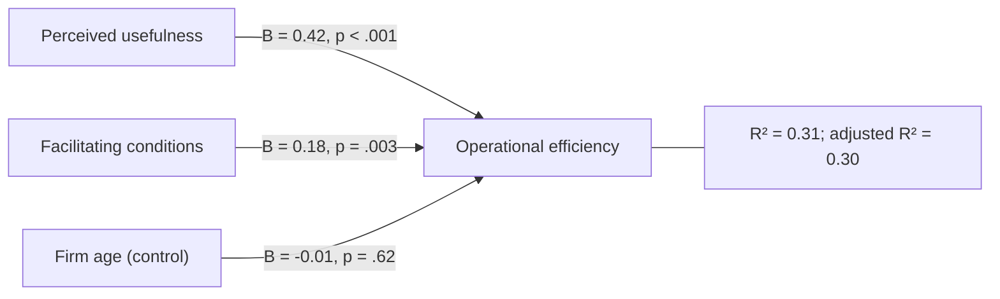

## Introduction

Much IT-for-business research asks how variables relate to one another. Is perceived usefulness related to intention to use an AI tool? Do retailers who perceive higher transaction costs accept digital payments less often? Does training predict fewer security incidents? **Correlation** measures the strength and direction of a linear relationship between two variables; **regression** models how an outcome changes with one or more predictors and allows prediction. Together they are the workhorses of explanatory survey research based on frameworks such as TAM and UTAUT.

These techniques are powerful but easily misread. Students frequently treat a correlation as proof of causation, interpret unstandardised and standardised coefficients interchangeably, or report a high R² as if it guaranteed a good model. This lesson builds understanding from a hand calculation to the interpretation of a typical software output, and closes with an international case showing how correlation-driven models can fail.

## Learning Objectives

- Explain what Pearson's correlation coefficient measures and interpret its sign, size and significance.
- Calculate Pearson's r, the regression slope and intercept, and R² for a small dataset.
- Interpret unstandardised (B) and standardised (β) coefficients, t-values, p-values, R², adjusted R² and the F-test in a multiple regression output.
- Evaluate the key assumptions of linear regression and the threats posed by outliers, multicollinearity and omitted variables.
- Justify cautious causal language when reporting correlational and regression findings.

## Prerequisite Knowledge

- Descriptive statistics, especially means, deviations and standard deviations (Lesson 1 of this module).
- Hypothesis testing, p-values and confidence intervals (previous lesson).
- Conditions for causal inference (Module 4).

## Key Terminology

- **Pearson's correlation coefficient (r)**: A statistic ranging from −1 to +1 that measures the strength and direction of the linear relationship between two interval or ratio variables.
- **Spearman's rank correlation (rho)**: A non-parametric correlation based on ranks, suitable for ordinal data or non-linear but monotonic relationships.
- **Simple linear regression**: A model predicting an outcome (dependent variable) from one predictor using a straight line `ŷ = a + bx`.
- **Multiple regression**: A model predicting an outcome from two or more predictors simultaneously, estimating each predictor's association while holding the others constant.
- **Unstandardised coefficient (B)**: The expected change in the outcome, in its original units, for a one-unit increase in a predictor, holding other predictors constant.
- **Standardised coefficient (β)**: The expected change in the outcome, in standard deviations, for a one-standard-deviation increase in a predictor; useful for comparing predictors measured on different scales.
- **Coefficient of determination (R²)**: The proportion of variance in the outcome explained by the model.
- **Multicollinearity**: High correlation among predictors, which makes individual coefficients unstable and hard to interpret.

## Detailed Explanation

### Correlation

Pearson's r is computed as:

```
r = Σ(x − x̄)(y − ȳ) / √[ Σ(x − x̄)² × Σ(y − ȳ)² ]
```

The numerator captures whether high values of x tend to pair with high (or low) values of y. The denominator standardises the result so that r lies between −1 and +1.

- **Sign** shows direction: positive r means the variables increase together; negative r means one decreases as the other increases.
- **Size** shows strength. Cohen's widely cited guidelines treat about 0.1 as small, 0.3 as medium and 0.5 as large, although interpretation should consider the field and context.
- **Significance** tests whether r differs from zero in the population; with large samples, even small correlations become significant.
- **r²** gives the proportion of shared variance: r = 0.5 implies that 25% of the variance in one variable is associated with the other.

Correlation measures only *linear* association. A strong curved relationship can produce r near zero, which is why scatter plots should always be inspected. Anscombe's (1973) famous quartet showed four datasets with nearly identical correlations and regression lines but completely different patterns when plotted.

### Simple linear regression

Regression fits the line that minimises the sum of squared vertical distances (residuals) between observed and predicted values, the **ordinary least squares** (OLS) method:

```
b = Σ(x − x̄)(y − ȳ) / Σ(x − x̄)²
a = ȳ − b × x̄
ŷ = a + b × x
```

The slope `b` tells you how much the predicted outcome changes for each one-unit increase in x. The intercept `a` is the predicted outcome when x = 0, which may or may not be meaningful.

R² can be calculated as:

```
R² = 1 − (SS_residual / SS_total)
```

where `SS_total = Σ(y − ȳ)²` and `SS_residual = Σ(y − ŷ)²`. In simple regression, R² equals r².

### Multiple regression

Most explanatory studies use several predictors, for example perceived usefulness, facilitating conditions and firm age predicting operational efficiency. Each coefficient then represents a predictor's association with the outcome **holding the other predictors constant**. This is how researchers statistically control for confounders, although only for those they measure.

Key elements of a multiple regression output include:

- **R² and adjusted R²**: adjusted R² penalises the addition of predictors that add little explanatory power and is preferred when comparing models.
- **F-test (ANOVA table)**: tests whether the model as a whole explains significant variance.
- **Coefficients table**: B, standard error, β, t (= B / SE) and p for each predictor.
- **Collinearity diagnostics**: tolerance and the variance inflation factor (VIF); high VIF values signal multicollinearity. Field discusses commonly used thresholds.

### Assumptions of linear regression

OLS regression relies on several assumptions, which Field summarises in detail:

1. **Linearity** of the relationship between predictors and outcome.
2. **Independence of errors**, for example no clustering of observations that the model ignores.
3. **Homoscedasticity**: residuals have roughly constant spread across predicted values.
4. **Normality of residuals**, mainly important for significance tests in small samples.
5. **No severe multicollinearity** among predictors.
6. **No unduly influential cases**, checked with measures such as Cook's distance.

Residual plots (residuals against predicted values) are the main diagnostic tool.

## Theories, Frameworks and Models

### Regression as a test of theory

In IS research, regression often tests paths in a theoretical model. In UTAUT, for example, performance expectancy, effort expectancy and social influence are theorised to predict behavioural intention. A regression with intention as the outcome tests whether each construct is a significant predictor once the others are controlled. More complex models with latent variables and multiple outcomes are often estimated with structural equation modelling (SEM), which extends the same logic.

### From association to explanation

Regression satisfies the covariation condition for causality and partly addresses non-spuriousness through control variables. It does not establish temporal precedence in cross-sectional data, and it cannot control for unmeasured confounders. Hence the recommended language: "X is a significant positive predictor of Y" or "X is associated with Y, controlling for Z", rather than "X causes Y".

## Diagram



The diagram summarises the illustrative regression output interpreted in Part B of the worked example below.

## Worked Example

### Part A: Hand calculation

**Illustrative scenario.** Five SMEs report the number of days of digital-skills training their staff received (x) and a staff-rated process efficiency score out of 10 (y).

| SME | x (training days) | y (efficiency) |
|---|---|---|
| A | 1 | 2 |
| B | 2 | 4 |
| C | 3 | 5 |
| D | 4 | 4 |
| E | 5 | 5 |

**Step 1 – Means.** `x̄ = 15 / 5 = 3`; `ȳ = 20 / 5 = 4`.

**Step 2 – Deviations and products.**

| x − x̄ | y − ȳ | (x − x̄)(y − ȳ) | (x − x̄)² | (y − ȳ)² |
|---|---|---|---|---|
| −2 | −2 | 4 | 4 | 4 |
| −1 | 0 | 0 | 1 | 0 |
| 0 | 1 | 0 | 0 | 1 |
| 1 | 0 | 0 | 1 | 0 |
| 2 | 1 | 2 | 4 | 1 |
| **Sum** | | **6** | **10** | **6** |

**Step 3 – Pearson's r.**

```
r = 6 / √(10 × 6) = 6 / √60 = 6 / 7.746 = 0.77
```

A strong positive correlation.

**Step 4 – Regression line.**

```
b = 6 / 10 = 0.6
a = 4 − 0.6 × 3 = 2.2
ŷ = 2.2 + 0.6x
```

Each additional training day is associated with a 0.6-point higher predicted efficiency score. For an SME with 4 training days, `ŷ = 2.2 + 2.4 = 4.6`.

**Step 5 – R².** Predicted values are 2.8, 3.4, 4.0, 4.6 and 5.2. Residuals (y − ŷ) are −0.8, 0.6, 1.0, −0.6 and −0.2.

```
SS_residual = 0.64 + 0.36 + 1.00 + 0.36 + 0.04 = 2.40
SS_total = 6
R² = 1 − 2.40 / 6 = 0.60
```

This equals `r² = 0.775² ≈ 0.60`: training days account for 60% of the variance in efficiency scores in these five firms.

**Caution:** with only five cases, the estimate is extremely unstable, and a significance test would have very little power. The example illustrates calculation, not a defensible study.

### Part B: Interpreting a software output

**Illustrative scenario.** Kwesi surveys 180 SMEs and regresses an operational efficiency scale score (1–5) on perceived usefulness of AI tools (1–5), facilitating conditions (1–5) and firm age (years). The output below is illustrative.

```
Model summary:  R² = 0.31   Adjusted R² = 0.30
ANOVA:          F(3, 176) = 26.4,  p < .001

Coefficients
Predictor                  B       SE     Beta     t      p
(Constant)               1.10    0.25            4.40   <.001
Perceived usefulness     0.42    0.07    0.39    6.00   <.001
Facilitating conditions  0.18    0.06    0.21    3.00    .003
Firm age                -0.01    0.02   -0.03   -0.50    .620
```

**Interpretation, step by step.**

1. **Overall model.** F(3, 176) = 26.4, p < .001: the predictors together explain significant variance in efficiency. R² = 0.31 means about 31% of the variance is explained; 69% is due to factors outside the model or error.
2. **Perceived usefulness.** B = 0.42: holding the other predictors constant, a one-point increase in perceived usefulness is associated with a 0.42-point increase in efficiency. t = 0.42 / 0.07 = 6.00, p < .001. β = 0.39 shows it is the strongest predictor in standardised terms.
3. **Facilitating conditions.** B = 0.18, p = .003: a smaller but significant positive association (β = 0.21).
4. **Firm age.** B = −0.01, p = .620: no significant association once the other predictors are included.
5. **Calibrated conclusion.** *"Perceived usefulness and facilitating conditions were significant positive predictors of reported operational efficiency, together with firm age explaining 31% of its variance. Because the data are cross-sectional and self-reported, these associations should not be interpreted as causal effects."*

**Consistency checks** students can perform on any output: t should equal B / SE; F can be recovered from R² using `F = (R² / k) / ((1 − R²) / (n − k − 1)) = (0.31 / 3) / (0.69 / 176) ≈ 26.4`.

## Ghanaian Business Application

Correlation and regression are central to many Ghanaian MSc projects.

- **Digital payment adoption.** Regression of retailers' intention to accept merchant payments on perceived usefulness, transaction costs, trust and network reliability can show which factors matter most once others are controlled. A negative B for transaction costs would support arguments for fee reductions, but policy-makers should note that correlation does not prove that cutting fees alone will change behaviour.
- **AI adoption and SME performance.** Regression can control for firm size and sector when relating AI use to efficiency, partially addressing confounding. Owner education or managerial capability, if unmeasured, may still bias results.
- **Student cybersecurity behaviour.** Correlations between awareness and safe behaviour are often only moderate, illustrating the "knowledge–behaviour gap". Regression may show that perceived vulnerability or peer norms predict behaviour beyond awareness.
- **Healthcare technology.** In hospitals, regression of nurses' EHR use on training hours, workload and perceived ease of use must consider clustering by ward; nurses in the same ward share conditions, violating independence unless the model accounts for it.

Ghanaian researchers should also consider **multicollinearity** in adoption models: constructs such as perceived usefulness and performance expectancy can be highly correlated, especially when items are adapted from different frameworks, making individual coefficients unstable.

## International Case Study

### Google Flu Trends

Google Flu Trends, launched in 2008, estimated influenza activity in the United States from the volume of related search queries. The approach was essentially correlational: researchers identified search terms whose frequencies correlated with historical flu surveillance data and used them to predict current flu levels faster than official reporting.

Initially the model appeared highly successful. However, in the 2012–2013 flu season its estimates substantially overestimated flu prevalence compared with surveillance data from the Centers for Disease Control and Prevention. In a widely cited 2014 article in *Science*, "The Parable of Google Flu: Traps in Big Data Analysis", David Lazer and colleagues analysed the failure. They pointed to what they called "big data hubris" (treating large-scale correlational data as a substitute for, rather than a supplement to, traditional data collection), to the selection of search terms that correlated with flu by chance or because of seasonal patterns rather than flu itself, and to changes in Google's search algorithms that altered how people searched, so that the relationships on which the model relied shifted over time. Google later discontinued publishing the estimates.

For students of correlation and regression the case teaches several lessons. A strong historical correlation does not guarantee a stable relationship; predictors chosen because they correlate, without theoretical justification, can capture spurious patterns; and models must be validated on new data. These risks apply equally to Ghanaian organisations building predictive models from mobile money, e-commerce or hospital data.

## Common Misconceptions

- **Misconception:** A strong correlation proves that one variable causes the other. **Correction:** Correlation shows association; causation also requires temporal precedence and the elimination of confounders.
- **Misconception:** r = 0 means the variables are unrelated. **Correction:** r = 0 means no *linear* relationship; a strong curved relationship may exist, so inspect a scatter plot.
- **Misconception:** A high R² means the model is correct. **Correction:** High R² can arise from overfitting, spurious predictors or violated assumptions; theory and diagnostics matter.
- **Misconception:** The largest B is always the most important predictor. **Correction:** B depends on measurement units; compare standardised β coefficients (with caution) for relative importance.
- **Misconception:** Regression controls for all confounders. **Correction:** It controls only for the variables included in the model.

## Common Examination Mistakes

- Interpreting r as a percentage (for example, saying r = 0.5 means 50% explained) instead of using r².
- Forgetting the phrase "holding other variables constant" when interpreting a multiple regression coefficient.
- Using B and β interchangeably or comparing B values across predictors on different scales.
- Reporting R² without the F-test, coefficients or assumption checks.
- Using causal language such as "impact" or "effect" for cross-sectional regression results without qualification.

## Critical Thinking Questions

1. A study of 2,000 students finds r = 0.08 between cybersecurity awareness and safe password behaviour, p < .001. Is this finding important? What does it suggest about awareness campaigns?
2. If perceived usefulness and performance expectancy correlate at 0.85 in your survey, what problems would arise from entering both into a regression, and what would you do?
3. The Google Flu Trends case involved enormous datasets. Why did size not protect the model from failure, and what does this imply for "big data" research in Ghanaian fintech?
4. Under what conditions, if any, could a regression on cross-sectional survey data support a causal interpretation?

## Practical Exercises

1. **Compute r and the regression line.** For four retailers, monthly mobile money transactions (x, in hundreds) and a customer satisfaction score (y) are: (1, 3), (2, 5), (3, 4), (4, 8). Compute r, b, a and R². *Expected output:* `x̄ = 2.5`, `ȳ = 5`; `Σ(x − x̄)(y − ȳ) = 7.0`, `Σ(x − x̄)² = 5.0`, `Σ(y − ȳ)² = 14.0`; `r = 7 / √70 = 0.84`; `b = 1.4`; `a = 5 − 1.4 × 2.5 = 1.5`; `R² ≈ 0.70`.
2. **Interpret an output.** Using the illustrative output in Part B, write a 120-word results paragraph in APA style for a dissertation. *Expected output:* a paragraph reporting F, R², adjusted R², and B, β, t and p for each predictor, with cautious, non-causal language.
3. **Diagnose assumptions.** Describe what you would look for in a residuals-versus-predicted plot to check linearity and homoscedasticity, and how you would respond to a funnel-shaped pattern. *Expected output:* a description of random scatter as the ideal, recognition of a funnel shape as heteroscedasticity, and remedies such as transformation or robust standard errors.

## Key Takeaways

- Pearson's r measures linear association from −1 to +1; always inspect a scatter plot.
- Regression estimates how an outcome changes with predictors; `b = Σ(x − x̄)(y − ȳ) / Σ(x − x̄)²` and `a = ȳ − b x̄`.
- In multiple regression, B is interpreted holding other predictors constant; β allows comparison across scales.
- R² is explained variance; adjusted R² penalises unnecessary predictors; F tests the overall model.
- Check assumptions and multicollinearity, and use non-causal language for correlational designs.

## Further Reading

- Field, A. (2018). *Discovering statistics using IBM SPSS statistics* (5th ed.). SAGE.
- Anscombe, F. J. (1973). Graphs in statistical analysis. *The American Statistician, 27*(1), 17–21.
- Lazer, D., Kennedy, R., King, G., & Vespignani, A. (2014). The parable of Google Flu: Traps in big data analysis. *Science, 343*(6176), 1203–1205.
- Venkatesh, V., Morris, M. G., Davis, G. B., & Davis, F. D. (2003). User acceptance of information technology: Toward a unified view. *MIS Quarterly, 27*(3), 425–478.

## Video Resources

- [Khan Academy: Statistics and Probability](https://www.khanacademy.org/math/statistics-probability) — Khan Academy. Free official course with units on scatter plots, correlation coefficients and least-squares regression.
- [IBM SPSS Statistics](https://www.ibm.com/products/spss-statistics) — IBM. Official product page with links to documentation for running and interpreting correlation and regression in SPSS.

## Revision Summary

Correlation quantifies the strength and direction of a linear relationship between two variables, while regression models how an outcome changes with one or more predictors and enables prediction. Interpreting regression output requires reading R², adjusted R², the F-test and each coefficient's B, β, t and p, checking assumptions, and avoiding causal claims that the design cannot support.

- `r = Σ(x − x̄)(y − ȳ) / √[Σ(x − x̄)² Σ(y − ȳ)²]`; r² = shared variance.
- `ŷ = a + bx`; `b = Sxy / Sxx`; `a = ȳ − b x̄`.
- B: change in Y per unit of X, holding others constant; β: standardised.
- `t = B / SE`; F tests the whole model.
- Check linearity, homoscedasticity, independence, normality of residuals, multicollinearity.
- Correlation ≠ causation (Google Flu Trends).
