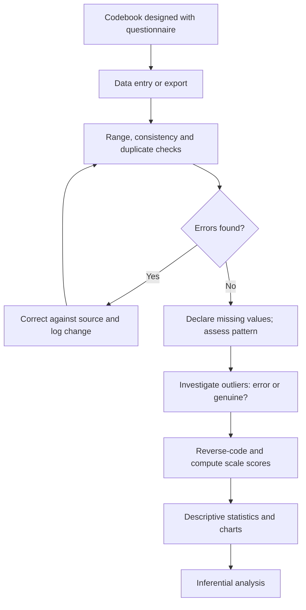

## Introduction

Between collecting questionnaires and running statistical tests lies a stage that rarely appears in published articles but often decides the quality of a dissertation: **data preparation**. Responses must be coded into numbers, entered or exported, checked for errors, screened for missing values and outliers, and transformed where needed. Errors at this stage silently contaminate every later analysis. A single mistyped value can shift a mean dramatically; an undeclared missing-value code such as 99 can make a five-point scale appear to average 12.

Once data are clean, **descriptive statistics** summarise them: what is typical, how much responses vary, and what shape the distribution takes. Description is the foundation for inference and is often the first set of results examiners read. This lesson covers both stages with a fully worked calculation and practical guidance relevant to tools such as IBM SPSS Statistics, Excel, R or Python.

## Learning Objectives

- Explain the stages of data preparation, from codebook design to data screening.
- Apply coding conventions, including reverse coding and missing-value codes, to questionnaire data.
- Calculate the mean, median, mode, range, interquartile range, variance and standard deviation for a small dataset.
- Compare the suitability of different descriptive measures for nominal, ordinal and interval or ratio data and for skewed distributions.
- Evaluate how data entry errors and outliers affect descriptive results and decide how to handle them.

## Prerequisite Knowledge

- Levels of measurement and questionnaire design (Module 5).
- Basic arithmetic, squaring and square roots.
- Familiarity with a spreadsheet or statistical package is helpful.

## Key Terminology

- **Codebook**: A document that defines every variable in a dataset, including its name, label, values, value labels, missing-value codes and level of measurement.
- **Data cleaning**: Detecting and correcting (or removing) errors, inconsistencies and impossible values in a dataset.
- **Missing data**: Values that are absent because a respondent skipped an item, did not know, or was routed past it.
- **Outlier**: A value that lies far from most other values; it may be an error or a genuine extreme case.
- **Measures of central tendency**: Statistics that describe the typical value, namely the mean, median and mode.
- **Measures of dispersion**: Statistics that describe the spread of values, such as range, interquartile range, variance and standard deviation.
- **Standard deviation**: The square root of the variance; roughly, the typical distance of observations from the mean, in the original units.
- **Skewness**: The degree of asymmetry of a distribution; positive skew has a long tail of high values.

## Detailed Explanation

### Stage 1: Design the codebook

Ideally the codebook is written *before* data collection, alongside the questionnaire. Each variable receives a short, systematic name (for example `PU1` to `PU4` for perceived usefulness items), a descriptive label, numeric codes for categories (1 = Accra, 2 = Kumasi, 3 = Takoradi), the level of measurement, and codes for different kinds of missing data (for example, 98 = "don't know", 99 = "no response"). Consistent naming makes syntax and scale construction far easier later.

### Stage 2: Enter or export data

Paper questionnaires require manual entry, ideally with **double entry** of a subset by a second person to estimate the error rate. Online tools export data directly, but exports still need checking: text responses may need coding, dates may be formatted inconsistently, and multiple-response questions may arrive as single text strings that must be split into separate yes/no variables.

### Stage 3: Clean the data

Cleaning combines systematic checks with judgement.

1. **Range checks.** Run frequencies for every variable. A value of 6 on a five-point scale, or 250 employees in a "micro-enterprise" category, signals an error.
2. **Consistency checks.** Cross-check logically related answers: a respondent who says they do not use mobile money should not report weekly mobile money transactions.
3. **Duplicate checks.** Online surveys can receive repeated submissions; check identifiers and timestamps.
4. **Return to the source.** Where possible, correct errors against the original questionnaire rather than deleting data.
5. **Document every change** in a cleaning log so that the process is transparent and reproducible.

### Stage 4: Screen for missing data and outliers

**Missing data** must be declared to the software as missing, otherwise codes such as 99 are treated as real values. The pattern matters: values missing completely at random are less problematic than values missing because, for example, less profitable firms refused to answer revenue questions. Common approaches include listwise deletion (dropping cases with any missing value on the variables analysed), pairwise deletion, and more advanced methods such as multiple imputation, which Field discusses. For an MSc study, students should at least report the amount and pattern of missing data and justify their handling.

**Outliers** should first be checked for errors. A genuine extreme case, such as a single very large SME in a sample of micro-enterprises, should not be deleted simply because it is inconvenient; options include reporting results with and without it, using robust statistics such as the median, or transforming the variable.

### Stage 5: Transform and compute variables

Typical transformations include **reverse coding** negatively worded items (`6 − x` on a five-point scale), computing **scale scores** as the mean of a construct's items, and **recoding** continuous variables into categories for presentation (for example, firm age into bands). Always keep the original variables so that transformations can be checked.

### Describing data: central tendency

- **Mean**: sum of values divided by the number of values. It uses all data but is sensitive to extreme values. Appropriate for interval and ratio data.
- **Median**: the middle value when data are ordered (the average of the two middle values if *n* is even). Robust to outliers and appropriate for ordinal data and skewed distributions, such as income or revenue.
- **Mode**: the most frequent value; the only measure of central tendency for nominal data.

### Describing data: dispersion

- **Range**: maximum minus minimum; simple but determined entirely by the two most extreme values.
- **Interquartile range (IQR)**: the spread of the middle 50% of values (Q3 − Q1); robust to outliers and pairs naturally with the median.
- **Variance**: the average squared deviation from the mean. For a sample, divide the sum of squared deviations by `n − 1`.
- **Standard deviation (SD)**: the square root of the variance, expressed in the original units, and pairs naturally with the mean.

### Describing data: shape

Histograms and box plots reveal shape. In a **positively skewed** distribution, such as monthly online sales among SMEs where a few firms sell far more than the rest, the mean is pulled above the median. Skewness and kurtosis statistics can be reported, but visual inspection is usually more informative for interpretation.

## Theories, Frameworks and Models

### Matching descriptive statistics to measurement levels

| Level of measurement | Central tendency | Dispersion | Typical display |
|---|---|---|---|
| Nominal (sector, region) | Mode | Frequencies and percentages | Bar chart, frequency table |
| Ordinal (single Likert item, education) | Median (mode) | IQR, range, percentages per category | Bar chart, stacked bar chart |
| Interval or ratio, symmetric (scale scores) | Mean | Standard deviation | Histogram, mean ± SD table |
| Interval or ratio, skewed (revenue, transaction counts) | Median (report mean too) | IQR | Histogram, box plot |

### The data preparation pipeline

Data preparation is best understood as a reproducible pipeline: raw data are never overwritten; each step is scripted (for example, with SPSS syntax or R code) or logged; and the final analysis dataset can be regenerated from the raw data. This principle protects against errors and allows examiners or collaborators to verify the work.

## Diagram



## Worked Example

**Illustrative scenario.** Adwoa surveys ten small online retailers in Accra about their monthly digital sales in thousands of Ghana cedis (GH¢000). After cleaning, the values are:

```
12, 15, 9, 20, 14, 11, 18, 13, 16, 12
```

**Step 1: Mean.**

```
Sum = 12 + 15 + 9 + 20 + 14 + 11 + 18 + 13 + 16 + 12 = 140
Mean = 140 / 10 = 14.0
```

**Step 2: Median and mode.** Order the data:

```
9, 11, 12, 12, 13, 14, 15, 16, 18, 20
```

With *n* = 10, the median is the average of the 5th and 6th values: `(13 + 14) / 2 = 13.5`. The mode is 12 (it appears twice).

**Step 3: Range and IQR.**

```
Range = 20 − 9 = 11
Lower half: 9, 11, 12, 12, 13 → Q1 = 12
Upper half: 14, 15, 16, 18, 20 → Q3 = 16
IQR = 16 − 12 = 4
```

(Software packages use slightly different quartile methods, so IQR values may differ marginally; state which method you used.)

**Step 4: Variance and standard deviation.**

| Value (x) | Deviation (x − 14) | Squared deviation |
|---|---|---|
| 12 | −2 | 4 |
| 15 | 1 | 1 |
| 9 | −5 | 25 |
| 20 | 6 | 36 |
| 14 | 0 | 0 |
| 11 | −3 | 9 |
| 18 | 4 | 16 |
| 13 | −1 | 1 |
| 16 | 2 | 4 |
| 12 | −2 | 4 |
| **Sum** | **0** | **100** |

```
Sample variance s² = 100 / (10 − 1) = 11.11
Standard deviation s = √11.11 = 3.33
```

**Interpretation:** typical monthly digital sales are about GH¢14,000, with sales typically about GH¢3,330 either side of that average. Mean and median are close (14.0 versus 13.5), suggesting a roughly symmetric distribution.

**Step 5: The effect of a data entry error.** Suppose the value 20 had been mistyped as 200.

```
New sum = 140 − 20 + 200 = 320
New mean = 320 / 10 = 32.0
New median = 13.5 (unchanged: the middle values are the same)
```

One keystroke more than doubled the mean while leaving the median untouched. This illustrates why range checks matter and why the median is preferred for skewed or outlier-prone data. **Expected output:** mean 14.0, median 13.5, mode 12, range 11, IQR 4, SD 3.33, and a written interpretation including the outlier effect.

## Ghanaian Business Application

Data preparation challenges are common in Ghanaian business research.

- **Currency and units.** Revenue may be reported in cedis, in thousands of cedis, or occasionally in old cedi denominations by older respondents, and some may answer in US dollars. The codebook should specify units, and cleaning should standardise them.
- **Mobile money transaction data.** Researchers working with transaction logs from a firm (with permission) often face highly skewed distributions: many small transactions and a few very large ones. Medians and IQRs, or log transformations, give a more truthful summary than means alone.
- **Multiple languages and open responses.** Open answers recorded in Twi, Ga or Pidgin English need consistent coding into categories, ideally by two coders who agree a coding scheme.
- **Paper questionnaires in hospitals or markets.** Manual entry is common; double entry of a sample helps estimate error rates.
- **Missing financial data.** SME owners frequently decline revenue questions. Reporting the proportion missing, and comparing respondents who answered with those who did not on other characteristics (such as sector or size), helps readers judge the risk of bias.
- **Data protection.** Cleaned datasets should be stripped of names and phone numbers (pseudonymised) before analysis and sharing, consistent with the Data Protection Act, 2012 (Act 843).

For student cybersecurity surveys, descriptive tables of awareness scores by faculty (means and SDs) and frequencies of risky behaviours (percentages) usually form the opening results section.

## International Case Study

### The Reinhart-Rogoff spreadsheet error

In 2010, economists Carmen Reinhart and Kenneth Rogoff published an influential paper, "Growth in a Time of Debt", which was widely cited in debates about government austerity. In 2013, Thomas Herndon, Michael Ash and Robert Pollin of the University of Massachusetts Amherst attempted to replicate the results using the original spreadsheet. They reported several problems, including a spreadsheet coding error that excluded some countries from a key average, the selective exclusion of certain data, and an unconventional weighting of country averages. Their corrected analysis showed a considerably weaker relationship between high public debt and low growth than the original paper had suggested. Reinhart and Rogoff acknowledged the spreadsheet error while defending other aspects of their work.

The case is directly relevant to data preparation. First, it shows that errors in coding and data handling, not only in statistical theory, can change substantive conclusions. Second, the error was found only because the authors shared their spreadsheet, illustrating the value of transparency and reproducible workflows. Third, decisions about which cases to include and how to weight them are analytical choices that must be documented and justified. For MSc students, the practical lessons are to keep raw data untouched, script or log every transformation, check that averages include all intended cases, and be prepared to share the analysis file with supervisors and examiners.

## Common Misconceptions

- **Misconception:** Cleaning data means deleting anything that looks unusual. **Correction:** Cleaning corrects errors; genuine extreme values should be investigated and handled transparently, not deleted for convenience.
- **Misconception:** The mean is always the best summary of a typical value. **Correction:** For skewed data or data with outliers, the median often represents the typical case better.
- **Misconception:** Missing values can be ignored because software handles them. **Correction:** Software only handles values declared as missing; undeclared codes such as 99 corrupt results, and the pattern of missingness can bias findings.
- **Misconception:** Standard deviation and variance measure the same thing in the same units. **Correction:** Variance is in squared units; the standard deviation returns to the original units and is easier to interpret.
- **Misconception:** Descriptive statistics are trivial and do not need interpretation. **Correction:** Descriptive results should be interpreted in context and often reveal patterns that shape later analysis.

## Common Examination Mistakes

- Dividing by *n* rather than *n − 1* when computing a sample variance without stating which is used.
- Reporting means for nominal variables such as sector or region.
- Forgetting to order data before finding the median.
- Presenting descriptive tables without any interpretation of what the numbers mean for the research question.
- Omitting any mention of data cleaning, missing data or outliers in a methodology answer.

## Critical Thinking Questions

1. When is it legitimate to remove an outlier from a dataset, and what must the researcher report if they do so?
2. A survey of SME owners has 30% missing data on revenue. What risks does this create, and how would you decide whether to use listwise deletion or another approach?
3. Should single Likert items be summarised with means or medians? Defend a position and explain how you would report it to an examiner.
4. The Reinhart-Rogoff case was discovered through replication. How could MSc programmes encourage reproducible data preparation among students?

## Practical Exercises

1. **Build a codebook.** For a short questionnaire on student cybersecurity awareness (faculty, level, gender, four awareness items, one negatively worded item, weekly hours online), write a codebook. *Expected output:* a table with variable names, labels, value codes, missing-value codes, measurement level and a note that the negative item will be reverse-coded with `6 − x`.
2. **Compute descriptives.** The number of AI tools used by eight SMEs is `0, 1, 1, 2, 2, 2, 3, 5`. Compute the mean, median, mode and sample standard deviation. *Expected output:* mean = 2.0, median = 2, mode = 2; squared deviations sum to `4 + 1 + 1 + 0 + 0 + 0 + 1 + 9 = 16`, so `s² = 16 / 7 = 2.29` and `s = 1.51`.
3. **Spot the errors.** Given a dataset extract containing a value of 7 on a five-point item, a respondent aged 9 in an SME owner survey, and a code of 99 for an unanswered item, describe how you would detect and handle each. *Expected output:* three short explanations referring to range checks, consistency checks and declaring missing values.

## Key Takeaways

- Data preparation (codebook, entry, cleaning, screening, transformation) determines the trustworthiness of every later result.
- Declare missing-value codes, examine missingness patterns and document how missing data were handled.
- Check outliers for errors; handle genuine extremes transparently.
- Match descriptive statistics to measurement level and distribution shape: mean and SD for symmetric interval data; median and IQR for skewed or ordinal data; mode and percentages for nominal data.
- Keep raw data untouched and log or script every change.

## Further Reading

- Field, A. (2018). *Discovering statistics using IBM SPSS statistics* (5th ed.). SAGE.
- Saunders, M., Lewis, P., & Thornhill, A. (2019). *Research methods for business students* (8th ed.). Pearson.
- Herndon, T., Ash, M., & Pollin, R. (2014). Does high public debt consistently stifle economic growth? A critique of Reinhart and Rogoff. *Cambridge Journal of Economics, 38*(2), 257-279.
- NIST/SEMATECH. (n.d.). *e-Handbook of statistical methods*. National Institute of Standards and Technology. <https://www.itl.nist.gov/div898/handbook/>

## Video Resources

- [Khan Academy: Statistics and Probability](https://www.khanacademy.org/math/statistics-probability): Khan Academy. Free official course with units on summarising quantitative data, including mean, median, IQR and standard deviation.
- [IBM SPSS Statistics](https://www.ibm.com/products/spss-statistics): IBM. Official product page with links to documentation and learning resources for data preparation and descriptive statistics in SPSS.

## Revision Summary

Data preparation turns raw responses into a trustworthy dataset through a codebook, careful entry or export, range and consistency checks, declared missing values, investigated outliers and documented transformations. Descriptive statistics then summarise the typical value (mean, median, mode), the spread (range, IQR, variance, SD) and the shape of each distribution, chosen to suit the level of measurement.

- Sample variance divides by `n − 1`; SD = √variance.
- Mean is sensitive to outliers; median is robust.
- Mode for nominal; median and IQR for ordinal or skewed; mean and SD for symmetric interval data.
- Undeclared codes such as 99 corrupt means.
- Log every cleaning decision; never overwrite raw data.
