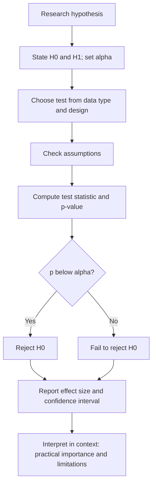

## Introduction

Descriptive statistics tell you about the people or firms you actually studied. Most research, however, wants to say something about a wider population: *all* registered SMEs in Accra, *all* undergraduate students at a university, *all* retailers in a market. **Inferential statistics** provide the tools for moving from a sample to a population while quantifying the uncertainty involved.

This lesson explains the logic behind inference rather than treating it as a set of software buttons. You will learn why sampling distributions matter, how hypothesis tests and confidence intervals work, what a p-value does and does not mean, how to choose a basic test, and why effect sizes and confidence intervals deserve as much attention as statistical significance. Worked calculations use realistic Ghanaian research scenarios, and the international case study examines the American Statistical Association's influential statement on p-values.

## Learning Objectives

- Explain the logic of statistical inference, including sampling distributions and standard errors.
- Apply the steps of null hypothesis significance testing to a research hypothesis.
- Calculate and interpret a 95% confidence interval for a mean, a one-sample t statistic and Cohen's d.
- Calculate and interpret a chi-square test of independence for a 2 × 2 table.
- Evaluate common misinterpretations of p-values and justify reporting effect sizes and confidence intervals.

## Prerequisite Knowledge

- Descriptive statistics, especially mean, standard deviation and variance (previous lesson).
- Research hypotheses and their alignment with objectives (Module 2).
- Probability sampling and margin of error (Module 5).

## Key Terminology

- **Population parameter**: A numerical characteristic of a population, such as the population mean μ, usually unknown.
- **Sample statistic**: A numerical characteristic calculated from a sample, such as the sample mean x̄, used to estimate a parameter.
- **Standard error (SE)**: The standard deviation of a statistic's sampling distribution; for a mean, `SE = s / √n`.
- **Null hypothesis (H0)**: The hypothesis of no effect, no difference or no relationship that a significance test evaluates.
- **p-value**: The probability of obtaining a result at least as extreme as the one observed, assuming the null hypothesis and all model assumptions are true.
- **Significance level (α)**: The threshold, often 0.05, below which a p-value leads the researcher to reject H0.
- **Confidence interval (CI)**: A range of plausible values for a parameter, constructed by a procedure that captures the true value in a stated proportion (for example 95%) of repeated samples.
- **Effect size**: A measure of the magnitude of an effect or relationship, such as Cohen's d or a correlation coefficient, that does not depend on sample size in the way p-values do.

## Detailed Explanation

### Why inference is needed

If you drew many different random samples of 100 students and measured their cybersecurity awareness, each sample mean would differ slightly from the others because of chance. The distribution of these hypothetical sample means is the **sampling distribution**. The **central limit theorem** tells us that, for reasonably large samples, this distribution is approximately normal and centred on the population mean, with a spread equal to the **standard error**. Inference uses the standard error to judge how far a sample result is likely to be from the true population value.

Inference is only as good as the sample. Formulas assume probability sampling; with convenience samples, p-values and confidence intervals describe uncertainty under assumptions that may not hold, and must be interpreted cautiously.

### Null hypothesis significance testing

A significance test follows a standard sequence.

1. **State hypotheses.** For example, H0: the mean awareness score equals 3.0 (the neutral midpoint); H1: it differs from 3.0.
2. **Choose α**, conventionally 0.05, before seeing the data.
3. **Select the test** appropriate to the data and design.
4. **Check assumptions**, such as independence, approximate normality or adequate expected frequencies.
5. **Compute the test statistic** and its p-value.
6. **Decide**: if `p < α`, reject H0; otherwise, fail to reject H0.
7. **Interpret substantively**, reporting the effect size and confidence interval.

"Fail to reject" is not the same as "accept": a non-significant result may reflect a small sample rather than the absence of an effect.

### Errors and power

| Decision | H0 actually true | H0 actually false |
|---|---|---|
| Reject H0 | **Type I error** (false positive), probability α | Correct decision, probability = power |
| Fail to reject H0 | Correct decision | **Type II error** (false negative), probability β |

**Power** (`1 − β`) is the probability of detecting a true effect. It increases with sample size, effect size and α. Cohen proposed 0.80 as a conventional target. Underpowered studies are common in student research and produce unstable results.

### One-tailed and two-tailed tests

A two-tailed test asks whether a value differs in either direction; a one-tailed test examines one direction only. One-tailed tests should be specified in advance with strong theoretical justification; switching to a one-tailed test after seeing the data to obtain significance is inappropriate.

### Confidence intervals

A 95% confidence interval for a mean, with a reasonably large sample, is approximately:

```
x̄ ± 1.96 × SE
```

For small samples, the multiplier comes from the t-distribution with `n − 1` degrees of freedom and is slightly larger than 1.96. A confidence interval conveys both the estimate and its precision. If a 95% CI for a mean excludes a hypothesised value, a two-tailed test at α = 0.05 would reject that value, so the CI contains the information of the test and more.

### Choosing a basic test

| Research question | Data | Common parametric test | Common non-parametric alternative |
|---|---|---|---|
| Does a mean differ from a fixed value? | One interval variable | One-sample t-test | Wilcoxon signed-rank test |
| Do two independent groups differ? | Interval outcome, two groups | Independent-samples t-test | Mann–Whitney U test |
| Do the same people differ at two times? | Interval outcome, paired | Paired-samples t-test | Wilcoxon signed-rank test |
| Do three or more groups differ? | Interval outcome, 3+ groups | One-way ANOVA | Kruskal–Wallis test |
| Are two categorical variables associated? | Two nominal variables | Chi-square test of independence | Fisher's exact test (small samples) |
| Are two interval variables related? | Two interval variables | Pearson correlation | Spearman's rank correlation |

Field's *Discovering Statistics Using IBM SPSS Statistics* gives detailed guidance on assumptions and procedures for each test.

## Theories, Frameworks and Models

### What a p-value means and does not mean

A p-value of 0.03 means: *if H0 and the model assumptions were true, results as extreme as these, or more so, would occur about 3% of the time.* It does **not** mean:

- that there is a 3% probability that H0 is true;
- that there is a 97% probability that the hypothesis is correct;
- that the effect is large or important;
- that the result will replicate.

### Statistical versus practical significance

With very large samples, trivial effects become statistically significant; with small samples, important effects may not reach significance. **Effect sizes** address magnitude. Cohen's d for a mean difference is:

```
d = (difference in means) / standard deviation
```

Cohen suggested approximate benchmarks of 0.2 (small), 0.5 (medium) and 0.8 (large), while cautioning that what counts as important depends on context. A modest effect on phishing susceptibility may be practically valuable for a bank if it prevents costly incidents.

## Diagram



## Worked Example

### Part A: Confidence interval, t-test and effect size

**Illustrative scenario.** Nana surveys a random sample of 100 undergraduate students at a Ghanaian university using a validated five-point cybersecurity awareness scale (1 = very low, 5 = very high). She wants to know whether average awareness differs from the neutral midpoint of 3.0.

```
n = 100,  x̄ = 3.40,  s = 0.80
```

**Step 1 – Standard error.**

```
SE = s / √n = 0.80 / √100 = 0.80 / 10 = 0.08
```

**Step 2 – 95% confidence interval.**

```
3.40 ± 1.96 × 0.08 = 3.40 ± 0.157
CI = (3.24, 3.56)
```

(Using the t multiplier for 99 degrees of freedom, about 1.98, gives nearly the same interval.)

**Step 3 – One-sample t-test.** H0: μ = 3.0; H1: μ ≠ 3.0; α = 0.05.

```
t = (x̄ − μ0) / SE = (3.40 − 3.00) / 0.08 = 5.0,  df = 99
```

A t value of 5.0 with 99 degrees of freedom corresponds to `p < .001`. Nana rejects H0.

**Step 4 – Effect size.**

```
d = (3.40 − 3.00) / 0.80 = 0.50
```

This is a medium effect by Cohen's conventions.

**Step 5 – Report.** *"Mean cybersecurity awareness (M = 3.40, SD = 0.80) was significantly above the scale midpoint, t(99) = 5.00, p < .001, d = 0.50, 95% CI [3.24, 3.56]."* Interpretation: awareness is moderately above neutral, but even the upper end of the interval (3.56) is well below "high" (4), suggesting room for improvement.

### Part B: Chi-square test of independence

**Illustrative scenario.** Nana also records whether 200 students clicked a simulated phishing link, comparing those who had attended a training session with those who had not.

| | Clicked | Did not click | Total |
|---|---|---|---|
| Trained | 12 | 68 | 80 |
| Not trained | 36 | 84 | 120 |
| **Total** | **48** | **152** | **200** |

**Step 1 – Expected frequencies** under H0 (no association): `E = (row total × column total) / grand total`.

```
Trained, clicked:       80 × 48 / 200 = 19.2
Trained, not clicked:   80 × 152 / 200 = 60.8
Untrained, clicked:     120 × 48 / 200 = 28.8
Untrained, not clicked: 120 × 152 / 200 = 91.2
```

All expected frequencies exceed 5, so the chi-square approximation is acceptable.

**Step 2 – Chi-square statistic:** `χ² = Σ (O − E)² / E`.

```
(12 − 19.2)² / 19.2 = 51.84 / 19.2 = 2.700
(68 − 60.8)² / 60.8 = 51.84 / 60.8 = 0.853
(36 − 28.8)² / 28.8 = 51.84 / 28.8 = 1.800
(84 − 91.2)² / 91.2 = 51.84 / 91.2 = 0.568
χ² = 5.92,  df = (2 − 1) × (2 − 1) = 1
```

**Step 3 – Decide.** The critical value of χ² at α = 0.05 with 1 df is 3.84. Since 5.92 > 3.84, H0 is rejected; the p-value lies between 0.01 and 0.025.

**Step 4 – Interpret.** Click rates were 15% among trained students (12/80) and 30% among untrained students (36/120). Training is associated with a lower click rate. Because students chose whether to attend training, this is an association, not proof of causation; more security-conscious students may have been more likely to attend.

**Expected output:** CI [3.24, 3.56], t(99) = 5.00, d = 0.50, χ²(1) = 5.92, with correct decisions and calibrated interpretations.

## Ghanaian Business Application

Inferential statistics underpin many decisions in Ghanaian organisations and research.

- **Digital payment adoption.** A researcher might test whether the proportion of retailers accepting merchant payments differs between Accra and Tamale (chi-square), or whether mean perceived transaction cost differs between adopters and non-adopters (independent-samples t-test). Reporting the size of the difference, not just its significance, helps fintech managers judge whether the gap matters commercially.
- **AI adoption among SMEs.** An SME support programme might compare mean efficiency scores before and after an AI bookkeeping pilot for the same firms (paired-samples t-test), while recognising the threats to internal validity discussed in Module 4.
- **Healthcare technology.** Hospital managers may compare average patient waiting times across departments using a new system (ANOVA), but waiting times are often skewed, so a non-parametric test or a transformation may be more appropriate.
- **Student cybersecurity awareness.** Comparisons across faculties often involve multiple tests. Running many tests at α = 0.05 inflates the chance of false positives; researchers should plan comparisons in advance or adjust for multiple testing.

A recurring issue in Ghanaian MSc research is the use of inferential tests on convenience samples. Tests can still be run, but students should state that p-values assume random sampling and interpret them as indicative rather than definitive.

## International Case Study

### The American Statistical Association's statement on p-values

In 2016 the American Statistical Association (ASA) took the unusual step of issuing a formal statement on statistical significance and p-values, published by Ronald Wasserstein and Nicole Lazar in *The American Statistician*. The statement was prompted by concerns that misuse and misinterpretation of p-values were contributing to unreliable research findings across disciplines, a concern linked to the broader "replication crisis" discussed in Module 1.

The statement set out six principles. In summary: p-values can indicate how incompatible data are with a specified statistical model; they do not measure the probability that the studied hypothesis is true or that the data arose by chance alone; scientific conclusions and business or policy decisions should not be based only on whether a p-value passes a threshold; proper inference requires full reporting and transparency; a p-value does not measure the size of an effect or the importance of a result; and by itself a p-value does not provide a good measure of evidence regarding a model or hypothesis.

The statement did not ban p-values, but it encouraged researchers to supplement or replace them with estimation (confidence intervals), effect sizes and other approaches, and to report all analyses performed rather than only significant ones. For MSc students, its practical implications are clear: never write "p < .05, therefore the hypothesis is proven"; always report effect sizes and confidence intervals; describe all tests conducted; and interpret findings in light of design quality, sample and context.

## Common Misconceptions

- **Misconception:** A p-value is the probability that the null hypothesis is true. **Correction:** It is the probability of data at least as extreme as observed, assuming H0 is true.
- **Misconception:** A non-significant result proves there is no effect. **Correction:** It means the data are not sufficiently incompatible with H0; the study may have lacked power.
- **Misconception:** Smaller p-values mean larger effects. **Correction:** p-values depend heavily on sample size; effect sizes measure magnitude.
- **Misconception:** A 95% CI means there is a 95% probability that the true value lies in this particular interval. **Correction:** Strictly, 95% of intervals constructed by this procedure would contain the true value; any single interval either does or does not.
- **Misconception:** Statistical significance means practical importance. **Correction:** Importance depends on effect size, costs, benefits and context.

## Common Examination Mistakes

- Stating hypotheses about sample statistics (x̄) instead of population parameters (μ).
- Writing "accept H0" instead of "fail to reject H0".
- Choosing a test without considering the measurement level of the variables or the design (independent versus paired).
- Reporting a significant result without an effect size or confidence interval.
- Interpreting a significant chi-square result from observational data as evidence of causation.

## Critical Thinking Questions

1. If a study of 5,000 mobile money users finds a statistically significant but tiny difference in satisfaction between two providers, how should a manager interpret it?
2. Should MSc dissertations based on convenience samples report p-values at all? Justify your answer with reference to the ASA statement.
3. A student runs twenty t-tests comparing faculties and finds one significant at p = 0.04. What should the student conclude, and why?
4. How might a confidence interval change the way a hospital board interprets a reduction in average waiting time after a new system is introduced?

## Practical Exercises

1. **Confidence interval.** A random sample of 64 SMEs reports a mean AI-readiness score of 2.8 (SD = 1.2) on a five-point scale. Compute the standard error and the 95% CI. *Expected output:* `SE = 1.2 / 8 = 0.15`; `CI = 2.8 ± 1.96 × 0.15 = 2.8 ± 0.294 = (2.51, 3.09)`, interpreted as a plausible range that includes the midpoint 3.0.
2. **Hypothesis test.** Using the same data, test H0: μ = 3.0 at α = 0.05 and compute Cohen's d. *Expected output:* `t = (2.8 − 3.0) / 0.15 = −1.33`, df = 63, not significant (|t| < about 2.00); `d = −0.2 / 1.2 = −0.17`, a small effect; conclusion: fail to reject H0, consistent with the CI including 3.0.
3. **Choose the test.** For each question, name the appropriate test: (a) Do adopters and non-adopters of e-commerce differ in mean firm age? (b) Is gender associated with password reuse (yes/no)? (c) Do nurses' satisfaction scores differ before and after EHR training? *Expected output:* (a) independent-samples t-test (or Mann–Whitney U), (b) chi-square test of independence, (c) paired-samples t-test (or Wilcoxon signed-rank).

## Key Takeaways

- Inference uses the sampling distribution and standard error to generalise from sample to population under stated assumptions.
- Hypothesis testing follows a fixed sequence, and "fail to reject" is not "accept".
- Type I and Type II errors trade off; power depends on sample size, effect size and α.
- Confidence intervals and effect sizes convey precision and magnitude that p-values cannot.
- p-values do not measure the probability that a hypothesis is true, the size of an effect or its importance.

## Further Reading

- Field, A. (2018). *Discovering statistics using IBM SPSS statistics* (5th ed.). SAGE.
- Cohen, J. (1988). *Statistical power analysis for the behavioral sciences* (2nd ed.). Lawrence Erlbaum Associates.
- Wasserstein, R. L., & Lazar, N. A. (2016). The ASA's statement on p-values: Context, process, and purpose. *The American Statistician, 70*(2), 129–133. <https://doi.org/10.1080/00031305.2016.1154108>
- Saunders, M., Lewis, P., & Thornhill, A. (2019). *Research methods for business students* (8th ed.). Pearson.

## Video Resources

- [Khan Academy: Statistics and Probability](https://www.khanacademy.org/math/statistics-probability) — Khan Academy. Free official course with units on confidence intervals, significance tests and chi-square tests.
- [MIT OpenCourseWare](https://ocw.mit.edu/) — Massachusetts Institute of Technology. Official open learning portal; search for introductory probability and statistics course materials.

## Revision Summary

Inferential statistics generalise from samples to populations by using the standard error to quantify chance variation. Significance tests evaluate how compatible data are with a null hypothesis, while confidence intervals and effect sizes convey precision and magnitude; responsible reporting combines all three and interprets results in light of design and context.

- `SE = s / √n`; 95% CI ≈ `x̄ ± 1.96 × SE`.
- One-sample t = `(x̄ − μ0) / SE`; Cohen's d = difference / SD.
- Chi-square: `E = row × column / total`; `χ² = Σ(O − E)²/E`; df = (r − 1)(c − 1).
- Type I = false positive (α); Type II = false negative (β); power = 1 − β.
- p-value ≠ probability H0 is true; significance ≠ importance.
