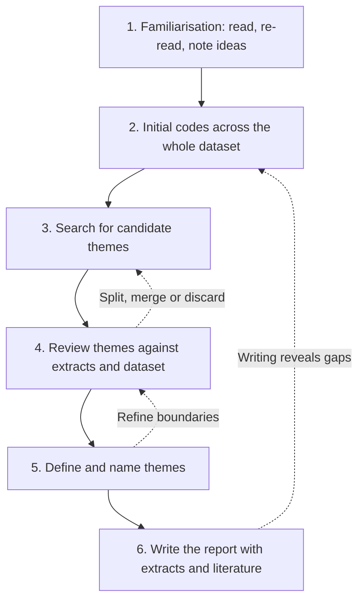

## Introduction

After interviews, focus groups or observation, a qualitative researcher may hold hundreds of pages of transcripts and field notes. The challenge is to turn this mass of words into an analysis that answers the research question without losing the richness that justified collecting qualitative data in the first place. **Coding** is the foundational technique: labelling segments of data with short descriptive or interpretive tags. **Thematic analysis** organises codes into patterns of shared meaning, or themes, that tell a coherent analytic story.

Thematic analysis is the most widely used qualitative analytic method in business and information systems dissertations, in large part because of Braun and Clarke's (2006) clear description of its phases. It is also widely misused: "themes" that are merely topic headings, codes that simply repeat interview questions, and analyses that summarise what participants said without interpreting it. This lesson provides a step-by-step guide, a worked coding frame from a Ghanaian SME study, and criteria for judging quality.

## Learning Objectives

- Explain the purpose of coding and distinguish descriptive, in vivo, process and interpretive codes.
- Compare inductive and deductive (and hybrid) approaches to coding.
- Apply Braun and Clarke's six phases of thematic analysis to a small dataset.
- Construct a coding frame with code names, definitions, inclusion criteria and example extracts.
- Evaluate the quality of a thematic analysis, including the debate about inter-coder reliability.

## Prerequisite Knowledge

- Qualitative research logic and data collection methods (Modules 4 and 5).
- Interpretivist assumptions about knowledge (Module 1).
- Purposive sampling and saturation (Module 5).

## Key Terminology

- **Code**: A short label assigned to a segment of data that captures a feature relevant to the research question.
- **Coding frame (codebook)**: A structured list of codes with names, definitions, inclusion and exclusion criteria and example extracts, used to apply codes consistently.
- **Theme**: A pattern of shared meaning across the dataset, organised around a central concept, that captures something important about the data in relation to the research question.
- **Inductive coding**: Developing codes from the data without a predetermined framework.
- **Deductive coding**: Applying codes derived in advance from theory or prior research, such as constructs from UTAUT.
- **In vivo code**: A code that uses participants' own words as its label.
- **Semantic versus latent analysis**: Semantic analysis stays close to the explicit content of the data; latent analysis interprets underlying assumptions, ideas and meanings.
- **Reflexivity**: The researcher's ongoing critical reflection on how their own background, assumptions and decisions shape the analysis.

## Detailed Explanation

### What coding does

Coding breaks data into meaningful segments and labels them, making it possible to retrieve, compare and organise material across many transcripts. Saldaña's *The Coding Manual for Qualitative Researchers* describes many coding methods. Useful types for IT-for-business research include:

- **Descriptive codes** summarise the topic of a segment ("training", "network outage").
- **In vivo codes** preserve participants' language ("the system sleeps", a nurse's phrase for frequent downtime).
- **Process codes** capture actions, often as gerunds ("working around the system", "testing the chatbot quietly").
- **Interpretive or concept codes** capture the analyst's reading of underlying meaning ("delegating trust to family members").

First-cycle coding applies initial labels; second-cycle coding groups, refines and links codes into categories or themes.

### Inductive, deductive and hybrid approaches

An **inductive** approach lets codes emerge from the data and suits exploratory research. A **deductive** approach starts with codes from theory, for example the UTAUT constructs of performance expectancy, effort expectancy, social influence and facilitating conditions, and suits research testing or elaborating an existing framework. Many dissertations adopt a **hybrid** approach: a deductive starting frame plus inductive codes for issues the theory does not anticipate. Hybrid coding is particularly useful in Ghanaian contexts, where imported adoption theories may miss local factors such as family involvement in business decisions or reliance on informal technical help.

### Braun and Clarke's six phases

Braun and Clarke (2006) describe thematic analysis as a flexible method that can be used within different theoretical frameworks. Their six phases are recursive rather than strictly linear.

1. **Familiarising yourself with the data.** Transcribe or check transcripts, read and re-read them, and note initial ideas.
2. **Generating initial codes.** Code interesting features systematically across the whole dataset, collating extracts for each code.
3. **Searching for themes.** Collate codes into potential themes, gathering all relevant data for each.
4. **Reviewing themes.** Check whether themes work in relation to coded extracts and the entire dataset; split, merge or discard themes as needed. A thematic map helps.
5. **Defining and naming themes.** Refine the specifics of each theme and the overall story; give themes clear, informative names.
6. **Producing the report.** Select vivid, compelling extracts, relate the analysis back to the research question and literature, and produce a scholarly account.

In later work, Braun and Clarke (2019) emphasised what they call **reflexive thematic analysis**, stressing that themes are actively constructed by the researcher rather than "emerging" passively, and that researcher subjectivity is a resource to be reflected upon rather than a bias to be eliminated.

### Themes versus topics

A common weakness is to present **topic summaries** ("Theme 1: Training"; "Theme 2: Cost") that simply group what participants said about each interview question. A genuine theme has a **central organising concept** that says something about the data: "Training as a ritual rather than a resource" captures an interpretive insight about how participants experienced training. Theme names that make a claim help ensure analysis goes beyond description.

### Quality and the inter-coder reliability debate

In codebook-style thematic analysis and content analysis, two coders may independently code the same material and compute agreement, often using Cohen's kappa, which corrects simple percentage agreement for chance. Braun and Clarke argue that such measures fit poorly with reflexive thematic analysis because there is no single "correct" coding to agree upon. Researchers should choose a position consistent with their approach: codebook or positivist-leaning approaches may report agreement; reflexive approaches should instead demonstrate quality through transparency, reflexivity, an audit trail, and well-evidenced themes. Lincoln and Guba's trustworthiness criteria (credibility, transferability, dependability, confirmability), covered in Module 7, apply in either case.

### Software

Computer-assisted qualitative data analysis software (CAQDAS) such as NVivo, ATLAS.ti or the free QDA tools available online can help organise codes, retrieve extracts and visualise relationships. Software does not analyse data; it supports the researcher's interpretive work. Spreadsheets or word processors can be adequate for smaller studies.

## Theories, Frameworks and Models

### Approaches to qualitative analysis compared

| Approach | Main aim | Coding style | Typical output |
|---|---|---|---|
| Reflexive thematic analysis | Identify patterns of meaning in relation to a question | Flexible, organic, researcher-led | Interpretive themes with extracts |
| Codebook thematic analysis | Structured identification of themes, often in teams | Coding frame developed early, sometimes with agreement checks | Themes mapped to a codebook |
| Qualitative content analysis | Systematic categorisation, sometimes with counts | Detailed categories, often deductive | Category frequencies and descriptions |
| Grounded theory | Build theory from data | Open, axial or focused, and theoretical coding with constant comparison | A substantive theory or model |
| Framework analysis | Applied policy-oriented analysis | Thematic framework applied to charts by case and theme | Matrices comparing cases |

Miles, Huberman and Saldaña's *Qualitative Data Analysis* also offers many display techniques, such as matrices and networks, that complement thematic analysis.

## Diagram



## Worked Example

**Illustrative scenario.** Akua interviews twelve owners of small businesses in Accra about adopting AI tools such as chatbots and automated bookkeeping. Her research question is: *How do SME owners experience the adoption of AI tools in their operations?* She adopts a hybrid approach, starting with UTAUT-informed codes and adding inductive ones.

**Step 1 – Familiarisation.** She reads all transcripts twice and writes memos, noting that owners often mention relatives and that many describe "testing quietly" before telling staff.

**Step 2 – Initial coding of extracts.** Three illustrative extracts (invented for teaching):

| Extract | Initial codes |
|---|---|
| "The chatbot answers customers at night, so I don't lose orders while I sleep." | Out-of-hours availability; reduced lost sales (performance expectancy) |
| "My nephew set it up for me. If he travels, I am stuck." | Dependence on family for technical help; fragile support (facilitating conditions) |
| "I tried it quietly for two weeks before I told my staff, because I didn't want them to think I was replacing them." | Testing quietly; managing staff fears; job-security concerns |

**Step 3 – Build the coding frame.**

| Code | Definition | Include when | Exclude when | Example extract |
|---|---|---|---|---|
| Out-of-hours availability | AI tool performs tasks when the owner or staff are unavailable | Mentions of night, weekends, absence | General speed of response during working hours | "answers customers at night" |
| Family as tech support | Reliance on relatives for set-up, maintenance or troubleshooting | Named or implied family helpers | Paid IT vendors | "My nephew set it up" |
| Testing quietly | Trialling AI privately before wider introduction | Concealed or unannounced trials | Formal pilot announced to staff | "tried it quietly for two weeks" |
| Staff job-security concerns | Owner's perception that staff fear replacement | Explicit or implied fear of being replaced | Staff complaints about usability | "think I was replacing them" |
| Cost justification | Weighing AI subscription costs against benefits | Mentions of fees, data bundles, value | Generic complaints about the economy | "worth it if it brings two orders a week" |

**Step 4 – Search for and review themes.** Akua clusters codes:

- *Out-of-hours availability* + *cost justification* → candidate theme: **"AI as an extra pair of hands"** (AI valued as a tireless, low-cost assistant).
- *Family as tech support* + other codes about informal help → candidate theme: **"Borrowed capability"** (adoption depends on capability borrowed from relatives and friends, which makes it fragile).
- *Testing quietly* + *staff job-security concerns* → candidate theme: **"Adopting in the shadows"** (owners manage the social risks of AI by introducing it discreetly).

On review, she checks that each theme is supported across several interviews, not just one vivid quote, and that themes are distinct. She finds that "borrowed capability" also explains why some owners abandoned tools, strengthening the theme.

**Step 5 – Define and name.** Each theme receives a short definition, for example: *"Borrowed capability: owners' adoption of AI rests on technical skills borrowed from family and friends, so continued use is vulnerable when those helpers are unavailable."*

**Step 6 – Report.** In her findings chapter, each theme is presented with an analytic narrative, two or three well-chosen extracts, and links to literature: "borrowed capability" extends UTAUT's facilitating conditions by showing that support may be informal and relational in Ghanaian SMEs.

**Optional agreement check (codebook approach).** If Akua's supervisor codes 50 segments for the presence of *Family as tech support* and they agree on 42, with Akua applying the code to 20 segments and the supervisor to 22:

```
Observed agreement Po = 42 / 50 = 0.84
Expected agreement Pe = (20 × 22 + 30 × 28) / 50² = (440 + 840) / 2,500 = 0.512
Cohen's kappa = (Po − Pe) / (1 − Pe) = (0.84 − 0.512) / 0.488 = 0.67
```

Kappa of about 0.67 indicates substantial agreement beyond chance under commonly cited benchmarks, though Akua would only report this if her approach is codebook-based rather than reflexive.

**Expected output:** a coding frame, three defined themes with names that make an analytic claim, and a short audit trail showing how codes became themes.

## Ghanaian Business Application

Thematic analysis is well suited to many Ghanaian IT-for-business research questions.

- **Healthcare technology adoption.** Interviews with nurses and records officers about an EHR system might produce themes such as "the system sleeps" (an in vivo code for frequent downtime), "paper as a safety net" and "training that did not travel to the night shift". Such themes can inform hospital managers' implementation strategies.
- **Digital payment adoption among retailers.** Traders' accounts may reveal themes about relationships with regular customers, visibility to tax authorities and the reliability of networks, which survey items may not capture.
- **Student cybersecurity awareness.** Focus group data might show themes like "sharing as friendship", where password sharing signals trust between friends, explaining why awareness does not always translate into secure behaviour.
- **E-commerce among small businesses.** Owners' narratives about selling through social media may reveal themes around "trust built in the inbox", showing how personal messaging substitutes for formal trust mechanisms.

Practical considerations include translating extracts from Twi, Ga or other languages while preserving meaning (keeping the original phrase alongside the translation where helpful), anonymising extracts so that small business owners cannot be identified in close-knit communities, and storing transcripts securely in line with the Data Protection Act, 2012 (Act 843).

## International Case Study

### Orlikowski's study of Lotus Notes in a consulting firm

In the early 1990s, Wanda Orlikowski published an influential interpretive study of the introduction of Lotus Notes, a groupware system, in a large consulting firm. The firm's leaders expected the technology to transform knowledge sharing among consultants. Orlikowski conducted interviews with consultants, managers and technologists, supplemented by other data, and analysed them interpretively.

Her analysis showed that adoption and use were shaped less by the technology's features than by two sets of factors. First, people's **mental models** of the system (an idea Orlikowski later developed with Debra Gash as "technological frames"): many consultants understood Notes as just another piece of software, similar to familiar tools, rather than as a new way of collaborating. Second, the firm's **structural properties**, especially an incentive and promotion system that rewarded individual expertise and billable hours. In such a culture, sharing knowledge freely could appear to reduce one's own competitive advantage, so the collaborative potential of the system went largely unrealised.

Although the study pre-dates Braun and Clarke's codification of thematic analysis, it exemplifies the qualities of good thematic interpretation: themes that make an analytic claim rather than summarise topics, careful use of participants' accounts as evidence, and a strong connection to theory (in this case, ideas about mental models and organisational structure). For students analysing AI adoption in Ghanaian SMEs or EHR use in hospitals, the case shows how qualitative analysis can reveal that "adoption problems" are often organisational and interpretive, not merely technical.

## Common Misconceptions

- **Misconception:** Themes emerge from the data on their own. **Correction:** Themes are actively constructed by the researcher through interpretation; reflexivity about this role is part of quality.
- **Misconception:** Each interview question produces one theme. **Correction:** Organising findings by question produces topic summaries; themes cut across questions around shared meanings.
- **Misconception:** The more often something is mentioned, the more important the theme. **Correction:** Prevalence can inform analysis, but importance depends on relevance to the research question, not frequency alone.
- **Misconception:** Qualitative software does the analysis. **Correction:** Software organises and retrieves data; interpretation remains the researcher's work.
- **Misconception:** High inter-coder agreement is always required for rigorous thematic analysis. **Correction:** Agreement measures fit codebook approaches; reflexive thematic analysis demonstrates quality through transparency and reflexivity instead.

## Common Examination Mistakes

- Listing Braun and Clarke's six phases without showing how they would be applied to the scenario's data.
- Presenting "themes" that are single words or topic labels with no central organising concept.
- Using quotations as a substitute for analysis, with no interpretive commentary.
- Confusing codes and themes, or failing to show how one leads to the other.
- Reporting percentages of participants as if a small purposive sample supported statistical generalisation.

## Critical Thinking Questions

1. Is it appropriate to report that "eight of twelve owners mentioned cost" in a thematic analysis? When might such counts help, and when might they mislead?
2. How should a researcher who is also an employee of the hospital being studied practise reflexivity during thematic analysis of nurses' interviews?
3. A deductive UTAUT coding frame captures most of your data, but several owners talk about religious beliefs shaping their attitudes to AI. How should you handle data that do not fit the theory?
4. Should a dissertation using reflexive thematic analysis report Cohen's kappa? Defend your answer.

## Practical Exercises

1. **Code an extract.** Code the following illustrative extract from a retailer: "I accept MoMo from customers I know, but for strangers I prefer cash because sometimes the money does not show and they have already left." *Expected output:* three to five codes (for example, trust in known customers; fear of failed transactions; preference for cash with strangers; delayed confirmation risk) with a one-line justification for each.
2. **Build a coding frame.** Using four codes from Exercise 1 or your own data, create a coding frame with definitions, inclusion and exclusion criteria and an example extract for each. *Expected output:* a five-column table similar to the worked example.
3. **From codes to themes.** Given the codes "sharing passwords with roommates", "trusting friends more than IT staff", "awareness from orientation week" and "not wanting to seem suspicious", propose one theme with a name that makes an analytic claim and a two-sentence definition. *Expected output:* a theme such as "Security as a social risk" defined as students weighing the social cost of appearing distrustful against security advice.

## Key Takeaways

- Coding labels meaningful segments of data; codes may be descriptive, in vivo, process or interpretive.
- Inductive, deductive and hybrid approaches suit different purposes; hybrid coding helps adapt imported theories to local contexts.
- Braun and Clarke's six phases are recursive: familiarise, code, search, review, define and name, report.
- Themes are patterns of shared meaning with a central organising concept, not topic summaries.
- Quality comes from transparency, reflexivity, an audit trail and well-evidenced themes; agreement statistics suit codebook approaches only.

## Further Reading

- Braun, V., & Clarke, V. (2006). Using thematic analysis in psychology. *Qualitative Research in Psychology, 3*(2), 77–101. <https://doi.org/10.1191/1478088706qp063oa>
- Braun, V., & Clarke, V. (2019). Reflecting on reflexive thematic analysis. *Qualitative Research in Sport, Exercise and Health, 11*(4), 589–597.
- Saldaña, J. (2016). *The coding manual for qualitative researchers* (3rd ed.). SAGE.
- Miles, M. B., Huberman, A. M., & Saldaña, J. (2014). *Qualitative data analysis: A methods sourcebook* (3rd ed.). SAGE.

## Video Resources

- [SAGE Research Methods](https://methods.sagepub.com/) — SAGE Publishing. Official research methods platform (access may depend on institutional subscription) with material on qualitative coding and thematic analysis.
- [MIT OpenCourseWare](https://ocw.mit.edu/) — Massachusetts Institute of Technology. Official open learning portal; search for qualitative research methods and analysis course materials.

## Revision Summary

Qualitative coding labels meaningful segments of data so that they can be compared and organised, and thematic analysis builds those codes into themes: patterns of shared meaning that answer the research question. Braun and Clarke's six recursive phases provide the procedure, while quality depends on interpretive depth, transparency and reflexivity.

- Six phases: familiarise → code → search → review → define and name → report.
- Coding frame: name, definition, include, exclude, example.
- Theme names should make an analytic claim.
- Hybrid coding = theory-driven codes plus inductive codes.
- Kappa = (Po − Pe) / (1 − Pe), for codebook approaches only.
