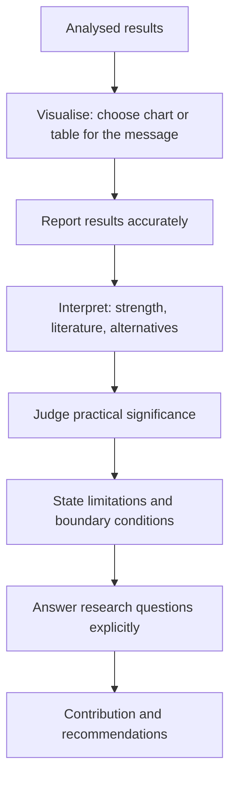

## Introduction

Analysis produces numbers, coefficients, codes and themes; it does not by itself produce understanding. Two further skills turn analysis into a contribution. The first is **visualisation**: presenting results in charts, tables and diagrams that let readers see patterns accurately and quickly. The second is **interpretation**: explaining what the results mean for the research questions, how they relate to existing literature and theory, how much confidence they deserve and what they imply for practice.

Examiners often find that MSc results chapters contain correct analyses but weak presentation and interpretation: three-dimensional pie charts, tables copied directly from software output, and discussion sections that repeat the results without explaining them. This lesson provides principles for honest, effective visualisation, a guide to choosing chart types, a framework for interpretation, and an international case showing how poor presentation of data contributed to a disaster.

## Learning Objectives

- Explain principles of effective and honest data visualisation, including data-ink, appropriate scales and accessibility.
- Select an appropriate chart or table for a given type of variable and analytic purpose.
- Identify and correct misleading visual practices such as truncated axes and three-dimensional effects.
- Apply a structured framework for interpreting findings in relation to research questions, literature, practical significance and limitations.
- Distinguish the purposes of results and discussion sections and present qualitative findings effectively.

## Prerequisite Knowledge

- Descriptive and inferential statistics, correlation and regression (earlier lessons in this module).
- Qualitative coding and thematic analysis (previous lesson).

## Key Terminology

- **Data visualisation**: The graphical representation of data to reveal patterns, comparisons, distributions and relationships.
- **Data-ink ratio**: Tufte's idea that the proportion of a graphic's ink devoted to showing data should be maximised, removing non-informative decoration.
- **Chartjunk**: Decorative elements, such as 3D effects, heavy gridlines and clip art, that do not convey data and can distort perception.
- **Truncated axis**: A value axis that does not start at zero, which can exaggerate differences in bar charts.
- **Joint display**: A table or figure in mixed-methods research that brings quantitative and qualitative results together to show integration.
- **Practical significance**: The real-world importance of a finding, judged by effect size, costs, benefits and context, as distinct from statistical significance.
- **Interpretation**: The process of explaining what findings mean in relation to research questions, theory and prior studies.
- **Limitation**: A feature of the design, sample, measurement or analysis that constrains the confidence or scope of conclusions.

## Detailed Explanation

### Why visualisation matters

Well-designed graphics allow readers to compare values, see distributions and detect relationships far faster than they could by reading tables. Anscombe's quartet, discussed in the previous lesson, demonstrated that datasets with nearly identical summary statistics can show completely different patterns when plotted. Visualisation is therefore not decoration; it is part of analysis and part of honest communication.

### Principles of effective visualisation

Drawing on Tufte's *The Visual Display of Quantitative Information* and common practice in statistical communication:

1. **Start with the message.** Decide what comparison or pattern the reader should see, then choose the chart that shows it most directly.
2. **Maximise data-ink, minimise chartjunk.** Remove 3D effects, shadows, unnecessary gridlines and decorative images.
3. **Use honest scales.** Bar charts encode values by length, so their value axis should start at zero. Line charts showing change over time may use a non-zero baseline if clearly labelled.
4. **Label clearly.** Use informative titles, axis labels with units, data sources, sample sizes (n) and notes on missing data.
5. **Order meaningfully.** Sort categories by value or by a logical order (such as Likert response order) rather than alphabetically.
6. **Use colour with purpose.** Highlight the key comparison; ensure the chart remains readable in greyscale and for readers with colour vision deficiencies.
7. **Show uncertainty where relevant.** Error bars or confidence intervals help readers judge whether differences are meaningful.
8. **Prefer simple charts.** Pie charts make precise comparisons difficult, especially with many slices; bar charts are usually clearer.

### Choosing a chart

| Purpose | Data type | Recommended chart | Avoid |
|---|---|---|---|
| Compare categories | Nominal or ordinal counts or percentages | Bar chart (horizontal for long labels) | 3D bars, pie charts with many slices |
| Show composition of Likert responses | Ordinal items | Stacked (diverging) bar chart | Separate pie chart per item |
| Show a distribution | Interval or ratio | Histogram, box plot | Bar chart of every individual value |
| Compare distributions across groups | Interval outcome by group | Side-by-side box plots | Means alone without spread |
| Show change over time | Time series | Line chart | Bar charts with many time points |
| Show a relationship | Two interval variables | Scatter plot with optional fitted line | Line chart joining unordered points |
| Show estimates with uncertainty | Means or coefficients | Dot plot with error bars | Bars without intervals |
| Present precise values | Any | Well-formatted table | Raw software output pasted in |

### Tables

Tables suit precise values and multiple statistics. Good tables are numbered and titled, follow a consistent format such as APA 7, report appropriate decimal places (usually two for most statistics), align numbers by decimal point, and include notes explaining abbreviations and significance markers. Software output should always be reformatted: examiners want the statistics that answer the question, not every line SPSS produces.

### Presenting qualitative findings

Qualitative findings are usually presented as themes with analytic narrative and selected extracts. Useful visual aids include **thematic maps** showing how themes and sub-themes relate, **matrices** comparing themes across cases or participant groups, and **joint displays** in mixed-methods studies that place survey results beside interview themes. Extracts should be short, attributed with anonymised identifiers (for example, "Owner 7, retail, Kumasi") and accompanied by interpretation explaining why each extract illustrates the theme.

### Interpreting findings

Interpretation answers the question "So what?" A structured approach for each key finding:

1. **Restate the finding** briefly and accurately in relation to the research question or hypothesis.
2. **Assess its strength**: effect size, confidence interval, consistency across analyses or cases.
3. **Relate it to literature**: does it confirm, extend or contradict previous studies and theory? Offer plausible explanations for differences, such as context, sample or measurement.
4. **Consider alternative explanations**: confounders, reverse causality, sampling bias, social desirability.
5. **Judge practical significance**: what does the finding mean for managers, policy-makers or system designers?
6. **State limitations and boundary conditions**: to whom and where does the finding apply?

### Results versus discussion

The **results** section reports what was found, clearly and without extended interpretation. The **discussion** section interprets the results, links them to literature and theory, considers implications and limitations, and answers the research questions explicitly. Mixing them in unplanned ways, or simply repeating results in the discussion, weakens the dissertation. Some qualitative traditions integrate findings and discussion, which is acceptable if done deliberately and signposted.

## Theories, Frameworks and Models

### From analysis to contribution

Interpretation is where a study's contribution is made explicit. A useful framing distinguishes **theoretical contribution** (how findings confirm, refine or challenge a theory such as UTAUT), **methodological contribution** (for example, a validated local-language instrument), **contextual contribution** (evidence from an under-studied setting, such as informal Ghanaian markets) and **practical contribution** (recommendations for managers or policy-makers). Recommendations must follow from findings; a recommendation unsupported by the data, however sensible, undermines credibility.

## Diagram



## Worked Example

### Part A: Correcting a misleading chart

**Illustrative scenario.** A student's survey finds that 62% of retailers in Market A and 68% in Market B accept mobile money merchant payments. Her bar chart's vertical axis runs from 60% to 70%.

**Step 1: Measure the distortion.** On the truncated axis, Market A's bar shows `62 − 60 = 2` units of height and Market B's shows `68 − 60 = 8` units.

```
Visual ratio = 8 / 2 = 4
Actual ratio = 68 / 62 = 1.10
```

The chart makes Market B appear four times higher, when acceptance is actually about 10% higher in relative terms (6 percentage points).

**Step 2: Correct the chart.** Start the axis at 0%, label it "Percentage of retailers accepting merchant payments", add sample sizes (for example, n = 150 and n = 140), and consider adding 95% confidence interval error bars.

**Step 3: Check uncertainty.** With n ≈ 150 per market, the margin of error for each percentage is roughly `1.96 × √(0.65 × 0.35 / 150) ≈ 1.96 × 0.039 ≈ ±7.6` points. The intervals overlap substantially, so the student should not claim a meaningful difference without a formal test.

### Part B: Interpreting a finding

**Illustrative scenario.** A regression study of 180 SMEs (see the previous lesson) finds that perceived usefulness is a significant predictor of reported operational efficiency (B = 0.42, β = 0.39, p < .001), while firm age is not.

**Interpretation following the framework:**

1. **Restate:** Perceived usefulness of AI tools was the strongest predictor of reported efficiency.
2. **Strength:** β = 0.39 indicates a moderate standardised association; the model explains 31% of variance, leaving much unexplained.
3. **Literature:** This is consistent with TAM and UTAUT, which identify perceived usefulness or performance expectancy as central to technology acceptance; the study extends that logic from intention to perceived outcomes in Ghanaian SMEs.
4. **Alternatives:** Owners who already run efficient businesses may perceive AI as more useful (reverse causality); both measures are self-reported by the same person, so common method bias is possible.
5. **Practical significance:** Vendors and SME support programmes might emphasise demonstrable usefulness, for example case demonstrations with local firms.
6. **Limitations:** Cross-sectional, self-reported data from association members in Greater Accra; findings may not transfer to informal or rural firms.

**Expected output:** a corrected chart specification with the computed distortion ratio, and a six-part interpretation paragraph using calibrated language.

## Ghanaian Business Application

Clear visualisation and careful interpretation matter for Ghanaian audiences beyond examiners.

- **Presenting to SME owners and associations.** A short report on AI adoption for a business association should use simple, well-labelled bar charts and plain-language interpretation, avoiding statistical jargon while remaining accurate about uncertainty.
- **Hospital management.** For a board considering scaling an EHR system, a line chart of monthly record-retrieval times before and after implementation, with the implementation date marked, conveys change more clearly than a table of averages. Interpretation must note concurrent changes (new staff, renovations) as alternative explanations.
- **Fintech and digital payments.** Diverging stacked bar charts of Likert responses about trust, transaction costs and network reliability help managers see where concerns concentrate. Interpreting them requires recognising that agreement percentages from a convenience sample cannot be presented as national figures.
- **University cybersecurity.** A joint display combining survey awareness scores by faculty with focus group themes ("sharing as friendship") can help IT units design targeted campaigns.
- **Policy audiences.** When findings are shared with regulators or public bodies, over-claiming is especially risky. Statements should be calibrated, limitations explicit and data sources clear.

Ghanaian researchers should also consider accessibility: charts reproduced on mobile phones or in black-and-white photocopies must remain readable, which favours simple designs, direct labels and patterns rather than colour alone.

## International Case Study

### The Space Shuttle *Challenger* and the O-ring data

On 28 January 1986, the Space Shuttle *Challenger* broke apart shortly after launch, killing all seven crew members. The Presidential Commission that investigated the accident (often called the Rogers Commission) concluded that the failure of an O-ring seal in a solid rocket booster joint, made worse by the unusually cold temperature at launch, caused the disaster.

On the evening before the launch, engineers from the booster manufacturer, Morton Thiokol, raised concerns about launching in cold weather and presented charts of past O-ring damage to NASA managers. The launch nevertheless proceeded. Edward Tufte later analysed the charts in his book *Visual Explanations*, arguing that the way the evidence was displayed obscured the relationship between temperature and O-ring damage. In his view, the charts did not plot damage against temperature for all previous flights, including those with no damage; a simple scatter plot of that kind, he argued, would have shown clearly that damage became more likely at lower temperatures and that the planned launch temperature lay far below previous experience. Tufte's interpretation has itself been debated by others who emphasise organisational and decision-making factors, and the Commission's report and later analyses, including sociologist Diane Vaughan's study of NASA's culture, highlight such factors.

The case offers lessons that apply directly to business and technology research. Selecting only some cases (flights with damage) can hide a relationship, just as analysing only adopters can hide what distinguishes adopters from non-adopters. The choice of chart shapes what decision-makers see. And interpretation must consider the range of the data: extrapolating far beyond observed conditions, as the cold launch did, carries high risk.

## Common Misconceptions

- **Misconception:** More colourful and three-dimensional charts are more professional. **Correction:** Decoration usually reduces clarity and can distort perception; simple, well-labelled charts communicate better.
- **Misconception:** Bar chart axes can start wherever makes differences visible. **Correction:** Bar lengths encode values, so truncated axes exaggerate differences; start bar charts at zero.
- **Misconception:** The discussion section should summarise the results again. **Correction:** The discussion interprets results, relates them to literature and theory, considers alternatives and states implications and limitations.
- **Misconception:** A statistically significant finding automatically justifies strong recommendations. **Correction:** Recommendations should consider effect size, design limitations and context.
- **Misconception:** Qualitative findings cannot be visualised. **Correction:** Thematic maps, matrices and joint displays effectively present qualitative and mixed-methods findings.

## Common Examination Mistakes

- Pasting unformatted software output into answers or dissertations instead of concise, titled tables.
- Choosing pie charts for comparisons across many categories or for Likert data.
- Interpreting findings without reference to the research questions or the literature reviewed.
- Ignoring alternative explanations and limitations when discussing results.
- Making recommendations that do not follow from the study's findings.

## Critical Thinking Questions

1. Is a truncated axis ever acceptable? Consider line charts of exchange rates or monthly transaction volumes, and explain your reasoning.
2. Tufte's analysis of the *Challenger* charts has been debated. To what extent can poor visualisation be blamed for a decision that also involved organisational pressures?
3. How would you present a finding that contradicts a well-established theory such as UTAUT, without either dismissing your data or over-claiming?
4. When presenting results to SME owners with limited statistical training, how do you balance simplicity with honesty about uncertainty?

## Practical Exercises

1. **Choose the chart.** For each result, recommend a chart type and justify it: (a) distribution of monthly online sales for 120 SMEs; (b) responses to five Likert items on trust in digital payments; (c) relationship between training hours and security incident counts; (d) monthly EHR log-ins over two years. *Expected output:* (a) histogram or box plot, (b) diverging stacked bar chart, (c) scatter plot, (d) line chart, each with a one-sentence justification.
2. **Fix a table.** Take a regression output from any statistics package (or the illustrative output in the previous lesson) and reformat it as an APA-style table. *Expected output:* a numbered, titled table with predictors, B, SE, β, t and p, two decimal places, and a note defining abbreviations and reporting R² and F.
3. **Interpret a finding.** A survey of 300 students finds that those who attended cybersecurity orientation scored 0.3 points higher on a five-point awareness scale (d = 0.35, p = .004). Write a 150-word interpretation using the six-step framework. *Expected output:* a paragraph that restates the finding, notes a small-to-medium effect, relates it to literature on awareness training, raises self-selection as an alternative explanation, discusses practical value and states limitations.

## Key Takeaways

- Visualisation is part of analysis and honest communication; choose the chart that shows the intended message most directly.
- Maximise data-ink, avoid chartjunk, start bar charts at zero, label fully and show uncertainty.
- Tables should be concise, formatted and focused on the statistics that answer the research question.
- Interpretation restates, weighs, connects to literature, considers alternatives, judges practical significance and states limitations.
- Results report; discussion interprets and makes the study's contribution explicit.

## Further Reading

- Tufte, E. R. (2001). *The visual display of quantitative information* (2nd ed.). Graphics Press.
- Tufte, E. R. (1997). *Visual explanations: Images and quantities, evidence and narrative*. Graphics Press.
- Vaughan, D. (1996). *The Challenger launch decision: Risky technology, culture, and deviance at NASA*. University of Chicago Press.
- American Psychological Association. (2020). *Publication manual of the American Psychological Association* (7th ed.). American Psychological Association.
- Field, A. (2018). *Discovering statistics using IBM SPSS statistics* (5th ed.). SAGE.

## Video Resources

- [Khan Academy: Statistics and Probability](https://www.khanacademy.org/math/statistics-probability): Khan Academy. Free official course with units on displaying and comparing quantitative and categorical data.
- [APA Style](https://apastyle.apa.org/): American Psychological Association. Official APA Style site with guidance on formatting tables and figures in APA 7.

## Revision Summary

Effective visualisation presents results honestly and clearly by matching chart types to data and messages, removing decoration, using zero baselines for bars, labelling fully and showing uncertainty. Interpretation then explains what findings mean for the research questions, how they relate to literature and theory, what alternative explanations exist, how practically important they are and what limits apply.

- Bars start at zero; truncated axes exaggerate (visual ratio vs actual ratio).
- Histogram/box plot for distributions; scatter for relationships; line for time; diverging bars for Likert.
- Format tables; never paste raw output.
- Interpretation: restate → strength → literature → alternatives → practical significance → limitations.
- Results report; discussion interprets.
