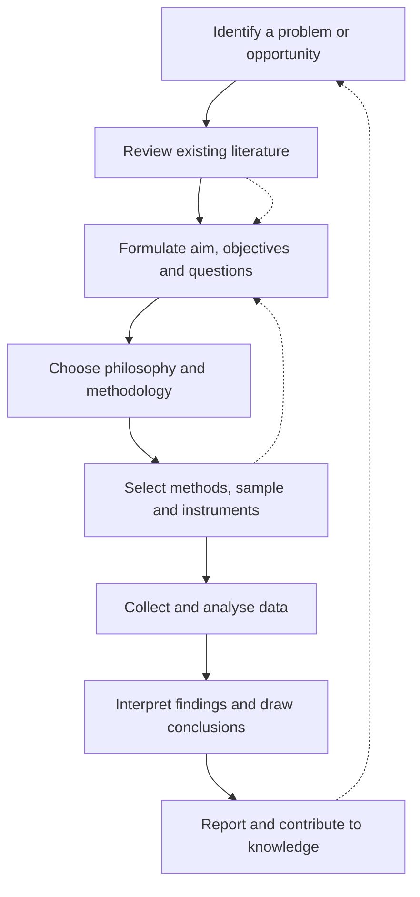

## Introduction

Almost every MSc IT for Business student eventually has to produce a dissertation or project report that is judged as *research*. Yet many students begin with an everyday understanding of the word: "looking things up", collecting opinions, or writing a long report about a technology. Postgraduate research is something more demanding. It is a systematic, transparent and defensible process of creating knowledge that others can scrutinise, challenge and build upon.

This lesson establishes the vocabulary and standards used throughout the course. You will learn what makes an enquiry count as research, the different purposes research can serve in business and information technology, the characteristics examiners look for, and the frequently confused distinction between research *methodology* and research *methods*. Getting these foundations right early prevents the most common weakness in student proposals: a study that collects data without a clear, justified logic connecting the question to the evidence.

## Learning Objectives

- Define research and distinguish it from journalism, consultancy reports and casual information gathering.
- Explain the main purposes of research, including exploration, description, explanation, prediction and evaluation.
- Apply the characteristics of good research to judge whether a proposed study is researchable and rigorous.
- Distinguish research methodology from research methods and use both terms correctly in writing.
- Evaluate the difference between basic and applied research in an IT-for-business context.

## Prerequisite Knowledge

- None beyond an undergraduate degree and general familiarity with business and information technology.
- Helpful but not essential: experience of writing an undergraduate project or long essay.

## Key Terminology

- **Research**: A systematic, transparent and ethical process of enquiry that collects and analyses evidence to answer a clearly defined question and contribute to knowledge.
- **Research methodology**: The overall strategy, philosophy and justification that explains why a study is designed the way it is and why particular methods are appropriate.
- **Research methods**: The specific techniques and tools used to collect and analyse data, such as questionnaires, interviews, regression or thematic analysis.
- **Basic research**: Enquiry aimed mainly at extending theoretical understanding, without an immediate practical application.
- **Applied research**: Enquiry aimed at solving a practical problem for an organisation, sector or policy-maker.
- **Empirical evidence**: Information obtained through observation or experience, such as survey responses, transaction logs or interview transcripts.
- **Replicability**: The extent to which another researcher, following the same procedures, could repeat a study and obtain comparable results.
- **Contribution to knowledge**: What a study adds to existing understanding, theory, method or practice.

## Detailed Explanation

### What counts as research?

Research can be defined as a *systematic* process of enquiry that collects and interprets evidence to answer a specified question, carried out so that the process and its conclusions can be examined by others. Three words in that definition carry most of the weight. **Systematic** means the study follows a planned sequence: a problem is identified, existing knowledge is reviewed, a design is chosen, data are gathered and analysed, and conclusions are drawn in relation to the original question. **Evidence** means conclusions rest on data rather than opinion or authority. **Examinable** means the researcher reports enough detail about procedures, sampling and analysis that a reader can judge whether the conclusions are warranted.

This distinguishes research from activities that superficially resemble it. A newspaper feature on mobile money may interview traders and quote statistics, but it is rarely explicit about how interviewees were selected or how competing interpretations were ruled out. A consultancy report may be thorough, yet it is often confidential and driven by a client's preferred answer. A student "report on cloud computing" that summarises vendor websites is description, not research, because it does not pose a question that requires new evidence or analysis.

### The purposes of research

Research is undertaken for several overlapping purposes, and a clear statement of purpose shapes every later decision.

1. **Exploration** – investigating a poorly understood phenomenon to generate insights and ideas, for example how small Ghanaian fashion businesses first experiment with Instagram selling.
2. **Description** – producing an accurate profile of people, events or situations, for example the proportion of pharmacies in a district that use electronic inventory systems.
3. **Explanation** – establishing relationships between variables and explaining why something happens, for example whether perceived usefulness explains the intention of retailers to accept mobile money payments.
4. **Prediction** – using established relationships to forecast outcomes, such as which customer characteristics predict adoption of a banking app.
5. **Evaluation** – judging the effectiveness of an intervention, system or policy, such as whether a new hospital records system reduced patient waiting times.

Purposes are linked to research questions. "What" and "how" questions often signal exploration or description; "why" and "to what extent" questions often signal explanation or evaluation.

### Basic and applied research

A useful distinction is between **basic** research, which aims primarily to extend theory, and **applied** research, which aims to solve a practical problem. In reality, most management and information systems research sits on a continuum. An MSc dissertation examining artificial intelligence adoption among Ghanaian SMEs is applied because it addresses a practical business concern, but it should still engage with theory so that its findings are meaningful beyond one firm.

### Methodology versus methods

The most frequent terminological error in postgraduate writing is to use "methodology" as a grand synonym for "methods". **Methods** are the techniques: a structured questionnaire, a semi-structured interview guide, a sampling technique, descriptive statistics, thematic coding. **Methodology** is the reasoned argument that links your philosophical assumptions, research purpose and questions to your choice of design and methods. A methodology chapter does not merely state "a questionnaire was used"; it explains *why* a survey strategy suits an explanatory question, *why* a particular population and sampling approach were chosen, and *how* the analysis will answer each objective. In short, methods are *what* you do; methodology is *why* doing it that way produces credible knowledge.

## Theories, Frameworks and Models

### The characteristics of good research

Textbooks such as Saunders, Lewis and Thornhill's *Research Methods for Business Students* and Bell, Bryman and Harley's *Business Research Methods* describe broadly similar characteristics of good research. A practical synthesis is shown below.

| Characteristic | What it means | Question to ask of your own study |
|---|---|---|
| Clearly defined purpose | The problem and question are explicit and focused | Can I state my research question in one sentence? |
| Systematic procedure | Steps are planned and logically ordered | Does each stage follow from the previous one? |
| Empirical grounding | Conclusions rest on evidence | What data will support each claim? |
| Rigour | Appropriate, carefully executed methods | Would an expert accept my design for this question? |
| Transparency and replicability | Procedures are reported in enough detail to be checked or repeated | Could another researcher follow my steps? |
| Critical and self-aware | Limitations and alternative explanations are acknowledged | What could make my conclusions wrong? |
| Ethical conduct | Participants and data are protected | Have I obtained consent and safeguarded data? |
| Contribution | The study adds something to knowledge or practice | Who will know or do something differently because of this? |

### The research process as a cycle

Research is often presented as a linear sequence, but in practice it is iterative. Reading literature may reshape the question; a pilot study may force changes to the instrument. The diagram below captures this cycle.

## Diagram

The dotted arrows show feedback loops: conclusions raise new problems, and literature and design decisions frequently cause a researcher to refine the question.

## Worked Example

**Illustrative scenario.** Ama, an MSc student, proposes: "A study of mobile money in Ghana." Apply the characteristics of good research to improve it.

1. **Purpose.** The topic has no question. Ama narrows it: *To what extent do perceived usefulness, transaction costs and trust influence the intention of market retailers in Kumasi to accept mobile money merchant payments?* The purpose is now explanatory.
2. **Systematic procedure.** She plans to review adoption literature, develop hypotheses, design a questionnaire, pilot it and analyse responses.
3. **Empirical grounding.** Each construct (usefulness, cost, trust, intention) will be measured with questionnaire items adapted from published studies.
4. **Methodology versus methods.** Her methodology argues that a survey strategy fits a question about relationships among measurable constructs across many retailers; her methods are a structured questionnaire, a defined sampling approach and statistical analysis.
5. **Contribution.** She identifies that much adoption research focuses on consumers rather than merchants in informal markets, so her study offers a merchant perspective.

The expected improvement is visible: an open topic has become a focused, researchable, justifiable study.

## Ghanaian Business Application

Ghana's business environment offers abundant research opportunities, and the purpose of a study should match the decision it informs. A rural bank considering whether to invest in agency banking might commission *descriptive* research to map current customer use of mobile money and bank branches. A fintech start-up wanting to know *why* some traders abandon its point-of-sale app after a few weeks needs *explanatory* or *exploratory* research. A district health directorate introducing an electronic health records system may require *evaluation* research to judge whether the system improves record retrieval.

The characteristics of good research matter particularly in such settings because results inform investment and policy. A study of cybersecurity awareness among university students that recruits only friends of the researcher on one hall of residence lacks rigour and transparency, even if it produces neat charts. Similarly, research touching personal data must respect Ghana's Data Protection Act, 2012 (Act 843), which illustrates that ethical conduct is not optional but a defining feature of legitimate research. Students should therefore view these characteristics as a checklist to apply to their own proposals, not as abstract textbook content.

## International Case Study

### The reproducibility project in psychology

In 2015 the Open Science Collaboration published, in the journal *Science*, the results of a large coordinated effort to repeat a sample of previously published psychology studies. Many replications produced weaker effects than the originals, and a substantial share did not reproduce the original statistically significant result. The project became a landmark in what is now called the "replication crisis".

The case is directly relevant to business and IT research for three reasons. First, it shows that **replicability** and **transparency** are not bureaucratic niceties: when procedures, data and analysis decisions are poorly reported, errors and chance findings are hard to detect. Second, it demonstrates that publication alone does not guarantee that a finding is robust, which is why literature reviews must evaluate evidence critically (see Module 3). Third, it encouraged reforms such as pre-registering hypotheses and sharing data and materials, practices that information systems and management researchers increasingly adopt. For an MSc student, the lesson is to document your sampling, instruments and analytical choices clearly enough that someone else could repeat your study.

## Common Misconceptions

- **Misconception:** Research means collecting new primary data. **Correction:** Research may analyse secondary data, documents or existing datasets; what matters is systematic analysis directed at a clear question.
- **Misconception:** Methodology is just a more academic word for methods. **Correction:** Methodology is the justified strategy and philosophy behind design choices; methods are the specific techniques.
- **Misconception:** Applied research does not need theory. **Correction:** Theory makes applied findings interpretable and transferable beyond the immediate case.
- **Misconception:** A large sample automatically makes research good. **Correction:** Rigour depends on the fit between question, design and method; a large but biased sample still produces misleading conclusions.
- **Misconception:** Research must prove something conclusively. **Correction:** Research provides evidence that supports or challenges claims, always within stated limitations.

## Common Examination Mistakes

- Defining research vaguely ("finding out about something") without mentioning systematic procedure, evidence or contribution.
- Listing characteristics of research without explaining or illustrating them with an example.
- Writing a "methodology" answer that lists methods but never justifies them.
- Confusing research purposes, for example describing a "why" question as descriptive research.
- Ignoring ethics when asked to evaluate whether a proposed study is good research.

## Critical Thinking Questions

1. Is a well-designed internal business analytics project at a Ghanaian bank "research"? Under what conditions would it meet the characteristics discussed in this lesson?
2. Can a study be rigorous but make no meaningful contribution? Give an example and explain the implications for topic selection.
3. Why might replicability be harder to achieve in qualitative studies of organisational technology use, and what could researchers do instead to demonstrate quality?
4. Should applied MSc research prioritise usefulness to a client organisation or contribution to academic theory? Justify your position.

## Practical Exercises

1. **Classify purposes.** Write one research question for each of the five purposes (exploration, description, explanation, prediction, evaluation) using the topic of e-commerce adoption among small businesses in Accra. *Expected output:* five questions, each labelled with its purpose and a one-sentence justification of the label.
2. **Audit a topic.** Take the topic "AI in Ghanaian SMEs" and rewrite it as a researchable question. Then complete the characteristics table in this lesson for your question. *Expected output:* a focused question and an eight-row table showing how your study would satisfy each characteristic.
3. **Methodology versus methods.** Write two short paragraphs about a study of cybersecurity awareness among students: one stating only the methods, and one presenting a methodological justification. *Expected output:* a methods paragraph (what) and a methodology paragraph (why), clearly different in purpose.

## Key Takeaways

- Research is systematic, evidence-based, transparent, ethical and aimed at contributing to knowledge.
- Purposes include exploration, description, explanation, prediction and evaluation, and they shape the research question.
- Basic and applied research form a continuum; applied MSc research still needs theory.
- Methods are techniques; methodology is the reasoned justification for the whole design.
- Transparency and replicability allow others to check and build on your work.

## Further Reading

- Saunders, M., Lewis, P., & Thornhill, A. (2019). *Research methods for business students* (8th ed.). Pearson.
- Bell, E., Bryman, A., & Harley, B. (2019). *Business research methods* (5th ed.). Oxford University Press.
- Creswell, J. W., & Creswell, J. D. (2018). *Research design: Qualitative, quantitative, and mixed methods approaches* (5th ed.). SAGE.
- Open Science Collaboration. (2015). Estimating the reproducibility of psychological science. *Science, 349*(6251), aac4716. <https://doi.org/10.1126/science.aac4716>

## Video Resources

- [SAGE Research Methods](https://methods.sagepub.com/) — SAGE Publishing. Official research methods platform (access may depend on institutional subscription) with explanatory material on the research process.
- [MIT OpenCourseWare](https://ocw.mit.edu/) — Massachusetts Institute of Technology. Official open learning portal; search for research methods and research design course materials.

## Revision Summary

Research is a systematic, evidence-based and transparent process of enquiry that answers a defined question and contributes to knowledge; it differs from journalism and casual information gathering through planned procedures, empirical grounding and openness to scrutiny. Its purposes are exploration, description, explanation, prediction and evaluation.

- Good research is purposeful, systematic, empirical, rigorous, transparent, critical, ethical and contributory.
- Basic research extends theory; applied research solves practical problems; most MSc work blends both.
- Methods = techniques; methodology = justification for design and method choices.
- Research is iterative: literature and pilots often refine the question.
- Replicability and transparency protect against unreliable findings.
