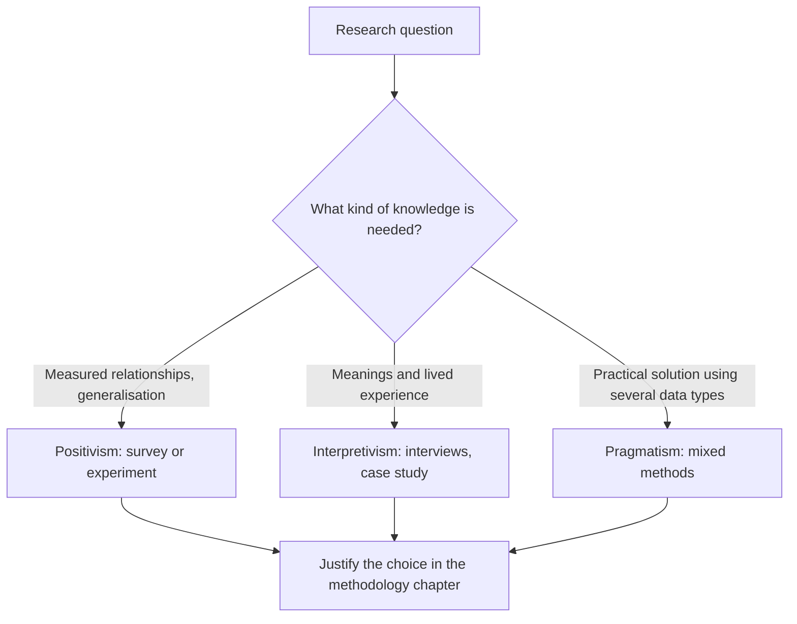

## Introduction

Two researchers can study the same phenomenon, such as why Ghanaian retailers do or do not accept digital payments, and design completely different studies. One distributes a structured questionnaire to several hundred retailers and tests hypotheses statistically. The other spends weeks in a market, conducting long conversations with a dozen traders about trust, family obligations and their experiences of failed transactions. Neither is "wrong". They are working within different **research paradigms**: shared sets of beliefs about what reality is, how it can be known and how research should be conducted.

Examiners frequently ask postgraduate students to identify, compare and justify paradigms, and supervisors expect a methodology chapter to state its philosophical position explicitly. This lesson introduces the paradigm concept and examines the three positions most commonly used in business and information systems research: positivism, interpretivism and pragmatism. It also briefly notes critical realism, which many management researchers adopt. The aim is not to memorise labels, but to understand how each position shapes questions, designs and claims.

## Learning Objectives

- Explain the concept of a research paradigm and why it matters for research design.
- Compare positivism, interpretivism and pragmatism in terms of their assumptions, typical methods and the kinds of claims they support.
- Apply paradigm reasoning to select an appropriate stance for a Ghanaian IT-for-business research problem.
- Evaluate the strengths and limitations of each paradigm for studying technology adoption.
- Justify a paradigm choice in the language expected in a postgraduate methodology chapter.

## Prerequisite Knowledge

- The meaning of research and the distinction between methodology and methods (previous lesson).
- Basic awareness of quantitative and qualitative data.

## Key Terminology

- **Paradigm**: A shared framework of philosophical assumptions, values and accepted practices that guides how a research community defines problems and produces knowledge.
- **Positivism**: A paradigm holding that an objective social reality exists and can be studied through observable, measurable evidence, typically to identify regularities and test hypotheses.
- **Interpretivism**: A paradigm holding that social reality is constructed through human meanings and interactions, so research must understand how people interpret their world.
- **Pragmatism**: A paradigm that judges knowledge by its practical consequences and selects whatever methods best answer the research question.
- **Critical realism**: A position accepting that reality exists independently of our knowledge but that our access to it is fallible and mediated, so research seeks underlying mechanisms.
- **Hypothetico-deductive method**: Deriving testable hypotheses from theory and testing them against data.
- **Verstehen**: A term associated with Max Weber meaning empathetic understanding of social action from the actor's point of view.

## Detailed Explanation

### Where the paradigm idea comes from

The term "paradigm" was popularised by Thomas Kuhn in *The Structure of Scientific Revolutions* (1962), where he described how scientific communities work within shared frameworks until accumulated anomalies prompt a shift to a new framework. Social science borrowed the term to describe competing philosophical traditions. Guba and Lincoln's influential chapter on competing paradigms in qualitative research framed paradigms in terms of three questions: what is the nature of reality (**ontology**), what is the relationship between the knower and what can be known (**epistemology**), and how should the enquirer go about finding things out (**methodology**). The next lesson examines ontology and epistemology in depth; here we focus on how the paradigms differ in practice.

### Positivism

Positivism has its roots in the natural sciences and in the work of thinkers such as Auguste Comte. Positivist researchers assume that the social world has an objective existence and contains regularities that can be observed and measured. The researcher aims to be independent and value-neutral, to operationalise concepts as variables, to derive hypotheses from existing theory and to test them using structured data, frequently from large samples. Findings are expressed as relationships that may be generalised to a wider population.

Much information systems research has been positivist. Studies using the Technology Acceptance Model (Davis, 1989), for example, typically measure perceived usefulness and perceived ease of use with questionnaire scales and test their statistical relationship with intention to use a system. A refinement worth knowing is **post-positivism**, influenced by Karl Popper's argument that scientific claims can never be conclusively proven, only tested and potentially falsified. Most contemporary "positivist" business research is in fact post-positivist: it accepts that measurement is imperfect and conclusions are probabilistic.

**Strengths:** precision, comparability, generalisability from representative samples and the ability to test theory. **Limitations:** it may strip away context and meaning, assumes concepts can be measured adequately, and can miss *why* people behave as they do.

### Interpretivism

Interpretivism emerged partly as a critique of applying natural science methods to people. Humans, unlike molecules, attach meanings to their actions, and those meanings shape behaviour. The interpretivist researcher seeks to understand phenomena from the perspective of participants, recognising that the researcher is part of the process of interpretation rather than a detached observer. Typical methods include in-depth interviews, observation and case studies, with data analysed through techniques such as thematic analysis (Braun & Clarke, 2006). Interpretive case studies have a well-established place in information systems research; Walsham (1995) set out their nature and method.

**Strengths:** rich, contextual understanding, sensitivity to meaning, culture and power, and the capacity to generate new theory. **Limitations:** findings are not statistically generalisable, and the researcher's influence must be managed reflexively. Quality is judged through criteria such as credibility and transferability rather than statistical reliability.

### Pragmatism

Pragmatism, associated with philosophers such as Charles Sanders Peirce, William James and John Dewey, sidesteps the long-running dispute between positivism and interpretivism. For a pragmatist, the value of knowledge lies in its practical consequences: does it help us solve the problem? Pragmatism therefore makes the **research question** central and treats methods as tools. Morgan (2007) argued that pragmatism offers a productive basis for mixed-methods research because it allows researchers to combine quantitative and qualitative approaches where each answers different parts of a problem.

**Strengths:** flexibility, a problem-solving orientation that suits applied business research, and a natural fit with mixed methods. **Limitations:** students sometimes use it as an excuse to avoid philosophical reasoning ("I am pragmatic, so anything goes"), and integrating different kinds of data requires real skill.

### Critical realism in brief

Critical realism, associated with Roy Bhaskar, holds that reality exists independently of our perceptions but that what we observe is only part of it; deeper structures and mechanisms generate observable events. Critical realists often use mixed methods to identify the mechanisms that explain outcomes in particular contexts. It is increasingly used in information systems research and is worth considering if you want to explain *how* and *why* technologies produce different outcomes in different organisations.

## Theories, Frameworks and Models

The comparison table below summarises the three main paradigms. Use it as a starting point, not a rigid formula; real studies sometimes blend features.

| Dimension | Positivism | Interpretivism | Pragmatism |
|---|---|---|---|
| View of reality | Objective, external, measurable | Socially constructed, multiple | Reality matters in terms of practical consequences |
| Role of researcher | Detached, value-neutral | Involved, reflexive | Problem-solver, value-aware |
| Typical reasoning | Deductive | Inductive | Abductive, combining both |
| Typical data | Numerical, structured | Textual, visual, rich | Both, chosen by question |
| Typical strategies | Surveys, experiments | Case studies, ethnography, interviews | Mixed methods, action research |
| Quality criteria | Validity, reliability, generalisability | Credibility, transferability, dependability | Usefulness, integration, warranted claims |
| Typical question | "To what extent does X influence Y?" | "How do participants experience X?" | "What works, and why, to solve problem P?" |

## Diagram

## Step-by-Step Guide

Use these steps to choose and justify a paradigm.

1. **Write down your research question exactly.** The wording of the question often reveals the type of knowledge required.
2. **Identify the claims you want to make.** Do you want to claim that a relationship holds across a population (positivist), to explain how people make sense of an experience (interpretivist), or to recommend a workable solution supported by several kinds of evidence (pragmatist)?
3. **Check your assumptions about the phenomenon.** Can the key concepts be measured reasonably well, or are they bound up with meaning and context?
4. **Consider the practical constraints.** Access to a sampling frame, time and skills all matter, but they should not be the only justification.
5. **Write the justification.** Name the paradigm, explain its core assumptions, link those assumptions to your question and acknowledge the trade-offs.

## Ghanaian Business Application

Consider three studies of digital payment adoption among Ghanaian retailers.

- **Positivist study (illustrative scenario).** A researcher asks: *To what extent do perceived usefulness, perceived risk and transaction charges predict retailers' intention to accept mobile money payments in Accra?* Constructs are measured with Likert-scale items and relationships are tested statistically. The paradigm fits because the question concerns measurable relationships across many retailers.
- **Interpretivist study (illustrative scenario).** Another researcher asks: *How do market traders in Makola experience and make sense of accepting digital payments from customers?* Through in-depth interviews, the researcher discovers themes such as concerns about visibility of income to family members and to tax authorities, and the social meaning of cash in credit relationships. These insights could be missed by a pre-structured questionnaire.
- **Pragmatist study (illustrative scenario).** A fintech firm wants to know why merchants abandon its app and what to change. The researcher first interviews a small number of merchants to identify problems, then surveys a larger group to estimate how widespread each problem is, and finally recommends design changes.

The same topic, then, can be studied under each paradigm. The decisive factor is the research question and the kind of knowledge needed, which is exactly what examiners want students to articulate.

## International Case Study

### The Hawthorne studies

Between the mid-1920s and early 1930s, researchers studied workers at Western Electric's Hawthorne Works near Chicago. The early experiments were designed in a broadly positivist manner: they manipulated physical variables such as lighting levels and measured changes in output. The results did not fit simple expectations, as productivity sometimes rose regardless of the change made. Later phases, associated with Elton Mayo and colleagues, placed much more emphasis on interviewing and observing workers, and drew attention to social relationships, group norms and workers' attitudes.

The studies, and the long debate about how to interpret them, illustrate a central point of this lesson: measurement can reveal that something happens, but understanding why often requires attending to meanings and social context. The term "Hawthorne effect", referring to changes in behaviour because people know they are being studied, also reminds researchers of every paradigm that the act of research can influence what is observed. For an IT researcher, the lesson is clear: if staff know their use of a new system is being monitored, measured usage may not reflect normal behaviour.

## Common Misconceptions

- **Misconception:** Positivism means quantitative and interpretivism means qualitative. **Correction:** Paradigms are about philosophical assumptions; data type usually follows, but qualitative data can be analysed in positivist ways and numbers can be interpreted contextually.
- **Misconception:** Pragmatism means you do not need to discuss philosophy. **Correction:** A pragmatist must still justify why combining approaches answers the question and how findings will be integrated.
- **Misconception:** One paradigm is superior. **Correction:** Each supports different kinds of claims; the best choice is the one that fits the question.
- **Misconception:** Interpretivist research is just opinion. **Correction:** It uses systematic data collection and analysis and demonstrates trustworthiness through transparent, reflexive procedures.

## Common Examination Mistakes

- Defining paradigms with textbook phrases but never applying them to the scenario in the question.
- Stating "this study adopts positivism" without explaining why the question requires it.
- Treating pragmatism as a compromise chosen because the student could not decide.
- Confusing paradigms with research designs or methods, for example calling "survey" a paradigm.
- Ignoring the limitations of the chosen paradigm.

## Critical Thinking Questions

1. Could a study of cybersecurity awareness among university students be designed under all three paradigms? What would each study claim, and what would each miss?
2. Why might positivist research have been dominant in information systems journals, and what might be lost if interpretive research were neglected?
3. Is pragmatism a genuine philosophical position or a convenient justification for mixed methods? Defend your answer.
4. If your supervisor prefers a particular paradigm that you think fits your question poorly, how would you argue your case?

## Practical Exercises

1. **Paradigm rewrite.** Take the topic "e-commerce adoption among small businesses in Ghana" and write one research question suited to each paradigm. *Expected output:* three questions, each with a two-sentence justification referring to the paradigm's assumptions.
2. **Justification paragraph.** Write a 150-word paragraph justifying a paradigm for a study of AI adoption in Ghanaian SMEs. *Expected output:* a paragraph that names the paradigm, states its assumptions, links them to the question and acknowledges one limitation.
3. **Critique.** Read the methodology section of any published information systems article available to you and identify its implicit paradigm. *Expected output:* a short note quoting (in your own words) the features that reveal the paradigm and stating whether the authors make it explicit.

## Key Takeaways

- A paradigm is a set of assumptions about reality, knowledge and appropriate methods.
- Positivism seeks measurable regularities and tests theory; interpretivism seeks to understand meanings in context; pragmatism prioritises the question and practical consequences.
- Critical realism is a further option focusing on underlying mechanisms.
- Paradigm choice must be justified by the research question, not by method preference alone.
- Every paradigm has limitations that should be acknowledged.

## Further Reading

- Kuhn, T. S. (1962). *The structure of scientific revolutions*. University of Chicago Press.
- Guba, E. G., & Lincoln, Y. S. (1994). Competing paradigms in qualitative research. In N. K. Denzin & Y. S. Lincoln (Eds.), *Handbook of qualitative research* (pp. 105-117). SAGE.
- Morgan, D. L. (2007). Paradigms lost and pragmatism regained: Methodological implications of combining qualitative and quantitative methods. *Journal of Mixed Methods Research, 1*(1), 48-76. <https://doi.org/10.1177/2345678906292462>
- Walsham, G. (1995). Interpretive case studies in IS research: Nature and method. *European Journal of Information Systems, 4*(2), 74-81.
- Saunders, M., Lewis, P., & Thornhill, A. (2019). *Research methods for business students* (8th ed.). Pearson.

## Video Resources

- [SAGE Research Methods](https://methods.sagepub.com/): SAGE Publishing. Official research methods platform (institutional access may be required) with explanations of research philosophies.
- [Coursera](https://www.coursera.org/): Coursera. Official learning platform; search for university-run research methods courses covering research philosophy.

## Revision Summary

A paradigm is a framework of assumptions that guides how research problems are framed and studied. Positivism treats social reality as objective and measurable and tests hypotheses deductively; interpretivism treats reality as socially constructed and seeks participants' meanings inductively; pragmatism judges knowledge by its usefulness and selects methods to fit the question, often through mixed methods.

- Kuhn (1962) popularised "paradigm"; Guba and Lincoln framed paradigms via ontology, epistemology and methodology.
- Positivism: detached researcher, large samples, validity and reliability.
- Interpretivism: reflexive researcher, rich data, credibility and transferability.
- Pragmatism: problem-centred, mixed methods, must still be justified.
- Choose and defend the paradigm that fits the question; acknowledge its limits.
