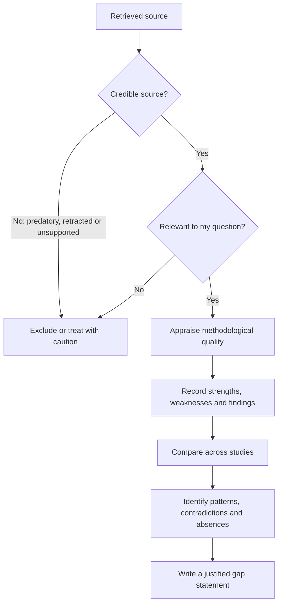

## Introduction

Finding literature is only the first step. A postgraduate researcher must decide which sources deserve trust, how much weight each should carry, and what the body of evidence collectively does and does not establish. Not every published article is equally credible: journals vary in rigour, some publishers operate without meaningful peer review, findings can be overturned, and even excellent studies have limitations that restrict what they show. A literature review that treats every source as equally authoritative is uncritical, and its conclusions are only as strong as its weakest evidence.

This lesson develops two linked skills. First, **evaluating sources**: judging the credibility, relevance and methodological quality of what you read. Second, **identifying research gaps**: using that critical evaluation to locate where knowledge is missing, inconsistent or weak, and arguing convincingly that your study addresses one of those gaps.

## Learning Objectives

- Explain why critical evaluation of sources is essential to a credible literature review.
- Apply source-evaluation criteria, including currency, relevance, authority, accuracy and purpose, to academic and grey literature.
- Evaluate the methodological quality of empirical studies using structured appraisal questions.
- Distinguish theoretical, empirical, methodological, contextual and practical research gaps.
- Construct a justified gap statement that links the literature to a proposed study.

## Prerequisite Knowledge

- Purposes of literature reviews and search strategies (previous lesson).
- Basic understanding of research designs and sampling.

## Key Terminology

- **Peer review**: Evaluation of a manuscript by independent experts before publication to assess its quality, originality and validity.
- **Predatory publishing**: Publishing practices that charge authors fees while providing little or no genuine peer review or editorial oversight.
- **Retraction**: The formal withdrawal of a published article, typically because of serious error, misconduct or unreliable findings.
- **Critical appraisal**: Systematic assessment of a study's trustworthiness, relevance and methodological quality.
- **Research gap**: An area where existing knowledge is missing, inconsistent, outdated or methodologically weak, providing a justification for new research.
- **Contextual gap**: A lack of evidence about whether findings hold in a particular population, sector, country or setting.
- **Methodological gap**: A weakness or lack of variety in how a topic has been studied, such as reliance on cross-sectional self-report surveys.
- **Theoretical gap**: An unexplained phenomenon, untested relationship or unchallenged assumption in existing theory.

## Detailed Explanation

### Why evaluation matters

Evidence differs in quality. A well-designed longitudinal study with validated measures and a clearly defined sample offers stronger evidence than a small convenience survey with untested items. A peer-reviewed article in an established journal generally deserves more confidence than an unreviewed blog post, but peer review is not infallible. Evaluating sources lets you weight evidence appropriately, explain inconsistencies between studies, and avoid building your argument on findings that are weak, biased or withdrawn.

### Evaluating the source

Several checklists help structure source evaluation. The **CRAAP test**, developed by librarians at California State University, Chico, asks about Currency, Relevance, Authority, Accuracy and Purpose. Adapted for postgraduate research:

- **Currency.** When was it published? In fast-moving areas such as AI or mobile payments, older studies may describe technologies that have changed substantially. Seminal works, however, remain essential regardless of age (Davis, 1989, is still cited for TAM).
- **Relevance.** Does it address your concepts, population or context? Is it the right level (scholarly rather than popular)?
- **Authority.** Who wrote it and where was it published? Is the journal established and genuinely peer-reviewed? Is the publisher reputable?
- **Accuracy.** Is the evidence presented, are claims supported with data and references, and are methods described clearly enough to judge them?
- **Purpose.** Was it written to inform, to sell or to persuade? Vendor white papers and sponsored reports may present selective evidence.

### Recognising questionable publishing

Students should be cautious of journals that promise very rapid acceptance, solicit papers through unsolicited emails, display unclear editorial boards or peer review processes, or publish articles with obvious errors. Checking whether a journal is listed in reputable indexes such as DOAJ (for open access journals), Scopus or Web of Science, and whether it is recognised in your field, is a sensible first step. Absence from an index is not automatic proof of poor quality, but it should prompt closer scrutiny.

### Appraising methodological quality

Beyond the source, appraise the study itself. Useful questions include:

1. Is the research question clear, and does the design suit it?
2. Is the sample appropriate in size and selection for the claims made?
3. Are the measures or interview guides valid and reliable, and are they reported?
4. Is the analysis appropriate and clearly reported?
5. Do the conclusions follow from the findings, or do the authors overclaim (for example, inferring causation from a cross-sectional survey)?
6. Are limitations acknowledged?
7. Are there potential conflicts of interest?

Recording these judgements in a structured way, for instance in a synthesis matrix column for "strengths and weaknesses", feeds directly into critical writing.

### From evaluation to gaps

Gaps emerge from critical evaluation of the literature as a whole. Common types include:

| Gap type | Description | Illustrative example |
|---|---|---|
| Theoretical | A relationship is untested, a theory fails to explain observations, or an assumption is unexamined | Adoption models assume individual decision-making, but SME technology decisions may be collective |
| Empirical or evidence | Little or contradictory evidence exists | Studies disagree on whether perceived risk deters mobile payment use |
| Methodological | The topic has been studied with limited methods | Most studies of cybersecurity awareness use self-report rather than observed behaviour |
| Contextual or population | Findings have not been tested in a particular setting | Few studies examine AI adoption among Ghanaian SMEs outside Accra |
| Practical | Practitioners lack knowledge needed for decisions | Hospital managers lack evidence on which training approaches support EHR use |
| Temporal | Evidence is outdated owing to technological or social change | Pre-smartphone e-commerce studies may not reflect current behaviour |

A strong **gap statement** names the gap, shows evidence for it from the literature, and explains why addressing it matters. It avoids sweeping claims such as "no research exists on this topic", which are rarely true and easily disproved; "limited research has examined…" is usually more accurate.

## Theories, Frameworks and Models

### A hierarchy of evidence, used cautiously

Health sciences often use a hierarchy that ranks systematic reviews and randomised controlled trials above observational studies and expert opinion. Business and IT research rarely fits neatly into this hierarchy because many questions concern meanings, processes or organisational contexts that experiments cannot address. A more useful principle for MSc students is **fitness for purpose**: the best evidence is the study design most appropriate to the question, executed rigorously. An in-depth interpretive case study may be the strongest available evidence on how a bank's staff experienced a core system migration.

## Diagram

## Worked Example

**Illustrative scenario.** Kwame is reviewing literature on digital payment adoption among retailers in Ghana. He has four sources.

1. **A peer-reviewed article in an established IS journal** testing UTAUT with a large sample of consumers in another African country. *Evaluation:* credible and rigorous, but its population is consumers, not merchants, so relevance is partial. *Use:* theory and measurement scales.
2. **An article in a journal that accepted it within a week and charged a high fee**, with no named editorial board and several statistical errors. *Evaluation:* questionable authority and accuracy. *Use:* excluded, or at most noted with explicit caution.
3. **A telecom operator's white paper** reporting rapid merchant uptake. *Evaluation:* useful context but potentially promotional purpose. *Use:* cited cautiously for context, with its commercial origin acknowledged.
4. **A qualitative study of market traders in Ghana** with a small sample but rich interview data showing concerns about transaction charges and privacy. *Evaluation:* credible and contextually relevant; not statistically generalisable. *Use:* to identify constructs (cost, privacy) that quantitative merchant studies have rarely measured.

**Gap statement:** "While consumer adoption of digital payments has been examined extensively using UTAUT, comparatively few studies have examined merchants, and qualitative evidence from Ghanaian markets suggests that transaction costs and privacy concerns may influence merchant acceptance in ways that existing models do not capture. This study therefore tests an extended UTAUT model among registered retailers in Accra." The statement identifies population, theoretical and contextual gaps and links them to the study.

## Ghanaian Business Application

Evaluating sources is particularly important for Ghanaian business and technology topics, where students may encounter a mix of international journals, regional journals of varying quality, conference papers, theses, news reports and corporate announcements. Several practical rules help:

- **Check figures at their origin.** Statistics about mobile money, internet penetration or cybercrime are frequently repeated in news articles and dissertations without sources. Trace each figure back to the original publication, such as an official report, and cite that, or omit it.
- **Distinguish regulatory facts from commentary.** The existence and provisions of laws such as the Data Protection Act, 2012 (Act 843) or the Cybersecurity Act, 2020 (Act 1038) should be cited from official texts, not from blog summaries.
- **Be wary of promotional sources.** Fintech and telecom press releases may be useful context but are not neutral evidence of adoption or impact.
- **Value local qualitative research.** Small Ghanaian qualitative studies may lack statistical generalisability but provide contextual insight that international surveys miss. Evaluate them by qualitative quality criteria rather than dismissing them.

Contextual gaps are common justifications in Ghanaian MSc research, but they are strongest when combined with a theoretical or practical argument for why the Ghanaian context matters, for example the role of informal trade, mobile money agents or family ownership structures.

## International Case Study

### The retracted Wakefield paper

In 1998, *The Lancet* published a paper led by Andrew Wakefield that suggested a link between the measles, mumps and rubella (MMR) vaccine and developmental disorders in children. The study involved a very small number of children and could not establish causation, yet it received enormous media attention and contributed to declining vaccination rates in some countries. Subsequent investigations revealed serious ethical and scientific problems, and *The Lancet* fully retracted the paper in 2010. Large-scale studies found no evidence of the claimed link.

Although this case comes from medicine, its lessons apply to every field. First, publication in a prestigious journal does not guarantee reliability. Second, small samples and designs that cannot support causal claims should be read cautiously, however striking their conclusions. Third, researchers should check whether articles have been retracted or corrected, since retracted papers continue to be cited. For business and IT students, the case is a powerful reminder that critical appraisal of method, not trust in reputation alone, protects the integrity of a literature review.

## Common Misconceptions

- **Misconception:** Peer-reviewed means correct. **Correction:** Peer review improves quality but does not guarantee it; individual studies still need appraisal.
- **Misconception:** Older sources should always be excluded. **Correction:** Seminal works remain essential; currency matters most for fast-changing technologies and statistics.
- **Misconception:** Grey literature has no place in academic research. **Correction:** Official reports can provide valuable context if evaluated carefully and cited precisely.
- **Misconception:** A gap means no research exists. **Correction:** Gaps are often about limited, inconsistent or methodologically weak evidence, or untested contexts.
- **Misconception:** Qualitative studies are weak evidence because they have small samples. **Correction:** Their quality is judged by different criteria, and they provide depth that surveys cannot.

## Common Examination Mistakes

- Claiming "there is no research on this topic" without evidence.
- Accepting statistics from news or websites without tracing their origin.
- Evaluating sources only by date or journal name, without considering methodology.
- Identifying a gap without explaining why it matters.
- Confusing a contextual gap with a theoretical contribution.

## Critical Thinking Questions

1. How should a researcher handle an important study whose methods are weak but which is the only evidence in a Ghanaian context?
2. Does the pressure to publish encourage questionable journals, and what are the implications for researchers in developing economies?
3. Can a contextual gap alone justify a dissertation, or must it be combined with another type of gap?
4. How might reliance on English-language, indexed journals bias literature reviews about African business?

## Practical Exercises

1. **Source evaluation table.** Select five sources on cybersecurity awareness among students (at least one grey source). Evaluate each using currency, relevance, authority, accuracy and purpose. *Expected output:* a five-row table with a rating and comment for each criterion and an overall decision (use, use with caution, exclude).
2. **Appraise a study.** Apply the seven appraisal questions to one empirical article on technology adoption in Ghanaian healthcare. *Expected output:* a half-page appraisal identifying at least two strengths and two weaknesses with reasons.
3. **Write a gap statement.** Using your sources, draft a gap statement of 100 to 150 words for a study of e-commerce adoption among small businesses. *Expected output:* a statement naming the gap type(s), citing evidence and linking to a proposed study.

## Key Takeaways

- Evidence varies in quality; evaluate both the source and the study.
- Use currency, relevance, authority, accuracy and purpose to judge sources.
- Appraise design, sample, measures, analysis, conclusions, limitations and interests.
- Gaps may be theoretical, empirical, methodological, contextual, practical or temporal.
- A strong gap statement is evidence-based, precise and linked to the study's significance.

## Further Reading

- Saunders, M., Lewis, P., & Thornhill, A. (2019). *Research methods for business students* (8th ed.). Pearson.
- Sandberg, J., & Alvesson, M. (2011). Ways of constructing research questions: Gap-spotting or problematization? *Organization, 18*(1), 23-44.
- Hart, C. (1998). *Doing a literature review: Releasing the social science research imagination*. SAGE.
- Snyder, H. (2019). Literature review as a research methodology: An overview and guidelines. *Journal of Business Research, 104*, 333-339. <https://doi.org/10.1016/j.jbusres.2019.07.039>

## Video Resources

- [Directory of Open Access Journals](https://doaj.org/): DOAJ. Official directory of quality-checked open access journals, useful for checking a journal's listing.
- [Purdue Online Writing Lab](https://owl.purdue.edu/): Purdue University. Official writing resource with guidance on evaluating sources.

## Revision Summary

Critical evaluation weighs evidence according to the credibility of the source and the quality of the study. Sources are judged by currency, relevance, authority, accuracy and purpose; studies by design fit, sampling, measures, analysis, justified conclusions, acknowledged limitations and conflicts of interest. Gaps emerge from evaluating the literature as a whole and must be stated precisely and linked to significance.

- Peer review helps but does not guarantee correctness; check for retractions.
- Trace statistics to their original source.
- Fitness for purpose matters more than a rigid evidence hierarchy.
- Gap types: theoretical, empirical, methodological, contextual, practical, temporal.
- Prefer "limited research has examined…" to "no research exists".
