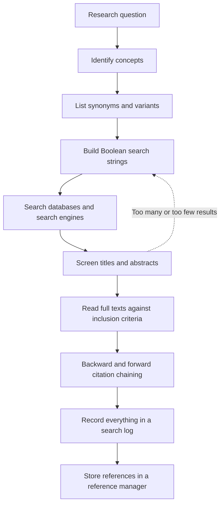

## Introduction

The literature review is often the longest chapter of an MSc proposal and one of the hardest to write well. Many students treat it as a collection of summaries: "Mensah (2019) found…, Smith (2020) found…, Boateng (2021) found…". Examiners describe such reviews as "annotated bibliographies" and mark them down, because they show reading but not thinking. A good literature review is an argument. It establishes what is known, evaluates the strength of that knowledge, identifies what is missing or contested, and positions your study as a sensible next step.

None of that is possible without first finding the right literature. This lesson therefore covers two connected skills: understanding the **purposes** of a literature review, and **searching** for scholarly literature systematically using academic databases, search engines and repositories. Later lessons in this module address evaluating sources, synthesising them and building frameworks.

## Learning Objectives

- Explain the main purposes of a literature review in postgraduate research.
- Distinguish narrative, systematic, scoping and integrative reviews.
- Identify appropriate academic databases and search tools for IT-for-business research.
- Apply keyword development, Boolean operators, truncation and filters to construct effective search strings.
- Create a documented, reproducible search log and use citation chaining to extend a search.

## Prerequisite Knowledge

- A defined research problem and draft objectives (Module 2).
- Basic familiarity with web search engines.

## Key Terminology

- **Literature review**: A critical, organised account of existing scholarship on a topic that establishes what is known, evaluates it and identifies gaps relevant to a research question.
- **Scholarly literature**: Work written by researchers for researchers, typically peer-reviewed journal articles, academic books, conference papers and theses.
- **Grey literature**: Material produced outside traditional academic publishing, such as government reports, working papers and industry white papers.
- **Boolean operators**: The search terms AND, OR and NOT used to combine or exclude keywords.
- **Truncation**: Using a symbol, commonly an asterisk, to search for variations of a word stem (for example, `adopt*` for adopt, adoption, adopting).
- **Citation chaining**: Finding further sources by following the references of a key article (backward) and works that later cite it (forward).
- **Systematic review**: A review that follows an explicit, pre-specified and reproducible protocol for searching, selecting and appraising studies.
- **Search log**: A record of databases searched, search strings, dates, filters and results, allowing the search to be reported and repeated.

## Detailed Explanation

### Why we review literature

A literature review serves several purposes simultaneously.

1. **Establishing the state of knowledge.** It shows what has been discovered about your topic, which concepts and theories are used, and how researchers have studied it.
2. **Justifying the study.** By identifying gaps, contradictions or untested assumptions, it explains why your research is needed. This links directly to the problem statement.
3. **Providing a theoretical foundation.** It identifies the theories and models (such as TAM, UTAUT or Diffusion of Innovations) that will frame your study and from which hypotheses or sensitising concepts are drawn.
4. **Informing methodology.** It reveals which designs, samples, instruments and analysis techniques others have used successfully, and which limitations they reported. Validated questionnaire scales are usually found this way.
5. **Avoiding duplication and supporting interpretation.** It prevents repeating settled research and later allows you to compare your findings with previous studies in the discussion chapter.
6. **Demonstrating scholarship.** It shows examiners that you understand the field and can evaluate it critically.

Webster and Watson (2002), writing in *MIS Quarterly*, argued that a strong review in information systems should be **concept-centric** rather than author-centric: organised around ideas and relationships, not around a list of who said what. This principle underlies the synthesis techniques discussed later in the module.

### Types of literature review

- **Narrative or traditional review.** A broad, expert-led overview. Flexible, but potentially selective and difficult to reproduce. Most MSc dissertations use a narrative review made more rigorous by systematic searching.
- **Systematic review.** Uses an explicit protocol, defined inclusion and exclusion criteria, comprehensive searching and formal quality appraisal. Common in health research and increasingly used in management (Tranfield, Denyer & Smart, 2003).
- **Scoping review.** Maps the extent and nature of research on a broad topic, often to identify gaps, without necessarily appraising quality in depth.
- **Integrative review.** Combines different types of studies, including qualitative and quantitative, to generate new frameworks or perspectives (Snyder, 2019, provides an overview of these types for business research).

### Where to search

No single source covers everything, so researchers combine several.

- **Academic search engines** such as Google Scholar index a very wide range of scholarly material and are useful for initial exploration and forward citation chaining ("Cited by"). Their coverage and ranking are not fully transparent, so they should be supplemented.
- **Bibliographic databases** such as Scopus and Web of Science index journals selectively and provide advanced search and citation tools; access usually depends on institutional subscriptions.
- **Publisher and subject platforms** such as the AIS eLibrary (Association for Information Systems), IEEE Xplore, the ACM Digital Library, ScienceDirect, Emerald Insight and JSTOR host full texts in IS, computing and management.
- **Open access sources** such as the Directory of Open Access Journals (DOAJ) and CORE aggregate openly available research papers.
- **Grey literature** from government ministries, central banks, regulators and international organisations is often essential for context in Ghana, but must be evaluated carefully.
- **University library portals** provide authenticated access to subscribed databases; check your institution's library for what is available to you.

## Theories, Frameworks and Models

### Building a search strategy: the concept table

The most reliable way to construct searches is to break the research question into **concepts**, then list synonyms for each.

| Concept | Synonyms and variants | Combined with |
|---|---|---|
| Technology | "mobile money" OR "digital payment*" OR "mobile payment*" OR "e-payment*" | AND |
| Behaviour | adopt* OR accept* OR "intention to use" OR usage | AND |
| Population | merchant* OR retailer* OR trader* OR "small business*" OR SME* | AND |
| Context | Ghana OR "West Africa" OR "sub-Saharan Africa" OR "developing countr*" | (optional) |

Synonyms within a concept are joined with **OR** (broadening), and concepts are joined with **AND** (narrowing). **NOT** excludes terms but should be used sparingly because it can remove relevant studies. Quotation marks search exact phrases; truncation captures variations. Database syntax varies, so consult each platform's help pages.

### A reproducible search process

PRISMA 2020 (Page et al., 2021) is a widely used reporting guideline for systematic reviews. Its flow diagram records how many records were identified, screened, excluded and included. Even in a narrative MSc review, borrowing this logic, documenting where you searched, what you found and why you included or excluded studies, greatly increases transparency.

## Diagram

## Step-by-Step Guide

1. **Define the question and scope.** Write the research question and the inclusion criteria: date range, languages, study types, populations.
2. **Identify concepts.** Typically two to four concepts, for example technology, behaviour and population.
3. **Generate keywords.** Use the vocabulary of key articles, database subject terms and thesauri; include British and American spellings (behaviour, behavior; organisation, organization).
4. **Construct and test search strings.** Run a draft search, examine results and refine. If results run into tens of thousands, add a concept or phrase; if very few, add synonyms or remove the context concept.
5. **Search several sources.** Combine Google Scholar with at least one subscription or subject database and an open access source.
6. **Screen systematically.** Review titles and abstracts first, then full texts, applying your criteria consistently.
7. **Chain citations.** Use reference lists of the most relevant papers (backward) and "cited by" features (forward) to find further work.
8. **Record and manage.** Keep a search log and save references in a reference manager such as Zotero, which can generate APA 7 citations.

## Worked Example

**Illustrative scenario.** Akosua's research question is: *What factors influence the adoption of AI-based tools by SMEs in Ghana?*

- **Concepts:** artificial intelligence; adoption; SMEs; Ghana or similar contexts.
- **Draft string:** `("artificial intelligence" OR AI OR "machine learning" OR chatbot*) AND (adopt* OR "intention to use" OR acceptance) AND (SME* OR "small and medium" OR "small business*")`
- **First result:** very large numbers of records, many about AI in large enterprises.
- **Refinement:** add the context concept `AND (Ghana OR Africa OR "developing countr*" OR "emerging econom*")`, restrict to the last ten years and to peer-reviewed articles.
- **Problem:** very few Ghana-specific studies. **Solution:** keep the international SME literature for theory and measurement, use African and developing-economy studies for contextual comparison, and note the scarcity of Ghana-specific work as part of the gap.
- **Chaining:** a highly relevant review article leads, through its reference list, to studies using the Technology-Organisation-Environment framework, which Akosua had not searched for, so she adds "TOE" as a keyword.
- **Log entry:** database, date, exact string, filters, number of results and number retained.

The expected learning is that searching is iterative and that the log turns a messy process into a transparent, reportable one.

## Ghanaian Business Application

Searching for literature on Ghanaian technology and business topics presents specific challenges. Research on Ghana is spread across international journals, African journals, conference proceedings and theses, and some relevant local journals may not be indexed in major subscription databases. Students should therefore combine international databases with open access aggregators and Google Scholar, and search for research from Ghanaian universities and institutions.

Grey literature is particularly important for context. Reports from the Bank of Ghana, the Ghana Statistical Service, the National Communications Authority, the Cyber Security Authority and relevant ministries can supply official context for topics such as mobile money, internet access or cybersecurity, but students must cite the exact report, quote figures accurately and note the date. Industry white papers from technology vendors or telecom operators should be treated with caution because of commercial interests. When researching technology adoption in healthcare, students may also find relevant studies in public health and medical informatics databases, not just business databases, which is a reminder that interdisciplinary topics require interdisciplinary searching.

## International Case Study

### The Cochrane Collaboration and systematic searching

The Cochrane Collaboration, now known simply as Cochrane, was founded in 1993 to produce systematic reviews of healthcare interventions. Its reviews are built on transparent, comprehensive searching across multiple databases, explicit inclusion criteria and documented screening by more than one reviewer, so that readers can see how conclusions were reached and other researchers can update them as new evidence appears.

Cochrane's approach, together with reporting guidelines such as PRISMA, influenced how other disciplines think about evidence. Management researchers such as Tranfield, Denyer and Smart (2003) adapted systematic review principles for management research, recognising that business questions are often less clearly defined than clinical ones. For an MSc student in IT for Business, the case shows that a literature search is not merely a preliminary chore; it is a research process in its own right whose quality affects the credibility of everything built on it. Even a narrative review benefits from Cochrane-style transparency: say where you searched, how and why you selected what you did.

## Common Misconceptions

- **Misconception:** A literature review summarises everything written on a topic. **Correction:** It selectively and critically reviews literature relevant to your research question and builds an argument.
- **Misconception:** Google Scholar alone is sufficient. **Correction:** It is useful but its coverage and ranking are not transparent; combine it with subject databases and open access sources.
- **Misconception:** More search results mean a better search. **Correction:** Precision matters; thousands of irrelevant hits waste time and hide key studies.
- **Misconception:** Only literature from Ghana is relevant to a Ghanaian study. **Correction:** International literature provides theory, methods and comparison; context-specific studies show how findings may differ.
- **Misconception:** The search is finished before writing begins. **Correction:** Searching continues iteratively as understanding develops.

## Common Examination Mistakes

- Describing a literature review as "a summary of what other authors said" without mentioning critical evaluation or gaps.
- Being unable to explain how literature was searched or selected.
- Relying heavily on websites, blogs and news articles instead of scholarly sources.
- Confusing systematic reviews with any review that is "well organised".
- Listing databases without explaining how search strategies were constructed.

## Critical Thinking Questions

1. Should MSc students in IT for Business conduct full systematic reviews, or is a systematically searched narrative review more appropriate? Justify your view.
2. What risks arise when algorithmic ranking in academic search engines shapes which studies researchers read?
3. How should researchers balance international and local literature when the local evidence base is small?
4. Is grey literature from technology vendors ever appropriate in an academic literature review? Under what conditions?

## Practical Exercises

1. **Concept table.** For the question "What factors influence cybersecurity behaviour among university students in Ghana?", build a concept table with at least three concepts and four synonyms each. *Expected output:* a completed table and one Boolean search string combining the concepts.
2. **Run and refine.** Run your string in Google Scholar and one other source available to you (for example DOAJ or CORE). Refine it at least twice. *Expected output:* a search log with date, source, string, filters, number of results and a note explaining each refinement.
3. **Citation chaining.** Choose one highly relevant article and perform backward and forward chaining. *Expected output:* a list of at least five additional relevant sources, each labelled as backward or forward, with a one-line relevance note.

## Key Takeaways

- A literature review establishes knowledge, justifies the study, provides theory, informs methods and supports interpretation.
- Reviews can be narrative, systematic, scoping or integrative; MSc work usually uses systematic searching within a narrative review.
- Break questions into concepts, use synonyms with OR, combine concepts with AND, and use truncation and phrases.
- Search several sources, including subject databases, open access aggregators and credible grey literature.
- Keep a search log and use citation chaining and a reference manager.

## Further Reading

- Webster, J., & Watson, R. T. (2002). Analyzing the past to prepare for the future: Writing a literature review. *MIS Quarterly, 26*(2), xiii-xxiii.
- Snyder, H. (2019). Literature review as a research methodology: An overview and guidelines. *Journal of Business Research, 104*, 333-339. <https://doi.org/10.1016/j.jbusres.2019.07.039>
- Tranfield, D., Denyer, D., & Smart, P. (2003). Towards a methodology for developing evidence-informed management knowledge by means of systematic review. *British Journal of Management, 14*(3), 207-222.
- Page, M. J., McKenzie, J. E., Bossuyt, P. M., Boutron, I., Hoffmann, T. C., Mulrow, C. D., Shamseer, L., Tetzlaff, J. M., Akl, E. A., Brennan, S. E., Chou, R., Glanville, J., Grimshaw, J. M., Hróbjartsson, A., Lalu, M. M., Li, T., Loder, E. W., Mayo-Wilson, E., McDonald, S., … Moher, D. (2021). The PRISMA 2020 statement: An updated guideline for reporting systematic reviews. *BMJ, 372*, n71. <https://doi.org/10.1136/bmj.n71>
- Hart, C. (1998). *Doing a literature review: Releasing the social science research imagination*. SAGE.

## Video Resources

- [Google Scholar Search Help](https://scholar.google.com/intl/en/scholar/help.html): Google. Official help page explaining search operators, "Cited by" and library links.
- [Purdue Online Writing Lab](https://owl.purdue.edu/): Purdue University. Official writing resource with guidance on conducting research and writing literature reviews.

## Revision Summary

A literature review is a critical, organised argument about existing knowledge that justifies the study, supplies theory, informs methods and supports interpretation; it should be concept-centric rather than a list of summaries. Effective searching breaks the question into concepts, uses synonyms with OR and concepts with AND, applies truncation and phrases, searches several sources and documents everything in a search log.

- Purposes: state of knowledge, justification, theory, methods, interpretation, scholarship.
- Types: narrative, systematic, scoping, integrative.
- Sources: Google Scholar, subject databases, DOAJ and CORE, credible grey literature.
- Boolean logic, truncation, phrase searching, filters.
- Citation chaining and a reproducible search log.
