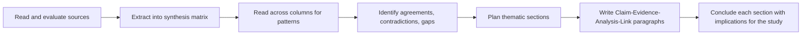

## Introduction

Synthesis is the skill that separates a postgraduate literature review from an undergraduate essay. Summarising means reporting what one source says. Synthesising means combining what *many* sources say to reveal patterns, agreements, contradictions and gaps, and to build an argument that no single source makes on its own. Examiners often comment that a review "describes rather than analyses" or "is organised by author rather than theme"; both comments are requests for synthesis.

This lesson explains what synthesis involves, introduces practical tools (the synthesis matrix and Webster and Watson's concept matrix) for organising sources, and shows how to write critically using appropriate academic language. It builds on the previous lessons on searching and evaluating sources and prepares you to construct theoretical and conceptual frameworks in the final lesson of this module.

## Learning Objectives

- Distinguish summary, paraphrase, analysis and synthesis in literature reviews.
- Construct a synthesis matrix that organises sources by concept or theme.
- Apply thematic, theoretical, methodological and chronological structures to organise a review.
- Write critically synthesised paragraphs that compare, contrast and evaluate multiple sources.
- Evaluate a literature review draft for descriptive and author-centred writing.

## Prerequisite Knowledge

- Searching for and evaluating sources and identifying gaps (previous lessons).
- Familiarity with APA 7 in-text citation.

## Key Terminology

- **Summary**: A condensed account of the main points of a single source in your own words.
- **Synthesis**: The integration of findings and ideas from multiple sources to identify relationships, patterns and gaps and to construct a new, coherent argument.
- **Synthesis matrix**: A table in which rows represent sources and columns represent concepts, themes or attributes, used to compare sources systematically.
- **Concept matrix**: Webster and Watson's tool for organising a review by concept, showing which sources address which concepts.
- **Author-centric review**: A review organised source by source, which tends to be descriptive.
- **Concept-centric review**: A review organised around ideas, themes or variables, which supports synthesis.
- **Critical writing**: Writing that evaluates evidence, explains disagreement, weighs strengths and weaknesses and draws reasoned conclusions.
- **Reporting verbs**: Verbs such as argue, demonstrate, suggest, contend and claim that signal how strongly an author asserts a position.

## Detailed Explanation

### From summary to synthesis

Consider four levels of engagement with literature.

1. **Summary**: "Owusu (2020) found that trust influenced mobile money use."
2. **Juxtaposition**: "Owusu (2020) found that trust influenced mobile money use. Brown (2019) found that cost was more important."
3. **Comparison and analysis**: "While Owusu (2020) identified trust as the strongest predictor, Brown (2019) found cost more influential; the difference may reflect their populations, as Owusu surveyed urban consumers and Brown rural traders."
4. **Synthesis**: "Studies consistently identify trust and cost as determinants of mobile money use, but their relative importance appears to vary by user group: trust dominates among urban consumers, whereas cost appears more salient for traders operating on thin margins. This pattern suggests that merchant adoption may follow a different logic from consumer adoption, a possibility that has rarely been tested directly."

*(The names above are illustrative placeholders, not real studies.)*

Level four makes a claim about the literature as a whole, explains variation, and points to a gap. Most strong review paragraphs work at levels three and four.

### Organising a review

A review can be structured in several ways, and many combine them.

- **Thematic or conceptual** – sections on each theme or construct (for example, perceived usefulness, cost, trust, infrastructure). This is the most common and most effective structure for MSc reviews.
- **Theoretical** – sections on competing theories (for example, TAM, UTAUT, Diffusion of Innovations) and how each explains the phenomenon.
- **Methodological** – grouping studies by approach (surveys, case studies, experiments) to show how method influences findings.
- **Chronological** – tracing how understanding developed over time; useful for showing evolution but risks becoming descriptive.

Whichever structure you choose, each section should open with a claim (a topic sentence), develop the claim with evidence from several sources, evaluate that evidence, and close with what it means for your study.

### The synthesis matrix

A **synthesis matrix** is the practical bridge between reading and writing. Rows are sources; columns are the concepts or attributes you care about. Filling it in as you read forces you to extract comparable information and makes patterns visible when you read across a column.

| Source | Context and sample | Method | Usefulness | Cost | Trust | Key limitation |
|---|---|---|---|---|---|---|
| Study A | Consumers, urban | Survey | Significant | Not measured | Strong | Cross-sectional |
| Study B | Traders, rural | Interviews | Mentioned | Central theme | Moderate | Small sample |
| Study C | SMEs, national | Survey | Significant | Significant | Not measured | Self-report |
| Study D | Merchants, peri-urban | Mixed methods | Significant | Significant | Weak | Single region |

*(Illustrative content for demonstration.)*

Reading down the "Cost" column shows that cost matters wherever merchants or traders are studied but is often unmeasured in consumer studies, which is itself a synthesis insight.

### Webster and Watson's concept matrix

Webster and Watson (2002) recommended a **concept matrix** in which concepts form the columns and articles the rows, with ticks showing which concepts each article addresses. They suggested that units of analysis (individual, group, organisation) can be added as sub-columns. The matrix encourages a concept-centric review and quickly exposes concepts that few studies have examined together.

### Critical writing

Critical writing does not mean being negative. It means making reasoned judgements. Useful moves include:

- **Comparing and contrasting:** "In contrast to…", "Consistent with…", "Similarly…".
- **Explaining inconsistency:** "These divergent findings may be explained by differences in…".
- **Evaluating strength of evidence:** "Although widely cited, this finding rests on a small convenience sample…".
- **Choosing reporting verbs carefully:** *demonstrates* implies strong evidence; *suggests* implies tentative evidence; *claims* implies scepticism. Use them accurately.
- **Establishing your voice:** after presenting evidence, state what you conclude and why it matters for your study.

Avoid long direct quotations; paraphrase and synthesise in your own words with accurate citations. Integrate citations as evidence for your claims, not as the subjects of every sentence.

## Theories, Frameworks and Models

### A paragraph structure for synthesis

A useful model for each paragraph is **Claim, Evidence, Analysis, Link**:

| Element | Function | Example phrase |
|---|---|---|
| Claim | State a point about the literature | "Research consistently links facilitating conditions to EHR use." |
| Evidence | Cite several sources that support or complicate it | "Studies in teaching hospitals and district facilities report…" |
| Analysis | Compare, explain differences, evaluate quality | "However, most rely on self-reported use, which may overstate…" |
| Link | Connect to your study or the next point | "This study therefore measures use through system logs where available." |

## Diagram

## Worked Example

**Illustrative scenario.** Esi's draft paragraph on cybersecurity awareness reads:

> "Adjei (2018) studied students and found low awareness. Mensah (2020) studied staff and found moderate awareness. Lee (2019) did a survey in Asia and found that training helped. Kim (2021) found that students who were victims were more careful."

*(Names are placeholders for illustration.)*

**Diagnosis:** author-centric, descriptive, no claim, no evaluation, no link.

**Step 1: Identify the theme.** All four sources concern factors associated with security awareness and behaviour.

**Step 2: Read across the matrix.** Two sources address training, one addresses prior victimisation, and two compare populations. Three rely on self-reported awareness.

**Step 3: Rewrite using Claim, Evidence, Analysis, Link.**

> "Existing studies suggest that awareness of cybersecurity risks varies by population and is associated with prior training and experience of victimisation. Studies of students tend to report lower awareness than studies of staff, while survey evidence from Asia indicates that structured training is associated with safer practices, and students who have previously been victims appear more cautious. However, most of this evidence relies on self-reported awareness, which may not reflect actual behaviour, and few studies examine training and prior victimisation together. This study therefore examines both factors in relation to observed security behaviour among Ghanaian undergraduates."

The expected outcome is a paragraph that makes a claim about the literature, explains variation, evaluates evidence quality and links to the study.

## Ghanaian Business Application

Synthesis is particularly valuable when Ghanaian evidence is limited. A student studying AI adoption among SMEs in Ghana may find few Ghana-specific studies but many international ones. Rather than reviewing them separately ("studies abroad found…; studies in Ghana found…"), the student can synthesise thematically: for each determinant, such as cost, skills, data availability, perceived usefulness or management support, the review can compare evidence from different contexts and ask whether Ghanaian conditions, such as reliance on mobile connectivity, informal business practices or limited local AI expertise, might strengthen or weaken the relationship.

Similar reasoning applies to technology adoption in Ghanaian healthcare. A synthesis matrix might reveal that facilitating conditions (power supply, connectivity, technical support) feature far more prominently in studies from resource-constrained settings than in studies from high-income countries. That pattern becomes a synthesised argument for giving facilitating conditions a central role in the conceptual framework, a clear demonstration of how synthesis feeds directly into research design.

## International Case Study

### Webster and Watson's guidance in information systems

Jane Webster and Richard Watson's 2002 editorial in *MIS Quarterly*, "Analyzing the Past to Prepare for the Future: Writing a Literature Review", was written partly in response to a perceived shortage of high-quality review articles in information systems. They argued that reviews should be concept-centric, proposed the concept matrix as a tool, recommended structured searching including backward and forward citation searches, and encouraged authors to develop theoretical models and propositions from their synthesis rather than simply cataloguing previous work.

The article has become one of the most widely cited methodological guides in the IS field and is frequently referenced in dissertations worldwide. Its lasting influence shows that synthesis is not just a writing style but a means of creating knowledge: a well-synthesised review can generate new conceptual models that later studies test. For MSc students, following its principles is a practical way to meet examiners' expectations of critical, concept-centric reviewing.

## Common Misconceptions

- **Misconception:** Synthesis means summarising many sources in one paragraph. **Correction:** Synthesis integrates sources to make a new claim about patterns, differences and gaps.
- **Misconception:** Critical writing means criticising authors. **Correction:** It means evaluating evidence fairly, including strengths as well as weaknesses.
- **Misconception:** Chronological organisation is always best. **Correction:** Thematic organisation usually supports synthesis better; chronology suits only arguments about development over time.
- **Misconception:** More citations per sentence always show better synthesis. **Correction:** Citations must support an analytical claim; lists of citations without analysis remain descriptive.
- **Misconception:** The synthesis matrix is optional busywork. **Correction:** It is the most reliable way to see patterns across sources before writing.

## Common Examination Mistakes

- Organising the review source by source ("Author A found…, Author B found…").
- Using reporting verbs inaccurately, for example "proves" for tentative findings.
- Over-relying on long direct quotations instead of paraphrased synthesis.
- Ending sections without stating implications for the study.
- Presenting a literature review with no evaluative comments on evidence quality.

## Critical Thinking Questions

1. How can a reviewer synthesise studies that used different definitions or measures of the same construct?
2. When does synthesis risk oversimplifying genuinely contradictory evidence?
3. How should a reviewer integrate qualitative and quantitative findings on the same theme?
4. Is it possible for a review to be too concept-centric, losing important information about context and method?

## Practical Exercises

1. **Build a synthesis matrix.** For a study of e-commerce adoption among small businesses, create a matrix with at least six real sources you have found and columns for context, method, three key concepts and limitations. *Expected output:* a completed matrix and three sentences describing patterns visible when reading down the columns.
2. **Rewrite a descriptive paragraph.** Rewrite the following using Claim, Evidence, Analysis, Link: "Study 1 found trust important. Study 2 found trust not significant. Study 3 found cost important." *Expected output:* a synthesised paragraph that explains the contradiction, evaluates the evidence and links to a proposed study.
3. **Outline a thematic review.** Produce a section outline for a literature review on digital payment adoption among Ghanaian retailers. *Expected output:* four to six thematic headings, each with a topic sentence stating the claim the section will make.

## Key Takeaways

- Summary reports one source; synthesis integrates many to make new claims.
- Organise reviews thematically or conceptually wherever possible.
- Synthesis and concept matrices make patterns, contradictions and gaps visible.
- Write paragraphs using Claim, Evidence, Analysis, Link.
- Critical writing evaluates evidence fairly and uses reporting verbs precisely.

## Further Reading

- Webster, J., & Watson, R. T. (2002). Analyzing the past to prepare for the future: Writing a literature review. *MIS Quarterly, 26*(2), xiii–xxiii.
- Hart, C. (1998). *Doing a literature review: Releasing the social science research imagination*. SAGE.
- Snyder, H. (2019). Literature review as a research methodology: An overview and guidelines. *Journal of Business Research, 104*, 333–339. <https://doi.org/10.1016/j.jbusres.2019.07.039>
- Saunders, M., Lewis, P., & Thornhill, A. (2019). *Research methods for business students* (8th ed.). Pearson.

## Video Resources

- [Purdue Online Writing Lab](https://owl.purdue.edu/) — Purdue University. Official writing resource covering synthesis, paraphrasing and academic writing.
- [Zotero Documentation](https://www.zotero.org/support/) — Zotero. Official documentation for organising sources, notes and tags that support a synthesis matrix.

## Revision Summary

Synthesis integrates multiple sources to reveal patterns, explain contradictions and identify gaps, producing an argument no single source makes. Reviews should be concept-centric, typically organised thematically, and built from synthesis or concept matrices that make cross-source patterns visible. Paragraphs follow Claim, Evidence, Analysis, Link, and critical writing evaluates evidence fairly with precise reporting verbs.

- Summary, juxtaposition, comparison, synthesis.
- Thematic, theoretical, methodological or chronological structures.
- Synthesis matrix: sources as rows, concepts as columns.
- Webster and Watson (2002): concept-centric reviews and the concept matrix.
- End each section with implications for your own study.
