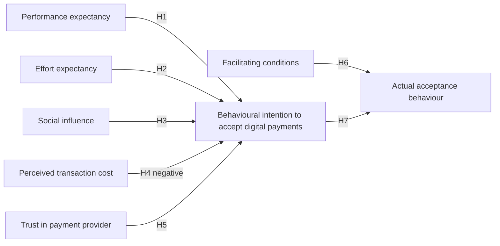

## Introduction

A literature review ends by telling the reader how the study will think about its problem. That is the role of the **theoretical framework** and the **conceptual framework**. These frameworks determine which variables or themes are examined, which relationships are hypothesised, how questionnaires and interview guides are designed and how findings are interpreted. A dissertation without a clear framework tends to collect data on everything and explain nothing.

In IT-for-business research, technology adoption theories dominate. This lesson explains the difference between theoretical and conceptual frameworks, examines three of the most influential adoption theories in detail, namely the Technology Acceptance Model (TAM), the Unified Theory of Acceptance and Use of Technology (UTAUT) and Diffusion of Innovations (DOI), and shows step by step how to construct and justify a conceptual framework for a Ghanaian study.

## Learning Objectives

- Distinguish a theoretical framework from a conceptual framework and explain how each is used.
- Explain the constructs and relationships of TAM, UTAUT and Diffusion of Innovations.
- Compare the strengths and limitations of these theories for studying technology adoption in Ghanaian organisations.
- Construct a conceptual framework diagram with justified constructs and hypothesised relationships.
- Evaluate whether a framework fits a given research question and level of analysis.

## Prerequisite Knowledge

- Research objectives, questions and hypotheses (Module 2).
- Synthesising literature (previous lesson).

## Key Terminology

- **Theory**: A set of interrelated concepts and propositions that explains or predicts a phenomenon.
- **Theoretical framework**: The established theory or theories a study draws on to explain the phenomenon and justify its focus.
- **Conceptual framework**: The researcher's own model, usually presented as a diagram, showing the specific constructs and relationships the study will examine, derived from theory and literature.
- **Construct**: An abstract concept, such as perceived usefulness, that is defined theoretically and measured through indicators.
- **Moderator**: A variable that changes the strength or direction of a relationship between two other variables.
- **Mediator**: A variable that explains how or why an independent variable affects a dependent variable.
- **Level of analysis**: Whether a theory explains behaviour of individuals, groups, organisations or wider systems.
- **Behavioural intention**: A person's stated likelihood of performing a behaviour, such as using a system, central in many adoption models.

## Detailed Explanation

### Theoretical versus conceptual frameworks

The two terms are often confused. A **theoretical framework** refers to one or more existing, tested theories that explain the phenomenon, such as UTAUT. It provides the "lens" for the study. A **conceptual framework** is the researcher's own structured representation of the specific constructs and relationships to be investigated in *this* study. It may adapt a theory (by selecting some constructs), combine theories, or add constructs supported by the literature, such as trust or cost. In quantitative studies the conceptual framework usually appears as a diagram of boxes and arrows, with each arrow corresponding to a hypothesis. In qualitative studies it may be a looser set of sensitising concepts that guide data collection without fixing relationships in advance.

A helpful way to remember the distinction: the theoretical framework is borrowed; the conceptual framework is built.

### The Technology Acceptance Model (TAM)

Davis (1989) proposed that two beliefs shape whether people accept an information technology. **Perceived usefulness** is the degree to which a person believes that using a system would enhance their job performance. **Perceived ease of use** is the degree to which a person believes that using the system would be free of effort. In the model, ease of use also influences usefulness, and both influence attitudes and behavioural intention, which in turn predicts actual use. TAM drew on the Theory of Reasoned Action and became one of the most widely applied models in IS research. Venkatesh and Davis (2000) extended it as TAM2 by adding determinants of usefulness, such as subjective norm and job relevance.

**Strengths:** parsimony, validated measurement scales and wide empirical support. **Limitations:** it focuses on individual beliefs, may neglect organisational, social and economic factors, and was originally developed in workplace settings where use was often expected.

### The Unified Theory of Acceptance and Use of Technology (UTAUT)

Venkatesh, Morris, Davis and Davis (2003) reviewed and empirically compared eight models of technology acceptance and integrated them into UTAUT. It proposes four core determinants:

- **Performance expectancy** – the belief that using the system will help attain gains in job performance (related to perceived usefulness).
- **Effort expectancy** – the ease associated with using the system (related to perceived ease of use).
- **Social influence** – the degree to which important others believe the individual should use the system.
- **Facilitating conditions** – the belief that organisational and technical infrastructure exists to support use.

The first three influence behavioural intention; intention and facilitating conditions influence use behaviour. **Gender, age, experience and voluntariness of use** moderate key relationships. Venkatesh, Thong and Xu (2012) later proposed UTAUT2 for consumer contexts, adding hedonic motivation, price value and habit.

**Strengths:** integrates prior models, explains behaviour well in organisational settings, includes facilitating conditions that matter greatly in resource-constrained contexts. **Limitations:** complexity, frequent partial or inconsistent application (moderators are often dropped without justification) and a focus on individual users rather than organisational adoption decisions.

### Diffusion of Innovations (DOI)

Everett Rogers' *Diffusion of Innovations* explains how innovations spread through social systems over time. Rogers identified five perceived attributes of innovations that influence their rate of adoption:

- **Relative advantage** – the degree to which an innovation is perceived as better than what it replaces.
- **Compatibility** – consistency with existing values, experiences and needs.
- **Complexity** – the perceived difficulty of understanding and using it.
- **Trialability** – the extent to which it can be experimented with on a limited basis.
- **Observability** – the visibility of its results to others.

Rogers also categorised adopters by the timing of adoption as innovators, early adopters, early majority, late majority and laggards, and described an innovation-decision process moving from knowledge through persuasion, decision and implementation to confirmation. Communication channels and social networks are central to diffusion.

**Strengths:** applicable to individuals and organisations, explains the social spread of innovations and offers a time dimension. **Limitations:** a pro-innovation bias (assuming adoption is desirable), and attributes are sometimes measured inconsistently.

### Other frameworks worth knowing

For organisation-level adoption, such as AI adoption by SMEs, many researchers use the **Technology-Organisation-Environment (TOE) framework** associated with Tornatzky and Fleischer (1990), which considers technological characteristics, organisational factors (size, resources, management support) and environmental factors (competition, regulation, vendor support). It is frequently combined with DOI. The Theory of Planned Behaviour (Ajzen, 1991) is another foundational model that adds perceived behavioural control to attitudes and subjective norms.

## Theories, Frameworks and Models

| Feature | TAM | UTAUT | Diffusion of Innovations |
|---|---|---|---|
| Originator | Davis (1989) | Venkatesh et al. (2003) | Rogers |
| Core constructs | Perceived usefulness, perceived ease of use | Performance expectancy, effort expectancy, social influence, facilitating conditions | Relative advantage, compatibility, complexity, trialability, observability |
| Outcome | Intention and use | Intention and use behaviour | Adoption and rate of diffusion |
| Typical level | Individual | Individual | Individual or organisation, social system |
| Moderators | Not central in original | Gender, age, experience, voluntariness | Adopter categories, communication channels |
| Typical use in Ghana research | Mobile banking, e-learning acceptance | Mobile money, EHR, e-government services | SME technology adoption, often with TOE |
| Key limitation | Neglects context and cost | Complex, often applied partially | Pro-innovation bias |

## Diagram

The following conceptual framework is an **illustrative example** for a study of digital payment acceptance among Ghanaian retailers, adapting UTAUT and adding two constructs justified by literature (perceived transaction cost and trust).

## Step-by-Step Guide

1. **Start with the research question and level of analysis.** Individual intention questions suit TAM or UTAUT; organisational adoption questions suit TOE or DOI.
2. **Review candidate theories.** Use your synthesis to compare how well each theory explains the phenomenon in similar contexts.
3. **Select a base theory and justify it.** Explain why it fits better than alternatives.
4. **Adapt with justification.** Remove constructs that do not apply (for instance, voluntariness when use is voluntary for all participants) and add constructs supported by literature. Every addition needs a reason grounded in evidence.
5. **Define each construct.** Provide clear conceptual definitions and identify validated measurement items.
6. **Specify relationships and hypotheses.** Each arrow in the diagram should correspond to a hypothesis with a rationale.
7. **Draw the diagram.** Keep it readable; label hypotheses.
8. **Check alignment.** Confirm that objectives, questions, hypotheses and the questionnaire all match the framework.

## Worked Example

**Illustrative scenario.** Nana Ama is studying AI tool adoption among SMEs in Greater Accra.

- **Question:** What factors influence SMEs' adoption of AI-based tools?
- **Level of analysis:** organisation, because the owner or management decides on adoption for the firm.
- **Theory choice:** TOE combined with DOI, rather than UTAUT, because the decision concerns the firm rather than individual employee use.
- **Constructs:** *Technology* – relative advantage and complexity (from DOI); *Organisation* – top management support and digital skills availability; *Environment* – competitive pressure and vendor support.
- **Hypotheses:** for example, H1 relative advantage positively influences adoption; H2 complexity negatively influences adoption; H3 top management support positively influences adoption.
- **Justification:** her synthesis showed that organisational resources and skills feature prominently in SME studies from developing economies, supporting the TOE organisational dimension.

The expected learning is that framework choice follows from the question and level of analysis, and that adaptations are justified by the literature.

## Ghanaian Business Application

Adoption theories are widely used in Ghanaian IT research on mobile money, internet banking, e-learning, e-government services and electronic health records. Applying them well in Ghana requires attention to context.

- **Facilitating conditions** such as reliable electricity, network coverage, device costs and technical support may weigh more heavily than in the settings where theories were developed.
- **Social influence** may operate through family, religious, professional or community networks, and through mobile money agents who often act as trusted intermediaries.
- **Cost and price value** matter for traders and SMEs, which is why UTAUT2 or added constructs such as perceived transaction cost are often justified for consumer and merchant studies.
- **Trust and perceived risk** frequently appear in studies of digital finance, given concerns about fraud and failed transactions.
- **Organisational decisions** in SMEs are often made by owner-managers, so TOE and DOI may be more suitable than individual-level models.

Students should resist the temptation to add many constructs simply because they appear in the literature. A parsimonious, well-justified framework is stronger than a crowded diagram with weakly justified arrows.

## International Case Study

### Rogers and the diffusion of hybrid seed corn

One of the classic studies discussed in Rogers' *Diffusion of Innovations* is the research by Bryce Ryan and Neal Gross, published in 1943, on how farmers in two Iowa communities adopted hybrid seed corn. Although hybrid corn offered clear advantages, adoption spread gradually over a number of years. Farmers typically first heard about the innovation through commercial sources such as salespeople, but neighbours were especially influential in persuading them to adopt, and many farmers tried the seed on part of their land before committing fully.

The study illustrates several of Rogers' concepts: the S-shaped pattern of adoption over time, the role of interpersonal networks, the importance of trialability, and the different timing of adopter categories. It also demonstrates the theoretical value of diffusion research for technology adoption today. When Ghanaian market traders learn about a new payment app from a sales agent but decide to adopt only after seeing neighbouring traders use it successfully, the same mechanisms of observability and interpersonal influence are at work, nearly a century later.

## Common Misconceptions

- **Misconception:** Theoretical and conceptual frameworks are the same. **Correction:** The theoretical framework is the existing theory; the conceptual framework is the researcher's adapted model of constructs and relationships for this study.
- **Misconception:** A good framework includes as many constructs as possible. **Correction:** Parsimony and justification matter more than size.
- **Misconception:** TAM or UTAUT suit every technology study. **Correction:** They explain individual acceptance; organisational adoption questions may need TOE or DOI.
- **Misconception:** Qualitative studies cannot use theory. **Correction:** They may use theory as a sensitising lens or generate new theory, without fixed hypotheses.
- **Misconception:** UTAUT moderators can be dropped freely. **Correction:** Removing them requires a reason, such as all participants sharing the same level of experience.

## Common Examination Mistakes

- Describing TAM, UTAUT and DOI without applying them to the question.
- Presenting a conceptual framework diagram with arrows that have no corresponding hypotheses.
- Adding constructs without literature-based justification.
- Mismatching the level of analysis, such as using UTAUT to explain an organisational purchasing decision without justification.
- Misattributing constructs, for example listing "relative advantage" as a TAM construct.

## Critical Thinking Questions

1. Is UTAUT's integration of eight models a strength or a weakness for researchers seeking explanation rather than prediction?
2. How might Rogers' pro-innovation bias affect research on AI adoption among Ghanaian SMEs?
3. When is it legitimate to combine two theories in one conceptual framework, and what risks does this create?
4. Should researchers in Ghana develop new, context-specific adoption theories rather than adapting models developed elsewhere?

## Practical Exercises

1. **Theory selection.** For each of the following questions, choose TAM, UTAUT, DOI or TOE and justify your choice in two sentences: (a) nurses' intention to use an EHR system; (b) SMEs' decisions to adopt cloud accounting; (c) consumers' continued use of a mobile banking app. *Expected output:* three choices with justifications referring to level of analysis and context.
2. **Build a framework.** Create a conceptual framework for cybersecurity behaviour among university students, based on an appropriate theory with up to two justified additional constructs. *Expected output:* a labelled diagram, a definition of each construct and a list of hypotheses matching each arrow.
3. **Critique a framework.** Find a published conceptual framework in a Ghanaian technology adoption study and evaluate it for justification, parsimony and alignment. *Expected output:* a half-page critique identifying at least two strengths and two possible improvements.

## Key Takeaways

- The theoretical framework is borrowed theory; the conceptual framework is the researcher's adapted model.
- TAM centres on perceived usefulness and ease of use; UTAUT on performance expectancy, effort expectancy, social influence and facilitating conditions with moderators; DOI on five innovation attributes and social diffusion.
- Choose theory according to question and level of analysis; TOE suits organisational adoption.
- Justify every construct and arrow; each arrow is a hypothesis.
- Adapt theories carefully to Ghanaian contexts, especially facilitating conditions, cost and trust.

## Further Reading

- Davis, F. D. (1989). Perceived usefulness, perceived ease of use, and user acceptance of information technology. *MIS Quarterly, 13*(3), 319–340. <https://doi.org/10.2307/249008>
- Venkatesh, V., Morris, M. G., Davis, G. B., & Davis, F. D. (2003). User acceptance of information technology: Toward a unified view. *MIS Quarterly, 27*(3), 425–478. <https://doi.org/10.2307/30036540>
- Venkatesh, V., Thong, J. Y. L., & Xu, X. (2012). Consumer acceptance and use of information technology: Extending the unified theory of acceptance and use of technology. *MIS Quarterly, 36*(1), 157–178.
- Rogers, E. M. (2003). *Diffusion of innovations* (5th ed.). Free Press.
- Tornatzky, L. G., & Fleischer, M. (1990). *The processes of technological innovation*. Lexington Books.
- Ajzen, I. (1991). The theory of planned behavior. *Organizational Behavior and Human Decision Processes, 50*(2), 179–211.

## Video Resources

- [SAGE Research Methods](https://methods.sagepub.com/) — SAGE Publishing. Official platform (institutional access may be required) with material on theoretical and conceptual frameworks.
- [Coursera](https://www.coursera.org/) — Coursera. Official learning platform; search for university courses on information systems and technology adoption.

## Revision Summary

A theoretical framework is the existing theory that provides the study's lens; a conceptual framework is the researcher's own adapted model of constructs and relationships, often a diagram in which each arrow is a hypothesis. TAM explains acceptance through perceived usefulness and ease of use; UTAUT integrates eight models around performance expectancy, effort expectancy, social influence and facilitating conditions, moderated by gender, age, experience and voluntariness; DOI explains adoption through relative advantage, compatibility, complexity, trialability and observability, and through social diffusion.

- Borrowed theory versus built framework.
- Match theory to level of analysis: TAM and UTAUT for individuals, TOE and DOI for organisations.
- UTAUT2 adds hedonic motivation, price value and habit for consumers.
- Justify every added construct with literature; keep frameworks parsimonious.
- Context matters in Ghana: facilitating conditions, cost, trust and social networks.
