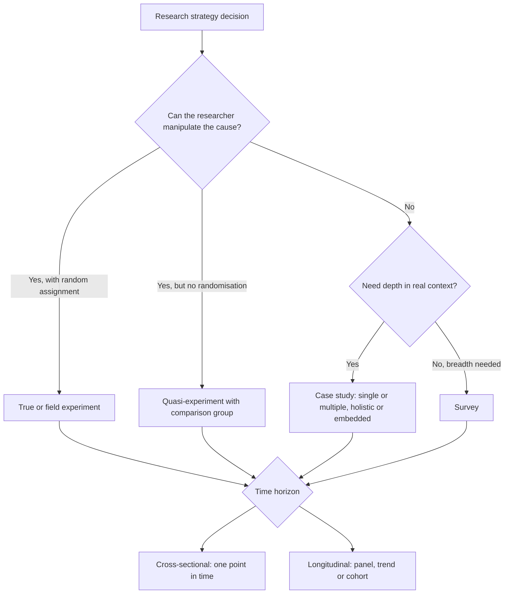

## Introduction

Choosing an approach (quantitative, qualitative or mixed) and a purpose (exploratory, descriptive or explanatory) still leaves an important decision: the *research strategy* through which data will be generated, and the *time horizon* over which the phenomenon will be observed. Saunders, Lewis and Thornhill place these choices in the middle layers of their "research onion", between methodological choice and data collection techniques.

This lesson concentrates on two contrasting strategies that MSc IT for Business students frequently propose and frequently misuse. **Experiments** offer the strongest basis for causal claims but require control that is hard to achieve in organisations. **Case studies** offer depth and real-world context but are often confused with "a study of one company". The lesson also explains **cross-sectional** and **longitudinal** time horizons, because whether you observe a phenomenon once or repeatedly shapes what you can conclude about change and causality.

## Learning Objectives

- Explain the logic of true experiments, quasi-experiments and field experiments, including random assignment and control groups.
- Identify common threats to internal validity and propose design features that address them.
- Apply Yin's classification of case study designs (single or multiple, holistic or embedded) to a research problem.
- Compare cross-sectional and longitudinal time horizons and select one appropriate to a research question.
- Calculate and interpret a simple difference-in-differences estimate from a quasi-experiment.

## Prerequisite Knowledge

- Exploratory, descriptive and explanatory purposes, and the three conditions for causal inference (previous lesson).
- Basic understanding of variables (independent, dependent, control).
- Familiarity with percentages and simple subtraction.

## Key Terminology

- **Experiment**: A strategy in which the researcher deliberately manipulates an independent variable and observes its effect on a dependent variable while controlling other influences.
- **Random assignment**: Allocating participants to groups by chance so that, on average, groups are equivalent on both measured and unmeasured characteristics.
- **Quasi-experiment**: A design that resembles an experiment but lacks random assignment, often comparing existing groups such as two branches or two classes.
- **Internal validity**: The degree to which a study can attribute observed changes in the outcome to the intervention rather than to other factors.
- **Case study**: An in-depth empirical investigation of a contemporary phenomenon within its real-life context, especially when the boundaries between phenomenon and context are not clearly evident.
- **Unit of analysis**: The main entity being studied, such as an individual, a team, an organisation or a project.
- **Cross-sectional study**: A study that collects data at a single point in time, providing a "snapshot".
- **Longitudinal study**: A study that collects data from the same or comparable units at two or more points in time to examine change and development.

## Detailed Explanation

### The logic of experiments

In a classic experiment the researcher creates at least two groups: an **experimental group** that receives an intervention (the treatment) and a **control group** that does not. Participants are randomly assigned, the dependent variable is measured (often before and after), and the difference between groups is attributed to the treatment. Random assignment is the key ingredient: because chance decides who receives the treatment, characteristics such as motivation, IT skill or firm size are expected to be balanced across groups, satisfying the non-spuriousness condition.

Campbell and Stanley's notation, extended by Shadish, Cook and Campbell, provides a compact way of describing designs. `R` denotes random assignment, `O` an observation (measurement) and `X` the treatment.

```
Pre-test post-test control group design
R   O1   X   O2
R   O3        O4
```

The effect estimate is the difference between the change in the treatment group `(O2 − O1)` and the change in the control group `(O4 − O3)`.

### Laboratory, field and quasi-experiments

**Laboratory experiments** take place in controlled settings, such as a usability lab where participants complete tasks with two versions of a payment app interface. Control is high, but artificial settings limit how well findings transfer to real use. **Field experiments** introduce manipulation in natural settings, such as randomly selecting which SMEs receive a free AI bookkeeping tool. **Quasi-experiments** are used when random assignment is impossible or unethical, for instance when one bank branch adopts a new system and another does not. Without randomisation, groups may differ systematically, so quasi-experiments rely on pre-tests, comparison groups and statistical adjustment to strengthen inference.

### Threats to internal validity

Shadish, Cook and Campbell catalogue threats that can create the illusion of an effect. Those most relevant to organisational IT research include:

- **History**: external events occurring during the study (for example, a widely reported fraud scandal that makes all staff more cautious online).
- **Maturation**: natural change over time, such as employees becoming more familiar with a system regardless of training.
- **Testing**: taking a pre-test can itself change post-test scores.
- **Selection**: groups differ before treatment, a major issue in quasi-experiments.
- **Attrition**: participants drop out unevenly, so remaining groups are no longer comparable.
- **Diffusion of treatment**: control participants learn about the intervention from treated colleagues.

A control group handles history and maturation well, because both groups experience them; random assignment handles selection.

### Case study research

Yin defines the case study as an empirical enquiry that investigates a contemporary phenomenon in depth and in its real-world context. Case studies typically use multiple sources of evidence (interviews, documents, archival records, observation, system data) and are suited to "how" and "why" questions about events over which the researcher has little control. They can be exploratory, descriptive or explanatory.

Yin's well-known classification crosses two choices:

| | Holistic (single unit of analysis) | Embedded (multiple sub-units) |
|---|---|---|
| **Single case** | One organisation studied as a whole, e.g. how one hospital implemented e-records | One organisation with several sub-units, e.g. three departments within the hospital |
| **Multiple cases** | Several organisations, each studied as a whole, e.g. four SMEs adopting AI | Several organisations, each with sub-units, e.g. four banks, two branches each |

A **single case** is justified when it is critical (tests a well-formulated theory), extreme or unusual, typical (representative), revelatory (gives access to a previously inaccessible phenomenon) or longitudinal. **Multiple cases** follow *replication logic*, not sampling logic: each case is selected because it is expected to produce similar results (literal replication) or contrasting results for predictable reasons (theoretical replication). Eisenhardt's approach to building theory from cases similarly emphasises theoretical sampling and cross-case comparison.

Case study generalisation is **analytic**, not statistical: findings generalise to theory rather than to a population. This distinction answers the common criticism that "one case cannot be generalised".

### Time horizons

A **cross-sectional** study collects data once. Most MSc surveys are cross-sectional because of time constraints, and they are well suited to describing prevalence or relationships at one time. Their weakness is that they cannot observe change, and temporal order between variables is inferred rather than observed.

A **longitudinal** study collects data at multiple points. Variants include **panel studies** (the same participants measured repeatedly), **trend studies** (different samples from the same population over time) and **cohort studies** (following a group that shares an experience, such as students who entered university in the same year). Longitudinal designs reveal change, sequence and development, which strengthens temporal precedence, but they face attrition, cost and the risk that repeated measurement influences responses. An MSc dissertation can achieve a modest longitudinal element by using secondary time-series data, archival records, or two survey waves a few months apart.

## Diagram



## Worked Example

**Illustrative scenario.** A private university in Accra introduces a phishing-awareness training module for students in one faculty (Faculty A). Another faculty (Faculty B) does not receive the training in that semester. The IT unit sends simulated phishing emails before and after the training and records the percentage of students who click the link.

| Group | Click rate before | Click rate after | Change |
|---|---|---|---|
| Faculty A (trained) | 30% | 12% | −18 points |
| Faculty B (comparison) | 28% | 24% | −4 points |

**Step 1 – Identify the design.** Students were not randomly assigned; whole faculties were. This is a **quasi-experiment** with a non-equivalent comparison group, in notation:

```
NR   O1   X   O2
NR   O3        O4
```

(`NR` = non-random assignment.)

**Step 2 – Compute the naive estimate.** Looking only at Faculty A, clicks fell by 18 percentage points. But this ignores history and maturation: Faculty B's rate also fell by 4 points without training, perhaps because of a campus-wide news story or growing familiarity with the simulation.

**Step 3 – Compute the difference-in-differences (DiD).**

```
DiD = (After_A − Before_A) − (After_B − Before_B)
    = (12 − 30) − (24 − 28)
    = (−18) − (−4)
    = −14 percentage points
```

The training is associated with a 14-point greater reduction in click rate than would have been expected from the comparison group's trend.

**Step 4 – Evaluate threats.** *Selection*: Faculty A may have more technically skilled students; the similar baseline rates (30% versus 28%) are reassuring but do not rule this out. *Diffusion*: Faculty B students sharing halls with Faculty A may have heard about the training, which would make the estimate conservative. *Testing*: the first simulated email may itself have taught students something, affecting both groups. The DiD logic assumes both faculties would have followed parallel trends without training.

**Step 5 – State a calibrated conclusion.** *"The quasi-experimental evidence suggests the training substantially reduced phishing susceptibility, although non-random assignment means selection effects cannot be fully excluded."* The expected output is the DiD figure (−14 points), a list of threats, and a cautious conclusion.

## Ghanaian Business Application

Each strategy and time horizon has natural uses in Ghanaian technology and business research.

- **Field experiments with SMEs.** An SME support programme could randomly select which applicant firms receive a subsidised cloud accounting package in the first year, with others receiving it later (a "waitlist" design). Random selection is fairer than choosing favoured firms and allows a credible estimate of effects on record-keeping or access to credit. Ethical review must confirm that delaying the benefit for some firms is acceptable.
- **Case studies of healthcare technology.** A multiple-case study of electronic health records in three hospitals (for example, a teaching hospital, a regional hospital and a mission hospital) could compare how implementation unfolded, using interviews, project documents and system data. Cases would be chosen for theoretical reasons, such as different funding models, not for convenience.
- **Embedded case studies of banks.** A study of how one bank introduced AI-based fraud detection might examine the fraud, customer-service and IT departments as embedded units, recognising that each experienced the change differently.
- **Longitudinal designs for digital payments.** Retailers' acceptance of mobile money merchant payments may change as fees, regulations and customer expectations evolve. A two-wave panel survey of the same traders, six months apart, could show whether early intentions translate into actual use, providing stronger evidence than a single snapshot.

In each case, students must consider access, consent and data protection under the Data Protection Act, 2012 (Act 843), and recognise that experiments in organisations require explicit managerial agreement.

## International Case Study

### Working from home at Ctrip

Nicholas Bloom and colleagues reported, in a study published in the *Quarterly Journal of Economics* in 2015, a randomised experiment at Ctrip, a large Chinese travel agency. Call-centre employees in Shanghai who volunteered to work from home and met eligibility conditions were randomly assigned, by a lottery based on birth dates, either to work from home or to remain in the office for about nine months.

The experiment found that home workers' performance improved, partly because they worked more minutes per shift and partly because they handled more calls per minute in quieter conditions, and that attrition among home workers fell. After the experiment, the firm offered the option to the wider workforce, and some employees who had worked from home chose to return to the office, citing loneliness.

The case illustrates several design principles. **Random assignment** among volunteers made the treatment and control groups comparable, strengthening internal validity far beyond a comparison of self-selected remote and office workers. The **field setting** gave real-world relevance that a laboratory study could not. The study's **duration** captured effects over months, not days, though it remained a relatively short time horizon for questions about promotion and career development. Finally, external validity is limited: the tasks were measurable, individual call-centre work in one firm, so results may not transfer to collaborative knowledge work or to firms in other countries, including Ghana. The case shows both the power and the boundaries of experimental evidence.

## Common Misconceptions

- **Misconception:** A case study is any study of a single organisation. **Correction:** A case study is a defined research strategy with a clear unit of analysis, theoretical case selection and multiple evidence sources; a survey of one firm's staff is a survey, not a case study.
- **Misconception:** Case studies cannot be generalised. **Correction:** Case studies support analytic generalisation to theory rather than statistical generalisation to populations.
- **Misconception:** Comparing an adopting firm with a non-adopting firm is an experiment. **Correction:** Without manipulation and random assignment it is, at best, a quasi-experiment or comparative case study, and selection effects must be addressed.
- **Misconception:** Longitudinal simply means a study that took a long time. **Correction:** Longitudinal refers to repeated observation over time to study change, regardless of how long the fieldwork took.
- **Misconception:** Experiments are only for laboratories and psychology. **Correction:** Field experiments, A/B tests and randomised programme roll-outs are widely used in business and technology.

## Common Examination Mistakes

- Calling a design an experiment when there is no manipulation of the independent variable or no control group.
- Ignoring threats to internal validity when asked to evaluate a before-and-after study.
- Failing to specify the unit of analysis or the criteria for case selection in a case study design.
- Describing a single survey as longitudinal because questions ask about past behaviour.
- Computing a simple before-and-after change and ignoring the comparison group in a quasi-experimental scenario.

## Critical Thinking Questions

1. Is it ethical to withhold a potentially beneficial cybersecurity training programme from a control group of students? How could a waitlist or stepped design address this concern?
2. A student proposes a "case study" of AI adoption using a questionnaire sent to 200 employees of one bank. Is this a case study? What would need to change for it to qualify?
3. Under what circumstances would a single revelatory case be more valuable to theory than a multiple-case study of four typical SMEs?
4. Many MSc projects must be completed within months. How can a student introduce a defensible longitudinal element without a multi-year panel?

## Practical Exercises

1. **Design notation.** Write the Shadish, Cook and Campbell notation for (a) a randomised post-test-only design and (b) a one-group pre-test post-test design. Identify which threats to internal validity each leaves unaddressed. *Expected output:* two notated designs (`R X O / R O` and `O X O`) and a list of threats, with history and maturation noted as major weaknesses of the one-group design.
2. **DiD calculation.** An SME association offers AI bookkeeping training to members in Tema but not in Takoradi. Average monthly hours spent on bookkeeping change from 40 to 28 in Tema and from 42 to 38 in Takoradi. Compute the difference-in-differences estimate and state one threat to its validity. *Expected output:* `(28 − 40) − (38 − 42) = −12 − (−4) = −8` hours, with a threat such as selection or a local history event.
3. **Case selection.** Propose a multiple-case design of e-commerce adoption among four Ghanaian small businesses, specifying the unit of analysis, the replication logic for each case and three evidence sources. *Expected output:* a short table with four cases, the reason each was selected (literal or theoretical replication) and data sources.

## Key Takeaways

- Experiments manipulate a cause and use random assignment to support strong causal claims; quasi-experiments lack randomisation and must address selection.
- Threats to internal validity include history, maturation, testing, selection, attrition and diffusion.
- Case studies investigate phenomena in depth in real contexts, using multiple evidence sources and analytic generalisation.
- Yin's designs cross single or multiple cases with holistic or embedded units.
- Cross-sectional studies give snapshots; longitudinal studies observe change and strengthen temporal precedence.

## Further Reading

- Yin, R. K. (2018). *Case study research and applications: Design and methods* (6th ed.). SAGE.
- Shadish, W. R., Cook, T. D., & Campbell, D. T. (2002). *Experimental and quasi-experimental designs for generalized causal inference*. Houghton Mifflin.
- Eisenhardt, K. M. (1989). Building theories from case study research. *Academy of Management Review, 14*(4), 532–550.
- Bloom, N., Liang, J., Roberts, J., & Ying, Z. J. (2015). Does working from home work? Evidence from a Chinese experiment. *Quarterly Journal of Economics, 130*(1), 165–218.
- Saunders, M., Lewis, P., & Thornhill, A. (2019). *Research methods for business students* (8th ed.). Pearson.

## Video Resources

- [SAGE Research Methods](https://methods.sagepub.com/) — SAGE Publishing. Official research methods platform (access may depend on institutional subscription) with material on experiments and case study design.
- [MIT OpenCourseWare](https://ocw.mit.edu/) — Massachusetts Institute of Technology. Official open learning portal; search for experimental design and causal inference materials.

## Revision Summary

Experiments manipulate an independent variable and, with random assignment and control groups, provide the strongest evidence of causation; quasi-experiments lack randomisation and rely on comparison groups and pre-tests. Case studies examine contemporary phenomena in depth within their real context and generalise analytically to theory. Time horizons are cross-sectional (one snapshot) or longitudinal (repeated observation).

- Notation: `R` random assignment, `O` observation, `X` treatment.
- DiD = change in treatment group minus change in comparison group.
- Key threats: history, maturation, testing, selection, attrition, diffusion.
- Yin: single or multiple cases; holistic or embedded.
- Panel, trend and cohort are longitudinal variants.
