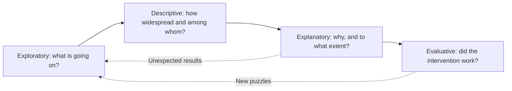

## Introduction

Every study has a purpose, and that purpose determines what kind of claim the study can legitimately make at the end. A survey showing that most Kumasi pharmacies use some form of digital stock management *describes*; it does not explain why. A dozen interviews with fintech founders may *explore* a new phenomenon richly; they cannot establish how common it is. A carefully designed study linking training to fewer phishing incidents may *explain*, but only if its design rules out rival explanations.

Research design textbooks, including Saunders, Lewis and Thornhill, classify the purpose of research as exploratory, descriptive or explanatory (some add evaluative). This lesson explains each purpose, the questions and methods associated with it, how purposes are often combined in a single project, and the conditions needed before a study can claim that one thing causes another. Mastering this classification helps you write research questions whose verbs match your design, a point examiners check closely.

## Learning Objectives

- Explain the aims and typical methods of exploratory, descriptive and explanatory research.
- Classify research questions by purpose and justify the classification.
- Apply the three conditions for causal inference to evaluate an explanatory claim.
- Compare how the three purposes can be sequenced within one research programme.
- Evaluate whether a study's conclusions exceed what its purpose and design can support.

## Prerequisite Knowledge

- Writing research objectives and questions (Module 2).
- The difference between quantitative, qualitative and mixed-methods research (previous lesson).
- Basic understanding of variables and relationships.

## Key Terminology

- **Exploratory research**: Research that investigates a poorly understood problem to clarify concepts, generate insights and identify variables or hypotheses for later study.
- **Descriptive research**: Research that produces an accurate profile of persons, events, situations or the distribution of characteristics in a population.
- **Explanatory research**: Research that establishes and explains relationships between variables, often in cause-and-effect terms.
- **Descripto-explanatory research**: A study that first describes a situation and then uses that description to explain relationships, a common pattern in business dissertations.
- **Causal inference**: The process of concluding that a change in one variable produces a change in another, having ruled out plausible alternative explanations.
- **Spurious relationship**: An apparent association between two variables that is actually produced by a third variable.
- **Confounding variable**: A variable related to both the presumed cause and the outcome that can distort the estimated relationship between them.
- **Temporal precedence**: The requirement that a cause occurs before its effect.

## Detailed Explanation

### Exploratory research

Exploratory research is used when the researcher does not yet know enough to specify precise variables or hypotheses. Its aim is discovery: what is happening, what concepts matter, how do participants talk about the issue? Typical methods include literature searches, expert interviews, in-depth interviews with practitioners, focus groups and observation. Exploratory studies are flexible; the researcher may change direction as new insights emerge.

For instance, generative AI tools have entered small-business practice quickly. A student wanting to know how Ghanaian graphic-design micro-enterprises use such tools, and what risks owners perceive, may find little relevant literature. Exploratory interviews could reveal unexpected issues, such as concerns about clients' intellectual property or the use of AI for writing proposals in English for international clients. The output is a richer understanding and, often, propositions for later testing, not estimates of prevalence.

Exploratory research is sometimes dismissed as "preliminary", but at postgraduate level it can be a complete dissertation if the topic is genuinely under-researched and the analysis is rigorous. Its weakness is limited generalisability.

### Descriptive research

Descriptive research answers *who, what, where, when* and *how many* questions with accuracy. Precision matters: the population must be clearly defined, the sample should be representative, and the measures valid. Typical methods include structured surveys, analysis of secondary data such as administrative records, and systematic observation. Descriptive statistics such as frequencies, percentages, means and cross-tabulations are the main analytical tools.

Description is essential for decision-making. A regional health directorate planning a records-digitisation programme needs to know how many facilities have reliable electricity, internet access and trained records staff. Saunders and colleagues caution, however, that description alone can be a "means to an end" in a dissertation: examiners expect the student to go on to draw conclusions, which leads naturally to descripto-explanatory work.

### Explanatory research

Explanatory research seeks to establish relationships and, where possible, to explain why they occur. Questions are framed as *why*, *to what extent* or *what is the effect of*. Quantitative explanatory studies typically test hypotheses derived from theory using correlation, regression or experiments. Qualitative explanatory studies, such as explanatory case studies, trace processes and mechanisms in depth.

The central challenge of explanatory research is **causal inference**. A survey may show that SMEs using AI tools report higher efficiency, but perhaps larger, better-resourced firms both adopt AI and run efficiently for other reasons. Firm size would then be a **confounding variable**.

### The three conditions for causal claims

A widely used framework, rooted in the philosophy of John Stuart Mill and standard in methods texts, holds that three conditions must be satisfied before claiming X causes Y.

1. **Covariation**: X and Y vary together; when X changes, Y tends to change.
2. **Temporal precedence**: X occurs before Y.
3. **Non-spuriousness**: the relationship is not explained by a third variable Z.

Experiments satisfy all three most convincingly because the researcher manipulates X and random assignment balances other variables. Cross-sectional surveys can establish covariation and, by statistically controlling for measured confounders, partially address non-spuriousness, but temporal order is often assumed rather than demonstrated. A well-written dissertation therefore uses cautious language such as "is associated with" or "predicts" unless the design supports "causes".

## Theories, Frameworks and Models

### Matching purpose, question and method

The table below summarises how purpose links to question wording, design and analysis.

| Purpose | Typical question stems | Typical designs and methods | Typical analysis | Claim supported |
|---|---|---|---|---|
| Exploratory | What is happening? How do participants understand...? | In-depth interviews, focus groups, expert interviews, literature search | Thematic coding, memo-writing | New concepts, propositions, insights |
| Descriptive | How many? What proportion? What are the characteristics of...? | Cross-sectional surveys, secondary data, structured observation | Frequencies, percentages, means, cross-tabulations | Accurate profile of a population |
| Explanatory | Why? To what extent does X affect Y? What explains...? | Experiments, hypothesis-testing surveys, explanatory case studies | Correlation, regression, process tracing | Relationships and (with strong design) causes |
| Evaluative | How effective is...? Did the intervention achieve its aims? | Quasi-experiments, before-and-after studies, mixed methods | Comparisons against criteria or baselines | Judgement of worth or effectiveness |

### The research cycle across purposes

In a mature research programme, purposes often follow one another. Exploration identifies variables; description establishes their distribution; explanation tests relationships; evaluation judges interventions informed by the explanation. A single MSc dissertation rarely does all four, but awareness of the cycle helps you position your study: "Previous exploratory studies identified trust and agent availability as concerns; this study tests their explanatory power."

## Diagram

The dotted arrows show that surprising explanatory or evaluative findings often prompt new exploratory work.

## Worked Example

**Illustrative scenario.** Efua is researching digital payment adoption among retailers in Makola Market, Accra. Her supervisor asks her to classify three draft questions and check that her methods fit each.

**Question 1:** *What reasons do retailers give for accepting or refusing mobile money merchant payments?*
- Purpose: exploratory (reasons are not pre-specified and may include unanticipated factors).
- Fit: semi-structured interviews with a purposive sample of retailers of different trades and sizes.
- Expected claim: "Retailers described five main considerations..." with no claim about percentages.

**Question 2:** *What proportion of retailers accept mobile money merchant payments, and how does this differ by trade category and age of owner?*
- Purpose: descriptive.
- Fit: structured questionnaire to a sample drawn as representatively as possible, analysed with percentages and cross-tabulations.
- Expected claim: "An estimated X% (with stated margin of error) accept merchant payments; acceptance is higher among..."

**Question 3:** *To what extent do perceived transaction costs and trust predict retailers' intention to accept merchant payments, controlling for business size?*
- Purpose: explanatory.
- Fit: hypothesis-testing survey using validated scales and multiple regression.
- Causal check: covariation can be shown; temporal precedence is plausible theoretically (perceptions shape intention) but not demonstrated; non-spuriousness is partly addressed by controlling for business size, but other confounders (education, customer base) may remain.
- Expected claim: "Trust is a significant positive predictor of intention" rather than "Trust causes adoption".

**Sequencing decision.** Efua realises Question 1 can inform the wording of items for Questions 2 and 3, producing an exploratory sequential design. The expected output of this exercise is a classification table with purpose, method, analysis and the strength of claim permitted for each question.

## Ghanaian Business Application

Ghanaian organisations commission research for each purpose, and confusing them can lead to poor decisions.

- **Banks and fintechs** often run *descriptive* market surveys (who has a wallet, who uses agent services) before launching products. When a product underperforms, managers need *explanatory* research to diagnose why, for example whether the problem is price, network reliability or trust in agents. Using a descriptive survey to answer an explanatory question invites misattribution.
- **SME support agencies and business associations** may want to understand how small manufacturers in Kumasi experiment with e-commerce. Where little is known, *exploratory* interviews with owners and platform intermediaries are the sensible first step.
- **University IT units** concerned about student cybersecurity might first *describe* the prevalence of risky behaviours such as password reuse, then *explain* which factors (awareness, perceived vulnerability, peer norms) predict safe behaviour, and finally *evaluate* an awareness campaign.
- **Hospitals adopting technology** frequently need *evaluative* research: has a new appointment system reduced waiting times? Here the comparison against a baseline is crucial.

A practical test for any Ghanaian MSc proposal is to underline the verb in each research question and ask whether the planned design can actually deliver that kind of answer.

## International Case Study

### Google's Project Aristotle

Google's People Operations researchers undertook a widely publicised internal study, known as Project Aristotle, to understand what makes some teams more effective than others. Google has described the project publicly through its re:Work website, and it attracted extensive media coverage.

The project moved through several purposes. Initially it had an *exploratory* character: researchers reviewed academic literature on team effectiveness and considered many possible factors, including team composition, personality, skills and seniority mix. They gathered *descriptive* data on a large number of internal teams, combining measures of effectiveness from managers, team leaders and members. The *explanatory* phase sought the factors that best distinguished effective teams. Google reported that who was on a team mattered less than how the team worked together, and that **psychological safety**, a concept developed by Amy Edmondson in her research on learning behaviour in work teams, was the most important of the factors they identified, alongside dependability, structure and clarity, meaning and impact.

The case illustrates three points. First, plausible initial hypotheses (that the "right mix" of people produces effective teams) were not supported, showing why exploration should not be skipped. Second, describing teams accurately required careful definition of the outcome variable, because "effectiveness" meant different things to different stakeholders. Third, the findings are explanatory associations within one company's teams; transferring them to other contexts, such as Ghanaian SMEs with family-based teams, requires further research.

## Common Misconceptions

- **Misconception:** Exploratory research is unscientific because it lacks hypotheses. **Correction:** Exploratory research is systematic; it is designed to generate well-grounded concepts and hypotheses where none can yet be justified.
- **Misconception:** Descriptive research is too simple for a master's dissertation. **Correction:** Accurate description of a defined population requires rigorous sampling and measurement, though most dissertations also draw analytical conclusions from it.
- **Misconception:** A statistically significant regression coefficient proves causation. **Correction:** Significance shows an association unlikely to be due to chance alone; causation also requires temporal precedence and the elimination of confounders.
- **Misconception:** Each study can have only one purpose. **Correction:** Many studies combine purposes, for example descripto-explanatory surveys or exploratory phases that feed explanatory testing.
- **Misconception:** Explanatory research must be quantitative. **Correction:** Qualitative explanatory case studies can explain mechanisms by tracing processes in depth.

## Common Examination Mistakes

- Classifying a question as explanatory merely because it contains the word "how", without checking whether it asks for mechanisms or extent.
- Using causal language ("impact", "effect", "causes") in conclusions drawn from cross-sectional survey data without qualification.
- Proposing a descriptive survey to answer a "why" question.
- Failing to identify an obvious confounding variable in a scenario question.
- Defining the three purposes accurately but not applying them to the case provided.

## Critical Thinking Questions

1. Many dissertations claim to study the "impact" of a technology using a single cross-sectional survey. Is the word "impact" ever defensible in such a study? What wording would you recommend instead, and why?
2. When is an exploratory study the most rigorous choice rather than a fallback for students who cannot design an explanatory study?
3. Project Aristotle drew conclusions from one organisation's teams. What would you need to do to test whether psychological safety explains team effectiveness in Ghanaian banks?
4. Can description ever be neutral? Consider how the choice of categories (for example "formal" versus "informal" business) shapes what a descriptive study reveals.

## Practical Exercises

1. **Classify and justify.** Write one exploratory, one descriptive and one explanatory question on cybersecurity awareness among university students in Ghana. *Expected output:* three questions, each with its purpose, a suitable method and a sentence stating the strongest claim the method could support.
2. **Confounder hunt.** A study reports that hospitals using electronic records have shorter patient waiting times. List three possible confounding variables and suggest how a researcher could address each. *Expected output:* a three-row table with confounder, why it could explain the association, and a design or statistical remedy.
3. **Rewrite causal claims.** Rewrite the conclusion "AI adoption causes higher SME efficiency" so that it is appropriate for (a) a cross-sectional survey and (b) a randomised field experiment. *Expected output:* two sentences with appropriately calibrated language and a one-line explanation of the difference.

## Key Takeaways

- Exploratory research discovers concepts and propositions; descriptive research profiles populations accurately; explanatory research establishes and explains relationships.
- The verb in a research question signals its purpose and must match the design.
- Causal claims require covariation, temporal precedence and non-spuriousness.
- Purposes are frequently combined and sequenced, for example in descripto-explanatory or exploratory sequential studies.
- Calibrate conclusions to what the design can support.

## Further Reading

- Saunders, M., Lewis, P., & Thornhill, A. (2019). *Research methods for business students* (8th ed.). Pearson.
- Bell, E., Bryman, A., & Harley, B. (2019). *Business research methods* (5th ed.). Oxford University Press.
- Creswell, J. W., & Creswell, J. D. (2018). *Research design: Qualitative, quantitative, and mixed methods approaches* (5th ed.). SAGE.
- Edmondson, A. (1999). Psychological safety and learning behavior in work teams. *Administrative Science Quarterly, 44*(2), 350-383.
- Shadish, W. R., Cook, T. D., & Campbell, D. T. (2002). *Experimental and quasi-experimental designs for generalized causal inference*. Houghton Mifflin.

## Video Resources

- [SAGE Research Methods](https://methods.sagepub.com/): SAGE Publishing. Official research methods platform (access may depend on institutional subscription) covering research purposes and design.
- [Google re:Work](https://rework.withgoogle.com/): Google. Official site where Google shares guides and research summaries on team effectiveness, including Project Aristotle.

## Revision Summary

Research purpose determines the claims a study can make: exploratory research clarifies poorly understood problems and generates propositions; descriptive research accurately profiles a defined population; explanatory research establishes relationships and, with strong designs, causes. Many projects combine purposes, and conclusions must be calibrated to the design.

- Exploratory = what is going on; descriptive = how many and who; explanatory = why and to what extent.
- Causation needs covariation, temporal precedence and non-spuriousness.
- Confounders create spurious relationships; control them by design or statistics.
- Match question verbs to designs.
- Avoid "impact" language for cross-sectional associations.
