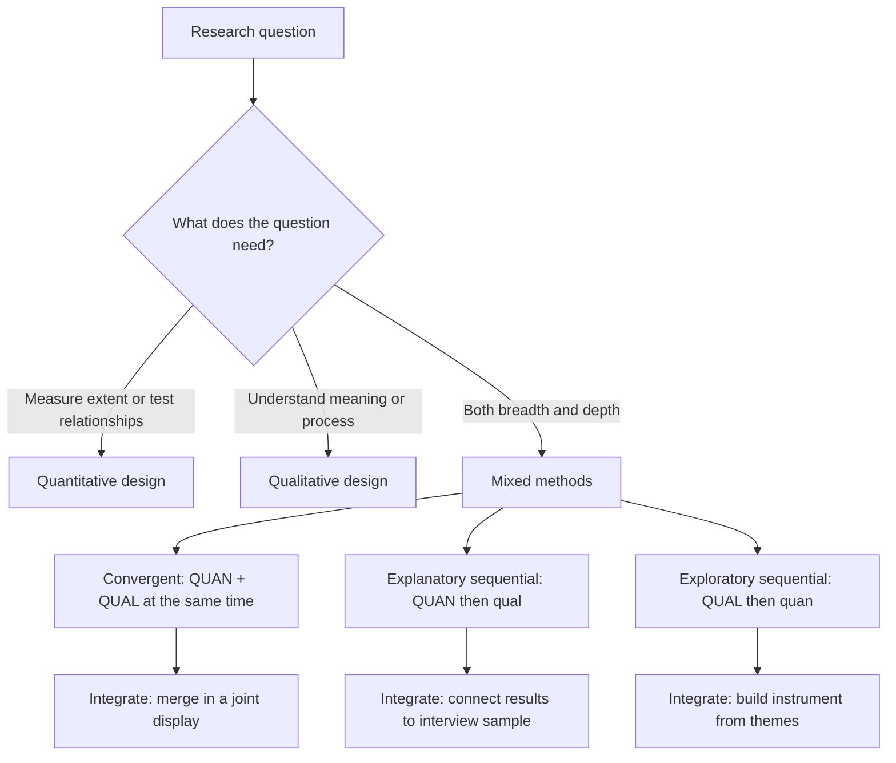

## Introduction

Once a research problem, objectives and conceptual framework are in place, the next decision is how evidence will be gathered and analysed to answer the questions. The most fundamental choice in that decision is the *methodological approach*: will the study rely mainly on numerical data analysed statistically, on textual and visual data interpreted for meaning, or on a deliberate combination of the two? This choice is not a matter of personal preference or of which software a student finds easier. It follows from the research question, the philosophical position adopted (Module 1) and the state of existing knowledge (Module 3).

This lesson explains the logic, strengths and limitations of quantitative, qualitative and mixed-methods research. It then introduces the core mixed-methods designs, shows how to justify a choice in a methodology chapter, and works through an example drawn from artificial intelligence (AI) adoption among Ghanaian small and medium-sized enterprises (SMEs). By the end you should be able to defend your approach to an examiner who asks, "Why did you not do it the other way?"

## Learning Objectives

- Explain the defining features, logic and typical methods of quantitative, qualitative and mixed-methods research.
- Compare the strengths and limitations of each approach in relation to different types of research question.
- Distinguish the convergent, explanatory sequential and exploratory sequential mixed-methods designs.
- Apply decision criteria to select an approach for an IT-for-business research problem.
- Evaluate a proposed design for coherence between paradigm, question, approach and methods.

## Prerequisite Knowledge

- Research paradigms (positivism, interpretivism and pragmatism) and the ideas of ontology and epistemology from Module 1.
- How to write research objectives, questions and hypotheses (Module 2).
- The role of theoretical and conceptual frameworks such as TAM and UTAUT (Module 3).

## Key Terminology

- **Quantitative research**: An approach that collects numerical data, or data that can be meaningfully converted into numbers, and analyses them statistically to describe patterns or test relationships.
- **Qualitative research**: An approach that collects non-numerical data such as interview transcripts, observations and documents, and interprets them to understand meanings, experiences and processes in context.
- **Mixed-methods research**: An approach that intentionally collects and analyses both quantitative and qualitative data within one study and integrates them to answer the research questions.
- **Integration**: The point and manner in which quantitative and qualitative strands are brought together, for example by comparing, connecting or embedding results.
- **Deductive reasoning**: Moving from theory to hypotheses that are tested against data; typical of quantitative designs.
- **Inductive reasoning**: Building concepts, themes or theory from patterns observed in data; typical of qualitative designs.
- **Abductive reasoning**: Moving back and forth between data and theory to find the most plausible explanation for a surprising observation.
- **Multi-method research**: Using more than one method of the same kind (for example, a survey and secondary statistics) without combining quantitative and qualitative strands.

## Detailed Explanation

### The logic of quantitative research

Quantitative research treats the phenomena of interest as *variables* that can be measured with acceptable precision. A researcher studying whether perceived usefulness influences retailers' intention to use digital payments would define each construct, measure it with questionnaire items, collect responses from a sample and use statistical techniques to estimate relationships. The logic is usually **deductive**: theory produces hypotheses, data are collected under controlled or standardised conditions, and the hypotheses are supported or not.

Its strengths are breadth, comparability and the possibility of generalising from a sample to a population when sampling is done properly. Its limitations are equally important. Measurement can only capture what the instrument asks about, so unexpected factors are easily missed. Standardised questions can strip away context; a retailer may tick "agree" to "Digital payments are useful" while privately meaning "useful for customers but costly for me". Quantitative research tends to be strongest when the concepts are already well understood and validated measures exist.

### The logic of qualitative research

Qualitative research aims to understand how people experience, interpret and act in their world. Data usually take the form of words, images or observations gathered through interviews, focus groups, participant observation or documents. The logic is typically **inductive** or abductive: rather than starting with fixed hypotheses, the researcher allows concepts and explanations to emerge from close engagement with the data, although existing theory still sensitises the analysis.

Qualitative research excels at answering "how" and "why" questions in context, uncovering processes, and studying new or poorly theorised phenomena. A study of how owners of Accra fashion boutiques decide whether to trust an AI chatbot with customer conversations would benefit from in-depth interviews because the relevant considerations (reputation, language, family involvement in the business) may not yet appear in published adoption models. Its limitations include small samples that do not support statistical generalisation, the time required for data collection and analysis, and the need to demonstrate trustworthiness rather than statistical reliability.

### Why "numbers versus words" is too simple

It is tempting to define the approaches by data type alone, but the deeper differences lie in assumptions and purposes. The table below compares them on several dimensions.

| Dimension | Quantitative | Qualitative | Mixed methods |
|---|---|---|---|
| Typical paradigm | Positivism or post-positivism | Interpretivism or constructivism | Pragmatism (sometimes critical realism) |
| Dominant reasoning | Deductive | Inductive or abductive | Combination, sequenced deliberately |
| Typical questions | To what extent, how many, does X affect Y | How, why, what is the experience of | Questions needing both breadth and depth |
| Sampling | Large, ideally probability-based | Small, purposive | Different samples per strand, linked by design |
| Data | Structured questionnaires, experiments, logs, secondary statistics | Interviews, focus groups, observation, documents | Both, collected concurrently or sequentially |
| Analysis | Descriptive and inferential statistics | Coding, thematic or narrative analysis | Separate analyses plus integration |
| Quality criteria | Validity, reliability, generalisability | Credibility, transferability, dependability, confirmability | Criteria for each strand plus quality of integration |
| Main risk | Measuring the wrong thing precisely | Rich but non-transferable findings | Two weak studies stapled together |

The final row is the most useful warning. Each approach has a characteristic failure, and good design anticipates it.

## Theories, Frameworks and Models

### Pragmatism as the philosophy of mixing

Mixed-methods researchers frequently adopt **pragmatism**, which judges methods by how well they answer the research question rather than by allegiance to a single view of reality. Pragmatism does not mean "anything goes"; it requires an explicit argument that combining approaches yields understanding that neither could provide alone.

### Core mixed-methods designs

Creswell and Plano Clark describe three core designs that most student projects can adopt or adapt.

1. **Convergent design.** Quantitative and qualitative data are collected in the same phase, analysed separately, then compared or merged to see whether they agree, complement or contradict one another. Useful when you want a fuller picture of one phenomenon within limited time.
2. **Explanatory sequential design.** A quantitative phase comes first; its results then guide a qualitative phase that explains them. For example, a survey finds that facilitating conditions strongly predict AI use, and follow-up interviews explore what "facilitating conditions" actually mean for SME owners.
3. **Exploratory sequential design.** A qualitative phase comes first to explore an under-researched issue; its findings are then used to build an instrument, intervention or hypotheses tested quantitatively. Useful when no suitable measures exist for the local context.

A common shorthand, associated with Morse, uses capitals to show priority and arrows to show sequence: `QUAN → qual` means a dominant quantitative phase followed by a supporting qualitative one; `QUAL + quan` means concurrent strands with qualitative priority.

### Integration: the defining feature

Integration distinguishes genuine mixed methods from two studies placed side by side. Integration can occur by **connecting** (results of one phase determine the sample or questions of the next), **building** (qualitative themes become questionnaire items), **merging** (results are compared in a joint display table) or **embedding** (a qualitative strand sits inside an experiment). A methodology chapter should state where integration happens and how.

## Diagram

## Worked Example

**Illustrative scenario.** Kwame is an MSc student interested in AI adoption among SMEs in Greater Accra. His draft question is: *"How does AI adoption affect SME operational efficiency?"* Work through the choice of approach.

**Step 1: Clarify what the question asks.** "How does" could mean "to what extent" (a measurable relationship) or "through what processes" (an explanation of mechanisms). Kwame decides he wants both: whether adoption is associated with efficiency gains, and how owners experience those gains.

**Step 2: Check existing knowledge.** His literature review shows that validated scales exist for AI use and perceived efficiency, but few studies examine Ghanaian SMEs, and none explain *how* efficiency gains arise in informal or family-run firms.

**Step 3: Match approach to need.** A purely quantitative survey would estimate associations but not explain mechanisms. A purely qualitative study would explain mechanisms in a few firms but not show how widespread the pattern is. A mixed-methods design is justified.

**Step 4: Choose the design.** Because validated measures exist, he chooses an **explanatory sequential design** (`QUAN → qual`): a survey of SMEs followed by interviews with selected owners.

**Step 5: Specify integration.** Survey results will be used to select interviewees, for example firms with high AI use but low reported efficiency (surprising cases) and firms with high use and high efficiency (typical cases). Interview themes will be reported alongside survey results in a joint display.

**Step 6: Write the justification.** A concise methodology statement might read: *"A pragmatist, explanatory sequential mixed-methods design was adopted because the first objective requires estimating the relationship between AI use and efficiency across SMEs, while the second requires understanding the mechanisms behind that relationship, which existing measures do not capture."*

The expected output is a design statement that names the approach, the specific design, the reason for its sequence and the point of integration.

## Ghanaian Business Application

Ghanaian business and technology research frequently benefits from careful approach selection because local conditions differ from those in which many theories were developed. Consider three common MSc topics.

- **Digital payment adoption among retailers.** If the aim is to estimate which factors predict acceptance of mobile money merchant payments across many market traders, a quantitative survey grounded in UTAUT is appropriate. But if traders' concerns involve informal credit relationships with customers or anxieties about tax visibility, those issues may only surface through interviews. An exploratory sequential design lets interviews shape culturally appropriate survey items.
- **Cybersecurity awareness among university students.** A questionnaire can measure awareness levels and self-reported behaviour across faculties. A small number of focus groups can explain why students who score highly on awareness still share passwords with friends, a gap between knowledge and practice that numbers alone cannot interpret.
- **Healthcare technology adoption.** A study of an electronic records system in a regional hospital might combine system usage logs (quantitative) with interviews of nurses and records officers (qualitative) in a convergent design, comparing what the logs show with what staff report.

In each case the researcher should also consider practical constraints common in Ghanaian fieldwork: the languages in which interviews must be conducted, the availability of sampling frames, internet connectivity for online surveys, and the requirement to protect personal data under the Data Protection Act, 2012 (Act 843). A mixed-methods design roughly doubles the fieldwork, so a student must show it is necessary and feasible within the dissertation timeline.

## International Case Study

### The Hawthorne studies at Western Electric

Between the mid-1920s and early 1930s, researchers conducted a series of studies at the Hawthorne Works of the Western Electric Company near Chicago. The early studies were essentially quantitative experiments: they varied workplace lighting and other conditions and measured worker output. Results were puzzling, because output sometimes rose in both experimental and comparison groups regardless of the changes made.

The investigators, later associated with Elton Mayo, Fritz Roethlisberger and William Dickson, then moved towards extensive interviewing of employees and close observation of work groups, including the well-known Bank Wiring Observation Room. These qualitative phases revealed the importance of informal group norms, supervision styles and social relationships, factors that the original experimental variables had not captured. The studies, reported in Roethlisberger and Dickson's *Management and the Worker*, became foundational to the human relations movement.

Later scholars have criticised aspects of the original experiments and debated the so-called "Hawthorne effect". For research design, however, the case illustrates two enduring lessons. First, quantitative measurement can tell you *that* something unexpected is happening without telling you *why*. Second, moving from experiments to interviews and observation is an early example of sequential, mixed enquiry in which one approach compensates for the blind spots of the other. Modern researchers would make the integration more systematic and plan it from the start rather than adopting it in response to surprise.

## Common Misconceptions

- **Misconception:** Qualitative research is simply research without statistics. **Correction:** Qualitative research has its own rigorous logic, sampling strategies, analytical procedures and quality criteria; it is not a weaker version of quantitative research.
- **Misconception:** Mixed methods is always superior because it uses "more" methods. **Correction:** Mixed methods is justified only when the question needs both strands and the researcher can integrate them; otherwise it doubles the workload without adding insight.
- **Misconception:** Including a few open-ended questions in a survey makes a study mixed methods. **Correction:** A handful of open comments is usually a minor qualitative component; mixed methods requires a planned qualitative strand with its own sampling, analysis and integration.
- **Misconception:** Quantitative research is objective and qualitative research is subjective. **Correction:** Both involve researcher judgement, in choosing measures, cut-offs and models as well as in coding; quality depends on transparency about those judgements.
- **Misconception:** The approach is chosen first and the question adjusted to fit. **Correction:** The research question and the state of knowledge should drive the approach.

## Common Examination Mistakes

- Describing quantitative and qualitative research in general terms without linking either to the specific question in the scenario.
- Claiming a study is mixed methods without naming the design (convergent, explanatory sequential, exploratory sequential) or explaining integration.
- Equating qualitative research with "small sample surveys" or describing interview data as being analysed by percentages only.
- Omitting the philosophical justification, for example proposing an interpretivist paradigm alongside hypothesis testing without explanation.
- Listing advantages and disadvantages as memorised bullet points instead of evaluating them in relation to the case.

## Critical Thinking Questions

1. A supervisor tells you that "mixed methods is fashionable but rarely done well". What evidence would you present in your proposal to show your mixed-methods design is necessary and feasible?
2. Can a positivist researcher legitimately conduct interviews? Under what conditions, and how would the interview data be treated differently from an interpretivist study?
3. In an explanatory sequential study of AI adoption, what would you do if the interview findings contradicted the survey results? Is contradiction a failure or a finding?
4. Should research in Ghanaian contexts rely on adoption theories developed elsewhere and tested quantitatively, or begin with qualitative exploration? Justify your view with reference to a specific topic.

## Practical Exercises

1. **Approach matching.** Write three research questions on e-commerce adoption among Ghanaian small businesses: one best answered quantitatively, one qualitatively, and one requiring mixed methods. *Expected output:* three questions, each followed by two sentences justifying the approach with reference to what the question needs.
2. **Design a mixed-methods study.** For the topic "cybersecurity awareness among university students", choose one core mixed-methods design and draw a simple flow diagram showing phases, sample for each phase and point of integration. *Expected output:* a labelled diagram (for example `QUAN → qual`) and a 150-word justification.
3. **Joint display.** Create an empty joint display table for a convergent study of electronic health records in a hospital, with rows for three themes and columns for "survey result", "interview finding" and "integrated interpretation". *Expected output:* a table template with example entries showing agreement, complementarity and contradiction.

## Key Takeaways

- The approach follows from the research question, the paradigm and the state of existing knowledge, not from preference.
- Quantitative research offers breadth and statistical generalisation; qualitative research offers depth, context and explanation of processes.
- Mixed methods is defined by intentional integration, not by the mere presence of two data types.
- The three core mixed-methods designs are convergent, explanatory sequential and exploratory sequential.
- A strong methodology chapter names the design, justifies its sequence and priority, and states where integration occurs.

## Further Reading

- Creswell, J. W., & Creswell, J. D. (2018). *Research design: Qualitative, quantitative, and mixed methods approaches* (5th ed.). SAGE.
- Creswell, J. W., & Plano Clark, V. L. (2018). *Designing and conducting mixed methods research* (3rd ed.). SAGE.
- Saunders, M., Lewis, P., & Thornhill, A. (2019). *Research methods for business students* (8th ed.). Pearson.
- Bell, E., Bryman, A., & Harley, B. (2019). *Business research methods* (5th ed.). Oxford University Press.
- Roethlisberger, F. J., & Dickson, W. J. (1939). *Management and the worker*. Harvard University Press.

## Video Resources

- [SAGE Research Methods](https://methods.sagepub.com/): SAGE Publishing. Official research methods platform (access may depend on institutional subscription) with explanatory material on quantitative, qualitative and mixed-methods design.
- [MIT OpenCourseWare](https://ocw.mit.edu/): Massachusetts Institute of Technology. Official open learning portal; search for research design and qualitative methods course materials.

## Revision Summary

Quantitative research measures variables and tests relationships deductively, offering breadth and generalisation; qualitative research interprets words, observations and documents inductively, offering depth and contextual explanation; mixed methods deliberately integrates both, usually under a pragmatist philosophy, when a question needs breadth and depth together.

- Choose the approach from the question and the state of knowledge.
- Convergent = concurrent strands merged; explanatory sequential = QUAN then qual; exploratory sequential = QUAL then quan.
- Integration (connecting, building, merging, embedding) is what makes a study mixed methods.
- Each approach has its own quality criteria.
- Always justify feasibility as well as fit.
