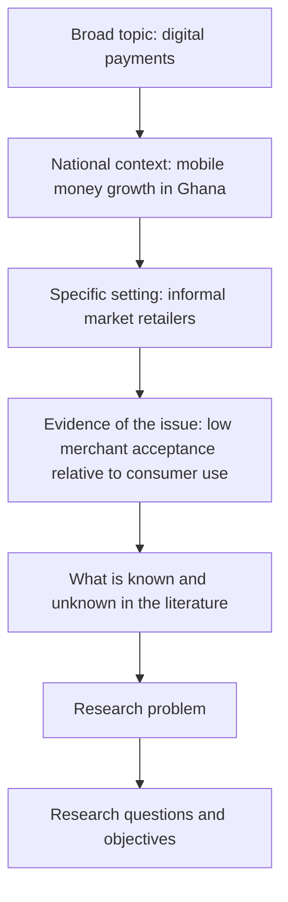

## Introduction

Every successful dissertation starts with a good research problem, and many struggling dissertations can be traced back to a weak one. Students commonly begin with a broad *topic* ("cloud computing", "fintech in Ghana") and assume that a problem will emerge as they read. Often it does not, and months later they are still collecting material without a focus. Learning to move deliberately from a topic of interest to a specific, researchable problem is therefore one of the most valuable skills in this course.

This lesson explains what a research problem is, where good problems come from, how to judge whether a problem is worth pursuing and feasible for an MSc, and how to write the **background to the study**: the opening section of a proposal or dissertation that establishes context and leads the reader, step by step, to the problem you will address. The next lesson turns the problem into a precise problem statement.

## Learning Objectives

- Distinguish a research topic, a research problem and a research question.
- Identify research problems from practice, literature, policy, technology change and theory.
- Apply feasibility and significance criteria to evaluate candidate research problems.
- Explain the difference between gap-spotting and problematisation as ways of generating research questions.
- Construct a funnel-structured research background for a Ghanaian IT-for-business study.

## Prerequisite Knowledge

- The characteristics of research and research purposes (Module 1).
- Basic familiarity with searching for academic articles.

## Key Terminology

- **Research topic**: A broad subject area of interest, such as digital payments or cybersecurity, which is not yet researchable in itself.
- **Research problem**: A specific issue, contradiction, knowledge gap or practical difficulty that justifies systematic investigation.
- **Research background**: The opening section of a proposal that establishes context, presents evidence of the issue and narrows towards the problem.
- **Funnel structure**: A way of organising the background from the broad context to the specific setting and problem.
- **Gap-spotting**: Identifying research questions by locating areas that existing literature has neglected, left incomplete or disputed.
- **Problematisation**: Generating research questions by identifying and challenging the assumptions underlying existing theory.
- **Researchability**: The extent to which a problem can be investigated empirically with available data, time and resources.
- **Significance**: The importance of a problem to theory, practice or policy, often expressed as who benefits from the answer.

## Detailed Explanation

### Topic, problem and question

A **topic** is an area of interest: "e-commerce among small businesses". A **problem** is a specific difficulty or puzzle within that area that needs explaining or solving: "Despite widespread smartphone ownership and the availability of free social media storefronts, many small retailers in Ghana continue to rely on walk-in sales, and the reasons are not well understood." A **research question** is the precise question the study answers: "What factors influence small retailers' decisions to adopt or reject online selling channels?" The movement from topic to problem to question is a process of narrowing and sharpening.

A research problem typically has three elements: a **desired or expected state** (what should be happening, or what theory predicts), an **actual state** (what is happening), and a **consequence** (why the gap matters). It is not simply something that is "bad"; it is a gap in knowledge or practice that evidence can help close.

### Sources of research problems

Good problems come from several sources, and strong proposals often combine more than one.

1. **Professional practice and workplace experience.** Many MSc IT for Business students work in banks, telecoms, hospitals or the public sector. Recurring operational difficulties, such as low uptake of a new staff portal, are fertile ground for applied research.
2. **The academic literature.** Articles often end with "limitations and directions for future research". Systematic reading reveals contradictory findings, under-studied contexts and untested relationships.
3. **Policy and regulation.** New laws, national strategies and regulatory changes create questions about compliance, readiness and impact. Ghana's Cybersecurity Act, 2020 (Act 1038), for instance, raises questions about organisational preparedness.
4. **Technological change.** Emerging technologies such as generative AI, cloud services and digital identity systems create questions about adoption, value and risk before mature evidence exists.
5. **Theory.** A theory developed in one context, such as a technology acceptance model tested mostly in large organisations in high-income countries, may not hold in informal or resource-constrained settings.
6. **Replication and extension.** Re-testing a published model in a new population or with a new technology is a legitimate MSc contribution if justified.

### Gap-spotting and problematisation

Sandberg and Alvesson (2011) distinguish two broad ways researchers construct questions. **Gap-spotting** identifies something missing in existing literature: a neglected population, an under-researched technology, or a contradiction between studies. It is the most common approach and is appropriate for most MSc work. **Problematisation** (Alvesson & Sandberg, 2011) goes further by questioning the assumptions on which existing research rests. For example, much adoption research assumes that the individual is the decision-maker, whereas in some Ghanaian family businesses technology decisions may be collective or shaped by extended family obligations. Challenging that assumption could generate a more interesting question than simply spotting an untested population.

A useful warning follows from this distinction: "no one has studied X in Ghana" is not, on its own, a sufficient justification. You must explain why the Ghanaian context might produce *different* results or why the knowledge is *needed*.

### Writing the research background

The background establishes why the problem matters and situates it in context. It is usually structured as a **funnel**:

1. **Broad context**: the global or sectoral development, such as the growth of digital payments.
2. **Regional or national context**: how the development plays out in Africa and Ghana.
3. **Specific setting**: the sector, organisation type or population you will study.
4. **Evidence of the problem**: credible sources showing the issue exists.
5. **What is known and not known**: a brief signal of existing research and the gap.
6. **Transition**: a sentence leading into the problem statement.

Each claim in the background should be supported by credible evidence: peer-reviewed research, reports from recognised institutions or official statistics. Precise numbers must be cited from their original source; unsupported claims such as "most SMEs have adopted AI" undermine credibility. A typical MSc background runs to two or three pages and should not become a full literature review.

## Theories, Frameworks and Models

### Criteria for evaluating a candidate problem

Researchers in clinical fields popularised the **FINER** mnemonic (Feasible, Interesting, Novel, Ethical, Relevant) for judging research questions. A version adapted for MSc IT-for-business research is shown below.

| Criterion | Guiding question | Warning sign |
|---|---|---|
| Feasible | Can I access the data, participants and skills within the time available? | "I will survey all banks in West Africa." |
| Interesting | Will the answer matter to me, my supervisor and practitioners? | Choosing a topic only because it seems easy |
| Novel | Does it add to, test or extend existing knowledge? | Repeating a well-established finding without new context or justification |
| Ethical | Can it be done without undue harm, coercion or privacy risk? | Studying employees' personal mobile money records without consent |
| Relevant | Does it connect to theory, practice or policy needs? | No identifiable audience for the findings |
| Researchable | Can it be answered empirically? | "Should Ghana ban cryptocurrencies?" posed as a normative question with no empirical angle |

## Diagram

## Step-by-Step Guide

1. **List interests and experiences.** Write down three technologies or business issues you encounter at work or in daily life.
2. **Read broadly, then narrowly.** For each, read recent review articles to learn what is established and what is debated.
3. **Formulate candidate problems.** For each interest, write a one-sentence problem using the pattern: *expected state, actual state, consequence*.
4. **Screen with criteria.** Apply the adapted FINER table and discard problems that fail feasibility or ethics.
5. **Discuss with a supervisor or practitioner.** Test whether the problem is meaningful and whether access is realistic.
6. **Draft the funnel background.** Write one paragraph per funnel stage, supporting each claim with a credible source.
7. **Revise.** Remove material that does not lead to the problem; the background is an argument, not a history.

## Ghanaian Business Application

**Illustrative scenario.** Efua works in the IT department of a mid-sized Ghanaian microfinance institution. She notices that loan officers continue to record client information on paper before entering it into the core banking system, despite the institution supplying tablets with a field data app.

- **Topic:** mobile field data collection in microfinance.
- **Candidate problem:** The institution expected the tablets to reduce data-entry delays and errors (expected state), but officers continue to use paper (actual state), leading to duplicated work and delayed loan approvals (consequence).
- **Source of the problem:** professional practice, reinforced by literature on post-adoption behaviour, which shows that initial adoption does not guarantee continued use.
- **Feasibility:** Efua has access to staff and can obtain permission from management, but she must address the axiological issue of being an insider and ensure participation is voluntary.
- **Background funnel:** global growth of digital financial services, Ghana's widespread use of mobile financial services, microfinance's reliance on field officers, evidence from internal process reports (with permission) of continued paper use, literature on technology continuance, and the gap concerning field staff in Ghanaian microfinance.

This illustrates how a practical workplace observation, when combined with literature and screened against criteria, becomes a defensible research problem.

## International Case Study

### Researching the impact of M-Pesa in Kenya

Safaricom launched the M-Pesa mobile money service in Kenya in 2007, and it rapidly became one of the best-known examples of mobile financial services in the world. Its spread raised an obvious research problem: did access to mobile money actually improve household welfare, or was it merely a convenient payment method?

Economists Tavneet Suri and William Jack investigated this question using household survey data collected over several years, examining how changes in households' proximity to mobile money agents related to later economic outcomes. Their 2016 article in *Science* reported evidence that increased access to mobile money was associated with improvements in consumption and reductions in poverty, with notable effects for female-headed households.

The case shows how a research problem can emerge from a widely observed technological change, how the problem was framed around consequences that matter (welfare, not merely usage), and how researchers matched the question with appropriate data. For Ghanaian researchers, it also illustrates the value of asking not only "who adopts?" but "what difference does adoption make?", and it reminds us that findings from one country should be tested rather than assumed to transfer.

## Common Misconceptions

- **Misconception:** A topic is the same as a research problem. **Correction:** A topic is a broad area; a problem specifies a gap between what is expected and what is happening, with consequences.
- **Misconception:** "No one has studied this in Ghana" is enough justification. **Correction:** You must explain why the context matters or why the knowledge is needed.
- **Misconception:** The background should cover everything about the topic. **Correction:** It is a focused argument that funnels the reader towards the problem.
- **Misconception:** Problems must come only from the literature. **Correction:** Practice, policy, technological change and theory are all legitimate sources, ideally linked to literature.

## Common Examination Mistakes

- Presenting a topic ("e-banking in Ghana") when asked to state a research problem.
- Writing a background full of unsupported claims or invented statistics.
- Confusing the background with the literature review and making it excessively long.
- Ignoring feasibility, for example proposing a national survey with no sampling frame.
- Failing to explain the consequences of the problem, so its significance is unclear.

## Critical Thinking Questions

1. When is gap-spotting a weak basis for a dissertation, and how could problematisation strengthen it?
2. How should an insider researcher balance access advantages against risks to objectivity and participant freedom?
3. Is a problem that matters to one organisation sufficiently significant for an MSc dissertation? What would make it so?
4. How might findings from Kenyan mobile money research differ in Ghana, and what does this imply for problem formulation?

## Practical Exercises

1. **Topic to problem.** Choose one of: AI adoption in SMEs, digital payment acceptance among retailers, cybersecurity awareness among students. Write a problem using the pattern expected state, actual state, consequence. *Expected output:* one sentence for each element, combined into a coherent problem of 60 to 100 words.
2. **Screen candidate problems.** Write three candidate problems and evaluate each with the adapted FINER table. *Expected output:* a completed table with a decision (keep, revise or discard) and a reason for each.
3. **Funnel background.** Draft a 400-word background for your chosen problem with one paragraph for each funnel stage. *Expected output:* a structured draft in which each paragraph is labelled with its funnel stage and every factual claim is marked with the type of source needed to support it.

## Key Takeaways

- Move deliberately from topic to problem to question.
- A good problem states the expected state, the actual state and the consequence.
- Problems arise from practice, literature, policy, technology change, theory and replication.
- Gap-spotting is common; problematisation can produce more original questions.
- The background is a funnel-shaped argument supported by credible evidence.

## Further Reading

- Alvesson, M., & Sandberg, J. (2011). Generating research questions through problematization. *Academy of Management Review, 36*(2), 247-271.
- Sandberg, J., & Alvesson, M. (2011). Ways of constructing research questions: Gap-spotting or problematization? *Organization, 18*(1), 23-44.
- Suri, T., & Jack, W. (2016). The long-run poverty and gender impacts of mobile money. *Science, 354*(6317), 1288-1292. <https://doi.org/10.1126/science.aah5309>
- Saunders, M., Lewis, P., & Thornhill, A. (2019). *Research methods for business students* (8th ed.). Pearson.

## Video Resources

- [Purdue Online Writing Lab](https://owl.purdue.edu/): Purdue University. Official writing resource with guidance on developing research topics and questions.
- [SAGE Research Methods](https://methods.sagepub.com/): SAGE Publishing. Official platform (institutional access may be required) with material on formulating research problems.

## Revision Summary

A research problem is a specific gap between an expected and an actual state with meaningful consequences, narrower than a topic and broader than a research question. Problems come from practice, literature, policy, technological change, theory and replication, and should be screened for feasibility, interest, novelty, ethics, relevance and researchability. The background funnels from broad context to the specific problem using credible evidence.

- Topic, then problem, then question.
- Expected state, actual state, consequence.
- Gap-spotting versus problematisation (Sandberg and Alvesson).
- Adapted FINER criteria screen candidate problems.
- Background is an argument, not a history or a full literature review.
