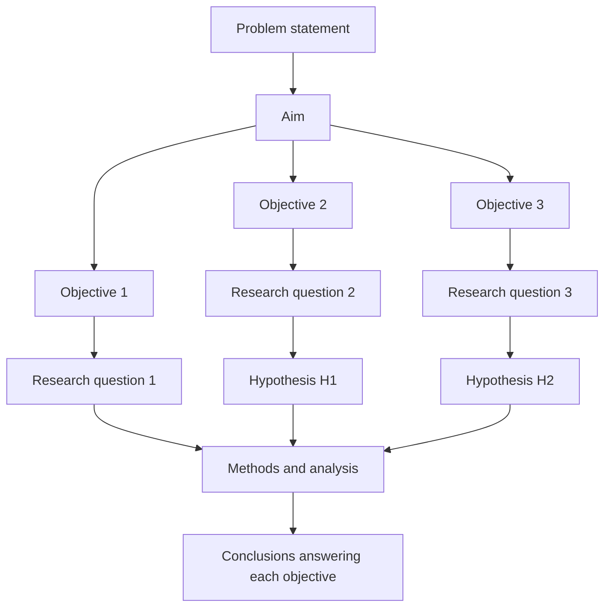

## Introduction

Once a research problem has been identified and stated, the researcher must translate it into a precise plan of enquiry. This is the role of the **aim**, **objectives**, **research questions** and, in many quantitative studies, **hypotheses**. These statements are the backbone of a dissertation: they determine what literature is reviewed, what data are collected, how data are analysed and, finally, what the conclusion must answer. Examiners routinely trace each objective through the methodology, findings and conclusions, and a study in which these elements do not line up is penalised heavily.

This lesson shows how to write each element, how they differ, and how to check that they are aligned with the problem statement and with each other. It uses recurring Ghanaian research contexts, including digital payment adoption, AI adoption in SMEs and technology use in healthcare, to illustrate good and weak formulations.

## Learning Objectives

- Distinguish a research aim, research objectives, research questions and hypotheses.
- Write SMART research objectives that begin with appropriate action verbs.
- Formulate descriptive, relational and causal research questions suited to different designs.
- Construct null and alternative hypotheses that are testable and grounded in theory.
- Evaluate the alignment of problem, aim, objectives, questions, hypotheses and methods using a consistency matrix.

## Prerequisite Knowledge

- Writing research problem statements (previous lesson).
- Understanding of positivism and interpretivism and of deductive and inductive reasoning (Module 1).

## Key Terminology

- **Research aim**: A single, broad statement of what the study intends to achieve overall.
- **Research objective**: A specific, measurable step that contributes to achieving the aim, usually beginning with an action verb.
- **Research question**: An interrogative statement specifying exactly what the study will answer.
- **Hypothesis**: A testable, predictive statement about the relationship between two or more variables, derived from theory or prior evidence.
- **Null hypothesis (H0)**: A statement of no relationship or no difference, which statistical tests evaluate.
- **Alternative hypothesis (H1)**: A statement that a relationship or difference exists, sometimes specifying its direction.
- **Independent variable**: A variable presumed to influence another variable.
- **Dependent variable**: The outcome variable presumed to be influenced.
- **Consistency matrix**: A table that maps each objective to its research question, hypothesis, data source and analysis technique to check alignment.

## Detailed Explanation

### From problem to aim

The **aim** expresses the overall purpose in one sentence and should follow directly from the problem statement. If the problem is that retailers in a Ghanaian city accept mobile money less readily than expected, and the reasons are not well understood, an appropriate aim is: *To examine the factors influencing retailers' acceptance of mobile money merchant payments in Kumasi.* The aim should not be so broad that it cannot be achieved ("to improve digital finance in Ghana"), nor should it list every detail of the study.

### Objectives

**Objectives** break the aim into specific, achievable steps. Each objective should describe something the research will *do* that produces knowledge. They are often written in the **SMART** form: Specific, Measurable, Achievable, Relevant and Time-bound (in a dissertation, "time-bound" is usually satisfied by the study's timetable). Objectives typically begin with verbs such as *examine*, *assess*, *determine*, *explore*, *compare*, *evaluate* or *identify*. Vague verbs such as *understand*, *know* or *study* make objectives hard to measure.

Weak objectives include actions that are not research outcomes: "to distribute questionnaires" is a method, not an objective; "to recommend solutions" is usually an outcome of all objectives rather than a separate research step, although some applied studies include it as a final objective justified by the findings.

### Research questions

**Research questions** restate each objective as a question to be answered. They can be:

- **Descriptive** – "What is the level of cybersecurity awareness among undergraduate students?"
- **Relational** – "What is the relationship between perceived usefulness and intention to use AI tools among SME owners?"
- **Causal or explanatory** – "Does completing a security training module reduce students' susceptibility to simulated phishing emails?" (requires an experimental or quasi-experimental design).
- **Exploratory or process** – "How do nurses adapt their routines after the introduction of electronic health records?" (typical of qualitative research).

In qualitative studies, research questions are usually open, framed with "how" or "what", and may evolve as understanding develops. Qualitative studies normally do **not** have hypotheses, because they aim to build understanding inductively rather than to test predictions.

### Hypotheses

A **hypothesis** is a tentative, testable prediction derived from theory or prior research. It specifies variables and the expected relationship between them. In deductive quantitative studies, each relational research question may lead to one or more hypotheses. A good hypothesis is:

- **Grounded** in theory or evidence, not a guess;
- **Testable** with data the study can realistically collect;
- **Specific** about the variables and, where justified, the direction of the relationship;
- **Falsifiable**, meaning the data could show it to be wrong.

Statistically, researchers test the **null hypothesis** (no relationship) and decide whether evidence supports rejecting it in favour of the **alternative hypothesis**. For example:

- H0: Perceived usefulness has no significant relationship with retailers' intention to accept mobile money payments.
- H1: Perceived usefulness has a significant positive relationship with retailers' intention to accept mobile money payments.

In write-ups, students commonly present only the alternative hypotheses, which is acceptable if the testing logic is made clear in the analysis.

### Alignment

**Alignment** means that each element follows logically from the previous one and that every objective is addressed by the methods and answered in the conclusions. A misaligned study might state an objective about *measuring* adoption levels but collect only interview data from five managers, or test a hypothesis about trust when trust was never measured. A **consistency matrix** is a practical tool for checking alignment before data collection begins.

## Theories, Frameworks and Models

### Hierarchy of research purpose statements

| Level | Form | Quantity | Example (AI adoption in Ghanaian SMEs) |
|---|---|---|---|
| Problem | Statement of gap and consequence | One | Many SMEs have access to AI-enabled tools but uptake appears limited, and drivers are unclear |
| Aim | Broad purpose statement | One | To examine factors influencing AI tool adoption among SMEs in Greater Accra |
| Objectives | Action statements | Usually three to five | To assess the influence of perceived usefulness on adoption intention |
| Research questions | Questions | One per objective | What is the influence of perceived usefulness on adoption intention? |
| Hypotheses | Testable predictions | Where deductive | H1: Perceived usefulness positively influences adoption intention |

### Theory as the source of hypotheses

Hypotheses in technology adoption research are usually derived from established models. TAM (Davis, 1989) proposes that perceived usefulness and perceived ease of use shape attitudes and intentions; UTAUT (Venkatesh et al., 2003) proposes that performance expectancy, effort expectancy and social influence shape behavioural intention, and that facilitating conditions influence use behaviour, with moderating effects of gender, age, experience and voluntariness of use. A student who uses UTAUT should derive hypotheses from these relationships and justify any additions with literature.

## Diagram

## Worked Example

**Illustrative scenario.** Abena is studying technology adoption among nurses using an electronic health records (EHR) system in Ghanaian district hospitals. She uses UTAUT as her theoretical framework.

**Aim:** To examine the factors influencing nurses' use of electronic health records in selected district hospitals in Ghana.

| Objective | Research question | Hypothesis | Data | Analysis |
|---|---|---|---|---|
| To assess the level of EHR use among nurses | What is the level of EHR use among nurses? | None (descriptive) | Questionnaire items on frequency and range of use | Descriptive statistics |
| To examine the influence of performance expectancy on behavioural intention | What is the influence of performance expectancy on intention to use EHR? | H1: Performance expectancy positively influences behavioural intention | Validated UTAUT scale items | Regression or structural equation modelling |
| To examine the influence of facilitating conditions on use behaviour | What is the influence of facilitating conditions on EHR use? | H2: Facilitating conditions positively influence use behaviour | Scale items on support, infrastructure, training | Regression |
| To determine whether experience moderates the effect of effort expectancy on intention | Does experience moderate the effect of effort expectancy on intention? | H3: The effect of effort expectancy on intention is stronger for less experienced nurses | Scale items plus months of EHR use | Moderation analysis |

**Checking alignment.** Each objective has a matching question; relational questions have hypotheses grounded in UTAUT; every variable in a hypothesis is measured; each analysis suits the type of question. Abena's conclusion chapter will contain one section answering each objective. The expected learning is that the consistency matrix exposes gaps before data collection, when they are still cheap to fix.

## Ghanaian Business Application

Alignment problems are common when MSc students in Ghana adapt research from published studies. Consider a student studying e-commerce adoption among small businesses in Accra who writes an aim about *adoption*, objectives about *satisfaction with delivery services*, and hypotheses about *website quality*. Each element is reasonable alone, but together they describe three different studies. Rewriting the objectives so that each examines a determinant of adoption, such as perceived benefits, cost, digital skills or logistics constraints, restores coherence.

Applied research for Ghanaian organisations often includes a final objective such as "to propose recommendations for improving merchant uptake of digital payments". This is acceptable when the recommendations are derived explicitly from findings, but it should not be confused with a research objective that generates evidence. Similarly, qualitative studies, for example exploring how owner-managers of family businesses decide whether to use AI chatbots for customer service, should use open "how" questions without hypotheses. Writing hypotheses for an interpretive study signals philosophical incoherence to examiners.

## International Case Study

### Hypothesis development in the UTAUT study

Venkatesh, Morris, Davis and Davis (2003), writing in *MIS Quarterly*, set out to address a practical difficulty facing researchers: the existence of several competing models of technology acceptance. They reviewed eight prominent models, including the Theory of Reasoned Action, TAM, the Theory of Planned Behaviour and Innovation Diffusion Theory, compared them empirically, and formulated a unified model.

The study is a strong example of alignment. The overall aim (to develop and test a unified model) led to specific objectives (compare existing models, formulate a unified model, validate it), and the unified model was expressed through explicit, theoretically justified hypotheses, such as the influence of performance expectancy on behavioural intention and the moderating roles of gender, age and experience. Data were collected from employees in organisations adopting new systems, measured at several points in time, so the design matched the hypotheses about intention and subsequent use. For MSc students, the paper demonstrates how hypotheses should emerge from a clear theoretical argument rather than being listed without justification, and why every hypothesised variable must be measured.

## Common Misconceptions

- **Misconception:** Every study must have hypotheses. **Correction:** Hypotheses suit deductive quantitative studies; exploratory and qualitative studies normally use research questions only.
- **Misconception:** Objectives and methods are the same. **Correction:** Objectives state what knowledge will be produced; methods state how data will be gathered and analysed.
- **Misconception:** More objectives make a study stronger. **Correction:** Three to five focused, aligned objectives are usually more achievable and defensible than many loosely related ones.
- **Misconception:** A hypothesis is a guess. **Correction:** It is a reasoned prediction derived from theory or prior evidence and capable of being falsified.
- **Misconception:** Failing to reject the null hypothesis means the study has failed. **Correction:** Non-significant results are findings that contribute knowledge when the study is well designed.

## Common Examination Mistakes

- Writing objectives with unmeasurable verbs such as "to understand" or "to know".
- Listing hypotheses that contain variables never measured or not discussed in the literature review.
- Writing hypotheses for a qualitative or interpretivist study.
- Confusing the null and alternative hypotheses, or stating a hypothesis as a question.
- Producing objectives that do not follow from the problem statement or aim.

## Critical Thinking Questions

1. When is it justified to include a directional hypothesis rather than a non-directional one?
2. How might an interpretivist researcher respond to an examiner who asks, "Where are your hypotheses?"
3. If data collection reveals that one objective cannot be achieved, how should the researcher handle this in the dissertation?
4. Should a recommendation objective be part of an MSc research design? Consider the purposes of applied research.

## Practical Exercises

1. **Write an aligned set.** For the topic "digital payment adoption among Ghanaian retailers", write one aim, three SMART objectives, three research questions and two hypotheses. *Expected output:* a coherent set in which each objective has a matching question and hypotheses appear only for relational questions.
2. **Repair misalignment.** Given the aim "to assess cybersecurity awareness among students", the objective "to evaluate the university's network infrastructure" and the hypothesis "training improves job performance", identify and fix the misalignments. *Expected output:* a revised aim, objective and hypothesis with a one-sentence explanation of each change.
3. **Consistency matrix.** Build a five-column consistency matrix (objective, question, hypothesis, data, analysis) for your own proposed MSc study. *Expected output:* a completed matrix with at least three rows and no empty cells except where hypotheses are not applicable.

## Key Takeaways

- The aim is broad; objectives are specific steps; questions specify what will be answered; hypotheses are testable predictions.
- SMART objectives use measurable action verbs.
- Hypotheses suit deductive quantitative studies and must be grounded in theory.
- Qualitative studies use open questions rather than hypotheses.
- A consistency matrix ensures alignment from problem to conclusion.

## Further Reading

- Venkatesh, V., Morris, M. G., Davis, G. B., & Davis, F. D. (2003). User acceptance of information technology: Toward a unified view. *MIS Quarterly, 27*(3), 425–478. <https://doi.org/10.2307/30036540>
- Davis, F. D. (1989). Perceived usefulness, perceived ease of use, and user acceptance of information technology. *MIS Quarterly, 13*(3), 319–340. <https://doi.org/10.2307/249008>
- Creswell, J. W., & Creswell, J. D. (2018). *Research design: Qualitative, quantitative, and mixed methods approaches* (5th ed.). SAGE.
- Popper, K. (1959). *The logic of scientific discovery*. Hutchinson.

## Video Resources

- [Khan Academy](https://www.khanacademy.org/) — Khan Academy. Official learning platform; its statistics materials explain null and alternative hypotheses and significance testing.
- [SAGE Research Methods](https://methods.sagepub.com/) — SAGE Publishing. Official platform (institutional access may be required) with material on research questions and hypotheses.

## Revision Summary

A study's aim expresses its overall purpose; objectives break the aim into specific, measurable steps; research questions state exactly what will be answered; and hypotheses, used in deductive quantitative studies, are testable predictions derived from theory. All of these must align with the problem statement, methods, analysis and conclusions.

- One aim, three to five SMART objectives, one question per objective.
- Hypotheses: grounded, testable, specific, falsifiable; test H0 against H1.
- Descriptive questions need no hypotheses; qualitative studies use open questions.
- Derive hypotheses from models such as TAM or UTAUT.
- Use a consistency matrix to detect misalignment before collecting data.
