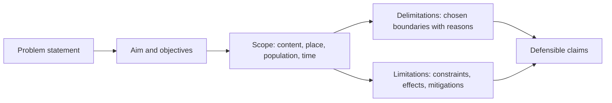

## Introduction

The problem statement is arguably the most important paragraph in a research proposal. Supervisors and examiners read it to decide whether the study is focused, justified and worth doing. A weak problem statement is vague, emotional or merely descriptive ("Cybercrime is increasing and this is bad"). A strong one identifies a specific gap, shows evidence that the gap exists, explains why it matters and points clearly to what the study will do about it.

Closely linked to the problem statement are three concepts that students routinely confuse: **scope**, **delimitations** and **limitations**. Together they tell the reader what the study covers, which boundaries the researcher has deliberately drawn, and which weaknesses are beyond the researcher's control. Stating these honestly is not an admission of failure; it is a mark of methodological maturity that protects you from overclaiming.

## Learning Objectives

- Explain the components of an effective research problem statement.
- Write a problem statement for a Ghanaian IT-for-business study using a structured template.
- Distinguish scope, delimitations and limitations and give examples of each.
- Evaluate problem statements and identify common weaknesses.
- Justify delimitations and propose mitigations for limitations.

## Prerequisite Knowledge

- Identifying research problems and writing the background (previous lesson).
- Awareness of basic research designs and sampling (developed further in Modules 4 and 5).

## Key Terminology

- **Problem statement**: A concise, evidence-based description of the specific issue a study addresses, its significance and the gap in knowledge or practice.
- **Scope**: The overall coverage of a study: its subject, population, setting, time frame and variables or themes.
- **Delimitations**: Boundaries deliberately chosen by the researcher to keep the study focused and feasible, such as region, sector or technology.
- **Limitations**: Weaknesses or constraints, often outside the researcher's control, that may affect the findings or their generalisability.
- **Generalisability**: The extent to which findings can be applied beyond the sample or setting studied.
- **Significance of the study**: The explanation of who benefits from the research and how, in theory, practice or policy.
- **Mitigation**: An action taken to reduce the effect of a limitation on the credibility of the findings.

## Detailed Explanation

### What a problem statement must do

A good problem statement answers four questions in a compact form, usually one to three paragraphs.

1. **What is the ideal or expected situation?** What should be happening according to policy, theory or organisational goals?
2. **What is the current reality?** What is actually happening, supported by credible evidence?
3. **What are the consequences?** Why does the discrepancy matter, and to whom?
4. **What is unknown, and what will this study do?** What gap in knowledge prevents the problem from being addressed, and how will the study contribute?

Some writers summarise this as "ideal, reality, consequences, proposal". The final element should lead directly into the research aim and objectives.

### Qualities of an effective problem statement

- **Specific.** It names the population, setting and phenomenon.
- **Evidence-based.** It cites credible sources for claims about the current situation.
- **Neutral.** It does not presume the answer. "To show that poor training causes low adoption" presumes the cause; "to examine factors associated with low adoption" does not.
- **Researchable.** The gap can be addressed with empirical data.
- **Concise.** It avoids lengthy background material, which belongs in the preceding section.

### Scope

Scope describes what the study covers. It usually specifies:

- **Content scope**: the variables, constructs or themes examined (for example, perceived usefulness, perceived risk and adoption intention).
- **Geographical scope**: the location (for example, the Greater Accra Region).
- **Population or unit of analysis**: who or what is studied (for example, registered SMEs with between 5 and 99 employees, or individual nurses).
- **Time scope**: the period covered by data collection, which affects whether results capture a moment or a trend.

### Delimitations

Delimitations are **choices**. The researcher draws boundaries to make the study focused and feasible, and must justify them. A study might focus only on retail pharmacies rather than all healthcare providers because pharmacies share similar inventory processes, or only on undergraduate students because they are the primary users of a particular campus system. Each delimitation should be accompanied by a reason, because unjustified boundaries look arbitrary.

### Limitations

Limitations are **constraints and weaknesses** that may affect the findings, often arising from design, resources or circumstances outside the researcher's control. Examples include reliance on self-reported data, a non-probability sample, a cross-sectional design that cannot establish causality, low response rates, or restricted access to organisational records. Good practice is to state each limitation, explain its likely effect and describe how it was mitigated. For instance, social desirability bias in self-reported cybersecurity behaviour may be reduced through anonymous questionnaires and carefully worded items.

A useful rule: you **delimit** your study; your study is **limited** by circumstances. In the proposal, limitations are anticipated; in the final dissertation, they are reported honestly in light of what actually happened.

## Theories, Frameworks and Models

### A template for problem statements

| Component | Purpose | Example sentence starter |
|---|---|---|
| Ideal or expected state | Establish what should be happening | "Digital payment platforms are expected to…" |
| Current reality with evidence | Show the discrepancy exists | "However, studies and industry reports indicate that…" |
| Consequences | Show why it matters | "This results in…, which affects…" |
| Knowledge gap | Show what is not known | "Existing research has focused on…, while little is known about…" |
| Purpose of the study | Point to the response | "This study therefore examines…" |

### Distinguishing the three boundary concepts

| Concept | Who controls it? | Typical example | What to write |
|---|---|---|---|
| Scope | Researcher, defined by the question | Content, place, population, time | A clear description of coverage |
| Delimitation | Researcher, by deliberate choice | Excluding microenterprises with fewer than five staff | The boundary and the reason for it |
| Limitation | Largely outside researcher's control | Low response rate; self-reported data | The weakness, its effect and mitigation |

## Diagram

## Worked Example

**Illustrative scenario.** A student's first draft reads: *"Cybercrime is a big problem in Ghana and students are victims. This study will show that students do not know about cybersecurity."*

**Step 1: Diagnose the weaknesses.** It is vague (which students, which crimes?), unsupported (no evidence), and presumes its conclusion ("will show that students do not know").

**Step 2: Rewrite using the template.**

> Universities increasingly rely on online learning platforms, student portals and mobile payment channels, and institutions expect students to protect their accounts and personal data responsibly. However, reports from national cybersecurity bodies and studies of university populations suggest that students remain frequent targets of phishing, account takeover and mobile money fraud *(student to insert specific, verified sources)*. Such incidents can lead to financial loss, compromised academic records and reputational harm to institutions. While existing studies have measured general awareness levels, less is known about how specific factors such as prior security training, self-efficacy and prior victimisation relate to students' actual security behaviour in Ghanaian universities. This study therefore examines the factors associated with cybersecurity behaviour among undergraduate students at a public university in Ghana.

**Step 3: Define scope, delimitations and limitations.**

- *Scope:* constructs of training, self-efficacy, prior victimisation and security behaviour; undergraduate students; one public university in Greater Accra; data collected in one semester.
- *Delimitations:* undergraduates only, because they are the largest user group of the student portal; one university, to allow access and a sampling frame through registered course lists (with permission).
- *Limitations:* self-reported behaviour may overstate good practice (mitigated by anonymity and behaviour-specific items); a single-university sample limits generalisation to other institutions (acknowledged when interpreting results); a cross-sectional design cannot establish causality (findings will be described as associations).

The expected outcome is a statement that is specific, evidence-based, neutral and clearly bounded.

## Ghanaian Business Application

Problem statements in Ghanaian business research are often weakened by unverified figures circulating on social media or in press releases. A student researching e-commerce adoption among small businesses in Kumasi should rely on credible sources, such as peer-reviewed studies, publications from recognised national bodies or official statistics, and should quote any figures exactly from those sources. Where reliable figures are not available, a qualitative statement such as "small businesses increasingly use social media platforms to reach customers" is more defensible than an invented percentage.

Delimitations are particularly important in Ghana's diverse business environment. A study of digital payment acceptance might deliberately focus on registered retailers in a defined municipal area, because a sampling frame can be constructed from business registration or association lists (with permission), while acknowledging that informal traders, who may behave differently, are excluded. That exclusion is a delimitation; the resulting inability to generalise to informal traders is a limitation that must be reported. Researchers studying healthcare technology adoption should likewise delimit carefully, for example by facility type (teaching hospital, district hospital, private clinic), since resources and governance differ substantially.

## International Case Study

### Scope and generalisability in the original TAM studies

Fred Davis's 1989 article in *MIS Quarterly* introduced and validated measurement scales for perceived usefulness and perceived ease of use, two constructs at the heart of the Technology Acceptance Model. The research was conducted with knowledge workers and students evaluating specific software applications available at the time, such as electronic mail and graphics programmes, within organisational and university settings in North America.

The case illustrates why scope and limitations matter. Davis's measurement work was carefully bounded: particular users, particular systems and a particular era of computing. Later researchers who extended TAM to mobile banking, e-government services or healthcare systems in other countries had to ask whether the constructs and relationships would hold in their contexts, and many adapted or extended the model (for example, Venkatesh and Davis's TAM2). For an MSc student, the lesson is that a clearly stated scope is what allows other researchers, and examiners, to judge how far findings can be transferred. When you apply TAM to Ghanaian SMEs, you are working beyond its original scope and should justify that move explicitly.

## Common Misconceptions

- **Misconception:** Limitations and delimitations are the same. **Correction:** Delimitations are deliberate boundaries chosen by the researcher; limitations are constraints that may weaken findings.
- **Misconception:** Admitting limitations weakens a dissertation. **Correction:** Honest limitations, with mitigations, demonstrate rigour and prevent overclaiming.
- **Misconception:** A problem statement should be long and detailed. **Correction:** It should be concise and focused; context belongs in the background.
- **Misconception:** The problem statement should state what the study will prove. **Correction:** It should remain neutral about findings and specify what will be examined.

## Common Examination Mistakes

- Writing a problem statement that is really a topic description or a moral complaint.
- Citing precise statistics without a source, or with an unreliable source.
- Listing limitations such as "lack of time and money" without explaining their effect on findings.
- Presenting a delimitation without a justification.
- Omitting the knowledge gap, so the reader cannot see why research is needed.

## Critical Thinking Questions

1. Can a problem statement be entirely practice-based, with no knowledge gap in the literature? What would an examiner think?
2. When does a delimitation become so narrow that the study loses significance?
3. How should a researcher report limitations that emerged unexpectedly during data collection, such as a low response rate?
4. Is it ethical to omit a known limitation because it might reduce the perceived value of the study?

## Practical Exercises

1. **Rewrite a weak statement.** Rewrite: "Hospitals in Ghana are not using technology well, so this study will fix the problem." *Expected output:* a 120 to 180 word problem statement using all five template components, neutral in tone, with source types indicated where evidence is needed.
2. **Boundary table.** For a study of AI adoption among Ghanaian SMEs, list two scope statements, two delimitations with reasons and three limitations with mitigations. *Expected output:* a three-column table clearly separating scope, delimitations and limitations.
3. **Peer critique.** Exchange problem statements with a classmate and evaluate each against the five qualities (specific, evidence-based, neutral, researchable, concise). *Expected output:* a short written critique rating each quality and suggesting one improvement.

## Key Takeaways

- A problem statement covers the expected state, current reality, consequences, knowledge gap and purpose.
- It must be specific, evidence-based, neutral, researchable and concise.
- Scope defines coverage; delimitations are justified choices; limitations are constraints with effects and mitigations.
- Honest limitations strengthen credibility and prevent overclaiming.
- Clearly stated scope allows others to judge how far findings transfer.

## Further Reading

- Creswell, J. W., & Creswell, J. D. (2018). *Research design: Qualitative, quantitative, and mixed methods approaches* (5th ed.). SAGE.
- Davis, F. D. (1989). Perceived usefulness, perceived ease of use, and user acceptance of information technology. *MIS Quarterly, 13*(3), 319-340. <https://doi.org/10.2307/249008>
- Venkatesh, V., & Davis, F. D. (2000). A theoretical extension of the technology acceptance model: Four longitudinal field studies. *Management Science, 46*(2), 186-204.
- Saunders, M., Lewis, P., & Thornhill, A. (2019). *Research methods for business students* (8th ed.). Pearson.

## Video Resources

- [Purdue Online Writing Lab](https://owl.purdue.edu/): Purdue University. Official writing resource with guidance on academic writing, including research proposals.
- [SAGE Research Methods](https://methods.sagepub.com/): SAGE Publishing. Official platform (institutional access may be required) covering problem statements and research proposals.

## Revision Summary

A problem statement concisely explains what should be happening, what is actually happening (with evidence), why the discrepancy matters, what is not yet known and what the study will examine, without presuming the findings. Scope defines the study's content, place, population and time; delimitations are boundaries the researcher deliberately chooses and justifies; limitations are constraints that may affect findings, reported with their effects and mitigations.

- Ideal, reality, consequences, gap, purpose.
- Specific, evidence-based, neutral, researchable, concise.
- You delimit your study; circumstances limit it.
- Never invent statistics; use qualitative statements if reliable figures are unavailable.
- Scope determines how far findings can be transferred.
