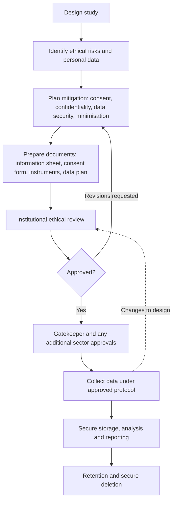

## Introduction

Research involving people is a privilege granted by participants who give their time, opinions, data and sometimes their vulnerabilities. Ethics is the set of principles and practices that ensure this privilege is not abused. In business and information technology research, ethical risks are often less visible than in medical research: nobody is being given a new drug. Yet an MSc student who collects staff opinions about a manager, scrapes social media posts, analyses customer transaction records or tests employees with simulated phishing emails can cause real harm, from embarrassment and job loss to identity fraud.

This lesson explains the ethical principles that underpin research, the practical meaning of informed consent, confidentiality and anonymity, and the legal dimension of personal data in Ghana under the **Data Protection Act, 2012 (Act 843)**, which established the **Data Protection Commission**. It also explains the purpose of ethical approval. Procedures differ between institutions, so you must always follow the ethics-approval process of your own university and of any host organisation; this lesson prepares you to engage with that process intelligently rather than replacing it. Nothing here is legal advice.

## Learning Objectives

- Explain the core ethical principles of respect for persons, beneficence and non-maleficence, justice, integrity and accountability.
- Apply the elements of valid informed consent to design a participant information sheet and consent form.
- Distinguish confidentiality, anonymity and pseudonymisation and select appropriate data-handling measures.
- Explain the main data protection principles in Ghana's Data Protection Act, 2012 (Act 843) and their implications for research data.
- Evaluate the ethical risks of a proposed study and prepare a justified ethics section for an approval application.

## Prerequisite Knowledge

- Understanding of data collection methods, including questionnaires, interviews and observation (Module 5).
- Familiarity with research bias and trustworthiness from earlier lessons in this module.
- None beyond general awareness of legal concepts; no legal training is assumed.

## Key Terminology

- **Research ethics**: The principles and standards that govern responsible conduct of research, protecting participants, researchers, institutions and the integrity of knowledge.
- **Informed consent**: A participant's voluntary agreement to take part, given with adequate understanding of the study's purpose, procedures, risks, benefits and rights, including the right to withdraw.
- **Confidentiality**: The researcher's commitment that information identifying participants will not be disclosed beyond agreed people and purposes.
- **Anonymity**: A condition in which nobody, including the researcher, can link data to an individual's identity.
- **Pseudonymisation**: Replacing direct identifiers with codes, while the key linking codes to identities is held separately and securely.
- **Personal data**: Data about an individual who can be identified from that data or from that data together with other information.
- **Data controller**: The person or organisation that determines the purposes and manner in which personal data are processed.
- **Ethical approval**: Formal permission, from a designated ethics committee or review body, to conduct research after its risks and safeguards have been reviewed.
- **Vulnerable participants**: People with reduced capacity to protect their own interests, such as minors, patients or those in dependent relationships with the researcher.

## Detailed Explanation

### Why ethics developed

Modern research ethics grew from responses to serious abuses. The Nuremberg Code (1947) followed the trials of physicians who conducted experiments in Nazi concentration camps. The World Medical Association's Declaration of Helsinki (first adopted in 1964 and revised several times) set out principles for medical research. In the United States, revelations about the Tuskegee syphilis study, in which treatment was withheld from Black men for decades, contributed to the Belmont Report (1979), which articulated three principles: **respect for persons**, **beneficence** and **justice**. Although these documents arose in biomedical contexts, their principles now inform social science, business and computing research worldwide.

### Core ethical principles

1. **Respect for persons and autonomy.** People are entitled to decide for themselves whether to participate. This underpins informed consent and the right to withdraw.
2. **Beneficence and non-maleficence.** Research should maximise benefits and minimise harm. Harms in business research include psychological distress, reputational damage, loss of employment, financial loss and privacy breaches.
3. **Justice.** The burdens and benefits of research should be fairly distributed. It is unjust, for example, to repeatedly study low-income traders for the benefit of a company's marketing without any return to them.
4. **Integrity and honesty.** Researchers must not fabricate, falsify or plagiarise, and must report findings truthfully, including unfavourable results.
5. **Accountability.** Researchers are answerable to participants, institutions, funders and the law.

### Informed consent in practice

Valid informed consent has four elements: **disclosure** (participants receive adequate information), **comprehension** (they understand it), **voluntariness** (they are free from coercion or undue influence) and **capacity** (they are able to decide). A participant information sheet typically covers:

- who the researcher is, their institution and supervisor;
- the purpose of the study in plain language;
- what participation involves, how long it takes and whether it is recorded;
- possible risks, discomforts and benefits;
- how data will be stored, who will see it, how long it will be kept and how it will be destroyed;
- whether participants will be identifiable in reports;
- the right to decline, skip questions and withdraw, and any practical limits on withdrawal (for example once data are anonymised and aggregated);
- contact details for questions or complaints.

Consent can be written, verbal (recorded) or implied by completing an anonymous questionnaire after reading the information, depending on risk and on what the ethics committee accepts. Information should be offered in a language and format participants understand; translation into local languages may be necessary. **Voluntariness** is particularly at risk when a manager asks subordinates to participate, a lecturer surveys their own students, or incentives are large enough to override judgement.

### Confidentiality, anonymity and pseudonymisation

These terms are often confused. An anonymous online survey that collects no names, emails or IP addresses offers **anonymity**. An interview study cannot be anonymous to the researcher, who has met the participant, but can promise **confidentiality**: names will not appear in reports, and quotations will be attributed to pseudonyms such as "Participant 7, IT manager". **Pseudonymised** data remain personal data because re-identification is possible using the key.

Small populations create a hidden risk called **deductive disclosure**. In a study of one hospital's IT department, "the head of the records unit, a woman with twenty years' experience" may be instantly identifiable to colleagues, even without a name. Researchers must remove or generalise such details, and should be honest with participants about the limits of confidentiality.

### Ghana's Data Protection Act, 2012 (Act 843)

Act 843 regulates the processing of personal information in Ghana and established the Data Protection Commission to oversee it. For researchers, the most useful starting point is the set of data protection principles in the Act, which require a data controller to take account of:

| Principle in Act 843 | What it means for a research project |
|---|---|
| Accountability | The researcher (and institution) must be able to demonstrate compliance |
| Lawfulness of processing | Personal data must be processed lawfully and fairly, usually with consent, without infringing privacy unnecessarily |
| Specification of purpose | Data should be collected for a specific, explicitly defined and lawful purpose |
| Compatibility of further processing with purpose of collection | Data collected for one purpose should not be reused for an unrelated purpose without justification |
| Quality of information | Data should be complete, accurate and up to date where necessary |
| Openness | Data subjects should be informed about the processing |
| Data security safeguards | Appropriate technical and organisational measures must protect data against loss, damage and unauthorised access |
| Data subject participation | Individuals have rights, including to access and request correction of their data |

The Act also gives special protection to certain categories of sensitive personal data (for example information about health, religious or political beliefs, ethnic origin and criminal behaviour), requires data controllers to register with the Data Protection Commission, and contains specific provisions, including exemptions in certain circumstances, that may be relevant to research. Whether a registration obligation or any exemption applies to a particular student project is a question to settle with your supervisor, your institution's ethics and data protection guidance, and the Commission's official materials; do not assume that an exemption applies simply because the work is academic. Researchers working across borders, for example using cloud tools hosted abroad or collaborating with European partners, may also need to consider other jurisdictions' laws.

### Ethical approval

Ethical approval is the formal review of a study's risks and safeguards by a designated body before data collection begins. Its purpose is to provide independent scrutiny, protect participants and researchers, and assure organisations that the research is responsible. Different institutions use different committees, forms, risk categories and timelines, and some studies require approval from more than one body. In Ghana, for example, health-related research may need review by a health-sector ethics committee such as the Ghana Health Service Ethics Review Committee, in addition to institutional review, and organisations such as banks or hospitals may require their own **gatekeeper permission**. You must identify and follow the process that applies to you; never begin collecting data before the required approvals are in place, and never treat approval as a one-off box to tick.

## Theories, Frameworks and Models

### Ethical theories behind the rules

- **Deontological (duty-based) ethics** holds that some actions are right or wrong regardless of consequences; deceiving participants is wrong because it disrespects their autonomy.
- **Consequentialist (utilitarian) ethics** judges actions by their outcomes; limited deception might be justified if harms are minimal and the knowledge gained is valuable.
- **Virtue ethics** emphasises the character of the researcher: honesty, care, fairness and humility.
- **Ethics of care** stresses relationships and responsibilities towards participants, especially vulnerable ones.

Ethics committees often reason in a consequentialist way (risk-benefit assessment) within deontological limits (consent, honesty), so understanding both helps you justify your design.

### A risk-benefit assessment model

A practical approach is to tabulate each risk, its likelihood, severity, mitigation and residual risk. This makes your reasoning visible to a reviewer and forces you to think beyond generic promises.

## Worked Example

**Illustrative scenario.** Yaw, an MSc student and IT officer at a private hospital in Accra, proposes to study electronic health record (EHR) use. He plans to (a) survey nurses, (b) interview doctors, and (c) analyse system audit logs showing which staff accessed records and when.

**Step 1: Identify stakeholders and vulnerabilities.** Nurses are in a dependent relationship with Yaw's department; audit logs involve staff personal data and are linked to patient records, which are sensitive health data under Act 843.

**Step 2: Risk-benefit table.**

| Risk | Likelihood | Severity | Mitigation | Residual |
|---|---|---|---|---|
| Nurses feel pressured to participate | Medium | Medium | Recruitment by neutral notice, not via managers; anonymous online survey; explicit statement that participation does not affect employment | Low |
| Interviewees identifiable from quotations | Medium | High | Pseudonyms; remove job titles and unit names; participant review of quotations | Low |
| Audit logs reveal patient information | High if raw logs used | High | Request only aggregated, de-identified usage statistics prepared by the data controller; no patient fields extracted | Low |
| Data breach of transcripts | Low | High | Encrypted storage; password-protected devices; access limited to researcher and supervisor; defined retention and deletion | Low |
| Researcher's insider role biases data | Medium | Medium | Declare role; reflexive journal; independent second coder | Medium |

**Step 3: Approvals.** Yaw identifies that he needs (i) his university's ethical approval, (ii) any health-sector ethics review required for research in a health facility, and (iii) written gatekeeper permission from hospital management, including agreement on what log data may be provided. He checks his institution's guidance on whether data protection registration or other steps apply.

**Step 4: Consent documents.** He prepares an information sheet and consent form for interviews, and an information page preceding the survey stating that submission indicates consent, with clear withdrawal rules.

**Step 5: Reflection.** Yaw considers dropping the audit-log element entirely. If aggregated statistics answer his research question, collecting less data is ethically and legally preferable, an application of **data minimisation** consistent with Act 843's purpose specification principle.

## Ghanaian Business Application

Ethical issues arise constantly in Ghanaian IT-for-business research. Studies of mobile money and fintech often involve transaction data; even if a partner company is willing to share it, the researcher must consider whether customers were informed that their data could be used in this way, and should prefer aggregated or de-identified datasets. Studies of SMEs frequently rely on owners' trust; publishing a recognisable account of a business's tax practices or informal arrangements could expose it to harm. Researchers recruiting through WhatsApp groups should avoid collecting phone numbers unnecessarily and should not add people to groups without consent.

Cybersecurity research brings particular dangers. A simulated phishing exercise on university students or bank employees involves deception and could cause distress or disciplinary consequences, so it needs explicit organisational authorisation, ethical approval, a debriefing plan and careful handling of results. Security testing must only be performed on systems you own or are explicitly authorised to test. Social media data, though publicly visible, is still personal data; quoting a Ghanaian Twitter or Facebook user's post verbatim can make them identifiable through a simple search, so paraphrasing and aggregation are often safer.

## International Case Study

### The Facebook emotional contagion experiment

In 2014 the *Proceedings of the National Academy of Sciences* published a study by Kramer, Guillory and Hancock reporting an experiment in which Facebook altered the News Feeds of a very large number of users to show fewer positive or fewer negative posts, then measured the emotional tone of those users' own posts. The authors reported evidence of a small emotional contagion effect.

Publication triggered widespread criticism. Users had not been told they were part of an experiment; the authors relied on Facebook's general data use policy as the basis for consent. Critics argued that agreeing to platform terms of service is not informed consent to psychological manipulation, that some users might have been vulnerable to negative emotional effects, and that the respective roles of the company and the university collaborators in ethical review were unclear. The journal subsequently published an editorial expression of concern about consent and opt-out.

The case is a powerful lesson for IT-for-business researchers who work with platform data or partner companies. Legal permission to process data under terms of service does not automatically make research ethical. Manipulating users' experiences is an intervention requiring careful review. Collaborations between industry and academia must clarify who is responsible for ethical oversight before the work begins, not after publication.

## Diagram

The dotted arrow is important: significant changes to an approved design usually require further review before they are implemented.

## Common Misconceptions

- **Misconception:** Publicly available online data can be used without ethical consideration. **Correction:** Public visibility does not remove privacy expectations or data protection duties; identifiability and potential harm must still be assessed.
- **Misconception:** Anonymity and confidentiality mean the same thing. **Correction:** Anonymity means no one can link data to identity; confidentiality means identifiable information is known but protected.
- **Misconception:** A signed consent form completes the researcher's ethical duties. **Correction:** Consent is an ongoing process; researchers must also protect data, respect withdrawal, minimise harm and report honestly.
- **Misconception:** Business and IT research is low-risk and does not need ethical approval. **Correction:** Studies involving people or personal data generally require review according to institutional rules; risks include job, reputational and privacy harms.
- **Misconception:** Academic research is automatically exempt from data protection law. **Correction:** Act 843 contains specific provisions that may apply to research, but whether any exemption applies must be checked; it cannot be assumed.

## Common Examination Mistakes

- Writing generic statements such as "ethical issues will be considered" without naming specific risks and safeguards.
- Confusing anonymity with confidentiality, or promising anonymity in face-to-face interviews.
- Omitting data storage, retention and destruction from the ethics discussion.
- Inventing specific approval procedures or committee names rather than stating that the institution's process will be followed.
- Ignoring power relationships, such as a manager researching subordinates or a lecturer surveying students.

## Critical Thinking Questions

1. Under what conditions, if any, could deception be ethically justified in a study of employees' susceptibility to phishing? What safeguards would be essential?
2. A partner fintech company offers you a large dataset of customer transactions "for your dissertation". What questions must you ask before accepting it?
3. Is it possible to give genuinely informed consent to the analysis of one's data by machine learning methods whose outputs are hard to predict?
4. How should a researcher balance a promise of confidentiality against discovering evidence of fraud or serious harm during an interview?

## Practical Exercises

1. **Participant information sheet.** Draft a one-page information sheet for an interview study on AI adoption among SME owners in Kumasi. *Expected output:* a plain-language document covering purpose, procedures, risks, benefits, confidentiality, data handling, withdrawal and contacts (use placeholders for contact details).
2. **Risk-benefit table.** For a survey on cybersecurity awareness among students, list five ethical risks with likelihood, severity, mitigation and residual risk. *Expected output:* a completed five-row table.
3. **Act 843 mapping.** Map each of the eight data protection principles in Act 843 to one concrete measure in your own proposed study. *Expected output:* an eight-row table linking principle to action.

## Key Takeaways

- Ethics protects participants, researchers, institutions and the integrity of knowledge.
- Valid informed consent requires disclosure, comprehension, voluntariness and capacity, and is an ongoing process.
- Anonymity, confidentiality and pseudonymisation are different; promise only what you can deliver.
- Ghana's Data Protection Act, 2012 (Act 843) sets data protection principles overseen by the Data Protection Commission; check how it applies to your project.
- Always follow your own institution's ethics-approval process and obtain any gatekeeper or sector approvals before collecting data.

## Further Reading

- National Commission for the Protection of Human Subjects of Biomedical and Behavioral Research. (1979). *The Belmont report: Ethical principles and guidelines for the protection of human subjects of research*. U.S. Department of Health, Education, and Welfare.
- Data Protection Act, 2012 (Act 843) (Ghana). <https://dataprotection.org.gh/>
- Kramer, A. D. I., Guillory, J. E., & Hancock, J. T. (2014). Experimental evidence of massive-scale emotional contagion through social networks. *Proceedings of the National Academy of Sciences, 111*(24), 8788-8790.
- Saunders, M., Lewis, P., & Thornhill, A. (2019). *Research methods for business students* (8th ed.). Pearson.
- Bell, E., Bryman, A., & Harley, B. (2019). *Business research methods* (5th ed.). Oxford University Press.

## Video Resources

- [CITI Program](https://about.citiprogram.org/): CITI Program. Official site of a widely used provider of research ethics and human subjects protection training courses (access may require registration or institutional subscription).
- [SAGE Research Methods](https://methods.sagepub.com/): SAGE Publishing. Official research methods platform with material on research ethics, consent and data management (access may depend on subscription).

## Revision Summary

Research ethics protects participants and the integrity of knowledge through respect for persons, beneficence, justice, integrity and accountability. In practice this means valid informed consent, honest confidentiality promises, secure and minimal data handling, compliance with Ghana's Data Protection Act, 2012 (Act 843), and formal ethical approval under your own institution's process.

- Consent: disclosure, comprehension, voluntariness, capacity; right to withdraw.
- Anonymity is not confidentiality; beware deductive disclosure in small settings.
- Act 843 principles include accountability, lawful processing, purpose specification, security safeguards and data subject participation.
- Sensitive data (such as health) need extra care; check registration and exemptions rather than assuming.
- Obtain institutional, sector and gatekeeper approvals before data collection.
- Legal access to data does not make its use ethical (Facebook contagion study).
