## Introduction

Bias is any systematic error that pushes research findings away from the truth in a consistent direction. Unlike random error, which tends to cancel out as samples grow, bias does not disappear with more data. A survey of ten thousand people that reaches only urban smartphone owners will produce a very precise but systematically misleading estimate of national digital payment use. This is why examiners treat bias as a central quality concern rather than a technicality.

Bias can enter at every stage: when a researcher chooses a topic and frames questions, when a sample is drawn, when participants answer, when data are coded and analysed, and when results are written up and published. This lesson classifies the main forms of bias relevant to MSc IT for Business research, explains the psychological and procedural mechanisms behind them, and equips you with concrete strategies to anticipate and reduce them. The aim is not to achieve an impossible bias-free study, but to show that you have recognised the risks honestly and acted on them.

## Learning Objectives

- Explain the difference between bias (systematic error) and random error and why larger samples do not remove bias.
- Identify sampling bias, non-response bias, response biases (such as social desirability and acquiescence) and researcher bias in a described study.
- Analyse how common method bias can inflate relationships in single-source survey research.
- Apply procedural and statistical remedies to reduce bias in a research design.
- Evaluate the remaining bias in a proposal and justify how it should be reported as a limitation.

## Prerequisite Knowledge

- Understanding of populations, sampling frames and sampling methods (Module 5).
- Familiarity with questionnaire and interview design (Module 5).
- Awareness of validity and reliability from the previous lesson.

## Key Terminology

- **Bias**: A systematic deviation of results or inferences from the truth, caused by flaws in design, conduct, analysis or reporting.
- **Sampling (selection) bias**: Systematic error arising when some members of the target population are more or less likely to be included than others, so the sample is unrepresentative.
- **Non-response bias**: Error arising when people who do not respond differ systematically from those who do on the variables being studied.
- **Social desirability bias**: Respondents' tendency to give answers that present themselves favourably rather than accurately.
- **Acquiescence bias**: A tendency to agree with statements regardless of their content.
- **Common method bias**: Inflated or distorted relationships between constructs caused by measuring them with the same method, source and occasion.
- **Researcher (confirmation) bias**: The researcher's tendency to seek, notice or interpret evidence in ways that confirm prior beliefs.
- **Reflexivity**: The researcher's ongoing, documented examination of how their own background, assumptions and role shape the research.

## Detailed Explanation

### Bias versus random error

Imagine measuring the average time Ghanaian SMEs take to reconcile mobile money receipts. If each respondent's estimate is a little too high or too low in no particular direction, that is **random error**, and averaging across a larger sample reduces its effect. If, however, the questionnaire is answered mainly by owners of the most organised firms, the average will be systematically too low. This is **bias**, and doubling the sample simply produces a more confident wrong answer. Bias threatens validity; random error mainly threatens precision and reliability.

### Sampling and selection bias

Sampling bias arises from the gap between the target population and the people actually studied. It has several sources:

- **Coverage (frame) bias** occurs when the sampling frame omits part of the population. A list of SMEs registered for online tax filing excludes informal businesses, which may be the very firms least likely to use digital tools.
- **Self-selection (volunteer) bias** occurs when participants choose whether to take part. People who respond to a WhatsApp survey link about cybersecurity may be more interested in, and more knowledgeable about, cybersecurity.
- **Convenience bias** occurs when researchers recruit whoever is easiest to reach, such as classmates or colleagues.
- **Survivorship bias** occurs when only "survivors" are studied. Researching only e-commerce businesses still operating hides the reasons others failed.
- **Non-response bias** occurs after selection: if busy managers ignore the questionnaire, the results describe less busy managers.

### Response biases

Response biases arise from how participants answer:

- **Social desirability**: Employees may overstate compliance with password policies, or doctors may overstate their use of an electronic records system, because the "correct" answer is obvious.
- **Acquiescence**: Some respondents tend to agree with most statements, a risk increased by long, positively worded Likert scales.
- **Extreme or central tendency responding**: Some respondents habitually choose the end points, while others avoid them.
- **Recall bias**: Memory of past behaviour is imperfect; asking "how many times did you use internet banking last year?" invites guesswork.
- **Question-order and framing effects**: Earlier questions or loaded wording shape later answers. "Given the many benefits of AI, how likely are you to adopt it?" leads the respondent.

Tourangeau, Rips and Rasinski's work on the psychology of survey response describes answering as a sequence of comprehension, retrieval, judgement and response; bias can creep in at each step.

### Researcher bias

Researchers are not neutral instruments. **Confirmation bias**, reviewed influentially by Nickerson (1998), leads people to favour information consistent with existing beliefs. In research it shows up as choosing literature that supports a preferred hypothesis, asking leading interview questions, coding ambiguous statements in the expected direction, or trying several analyses and reporting only the one that "works". The last practice, sometimes called **p-hacking** or selective reporting, distorts the published evidence base. Related problems include the **observer effect**, where participants change behaviour because they are being watched (often associated with the Hawthorne studies, discussed below), and **interviewer effects**, where the interviewer's status, gender, language or affiliation shapes responses.

### Common method bias

In IT adoption research, a single questionnaire often measures both independent variables (for example perceived usefulness) and dependent variables (intention to use) from the same respondent at the same time. Shared response styles, mood or a desire for consistency can inflate correlations between constructs. Podsakoff, MacKenzie, Lee and Podsakoff (2003) reviewed this problem and recommended procedural remedies (separating measures in time or source, protecting anonymity, varying scale formats, careful item wording) and statistical checks. Procedural remedies are generally more convincing than after-the-fact statistical tests, so they should be designed in from the start.

## Theories, Frameworks and Models

### A stage-based bias map

A practical framework is to map biases onto the stages of the research process, so each stage has a named risk and a planned remedy.

| Research stage | Typical biases | Practical remedies |
|---|---|---|
| Problem and literature | Confirmation bias, selective citation | Systematic search strategy; include contradicting studies; supervisor challenge |
| Sampling | Coverage, self-selection, convenience, survivorship | Better frames; probability sampling where possible; compare sample to known population profile |
| Data collection | Social desirability, acquiescence, interviewer effects, recall | Anonymity; neutral and balanced wording; reverse-worded items used carefully; trained interviewers; shorter recall periods |
| Measurement design | Common method bias | Temporal or source separation; varied scale formats; objective data where available |
| Analysis | Selective reporting, coding bias | Pre-specified analysis plan; second coder; report all tested models |
| Reporting | Publication and outcome reporting bias | Report non-significant results; acknowledge limitations honestly |

### Reflexivity as a qualitative safeguard

In interpretivist research, eliminating the researcher's influence is neither possible nor the goal. Instead, **reflexivity** makes that influence visible. A reflexive journal records the researcher's expectations before fieldwork, reactions during interviews and reasons for coding decisions. A short positionality statement in the methodology explains, for example, that the researcher previously worked for a fintech company whose product participants use, and describes the steps taken to limit the effect of that relationship.

## Worked Example

**Illustrative scenario.** Efua plans to study "cybersecurity awareness among university students". Her draft design is: post a Google Forms link in two class WhatsApp groups she belongs to; ask 25 statements such as "I always use strong passwords" (agree–disagree); and report the percentage of students who are "aware".

**Step 1 – Identify sampling biases.** Only students in her own programme and social circle can respond (coverage and convenience bias). Students interested in security are more likely to complete it (self-selection). Results cannot represent "university students".

**Step 2 – Identify response biases.** "I always use strong passwords" invites social desirability; all items are positively worded, inviting acquiescence; self-report of awareness may not reflect actual behaviour.

**Step 3 – Identify researcher bias.** Efua, an IT security enthusiast, expects low awareness; if she codes open-ended answers alone, she may interpret ambiguous answers as unaware.

**Step 4 – Redesign.**

1. Define the population precisely (for example, undergraduate students across faculties at one named institution, with permission) and use stratified sampling by faculty and level, recruiting through official channels where permitted.
2. Make the survey anonymous and state clearly that there are no right or wrong answers.
3. Replace self-assessment items with knowledge-based scenarios, such as identifying which of four emails is a phishing attempt, which are less vulnerable to social desirability.
4. Include some carefully worded reverse items and vary formats (multiple choice, scenarios, Likert).
5. Ask a second person to code a sample of open-ended answers and discuss disagreements.
6. Compare the faculty and gender profile of respondents with institutional figures, if officially available, to assess non-response bias.

**Step 5 – Report residual bias.** Efua acknowledges that a single-institution, self-administered survey still cannot measure actual behaviour and that findings may not transfer to other universities.

## Ghanaian Business Application

Bias is especially consequential in Ghana's fast-moving digital economy, where research often informs product launches and policy. A fintech start-up that surveys only existing app users about "barriers to digital payments" is likely to misunderstand non-users, who are the market it needs to reach; this is coverage and survivorship bias. A study of e-commerce adoption that recruits through Instagram will over-represent digitally active sellers. Researchers should consider who is invisible in their frame: market traders without smartphones, rural businesses with intermittent connectivity, older owners, or people more comfortable in a local language than in English.

Response bias also has a cultural dimension. In hierarchical workplaces, employees may hesitate to criticise a system their manager championed, especially if the researcher appears to be connected to management. Interviewing staff in a neutral place, emphasising confidentiality, and avoiding having supervisors distribute questionnaires all help. Language matters too: a question translated into Twi or Hausa may carry a stronger or weaker meaning than its English version, so piloting with members of the target group is essential. Finally, researchers employed by the organisation they study, which is common among MSc students, should declare this relationship and explain how they will manage it.

## International Case Study

### The 1936 *Literary Digest* poll and the Hawthorne studies

Two well-documented cases illustrate sampling bias and observer effects.

In the 1936 United States presidential election, the magazine *Literary Digest* mailed millions of ballots and confidently predicted that Alf Landon would defeat Franklin D. Roosevelt. Roosevelt won by a landslide. The poll is widely taught as a failure of sampling rather than sample size: the mailing lists were drawn substantially from sources such as telephone directories and automobile registrations, which in the Depression era tended to over-represent wealthier voters, and those who chose to return ballots may also have differed from those who did not. An enormous sample did not rescue a biased frame and self-selected responses. By contrast, smaller but more carefully selected samples used by emerging polling organisations predicted the result more accurately.

The Hawthorne studies, conducted at Western Electric's Hawthorne Works near Chicago in the 1920s and 1930s, examined how working conditions such as lighting affected productivity. Productivity sometimes appeared to rise under various changes, which later commentators attributed, at least partly, to workers responding to the attention of being studied. The interpretation of the original data remains debated, but the term "Hawthorne effect" has become shorthand for the observer effect.

For MSc researchers, the combined lesson is that **who you study and how they know they are being studied** can matter more than how many people you study.

## Diagram

```mermaid
flowchart LR
    A["Target population"] -->|"Coverage bias"| B["Sampling frame"]
    B -->|"Selection and convenience bias"| C["Selected sample"]
    C -->|"Non-response bias"| D["Respondents"]
    D -->|"Response biases"| E["Recorded data"]
    E -->|"Researcher and analysis bias"| F["Reported findings"]
    F -->|"Publication bias"| G["Body of evidence"]
```

Each arrow marks a point where the data can drift systematically away from the truth about the target population.

## Common Misconceptions

- **Misconception:** A larger sample reduces bias. **Correction:** A larger sample reduces random error but leaves systematic bias untouched, as the *Literary Digest* poll showed.
- **Misconception:** Anonymity eliminates social desirability bias. **Correction:** Anonymity reduces it, but respondents may still answer in self-flattering ways; behavioural or knowledge-based measures help further.
- **Misconception:** Qualitative research is inherently biased and therefore unscientific. **Correction:** All research involves potential bias; qualitative researchers manage it through reflexivity, triangulation and transparent audit trails.
- **Misconception:** Statistical tests can fully detect and correct common method bias after data collection. **Correction:** Post-hoc tests have limited power; procedural design remedies are more effective.
- **Misconception:** Acknowledging bias in the limitations section weakens a dissertation. **Correction:** Honest, specific acknowledgement of residual bias demonstrates critical maturity and is expected by examiners.

## Common Examination Mistakes

- Listing types of bias without linking them to the specific scenario in the question.
- Proposing "use a larger sample" as the remedy for a selection bias problem.
- Confusing sampling bias (who is in the study) with response bias (how they answer).
- Ignoring researcher bias when the scenario describes the researcher's personal interest or employment.
- Offering vague remedies such as "be objective" instead of concrete procedures such as second coding or anonymous administration.

## Critical Thinking Questions

1. Online surveys are cheap and fast in Ghana's growing smartphone market. In what circumstances is the resulting bias acceptable for an MSc study, and when does it make conclusions meaningless?
2. If an employee-researcher studies a system in their own organisation, is insider knowledge a source of bias, a source of insight, or both? How would you manage the tension?
3. Is it ethical to use mild deception, such as not revealing the exact hypothesis, to reduce response bias? Where would you draw the line?
4. How might pre-registering hypotheses and analysis plans change the incentives that lead to selective reporting?

## Practical Exercises

1. **Bias audit.** Take a questionnaire you have designed or found for this course and identify at least five items vulnerable to response bias. Rewrite each. *Expected output:* a two-column table of original and revised items, with the bias named for each.
2. **Stage-based bias plan.** For a proposed study on e-commerce adoption among small businesses in Accra, complete the stage-based bias map from this lesson with one risk and one remedy per stage. *Expected output:* a six-row table tailored to the study.
3. **Positionality statement.** Write a 150-word reflexive positionality statement for an interview study in which you are an employee of the organisation studied. *Expected output:* a statement that names your relationship, possible influence and specific mitigation steps.

## Key Takeaways

- Bias is systematic error; it does not shrink as samples grow.
- Sampling bias concerns who is studied; response bias concerns how they answer; researcher bias concerns how the investigator frames, collects and interprets.
- Common method bias is a major risk in single-source IT adoption surveys and is best addressed procedurally.
- Remedies must be specific to each stage of the research process.
- Residual bias should be acknowledged honestly and specifically in the limitations.

## Further Reading

- Podsakoff, P. M., MacKenzie, S. B., Lee, J.-Y., & Podsakoff, N. P. (2003). Common method biases in behavioral research: A critical review of the literature and recommended remedies. *Journal of Applied Psychology, 88*(5), 879–903.
- Nickerson, R. S. (1998). Confirmation bias: A ubiquitous phenomenon in many guises. *Review of General Psychology, 2*(2), 175–220.
- Tourangeau, R., Rips, L. J., & Rasinski, K. (2000). *The psychology of survey response*. Cambridge University Press.
- Bell, E., Bryman, A., & Harley, B. (2019). *Business research methods* (5th ed.). Oxford University Press.
- Saunders, M., Lewis, P., & Thornhill, A. (2019). *Research methods for business students* (8th ed.). Pearson.

## Video Resources

- [SAGE Research Methods](https://methods.sagepub.com/) — SAGE Publishing. Official research methods platform (access may depend on institutional subscription) with material on survey error, sampling and reflexivity.
- [Khan Academy Statistics and Probability](https://www.khanacademy.org/math/statistics-probability) — Khan Academy. Free official course pages that include lessons on sampling methods and bias in surveys.

## Revision Summary

Bias is systematic error that moves findings consistently away from the truth and is not reduced by collecting more data. It can enter at problem framing, sampling, data collection, measurement, analysis and reporting, so each stage needs a named risk and a specific remedy.

- Sampling bias: coverage, self-selection, convenience, survivorship, non-response.
- Response bias: social desirability, acquiescence, extreme responding, recall, framing.
- Researcher bias: confirmation bias, leading questions, selective reporting, interviewer effects.
- Common method bias: single source and occasion inflates correlations; prefer procedural remedies.
- Qualitative safeguard: reflexivity, second coding, audit trail.
- Report residual bias honestly as a limitation.
