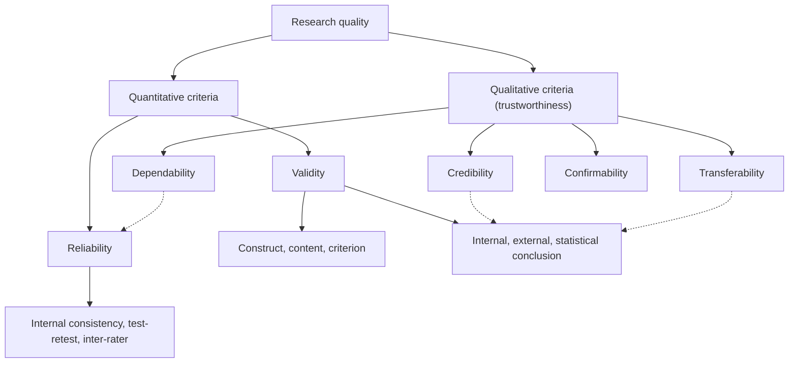

## Introduction

Every examiner reading a dissertation asks the same underlying question: *why should I believe these findings?* A study may have a fascinating topic and impressive charts, but if its questionnaire does not measure what it claims to measure, if its results would change dramatically on a second attempt, or if its interview themes reflect the researcher's hopes rather than participants' experiences, its conclusions cannot be trusted. Research quality is therefore not an add-on paragraph at the end of a methodology chapter; it is the thread that holds the whole study together.

This lesson introduces the vocabulary used to judge research quality. For quantitative research, the central criteria are **validity** and **reliability**. For qualitative research, many scholars prefer the language of **trustworthiness**, following Lincoln and Guba's influential criteria of credibility, transferability, dependability and confirmability. You will learn what each criterion means, how they relate to each other, how to assess them with practical techniques such as Cronbach's alpha and member checking, and how to write a convincing quality section for a proposal.

## Learning Objectives

- Explain the difference between validity and reliability and why reliability is necessary but not sufficient for validity.
- Distinguish content, construct (convergent and discriminant), criterion, internal, external and statistical conclusion validity.
- Apply common reliability checks, including internal consistency, test–retest and inter-rater reliability, to a research instrument.
- Compare Lincoln and Guba's trustworthiness criteria with their quantitative counterparts.
- Evaluate a research proposal and recommend specific strategies to strengthen its quality.

## Prerequisite Knowledge

- Familiarity with research designs and the distinction between quantitative and qualitative research (Module 4).
- Basic understanding of questionnaires, measurement scales and interviews (Module 5).
- Awareness of descriptive and inferential statistics (Module 6) is helpful for the reliability examples.

## Key Terminology

- **Validity**: The extent to which a study, instrument or conclusion accurately represents the concept or relationship it claims to represent.
- **Reliability**: The consistency or stability of a measurement, so that repeated measurement under similar conditions yields similar results.
- **Construct validity**: The degree to which a measure actually captures the theoretical construct it is intended to measure, supported by convergent and discriminant evidence.
- **Internal validity**: The degree to which a study can rule out alternative explanations and support a causal claim that X influences Y.
- **External validity**: The extent to which findings can be generalised to other people, settings and times.
- **Cronbach's alpha**: A coefficient summarising the internal consistency of a set of items intended to measure the same construct.
- **Trustworthiness**: An umbrella term for the quality of qualitative research, commonly assessed through credibility, transferability, dependability and confirmability.
- **Triangulation**: Using multiple data sources, methods, investigators or theories to cross-check and strengthen interpretations.
- **Audit trail**: A documented record of research decisions, data and analytic steps that allows another person to follow how conclusions were reached.

## Detailed Explanation

### Validity and reliability: the target analogy

A familiar way to explain the two ideas is a dartboard. If all your darts land tightly together but far from the centre, your throwing is **reliable but not valid**: consistent, yet consistently wrong. If darts are scattered around the centre, you are neither reliable nor precisely valid. Only when darts cluster tightly on the bullseye are you both reliable and valid.

The analogy highlights a key logical point: **reliability is a necessary but not sufficient condition for validity**. A bathroom scale that always reads 3 kg too heavy is perfectly reliable yet invalid. A questionnaire scale on "trust in mobile money" whose items consistently correlate might actually be measuring general satisfaction with a telecom network, not trust. Consistency alone does not prove you are measuring the right thing.

### Types of validity

Validity is not a single property. Different types address different threats.

| Type | Question it answers | Typical evidence |
|---|---|---|
| Face validity | Does the instrument appear, on inspection, to measure the concept? | Review by participants or colleagues (weakest form) |
| Content validity | Do the items cover the full domain of the construct? | Expert review against a definition from literature |
| Construct validity – convergent | Do items for one construct correlate strongly with each other? | Factor loadings, average variance extracted |
| Construct validity – discriminant | Is the construct empirically distinct from other constructs? | Low cross-loadings; Fornell–Larcker comparison |
| Criterion validity | Does the measure relate to an external benchmark? | Correlation with an established measure or outcome (concurrent or predictive) |
| Internal validity | Can alternative explanations for a causal relationship be ruled out? | Randomisation, control groups, controlling confounders |
| External validity | Can findings be generalised beyond the sample? | Probability sampling, replication in other settings |
| Statistical conclusion validity | Are statistical inferences sound? | Adequate sample size, appropriate tests, assumptions checked |

Two clarifications prevent common errors. First, **internal and external validity often trade off**. A tightly controlled laboratory experiment on phishing detection maximises internal validity but may not reflect how employees behave when busy at work. Second, **construct validity is about measurement, whereas internal validity is about causal inference**. Students frequently use "validity" vaguely without saying which kind they mean.

### Types of reliability

- **Internal consistency** asks whether multiple items intended to measure one construct produce consistent responses. Cronbach's alpha is the most widely reported statistic. Values around 0.70 or above are commonly treated as acceptable in exploratory social science work, though the threshold is a convention rather than a law, and very high values (for example above 0.95) can signal redundant, near-identical items.
- **Test–retest reliability** asks whether the same respondents give similar answers when measured on two occasions, assuming the construct has not genuinely changed.
- **Inter-rater (inter-coder) reliability** asks whether two or more people coding or rating the same material agree. In qualitative coding or content analysis, agreement can be summarised with statistics such as Cohen's kappa, or discussed through structured comparison of coding decisions.
- **Parallel-forms reliability** compares two equivalent versions of an instrument.

### Trustworthiness in qualitative research

Interpretivist researchers argue that terms such as "validity" assume a single objective reality that measurement can capture. In *Naturalistic Inquiry* (1985), Lincoln and Guba proposed alternative criteria that parallel the conventional ones:

| Conventional criterion | Trustworthiness criterion | Meaning | Example strategies |
|---|---|---|---|
| Internal validity | Credibility | Findings are a believable representation of participants' realities | Prolonged engagement, triangulation, member checking, peer debriefing, negative case analysis |
| External validity | Transferability | Readers can judge whether findings apply to other contexts | Thick description of setting, participants and context |
| Reliability | Dependability | The research process is logical, traceable and documented | Audit trail, consistent protocols, reflective memos |
| Objectivity | Confirmability | Findings are grounded in data, not researcher preference | Audit trail, reflexivity, quotations linked to themes |

Note the shift in responsibility for transferability: the qualitative researcher does not claim statistical generalisation but provides enough **thick description** that a reader in another context can decide whether the findings plausibly transfer.

## Theories, Frameworks and Models

### Threats to internal validity

Shadish, Cook and Campbell's work on experimental and quasi-experimental designs provides a well-known list of threats that any study claiming cause and effect should consider. The most relevant to business and IT research are:

1. **History** – external events occur during the study (for example, a nationwide network outage during an e-commerce intervention).
2. **Maturation** – participants naturally change over time (employees become more skilled with a system regardless of training).
3. **Testing** – taking a pre-test influences post-test scores.
4. **Instrumentation** – the measurement instrument or procedure changes between measurements.
5. **Selection** – groups differ before the intervention (volunteers for a pilot are already enthusiastic).
6. **Attrition** – participants drop out non-randomly.
7. **Regression to the mean** – extreme scores tend to move towards the average on re-measurement.

### Construct validity in structural models

In information systems survey research, constructs such as perceived usefulness, performance expectancy and behavioural intention (from TAM and UTAUT) are measured with multiple items. Researchers commonly assess **convergent validity** through item loadings and the average variance extracted (AVE), and **discriminant validity** through the Fornell and Larcker (1981) criterion, which compares the square root of each construct's AVE with its correlations with other constructs. Campbell and Fiske's (1959) multitrait–multimethod matrix is the classic origin of the convergent–discriminant distinction. You do not need to compute these by hand, but you must know what they demonstrate and report them correctly.

## Worked Example

**Illustrative scenario.** Kofi is studying mobile banking adoption among traders in Kumasi. His construct "perceived trust" has four Likert items (1 = strongly disagree, 5 = strongly agree). A pilot with 30 traders gives the following summary from statistical software:

| Item | Corrected item–total correlation | Alpha if item deleted |
|---|---|---|
| T1 "My bank's app keeps my money safe" | 0.68 | 0.71 |
| T2 "I trust the app to process transfers correctly" | 0.64 | 0.73 |
| T3 "The app's provider keeps its promises" | 0.61 | 0.74 |
| T4 "I prefer cash for large purchases" | 0.12 | 0.86 |

Overall Cronbach's alpha for the four items is 0.77.

**Step 1 – Interpret overall alpha.** 0.77 exceeds the conventional 0.70 benchmark, so at first glance the scale looks acceptable.

**Step 2 – Inspect items.** T4 has a very low item–total correlation (0.12), and deleting it would raise alpha to 0.86. This signals that T4 does not belong with the others.

**Step 3 – Diagnose conceptually, not only statistically.** T4 measures a *payment preference*, not trust in the app. This is a **content and construct validity** problem: the item was poorly matched to the construct definition. Deleting an item purely to raise alpha would be poor practice; here the statistical signal and the conceptual reasoning agree.

**Step 4 – Decide and document.** Kofi removes T4, reports the revised alpha, and records the reasoning in his audit of instrument changes. He also notes that the pilot was small, so alpha should be re-checked on the main sample.

**Step 5 – Remember the limits.** A high alpha shows only that the remaining items are consistent. It does not prove that they measure trust rather than, for instance, general satisfaction with the bank. Kofi should also assess discriminant validity against his "satisfaction" construct in the main study.

## Ghanaian Business Application

Quality criteria have direct practical consequences in Ghanaian organisations. A telecommunications company in Accra that commissions a customer satisfaction survey and then cuts or expands services on the basis of an unreliable instrument may waste substantial investment. A bank that measures "digital readiness" of branch staff using items written only in technical English may obtain responses that reflect language comprehension rather than readiness, a construct validity problem. Translating instruments into Twi, Ga, Ewe or other local languages can improve validity but introduces a new risk: translated items may not carry the same meaning. Back-translation (translating into the local language and then independently back into English) and pilot testing help to detect such shifts.

For qualitative work, consider an MSc student interviewing pharmacists in Tamale about electronic inventory systems. Credibility can be strengthened by spending time in pharmacies (prolonged engagement), comparing interview accounts with system records and observation (triangulation), and returning a summary of interpretations to some participants for comment (member checking). Transferability depends on describing the regional context, the size of pharmacies, connectivity conditions and supplier arrangements, so that a reader in Cape Coast or Lagos can judge relevance. These strategies are inexpensive and well suited to MSc projects with limited resources.

## International Case Study

### Validating a technology acceptance instrument: UTAUT

Venkatesh, Morris, Davis and Davis (2003) developed the Unified Theory of Acceptance and Use of Technology (UTAUT) by reviewing and empirically comparing eight earlier models of technology acceptance. Their paper in *MIS Quarterly* is a frequently cited illustration of how measurement quality is demonstrated. The authors collected data from employees in several organisations over time, reported the reliability of each construct, and examined convergent and discriminant validity before testing the structural relationships between performance expectancy, effort expectancy, social influence, facilitating conditions, intention and use. They then tested the model on further data to check whether it held beyond the original sample.

The lessons for MSc students are clear. First, a respected model was not accepted on conceptual grounds alone; it was accompanied by explicit measurement evidence. Second, when you **adapt** UTAUT items for a Ghanaian context, you cannot simply borrow the original authors' reliability figures: reliability and validity are properties of scores in a particular sample and context, so you must re-establish them with your own data. Third, testing a model on additional samples addresses external validity, which is precisely what a single-site MSc study cannot fully achieve and must therefore acknowledge as a limitation.

## Diagram

The dotted lines show the approximate parallels Lincoln and Guba drew between the two traditions; the parallels are conceptual, not exact equivalences.

## Common Misconceptions

- **Misconception:** A high Cronbach's alpha proves a scale is valid. **Correction:** Alpha indicates internal consistency (a form of reliability) only; validity requires separate conceptual and empirical evidence.
- **Misconception:** Qualitative research cannot be judged for quality. **Correction:** Qualitative research is judged by explicit trustworthiness criteria and strategies such as triangulation, audit trails and thick description.
- **Misconception:** Using an instrument from a published study guarantees validity in my study. **Correction:** Validity and reliability must be re-established in each new population and context, especially after adaptation or translation.
- **Misconception:** External validity simply means having a large sample. **Correction:** Generalisability depends mainly on how the sample was selected and how similar the target setting is, not only on size.
- **Misconception:** Face validity is sufficient evidence. **Correction:** Face validity is the weakest form; expert content review and statistical construct evidence are expected at postgraduate level.

## Common Examination Mistakes

- Defining validity and reliability but never explaining the relationship between them.
- Writing "the study will ensure validity and reliability" without naming any specific type or technique.
- Applying quantitative criteria (for example statistical generalisability) to judge a small interpretivist interview study.
- Confusing internal validity (causal inference) with internal consistency (a reliability statistic).
- Listing Lincoln and Guba's four criteria without giving a concrete strategy for each in the proposed study.

## Critical Thinking Questions

1. Is it ever justifiable to report a scale with a Cronbach's alpha below 0.70? What additional arguments or evidence would you present?
2. Lincoln and Guba's criteria were proposed partly to free qualitative research from positivist standards. Does presenting them as parallels to validity and reliability undermine that aim?
3. When translating a questionnaire into a Ghanaian language, which type of validity is most at risk, and how would you detect a problem?
4. Can a single MSc study realistically achieve both high internal validity and high external validity? Justify your answer with an example.

## Practical Exercises

1. **Diagnose the threat.** For each situation, name the main validity or reliability problem: (a) a scale on "cybersecurity awareness" that mostly asks about password length; (b) a training evaluation where the comparison group were employees who declined training; (c) two coders who agree on only half of their codes. *Expected output:* three labelled diagnoses (content validity; selection threat to internal validity; low inter-coder reliability) each with a one-sentence remedy.
2. **Quality plan for a survey.** Draft a 200-word "Validity and reliability" subsection for a survey on digital payment adoption among retailers, naming at least two validity types, one reliability check and the pilot procedure. *Expected output:* a concise subsection with specific techniques, not general promises.
3. **Trustworthiness table.** For an interview study of nurses' experiences with electronic health records, complete a four-row table listing each trustworthiness criterion and one concrete strategy you would use. *Expected output:* a completed table with context-specific strategies.

## Key Takeaways

- Validity is about accuracy; reliability is about consistency; reliability is necessary but not sufficient for validity.
- Always specify which type of validity you mean: construct, content, criterion, internal, external or statistical conclusion.
- Cronbach's alpha measures internal consistency; interpret it alongside item content and do not delete items mechanically.
- Qualitative quality is demonstrated through credibility, transferability, dependability and confirmability.
- Quality must be planned in advance and re-established in each new context, especially after adapting or translating instruments.

## Further Reading

- Lincoln, Y. S., & Guba, E. G. (1985). *Naturalistic inquiry*. SAGE.
- Shadish, W. R., Cook, T. D., & Campbell, D. T. (2002). *Experimental and quasi-experimental designs for generalized causal inference*. Houghton Mifflin.
- Cronbach, L. J. (1951). Coefficient alpha and the internal structure of tests. *Psychometrika, 16*(3), 297–334.
- Fornell, C., & Larcker, D. F. (1981). Evaluating structural equation models with unobservable variables and measurement error. *Journal of Marketing Research, 18*(1), 39–50.
- Venkatesh, V., Morris, M. G., Davis, G. B., & Davis, F. D. (2003). User acceptance of information technology: Toward a unified view. *MIS Quarterly, 27*(3), 425–478.
- Saunders, M., Lewis, P., & Thornhill, A. (2019). *Research methods for business students* (8th ed.). Pearson.

## Video Resources

- [SAGE Research Methods](https://methods.sagepub.com/) — SAGE Publishing. Official research methods platform (access may depend on institutional subscription) with explanations of validity, reliability and qualitative rigour.
- [MIT OpenCourseWare](https://ocw.mit.edu/) — Massachusetts Institute of Technology. Official open learning portal; search for research design and measurement course materials.

## Revision Summary

Research quality answers the examiner's question "why should I believe this?". Quantitative studies are judged by validity (accuracy of measurement and inference) and reliability (consistency); qualitative studies are commonly judged by Lincoln and Guba's trustworthiness criteria. Quality must be designed in from the start and evidenced with specific techniques.

- Reliability is necessary but not sufficient for validity.
- Validity types: content, construct (convergent/discriminant), criterion, internal, external, statistical conclusion.
- Reliability types: internal consistency (Cronbach's alpha), test–retest, inter-rater, parallel forms.
- Trustworthiness: credibility, transferability, dependability, confirmability.
- Strategies: piloting, expert review, triangulation, member checking, thick description, audit trail.
- Re-establish quality whenever instruments are adapted or translated.
