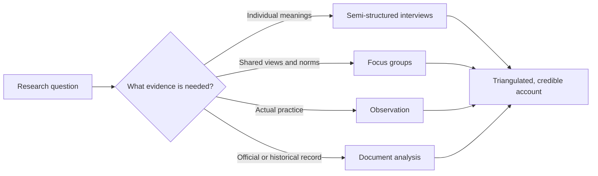

## Introduction

Questionnaires tell you how many people agree with a statement; they rarely tell you what the statement means to them, how they arrived at their view, or what they actually do when no one is asking. Qualitative data collection methods exist to capture those meanings, processes and practices. In IT-for-business research they are indispensable for understanding why a hospital's records system is resisted, how SME owners decide to trust an AI tool, or how security policies are interpreted in daily work.

This lesson examines four core methods: **interviews**, **focus groups**, **observation** and **document analysis**. For each, it explains purposes, variants, procedures and limitations, and it shows how to design an interview guide and plan a focus group. It closes with the practical and ethical considerations of collecting qualitative data in Ghana, where language, hierarchy and access shape what participants are willing to share.

## Learning Objectives

- Explain the purposes, variants, strengths and limitations of interviews, focus groups, observation and document analysis.
- Design a semi-structured interview guide with main questions, probes and follow-ups aligned to research objectives.
- Plan a focus group, including composition, size, moderation and recording.
- Compare participant and non-participant observation and select an appropriate observational role.
- Evaluate how combining methods supports triangulation and strengthens qualitative research.

## Prerequisite Knowledge

- Qualitative research logic and purposive sampling (previous lessons and Module 4).
- Awareness of research ethics and informed consent (developed fully in Module 7).

## Key Terminology

- **Semi-structured interview**: An interview guided by a set of planned questions and themes, with flexibility to change order, probe and follow up on participants' answers.
- **Probe**: A follow-up prompt used to obtain more detail, clarification or examples, such as "Can you give me an example?"
- **Focus group**: A facilitated group discussion, usually of six to ten participants, designed to explore views and how they are formed and challenged through interaction.
- **Moderator**: The person who facilitates a focus group, introducing topics, encouraging participation and managing group dynamics.
- **Participant observation**: Observation in which the researcher takes part in the activities being studied to understand them from the inside.
- **Non-participant observation**: Observation in which the researcher watches activities without taking part, either openly or, where ethically approved, covertly.
- **Document analysis**: The systematic review and evaluation of documents, such as policies, reports, emails and websites, as sources of evidence.
- **Triangulation**: Using multiple data sources, methods, investigators or theories to cross-check and deepen understanding of a phenomenon.

## Detailed Explanation

### Interviews

Interviews are conversations with a purpose. They vary in structure:

- **Structured interviews** use fixed questions in a fixed order, often with fixed responses; they are essentially interviewer-administered questionnaires.
- **Semi-structured interviews** use a guide of main questions and themes but allow flexibility. They are the most common choice in business and IS research because they balance comparability with depth.
- **Unstructured (in-depth) interviews** begin with a broad prompt and follow the participant's narrative. They suit exploratory and life-history research.

Interviews can be conducted face to face, by telephone or online. Face-to-face interviews allow rapport and observation of non-verbal cues; online video interviews reduce travel cost and suit dispersed participants but depend on connectivity.

Brinkmann and Kvale's *InterViews* emphasises that interviewing is a craft. Good interviewers listen more than they talk, avoid leading questions, use silence, ask for concrete examples ("Tell me about the last time a customer could not pay by mobile money"), and check understanding by summarising. **Elite interviews** with senior managers or officials require particular preparation: the interviewer must know the organisation well and manage limited time.

The main limitations are that interviews report what people *say* rather than what they *do*, that participants may give socially desirable accounts, and that transcription and analysis are time-consuming.

### Focus groups

Focus groups generate data through **interaction**. Participants hear others' views, agree, disagree and refine their own positions, revealing shared norms and the language people use. Krueger and Casey's practical guide recommends careful planning of purpose, participants, questioning route and analysis.

Key design choices include:

- **Composition.** Groups are usually homogeneous on characteristics that matter to the topic (for example, nurses separately from doctors) so that participants feel comfortable, while varying across groups to allow comparison.
- **Size.** Commonly about six to ten participants; smaller groups allow more depth per person, larger groups risk some members staying silent.
- **Number of groups.** Several groups per category help researchers see whether patterns repeat.
- **Questioning route.** An opening question, introductory and transition questions, key questions and an ending question that invites final reflections.
- **Moderation.** The moderator encourages quieter participants, manages dominant voices and keeps discussion on topic, often with an assistant who records observations.

Focus groups are less suitable for sensitive individual experiences, such as having been defrauded, and for groups with strong power differences, such as managers and their subordinates in the same session.

### Observation

Observation captures behaviour directly in natural settings. Researchers choose a role along a continuum:

1. **Complete participant** – a full member whose research role is concealed; raises serious ethical concerns and requires strong justification and approval.
2. **Participant as observer** – takes part openly while researching.
3. **Observer as participant** – mainly observes with limited participation.
4. **Complete observer** – observes without interaction.

Observation can be **structured**, using a checklist or coding schedule to count behaviours (for example, recording how often cashiers ask customers whether they will pay by mobile money), or **unstructured**, using detailed field notes. Observation reveals gaps between reported and actual behaviour, but it is time-consuming and subject to the **observer effect**: people may behave differently when watched.

### Document analysis

Documents include policies, strategy papers, minutes, project reports, emails, websites, social media posts, system manuals and audit reports. Bowen (2009) describes document analysis as a systematic procedure for reviewing and evaluating documents, often used to complement other methods. Documents are relatively cheap to obtain, are not affected by the research process (they are "non-reactive") and provide historical context. Their limitations include incomplete availability, bias in how they were produced (organisational documents present the organisation favourably) and the need for permission to access internal records. Researchers should evaluate each document's authenticity, credibility, representativeness and meaning, four criteria associated with John Scott's work on documentary sources.

## Theories, Frameworks and Models

### Comparing methods

| Method | Best for | Main strength | Main limitation | Typical Ghanaian IT-for-business use |
|---|---|---|---|---|
| Semi-structured interview | Individual experiences, reasons, processes | Depth and flexibility | Reports what people say, not do | SME owners' decisions about AI tools |
| Focus group | Shared views, norms, language | Interaction reveals how views form | Dominant voices; unsuitable for sensitive topics | Students' attitudes to cybersecurity practices |
| Observation | Actual behaviour and context | Captures practice directly | Time-consuming; observer effect | How traders handle payments at the stall |
| Document analysis | Policies, history, official positions | Non-reactive, contextual | Selective or incomplete records | Hospital e-records implementation reports |

### Triangulation

Denzin's well-known typology distinguishes **data triangulation** (different sources, times or places), **investigator triangulation** (more than one researcher), **theory triangulation** (different theoretical lenses) and **methodological triangulation** (different methods). In qualitative research, triangulation is less about "proving" one correct answer than about building a more complete and credible account. When interview accounts of a security policy contradict what observation shows, the contradiction itself becomes a finding.

## Diagram

## Worked Example

**Illustrative scenario.** Esi is studying how nurses in a Ghanaian regional hospital experience a newly introduced electronic health records (EHR) system. Her objective is: *To explore the factors that encourage or discourage nurses' use of the EHR system in daily ward work.*

**Step 1 – Choose methods.** Interviews capture individual experiences; observation of ward routines shows actual use; documents (training materials, implementation reports) show what the system was intended to do. She plans a small number of focus groups to explore shared norms among nurses.

**Step 2 – Draft the interview guide.**

| Section | Main question | Probes |
|---|---|---|
| Opening | Could you describe your role and a typical shift on the ward? | How long have you worked here? |
| Experience of the system | Tell me about the last time you used the EHR during a shift. | What were you doing? What happened next? |
| Encouraging factors | What, if anything, makes the system helpful in your work? | Can you give an example? Has this changed over time? |
| Discouraging factors | What makes the system difficult to use? | What do you do when it is unavailable? How do colleagues respond? |
| Support | How were you trained, and where do you go for help? | Who is the most helpful person? |
| Closing | Is there anything about the system we have not discussed that you think is important? | — |

The guide begins with easy, concrete questions, uses "tell me about the last time" to elicit specific episodes rather than generalisations, avoids leading wording such as "Isn't the system slow?", and ends with an open invitation.

**Step 3 – Plan focus groups.** Two groups of six to eight nurses each, separated by grade to reduce hierarchy effects; a trained moderator and an assistant; audio recording with consent; a 75-minute questioning route that moves from general experiences to key questions on workarounds and support.

**Step 4 – Plan observation.** With approval from the hospital and ward managers, Esi spends several shifts as an *observer as participant* at the nurses' station, recording field notes on when the EHR is used, when paper is used instead, and why.

**Step 5 – Plan document analysis.** She requests the implementation plan, training manual and any post-implementation review, evaluating each for authorship and purpose.

**Step 6 – Plan triangulation.** She expects to compare what nurses say about EHR use with what observation shows, and both with what documents intended.

The expected output is an aligned set of instruments (interview guide, focus group route, observation protocol, document checklist) and a statement of how they will be triangulated.

## Ghanaian Business Application

Collecting qualitative data in Ghana requires sensitivity to context.

- **Language and expression.** Participants may express themselves more fully in their first language. Researchers should consider conducting interviews in Twi, Ga, Ewe or other languages where appropriate, with careful translation of transcripts and attention to idioms that resist literal translation.
- **Hierarchy and respect.** In organisations with strong hierarchies, junior staff may defer to seniors in focus groups. Separate groups by rank and assure confidentiality. When interviewing SME owners, especially elders, appropriate greetings and respect for their time help build rapport.
- **Gatekeepers and access.** Hospitals, banks and universities typically require formal permission before staff can be approached, and ethics approval is needed. Market associations and their leaders may act as gatekeepers for traders.
- **Recording and data protection.** Audio recordings and transcripts contain personal data. Researchers should obtain informed consent, anonymise transcripts, store files securely and respect the Data Protection Act, 2012 (Act 843).
- **Observation in markets and SMEs.** Observing payment behaviour at stalls can reveal practices traders may not mention, such as asking customers to pay to a personal rather than a merchant wallet. Such sensitive observations require careful ethical handling.
- **Documents in SMEs.** Small firms may keep few formal documents, but WhatsApp business catalogues, social media pages and receipts can be legitimate documentary sources if permission is obtained.

For a study of cybersecurity awareness among students, focus groups can reveal peer norms around password sharing, while document analysis of university IT policies shows the official position; the gap between them is often the most interesting finding.

## International Case Study

### The Hawthorne interviewing programme

The Hawthorne studies at Western Electric (introduced in Module 4 as an example of sequential enquiry) also contributed a significant lesson about interviewing. After the early experiments, researchers launched a large employee interviewing programme at the Hawthorne Works. Roethlisberger and Dickson's account, *Management and the Worker*, describes how the interviewers initially used a directed approach, asking employees prepared questions about supervision, working conditions and the job. They found that employees often wanted to talk about matters the interviewers had not anticipated, and the researchers shifted towards a more **non-directive** style, encouraging employees to speak freely while interviewers listened attentively.

This shift had methodological consequences. Non-directive interviewing revealed concerns about informal social relations and personal circumstances that structured questions had missed, and it informed the later observational study of the Bank Wiring Observation Room, where researchers watched how a work group regulated its own output through informal norms. Interviews and observation together revealed that what workers said about output and what the group actually did could differ.

For contemporary IT-for-business researchers, the case remains instructive. Rigid interview schedules risk confirming the researcher's assumptions, whereas skilled, flexible interviewing allows unexpected themes to emerge. Combining interviews with observation helps distinguish reported from actual behaviour, a distinction central to studies of technology use, where people often describe official procedures rather than everyday workarounds.

## Common Misconceptions

- **Misconception:** A focus group is a quick way to interview several people at once. **Correction:** Focus groups are designed to generate data through interaction; they are not a time-saving substitute for individual interviews.
- **Misconception:** Semi-structured means unplanned. **Correction:** Semi-structured interviews require a carefully designed guide; flexibility lies in the order and follow-up, not in the absence of preparation.
- **Misconception:** Observation is objective because the researcher sees behaviour directly. **Correction:** Observers interpret what they see, and their presence can change behaviour; field notes and reflexivity are essential.
- **Misconception:** Documents are neutral facts. **Correction:** Documents are produced for particular purposes and audiences, and must be evaluated for authenticity, credibility and bias.
- **Misconception:** Triangulation means finding the single true answer. **Correction:** In qualitative research, triangulation builds a fuller account; divergence between sources can be as informative as convergence.

## Common Examination Mistakes

- Listing methods without linking each to the research objective in the scenario.
- Writing interview questions that are leading, closed or double-barrelled in an exam task asking for an interview guide.
- Recommending mixed managers and subordinates in one focus group without addressing hierarchy effects.
- Ignoring consent, recording and confidentiality when proposing interviews or observation.
- Treating covert observation as routine rather than an exceptional choice requiring ethical justification.

## Critical Thinking Questions

1. When would individual interviews be preferable to focus groups for studying cybersecurity practices among university staff, and when might the reverse be true?
2. Is it ever ethically acceptable to observe employees' use of an IT system covertly? What conditions would have to be met?
3. How should a researcher interpret a situation in which nurses say they always use the EHR but observation shows frequent use of paper records?
4. Interviews conducted online are cheaper and faster. What might be lost, and how could a researcher compensate when interviewing rural SME owners?

## Practical Exercises

1. **Interview guide.** Design a semi-structured interview guide of six to eight main questions with probes for a study of how owners of small e-commerce businesses in Accra choose online payment providers. *Expected output:* a table of sections, main questions and probes, beginning with an easy opening question and ending with an open closing question, with no leading or double-barrelled questions.
2. **Focus group plan.** Plan focus groups for a study of student attitudes towards university cybersecurity policies. *Expected output:* a one-page plan specifying the number and composition of groups, group size, moderator roles, questioning route (opening, introductory, transition, key and ending questions), recording and consent procedures.
3. **Document evaluation.** Choose a publicly available document, such as a published annual report or a technology policy from a Ghanaian organisation's website, and evaluate it for authenticity, credibility, representativeness and meaning. *Expected output:* a four-row evaluation table with evidence for each criterion and one limitation of using the document as data.

## Key Takeaways

- Interviews capture individual meanings and processes; focus groups capture shared views through interaction; observation captures actual practice; documents provide official and historical context.
- Semi-structured interviews need a carefully designed guide with probes and non-leading questions.
- Focus group composition should manage hierarchy and sensitivity, with skilled moderation.
- Observational roles range from complete participant to complete observer; covert roles need strong ethical justification.
- Triangulation across methods and sources strengthens credibility and can reveal informative contradictions.

## Further Reading

- Brinkmann, S., & Kvale, S. (2015). *InterViews: Learning the craft of qualitative research interviewing* (3rd ed.). SAGE.
- Krueger, R. A., & Casey, M. A. (2015). *Focus groups: A practical guide for applied research* (5th ed.). SAGE.
- Bowen, G. A. (2009). Document analysis as a qualitative research method. *Qualitative Research Journal, 9*(2), 27–40.
- Roethlisberger, F. J., & Dickson, W. J. (1939). *Management and the worker*. Harvard University Press.
- Saunders, M., Lewis, P., & Thornhill, A. (2019). *Research methods for business students* (8th ed.). Pearson.

## Video Resources

- [SAGE Research Methods](https://methods.sagepub.com/) — SAGE Publishing. Official research methods platform (access may depend on institutional subscription) with material on interviewing, focus groups and observation.
- [MIT OpenCourseWare](https://ocw.mit.edu/) — Massachusetts Institute of Technology. Official open learning portal; search for qualitative research methods and fieldwork course materials.

## Revision Summary

Qualitative data collection methods capture meanings, interactions, practices and records that questionnaires miss: semi-structured interviews explore individual experiences in depth, focus groups reveal how views are formed and contested in interaction, observation records actual behaviour in context, and document analysis supplies official and historical evidence. Combining them through triangulation builds a credible, well-rounded account.

- Interview guide: easy opening, concrete "last time" questions, probes, open closing.
- Focus groups: about 6–10, homogeneous on key traits, skilled moderator.
- Observation roles: complete participant ↔ complete observer.
- Evaluate documents for authenticity, credibility, representativeness, meaning.
- Obtain consent, anonymise and protect recordings.
