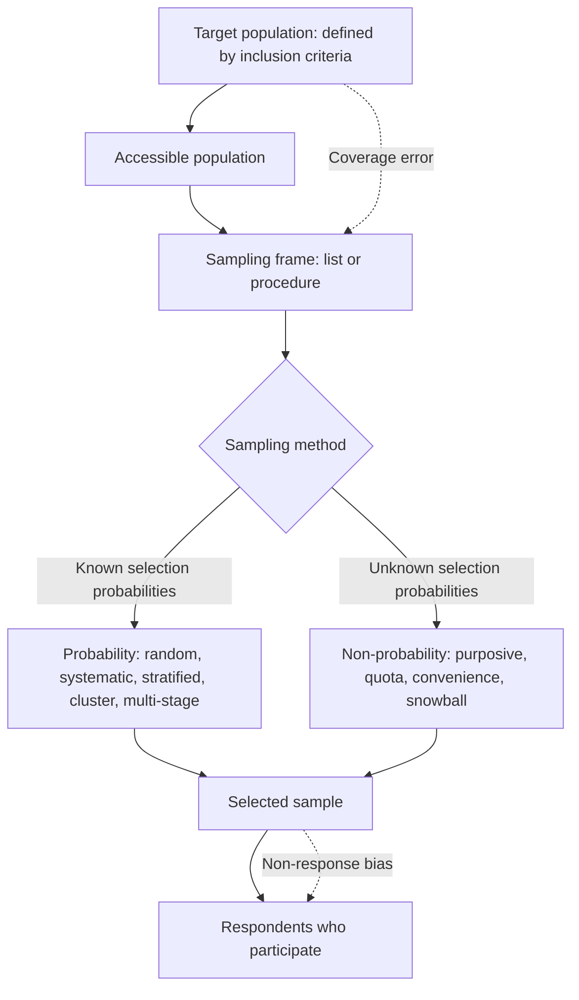

## Introduction

Few researchers can study every person, firm or transaction that interests them. Instead, they select a *sample* and use it to learn about a wider group. The quality of that selection often decides whether a study's conclusions are trustworthy. A beautifully designed questionnaire and sophisticated statistics cannot rescue a sample that systematically excludes the people who matter.

This lesson works through the logic of sampling from the top down: defining the **target population**, locating or building a **sampling frame**, and choosing between **probability** and **non-probability** methods. Ghanaian research presents particular sampling challenges, such as incomplete business registers, informal enterprises and the absence of published lists of mobile money merchants, so the lesson emphasises practical, defensible compromises and the need to state their consequences honestly.

## Learning Objectives

- Define target population, study population, sampling frame, sampling unit and sample, and explain how they relate.
- Explain the principles of simple random, systematic, stratified, cluster and multi-stage sampling.
- Explain the principles of purposive, quota, convenience, snowball and theoretical sampling.
- Apply proportional stratified allocation and systematic selection to a numerical example.
- Evaluate the coverage and selection biases that arise from imperfect sampling frames.

## Prerequisite Knowledge

- Research approaches and purposes (Module 4), especially the difference between descriptive and explanatory aims.
- Basic arithmetic with percentages and ratios.

## Key Terminology

- **Target population**: The complete set of cases about which the researcher wishes to draw conclusions, defined by clear inclusion criteria.
- **Sampling frame**: The list or procedure from which the sample is actually drawn, such as a business register, a student enrolment list or a map of market stalls.
- **Sampling unit**: The element selected at each stage of sampling, such as a district, a firm or an individual employee.
- **Probability sampling**: Sampling in which every case in the population has a known, non-zero chance of selection, enabling statistical inference to the population.
- **Non-probability sampling**: Sampling in which selection probabilities are unknown, relying instead on researcher judgement, accessibility or referral.
- **Coverage error**: Error that arises when the sampling frame omits or over-represents parts of the target population.
- **Stratum**: A subgroup of the population sharing a characteristic (such as region or firm size) used to organise stratified sampling.
- **Saturation**: In qualitative sampling, the point at which additional data no longer produce new insights relevant to the research question.

## Detailed Explanation

### From population to sample

Sampling decisions move through a chain of definitions. The **target population** is defined conceptually, for example "registered SMEs in Greater Accra that sell goods or services online". The **study population** or accessible population is the part you can realistically reach. The **sampling frame** is the concrete list, such as a membership database from a business association. The **sample** is the subset actually selected, and the **respondents** are those who participate.

Each step can introduce error. If the frame is a list of firms registered with one association, unregistered or non-member businesses are excluded, which is **coverage error**. If selected firms refuse to participate in ways related to the topic (for example, firms with poor digital capability decline a survey about e-commerce), **non-response bias** results. A good methodology chapter defines each level explicitly and discusses how far the final respondents can be said to represent the target population.

### Probability sampling methods

Probability methods allow the researcher to estimate sampling error and to generalise statistically.

1. **Simple random sampling.** Every case has an equal chance of selection, usually achieved by numbering the frame and using a random number generator. It is conceptually simple but requires a complete frame.
2. **Systematic sampling.** Every *k*th case is selected after a random start, where `k = N / n` (population size divided by sample size). It is easy to implement on lists or queues, but can produce bias if the list has a periodic pattern that coincides with *k*.
3. **Stratified sampling.** The population is divided into strata (for example region or firm size) and random samples are drawn within each. *Proportional* allocation mirrors each stratum's share of the population; *disproportional* allocation oversamples small strata to allow comparisons. Stratification improves precision when strata differ on the outcome.
4. **Cluster sampling.** Naturally occurring groups (clusters), such as markets, schools or hospital wards, are randomly selected, and all or some cases within them are studied. It reduces travel and cost when the population is geographically dispersed, but because cases in a cluster tend to be similar, it usually requires a larger sample for the same precision.
5. **Multi-stage sampling.** Combines methods across stages, such as randomly selecting districts, then markets within districts, then traders within markets. National household surveys commonly use multi-stage designs.

### Non-probability sampling methods

Non-probability methods are appropriate when no frame exists, when the population is hard to reach, or when the aim is depth and theoretical insight rather than statistical generalisation.

1. **Purposive (judgemental) sampling.** Cases are selected deliberately because they are information-rich for the research question. Variants include maximum variation, typical case, extreme or deviant case, homogeneous and critical case sampling.
2. **Quota sampling.** The researcher sets quotas for subgroups (for example, 50% female traders) and fills them non-randomly. It resembles stratified sampling but selection within quotas is not random.
3. **Convenience sampling.** Cases are chosen because they are easy to access, such as classmates or colleagues. It is cheap and quick but carries the greatest risk of bias and is hard to justify for anything beyond a pilot.
4. **Snowball sampling.** Initial participants refer others. It is valuable for hidden or networked populations, such as informal software developers or victims of online fraud, but tends to recruit people with similar characteristics.
5. **Theoretical sampling.** Used in grounded theory, cases are chosen as analysis proceeds to develop emerging concepts further.
6. **Self-selection (volunteer) sampling.** Participants respond to an open invitation, such as a link posted on social media. Those with strong views or high digital engagement may be over-represented.

## Theories, Frameworks and Models

### Choosing between probability and non-probability sampling

The choice follows from the research purpose and the claims you intend to make.

| Consideration | Points towards probability sampling | Points towards non-probability sampling |
|---|---|---|
| Purpose | Descriptive estimates or statistical tests to generalise to a population | Exploration, in-depth understanding, theory building |
| Frame | A reasonably complete frame exists or can be constructed | No frame exists or the population is hidden |
| Claim | "X% of registered SMEs..." | "Participants described..." |
| Approach | Quantitative surveys | Qualitative interviews, case studies, pilots |
| Resources | Time and access to reach randomly selected cases | Limited access, sensitive topics |

Saunders, Lewis and Thornhill present a similar decision logic, emphasising that a non-probability sample is not inferior when the aim is not statistical generalisation. The error is to use a non-probability sample and then write conclusions as if it were representative.

### Sampling in mixed-methods designs

In mixed-methods research, each strand usually has its own sampling logic. An explanatory sequential study might draw a stratified random sample for the survey and then purposively select interviewees from among survey respondents, for instance typical and deviant cases. Reporting both logics, and how they connect, is part of demonstrating integration.

## Diagram



## Worked Example

**Illustrative scenario.** Yaw is studying e-commerce adoption among registered SMEs. A business association provides a membership list of 1,200 SMEs located in Accra (600), Kumasi (360) and Takoradi (240). He plans a sample of 300.

**Step 1: Define the levels.** Target population: registered SMEs in Ghana's three largest commercial centres. Sampling frame: the association's membership list of 1,200 firms. Coverage limitation: non-member and unregistered firms are excluded, so conclusions apply to association members.

**Step 2: Choose a method.** E-commerce adoption is likely to differ between cities, so Yaw chooses **proportional stratified random sampling** by city.

**Step 3: Compute the sampling fraction.**

```
Sampling fraction = n / N = 300 / 1,200 = 0.25 (25%)
```

**Step 4: Allocate the sample to strata.**

| Stratum | Population | Share | Sample (25%) |
|---|---|---|---|
| Accra | 600 | 50% | 150 |
| Kumasi | 360 | 30% | 90 |
| Takoradi | 240 | 20% | 60 |
| **Total** | **1,200** | **100%** | **300** |

**Step 5: Select within strata using systematic sampling.** For Accra, `k = 600 / 150 = 4`. A random start between 1 and 4 is chosen, say 3, so firms 3, 7, 11, 15 ... are selected from the alphabetical Accra list. Yaw checks that the list has no periodic pattern (for example, every fourth firm being a branch of the same company).

**Step 6: Consider disproportional allocation.** If Yaw wanted to compare Takoradi with the other cities with similar precision, 60 firms might be too few. He could oversample Takoradi (for example, 100 firms) and use weights when estimating overall figures.

**Step 7: Anticipate non-response.** If he expects only some firms to respond, he will need to approach more firms than 300 (see the next lesson on sample size) and compare respondents with non-respondents on known characteristics such as city and sector.

The expected output is a fully specified sampling plan: population, frame, method, allocation table, selection procedure and stated limitations.

## Ghanaian Business Application

Sampling in Ghana requires creativity because comprehensive, up-to-date frames are often unavailable.

- **SMEs and AI adoption.** Possible frames include business association membership lists, lists from regional business support agencies, or lists of firms registered with the Office of the Registrar of Companies, each with different coverage. Many micro and informal enterprises appear on none of them. A researcher might combine a list-based frame for formal SMEs with area-based sampling (randomly selecting streets or market sections and listing all businesses) for informal firms.
- **Retailers and digital payments.** No public list of all traders exists, but markets are physically bounded. A researcher could map market sections, randomly select sections (clusters), and then systematically select every *k*th stall in each, approximating probability sampling.
- **Student cybersecurity awareness.** A university's registry holds enrolment lists, but access is governed by data protection obligations under the Data Protection Act, 2012 (Act 843) and institutional approval. Without such access, a student might use stratified quota sampling across faculties and levels, explaining clearly that results are not statistically representative.
- **Healthcare technology adoption.** Hospitals and clinics can be listed from health service directories; within facilities, staff rosters can serve as frames for clinicians and records officers. Purposive sampling of key informants (IT officers, records managers) suits the qualitative strand.

Across these contexts, honest reporting matters more than claiming an ideal method. A clear statement such as "a quota sample stratified by faculty was used because the registry list was unavailable; findings indicate patterns among respondents rather than population estimates" is far more defensible than a vague claim of "random sampling".

## International Case Study

### The 1936 *Literary Digest* poll

Before the 1936 United States presidential election, the magazine *The Literary Digest* conducted an enormous mail poll and predicted that the Republican candidate, Alf Landon, would defeat the incumbent Franklin D. Roosevelt. Roosevelt won by a landslide. In the same election, George Gallup's much smaller poll, based on more careful selection, correctly forecast Roosevelt's victory.

The *Digest* drew its mailing list largely from sources such as telephone directories, automobile registration lists and its own subscriber lists. During the Great Depression these sources over-represented wealthier households, who were more likely to vote Republican. In addition, only a fraction of those mailed returned their ballots, and those who did may have differed systematically from those who did not.

The case is a textbook illustration of two lessons. First, **coverage error** in the sampling frame cannot be fixed by sheer size: millions of responses from a biased frame produced a worse prediction than a much smaller, better-designed sample. Second, **non-response bias** compounds frame problems. For Ghanaian researchers, the modern equivalent might be an online survey of "digital payment users" distributed through a single social media platform, which would over-represent younger, urban, highly connected people and could badly misestimate adoption among older market traders.

## Common Misconceptions

- **Misconception:** A large sample guarantees representativeness. **Correction:** Representativeness depends on how cases are selected and on frame coverage; the *Literary Digest* poll was huge but biased.
- **Misconception:** "Random" means haphazard, such as approaching whoever passes by. **Correction:** Random selection requires a defined frame and a chance mechanism; approaching passers-by is convenience sampling.
- **Misconception:** Quota sampling is the same as stratified sampling. **Correction:** Both use subgroups, but selection within quotas is non-random, so quota samples do not support probability-based inference.
- **Misconception:** Non-probability samples are always poor research. **Correction:** Purposive and theoretical sampling are the appropriate choice for qualitative depth and theory building.
- **Misconception:** The sampling frame and the target population are the same thing. **Correction:** The frame is the practical list used; gaps between the two produce coverage error that must be discussed.

## Common Examination Mistakes

- Describing a convenience or snowball sample as "random" in a methodology answer.
- Failing to define the target population with inclusion and exclusion criteria.
- Naming a sampling technique without justifying it in relation to the purpose and frame available.
- Omitting coverage error and non-response bias when evaluating a scenario's sample.
- Miscalculating the systematic sampling interval or forgetting the random start.

## Critical Thinking Questions

1. If no reliable sampling frame of informal retailers exists, is it ever legitimate to generalise survey findings about them? What evidence would support or weaken such a claim?
2. Snowball sampling is useful for hidden populations, but participants tend to resemble one another. How could a researcher studying victims of mobile money fraud reduce this homogeneity?
3. When might disproportional stratified sampling be preferable to proportional allocation in a study of healthcare technology across hospital types?
4. Online surveys are cheap and fast. Under what conditions might an online self-selection sample of Ghanaian university students still produce useful findings?

## Practical Exercises

1. **Define the chain.** For a study of cybersecurity awareness among undergraduate students at one Ghanaian university, write the target population, accessible population, sampling frame and sampling unit, and identify one source of coverage error. *Expected output:* four labelled definitions and a sentence explaining the coverage risk.
2. **Allocate a stratified sample.** A hospital network has 500 clinical staff: 250 nurses, 150 doctors and 100 laboratory and records staff. Allocate a proportional sample of 200 and compute the systematic interval for nurses. *Expected output:* allocations of 100, 60 and 40, and `k = 250 / 100 = 2.5`, with a note on how to handle a fractional interval (for example, using a fractional interval with rounding or random selection instead).
3. **Critique a sample.** A student surveys 400 people who follow a fintech company's social media page and concludes that "Ghanaians trust digital payments". Identify the sampling method and three biases, and propose an improved design. *Expected output:* identification of self-selection or convenience sampling, three named biases and a revised sampling plan.

## Key Takeaways

- Define the target population, frame, unit and sample explicitly; gaps between them create coverage error.
- Probability sampling supports statistical generalisation; non-probability sampling supports depth and theory building.
- Stratified sampling improves precision; cluster sampling reduces cost but usually needs larger samples.
- Size cannot compensate for a biased frame or high non-response.
- Report sampling compromises honestly and calibrate conclusions accordingly.

## Further Reading

- Saunders, M., Lewis, P., & Thornhill, A. (2019). *Research methods for business students* (8th ed.). Pearson.
- Bell, E., Bryman, A., & Harley, B. (2019). *Business research methods* (5th ed.). Oxford University Press.
- Cochran, W. G. (1977). *Sampling techniques* (3rd ed.). Wiley.
- Fowler, F. J. (2014). *Survey research methods* (5th ed.). SAGE.

## Video Resources

- [Khan Academy: Statistics and Probability](https://www.khanacademy.org/math/statistics-probability): Khan Academy. Free official course including units on sampling methods and study design.
- [SAGE Research Methods](https://methods.sagepub.com/): SAGE Publishing. Official research methods platform (access may depend on institutional subscription) with material on sampling strategies.

## Revision Summary

Sampling links a defined target population to the cases actually studied through a sampling frame, and every step can introduce error. Probability methods (simple random, systematic, stratified, cluster, multi-stage) give each case a known chance of selection and support statistical generalisation; non-probability methods (purposive, quota, convenience, snowball, theoretical) rely on judgement or access and support depth rather than population estimates.

- Population ≠ frame; the gap is coverage error.
- Systematic interval `k = N / n` with a random start.
- Proportional allocation: each stratum's sample = its share × n.
- Quota ≠ stratified: no random selection within quotas.
- Big biased samples still mislead (*Literary Digest*, 1936).
