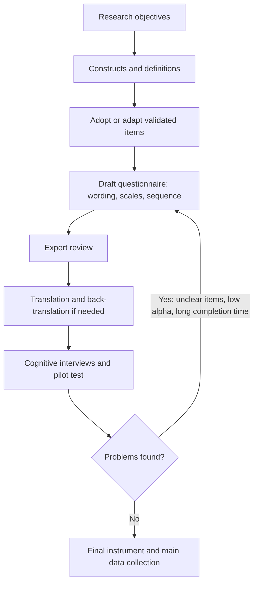

## Introduction

The questionnaire is the most widely used data collection instrument in MSc IT for Business dissertations. It is also one of the most underestimated. Writing questions appears easy, yet small decisions about wording, response options, order and layout can change the answers people give, and once a questionnaire has been distributed those decisions cannot be undone. A poorly designed instrument produces data that no amount of statistical analysis can repair.

This lesson treats questionnaire design as a disciplined process that begins with the conceptual framework and ends with a tested, reliable instrument. You will learn how to move from constructs to items, choose question types and measurement scales, avoid common wording errors, structure and sequence the instrument, translate it where needed for Ghanaian respondents, and pilot it, including a worked calculation of Cronbach's alpha to check internal consistency.

## Learning Objectives

- Explain how constructs in a conceptual framework are operationalised into questionnaire items.
- Distinguish nominal, ordinal, interval and ratio levels of measurement and identify the analyses each permits.
- Apply principles of good question wording to detect and correct leading, double-barrelled, ambiguous and loaded items.
- Design an appropriate structure, sequence and administration mode for a questionnaire.
- Calculate and interpret Cronbach's alpha from pilot data and plan revisions based on pilot results.

## Prerequisite Knowledge

- Conceptual frameworks and constructs such as those in TAM and UTAUT (Module 3).
- Sampling methods and sample size (previous lessons in this module).
- Basic arithmetic with variances (helpful for the reliability calculation).

## Key Terminology

- **Construct**: An abstract concept, such as perceived usefulness or trust, that cannot be observed directly and must be measured through indicators.
- **Operationalisation**: The process of defining how a construct will be measured, including the specific items and response format.
- **Item**: A single question or statement in a questionnaire that measures part of a construct.
- **Likert scale**: A set of statements to which respondents indicate their degree of agreement on an ordered response format, typically five or seven points, summed or averaged to form a scale score.
- **Level of measurement**: The nature of the information a variable holds (nominal, ordinal, interval or ratio), which determines the permissible statistical operations.
- **Pilot test**: A small-scale trial of the questionnaire with respondents similar to the target population to identify problems before main data collection.
- **Internal consistency reliability**: The extent to which items intended to measure the same construct produce consistent responses, commonly assessed with Cronbach's alpha.
- **Back-translation**: Translating a questionnaire into another language and then independently back into the original to check equivalence of meaning.

## Detailed Explanation

### From constructs to items

Good questionnaires are built backwards from the research objectives. Each objective identifies constructs; each construct receives a clear conceptual definition; each definition is operationalised through several items. Where possible, researchers **adopt or adapt validated items** from published studies, for example the perceived usefulness and ease of use items associated with Davis's Technology Acceptance Model or the UTAUT items of Venkatesh and colleagues. Adapting items to context (replacing "the system" with "mobile money merchant payments") is acceptable, but substantial changes require re-validation and the source must be cited.

A **construct-item matrix** is a simple control tool: rows list constructs and their definitions, and columns show item codes, item wording, source and the objective each serves. Any item that does not map to an objective should be removed; any objective without items reveals a gap.

### Question types

- **Closed questions** provide fixed response options. They are quick to answer and analyse, but only capture what the researcher anticipated. Types include dichotomous (yes/no), multiple choice, checklists ("tick all that apply"), ranking and rating scales.
- **Open questions** let respondents answer in their own words. They capture unexpected issues but are more demanding to answer and to code. A few open questions placed after relevant closed sections can be useful.
- **Filter (contingency) questions** route respondents past irrelevant sections, for example "If you do not currently use any AI tool, go to Section D."

### Levels of measurement

Stevens's classification remains the basis for choosing analyses.

| Level | Properties | Example | Typical analyses |
|---|---|---|---|
| Nominal | Categories with no order | Sector (retail, manufacturing, services) | Frequencies, mode, chi-square |
| Ordinal | Ordered categories, unequal or unknown gaps | Education level; a single Likert item | Median, percentiles, rank-based tests |
| Interval | Equal intervals, no true zero | Temperature in °C; multi-item scale scores are often treated as interval | Mean, SD, correlation, t-tests |
| Ratio | Equal intervals and a true zero | Number of employees; monthly online sales in GH¢ | All of the above plus meaningful ratios |

Whether Likert data can be treated as interval is a long-standing debate. A common, defensible position is that a single Likert item is ordinal, whereas a scale score averaged across several items more closely approximates interval data and is usually analysed with parametric statistics. Whatever position you take, state it.

Collect data at the highest sensible level. Asking for the exact number of employees (ratio) allows later grouping into categories, whereas asking only for a category ("1-5, 6-29, 30-99") cannot be reversed.

### Principles of good question wording

1. **Keep it simple and specific.** Use familiar words and a clear time frame ("In the past month...").
2. **Avoid double-barrelled questions.** "The app is fast and secure" asks two things at once.
3. **Avoid leading and loaded wording.** "Don't you agree that digital payments are safer than cash?" pushes respondents towards agreement.
4. **Avoid double negatives.** "I do not think AI should not be used" confuses respondents.
5. **Avoid assumptions.** "How often do you use your company's AI chatbot?" assumes one exists.
6. **Make response options exhaustive and mutually exclusive.** Ranges such as "0-5" and "5-10" overlap.
7. **Consider sensitive topics carefully.** Questions about revenue, tax or security breaches may need ranges, reassurance about confidentiality and placement later in the questionnaire.
8. **Include a mix of positively and negatively worded items cautiously.** Reverse-worded items can detect careless responding but can also confuse respondents; if used, they must be reverse-coded before analysis.

### Structure, sequence and layout

A typical sequence is: an introduction (purpose, voluntary participation, confidentiality, estimated time and contact details), easy and non-threatening opening questions, core construct sections in a logical order, sensitive questions and demographic items towards the end, and a thank-you. Dillman, Smyth and Christian's *tailored design method* emphasises reducing respondent burden, building trust and making participation easy, principles that apply whether the questionnaire is administered online, on paper or by an enumerator.

**Mode** matters. Online surveys are cheap and fast but can exclude respondents with limited connectivity or digital skills. Interviewer-administered questionnaires suit respondents with limited literacy in the questionnaire's language but introduce interviewer effects. Paper questionnaires suit settings such as hospital wards but require data entry.

### Pilot testing

Piloting is the last opportunity to find problems. A good pilot involves respondents similar to the target population and asks them not only to answer but to comment on clarity, length and difficulty. **Cognitive interviewing**, where respondents think aloud while answering, reveals how items are interpreted. Pilot data allow preliminary reliability checks, assessment of completion time, and verification that filter instructions and online logic work.

## Theories, Frameworks and Models

### Reliability and Cronbach's alpha

For multi-item scales, internal consistency is commonly assessed with Cronbach's alpha:

```
α = (k / (k − 1)) × (1 − (Σ item variances / variance of total score))
```

where *k* is the number of items. Alpha rises when items correlate strongly and when there are more items. A frequently cited rule of thumb treats values of about 0.70 or above as acceptable for research purposes, but this is a convention, not a law, and very high values (above about 0.95) may indicate redundant items. Field's *Discovering Statistics Using IBM SPSS Statistics* explains how to obtain alpha in SPSS and how to use "alpha if item deleted" to diagnose weak items. Alpha measures consistency, not validity: a scale can be consistently measuring the wrong thing.

### The questionnaire design cycle

Design proceeds iteratively: define constructs, draft items, expert review, cognitive testing, pilot, analyse pilot data, revise, then finalise. Each loop improves validity and reliability.

## Diagram



## Worked Example

**Illustrative scenario.** Kofi is measuring **trust in mobile money merchant payments** among retailers using four Likert items (1 = strongly disagree, 5 = strongly agree):

- T1: I trust that mobile money payments will reach my account.
- T2: I believe the mobile money provider protects my transaction information.
- T3: I am confident I can resolve a failed payment.
- T4: Mobile money payments are reliable for my business.

**Step 1: Check the wording.** Kofi's first draft of T2 read "The provider protects my information and resolves complaints quickly", which was double-barrelled. He split it, moving the complaints idea into T3.

**Step 2: Pilot.** Twenty retailers complete the pilot. Kofi computes the sample variance of each item and the variance of the total score (sum of the four items):

```
Var(T1) = 0.80
Var(T2) = 0.90
Var(T3) = 0.70
Var(T4) = 1.00
Sum of item variances = 3.40
Variance of total score = 9.00
k = 4
```

**Step 3: Compute alpha.**

```
α = (4 / 3) × (1 − 3.40 / 9.00)
  = 1.3333 × (1 − 0.3778)
  = 1.3333 × 0.6222
  = 0.83
```

**Step 4: Interpret.** An alpha of about 0.83 indicates good internal consistency for a four-item scale under the common 0.70 convention. Kofi also checks "alpha if item deleted" in SPSS; if removing an item would raise alpha substantially, he would examine its wording.

**Step 5: Act on qualitative pilot feedback.** Several older traders found "transaction information" unclear. Kofi rewords T2 as "I believe the mobile money provider keeps details of my payments private" and records the change in his methodology chapter.

**Step 6: Reverse coding check.** Had Kofi included a negatively worded item such as "I worry that payments will go missing", he would recode it before computing alpha using `recoded = 6 − original` on a five-point scale, so that 1 becomes 5 and 5 becomes 1.

The expected output is a revised item set, an alpha value with interpretation, and a documented list of pilot-based changes.

## Ghanaian Business Application

Questionnaire design in Ghana raises specific practical issues.

- **Language.** Many retailers and SME owners are more comfortable in Twi, Ga, Ewe, Dagbani or other Ghanaian languages than in English. If a questionnaire is administered in a local language, it should be translated by a competent translator, independently back-translated, and discrepancies resolved, so that "perceived usefulness" does not become something subtly different. Enumerators should be trained to read items consistently.
- **Mode and connectivity.** Online questionnaires distributed through messaging apps reach students and urban professionals easily but may under-represent rural traders. Interviewer-administered tablet surveys can combine reach with data validation.
- **Sensitive financial questions.** Asking SME owners about exact revenue or tax status may provoke refusals or inaccurate answers. Revenue ranges, assurances of confidentiality and placement near the end help.
- **Context-specific constructs.** Validated scales from international studies may omit locally important factors. For example, an AI adoption questionnaire for SMEs might need items about reliability of electricity supply or the availability of local technical support, informed by exploratory interviews.
- **Data protection.** If the questionnaire collects personal data, the introduction should explain how data will be stored and used, consistent with the Data Protection Act, 2012 (Act 843) and the ethics approval obtained.

For student cybersecurity research, self-reported behaviour ("I never share my password") may be inflated by social desirability; anonymous administration and neutral wording reduce, but do not eliminate, this problem.

## International Case Study

### Questionnaire translation in the European Social Survey

The European Social Survey (ESS) is a long-running, cross-national academic survey conducted in many European countries and languages. Because its value depends on comparing answers across countries, the ESS has invested heavily in ensuring that questions mean the same thing in every language.

The ESS has documented a translation approach widely referred to by the acronym **TRAPD**: Translation, Review, Adjudication, Pretesting and Documentation. Rather than relying on a single translator, two translators produce independent versions; a review session compares them and agrees a version; an adjudicator makes final decisions; the translated questionnaire is pretested; and every decision is documented. This "team" approach is designed to catch problems that a simple translation followed by back-translation may miss, such as items that are linguistically correct but culturally awkward.

The case offers two lessons for Ghanaian researchers. First, translation is a design activity, not a clerical task: decisions about how to express concepts such as "trust" or "privacy" in Twi or Ewe affect validity. Second, documentation matters; examiners and future researchers need to see how equivalence was established. An MSc student cannot replicate the ESS's resources, but can adopt its logic on a small scale: two independent translations, a reconciliation discussion with a knowledgeable colleague, a pilot, and a translation log appended to the dissertation.

## Common Misconceptions

- **Misconception:** Anyone can write a good questionnaire in an afternoon. **Correction:** Good questionnaires require construct definition, careful wording, expert review and piloting; most problems are only revealed by testing.
- **Misconception:** A high Cronbach's alpha proves a scale is valid. **Correction:** Alpha indicates internal consistency only; validity requires evidence that the scale measures the intended construct.
- **Misconception:** More questions always produce better data. **Correction:** Long questionnaires increase fatigue, careless responding and drop-out; each item must serve an objective.
- **Misconception:** Pilot testing means checking spelling with friends. **Correction:** A pilot uses respondents similar to the target population and tests clarity, timing, routing and reliability.
- **Misconception:** Likert items can be analysed in any way without justification. **Correction:** The ordinal or interval treatment of Likert data should be stated and justified, especially for single items.

## Common Examination Mistakes

- Failing to link questionnaire items to research objectives or constructs.
- Giving examples of poor questions without explaining what is wrong with them or how to fix them.
- Confusing levels of measurement, for example calling "sector" ordinal.
- Stating that alpha must exceed 0.70 as an absolute rule without acknowledging that it is a convention.
- Omitting the pilot test or describing it vaguely without stating what changed as a result.

## Critical Thinking Questions

1. Adopting validated items from international studies improves comparability but may miss local realities. How would you balance these goals in a questionnaire on AI adoption among Ghanaian SMEs?
2. Should a questionnaire on student cybersecurity behaviour include reverse-worded items? Weigh the benefits for detecting careless responding against the risk of confusion.
3. An online questionnaire achieves a much faster response than an enumerator-administered one but reaches a narrower population. Which would you choose for a study of digital payment adoption among market traders, and why?
4. Can a questionnaire ever be culturally neutral? What does your answer imply for cross-country comparisons of technology acceptance?

## Practical Exercises

1. **Fix the items.** Rewrite each item so that it is clear and unbiased: (a) "Do you agree that AI is useful and affordable for your business?" (b) "How much do you earn?" (c) "Don't you think students should take cybersecurity seriously?" *Expected output:* three rewritten items with a note naming the problem each had (double-barrelled; vague and sensitive; leading).
2. **Construct-item matrix.** Choose two UTAUT constructs relevant to healthcare technology adoption and write three items for each, adapted to nurses using an electronic records system. *Expected output:* a matrix with construct, definition, item code, item wording and the objective served.
3. **Alpha calculation.** A three-item scale has item variances 1.1, 0.9 and 1.0 and a total score variance of 6.6. Compute Cronbach's alpha and interpret it. *Expected output:* `α = (3/2) × (1 − 3.0/6.6) = 1.5 × 0.5455 = 0.82`, interpreted as good internal consistency under the usual convention.

## Key Takeaways

- Build questionnaires backwards from objectives through constructs to items, preferably adapting validated items.
- The level of measurement determines which analyses are appropriate; collect data at the highest sensible level.
- Avoid double-barrelled, leading, loaded, ambiguous and assumption-laden items.
- Pilot with similar respondents, use cognitive interviewing where possible, and document changes.
- Cronbach's alpha checks internal consistency, not validity.

## Further Reading

- Dillman, D. A., Smyth, J. D., & Christian, L. M. (2014). *Internet, phone, mail, and mixed-mode surveys: The tailored design method* (4th ed.). Wiley.
- Field, A. (2018). *Discovering statistics using IBM SPSS statistics* (5th ed.). SAGE.
- Stevens, S. S. (1946). On the theory of scales of measurement. *Science, 103*(2684), 677-680.
- Davis, F. D. (1989). Perceived usefulness, perceived ease of use, and user acceptance of information technology. *MIS Quarterly, 13*(3), 319-340.
- Saunders, M., Lewis, P., & Thornhill, A. (2019). *Research methods for business students* (8th ed.). Pearson.

## Video Resources

- [European Social Survey](https://www.europeansocialsurvey.org/): European Social Survey ERIC. Official site with documentation on questionnaire design, translation and fieldwork methodology.
- [SAGE Research Methods](https://methods.sagepub.com/): SAGE Publishing. Official research methods platform (access may depend on institutional subscription) with material on questionnaire design and piloting.

## Revision Summary

A questionnaire operationalises the constructs of a conceptual framework into clear items with appropriate response formats, sequenced to minimise burden and bias, translated with care where needed, and refined through piloting. Levels of measurement determine permissible analyses, and Cronbach's alpha provides evidence of internal consistency for multi-item scales.

- Objectives → constructs → items; use a construct-item matrix.
- Nominal, ordinal, interval, ratio: collect the highest sensible level.
- Watch for double-barrelled, leading, loaded and assumption-laden items.
- `α = (k/(k−1)) × (1 − Σσ²ᵢ/σ²ₜ)`; about 0.70+ is a common convention.
- Reverse-code with `6 − x` on a five-point scale.
- Pilot, revise, document.
