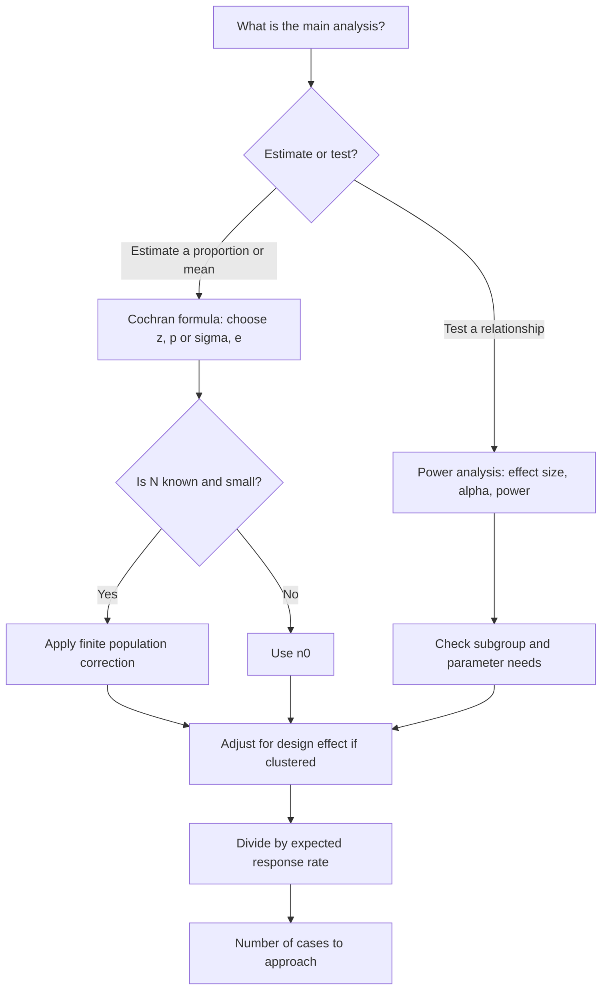

## Introduction

"How many respondents do I need?" is one of the first questions MSc students ask their supervisors, and one of the most frequently mishandled sections of a methodology chapter. Some students pick a round number such as 100 or 200 without justification; others quote a formula without understanding what its inputs mean; still others copy a figure from a table without checking whether its assumptions fit their study.

Sample size is not a single number to be looked up. It is a reasoned judgement that balances the precision required, the analyses planned, the variability of the population, expected response rates and available resources. In qualitative research, the question changes form entirely: the aim is not statistical precision but sufficient depth to answer the question, often discussed through the idea of **saturation**. This lesson teaches both logics with fully worked calculations.

## Learning Objectives

- Explain the factors that determine an appropriate quantitative sample size, including confidence level, margin of error, population variability and planned analysis.
- Apply Cochran's formula for proportions and for means, the finite population correction and a response-rate adjustment.
- Interpret the margin of error of a survey estimate and explain how it changes with sample size.
- Compare formula-based, table-based (Krejcie and Morgan) and analysis-based (rules of thumb, power analysis) approaches.
- Evaluate arguments for qualitative sample sizes based on saturation and information power.

## Prerequisite Knowledge

- Probability and non-probability sampling methods (previous lesson).
- Basic algebra, squaring numbers and using a calculator.
- Awareness of the normal distribution and the idea of a 95% confidence level (covered further in Module 6).

## Key Terminology

- **Margin of error**: The maximum expected difference, at a stated confidence level, between a sample estimate and the true population value, often written as ±e.
- **Confidence level**: The proportion of samples (for example 95%) whose confidence intervals would contain the true population value if sampling were repeated many times.
- **z-value**: The number of standard errors corresponding to a confidence level; 1.96 for 95% and 2.576 for 99%.
- **Finite population correction**: An adjustment that reduces the required sample size when the sample is a substantial fraction of a small, known population.
- **Statistical power**: The probability that a test will detect an effect of a given size if that effect truly exists, conventionally set at 0.80.
- **Effect size**: A standardised measure of the magnitude of a relationship or difference, independent of sample size.
- **Data saturation**: The point in qualitative data collection at which new data no longer generate new codes or insights relevant to the research question.
- **Information power**: The idea that the more relevant information a sample holds for the study aim, the fewer participants are needed.

## Detailed Explanation

### What drives quantitative sample size?

Five considerations interact.

1. **Precision required.** A smaller margin of error demands a larger sample. Because the margin of error shrinks in proportion to the square root of *n*, halving the margin of error requires roughly four times the sample.
2. **Confidence level.** Higher confidence (99% rather than 95%) requires a larger sample because the z-value increases from 1.96 to 2.576.
3. **Variability in the population.** For proportions, variability is greatest when the true proportion is 50%; for means, it is captured by the standard deviation. When variability is unknown, researchers use the most conservative assumption (`p = 0.5`) or a pilot estimate.
4. **Planned analysis.** Comparing subgroups, running multiple regression or structural equation modelling all need enough cases in each group or per estimated parameter.
5. **Practical constraints.** Expected response rates, cost, time and access determine how many cases must be approached to achieve the target.

### Cochran's formula for proportions

Cochran's *Sampling Techniques* gives the classic formula for estimating a population proportion with a desired margin of error:

```
n0 = (z^2 × p × q) / e^2
where q = 1 − p
```

For large populations, `n0` is the required sample. When the population is finite and `n0` is a noticeable fraction of it, apply the **finite population correction (FPC)**:

```
n = n0 / (1 + (n0 − 1) / N)
```

### Cochran's formula for means

When the key estimate is a mean (for example, an average score on a five-point awareness scale), the formula uses the population standard deviation σ and the margin of error e in the same units:

```
n0 = (z^2 × σ^2) / e^2
```

σ can be estimated from a pilot study or from published studies using similar scales.

### Krejcie and Morgan's table

Krejcie and Morgan (1970) published a widely used table of required sample sizes for populations of different sizes, based on a 95% confidence level, a 5% margin of error and the conservative `p = 0.5`. It produces figures very close to Cochran's formula with the finite population correction. The table is convenient, but students should state its assumptions; citing it for a study that needs subgroup comparisons or a different margin of error is a misuse.

### Analysis-based approaches

For explanatory studies, the question is often whether the sample is large enough to detect relationships, not just to estimate a proportion.

- **Power analysis** (Cohen) calculates the sample needed to detect an expected effect size with a given significance level (commonly 0.05) and power (commonly 0.80). Free software such as G*Power is widely used for this purpose.
- **Rules of thumb** for regression include Green's (1991) suggestion of `N ≥ 50 + 8m` for testing the overall model, where *m* is the number of predictors. Such rules are starting points, not substitutes for a justified calculation.
- **Subgroup requirements.** If results will be compared across, say, four faculties, each subgroup needs an adequate sample in its own right.

### Response rates and design effects

The calculated *n* is the number of *completed, usable* responses. If a response rate of *r* is expected, the number to approach is `n / r`. Cluster sampling usually inflates the required sample by a **design effect** (deff) because cases within clusters are similar; `n_cluster = n × deff`. The size of the design effect depends on how similar cases within clusters are and is best estimated from previous comparable surveys.

### Qualitative sample size

Qualitative researchers do not calculate *n* by formula because the goal is depth, not statistical precision. Sample size is justified by:

- **Saturation.** Data collection continues until new interviews produce little or no new information relevant to the question. Guest, Bunce and Johnson (2006) reported that, in their study of a relatively homogeneous group, most of the codes they eventually identified had emerged within the first twelve interviews. This is evidence from one study, not a universal rule.
- **Information power.** Malterud and colleagues argue that fewer participants are needed when the aim is narrow, participants are highly specific to the aim, established theory guides the analysis, dialogue quality is strong and the analysis is case-oriented.
- **Design and analytic approach.** A phenomenological study may involve a small number of participants interviewed in depth, whereas a multiple-case study needs enough cases for replication logic.

Good practice is to state an initial estimate, explain the criteria for stopping, and report how saturation was judged, for example by tracking new codes per interview.

## Theories, Frameworks and Models

### Choosing a sample size approach

| Situation | Recommended approach | Key inputs to state |
|---|---|---|
| Estimating a proportion in a population | Cochran for proportions + FPC (or Krejcie and Morgan table) | z, p, e, N, response rate |
| Estimating a mean score | Cochran for means + FPC | z, σ (from pilot or literature), e, N |
| Testing a regression or group difference | Power analysis (or a rule of thumb as a check) | Effect size, α, power, number of predictors |
| Comparing subgroups | Calculate per subgroup, then sum | Same inputs per subgroup |
| Cluster sampling | Multiply by design effect | Expected deff |
| Qualitative interviews or cases | Saturation and information power | Stopping criteria, homogeneity, aim |

## Diagram



## Worked Example

**Illustrative scenario.** Akosua is surveying registered SMEs in Greater Accra about AI adoption. A business association's list contains `N = 1,200` firms. She wants to estimate the proportion that use any AI tool with 95% confidence and a margin of error of ±5 percentage points. No previous estimate exists.

**Step 1 – Choose the inputs.**

```
z = 1.96 (95% confidence)
p = 0.5 (no prior estimate; most conservative)
q = 1 − 0.5 = 0.5
e = 0.05
```

**Step 2 – Compute n0.**

```
n0 = (1.96^2 × 0.5 × 0.5) / 0.05^2
   = (3.8416 × 0.25) / 0.0025
   = 0.9604 / 0.0025
   = 384.16  → 385 (always round up)
```

**Step 3 – Apply the finite population correction.**

```
n = 384.16 / (1 + (384.16 − 1) / 1,200)
  = 384.16 / (1 + 383.16 / 1,200)
  = 384.16 / (1 + 0.3193)
  = 384.16 / 1.3193
  = 291.18  → 292
```

This is very close to the figure given in Krejcie and Morgan's (1970) table for a population of 1,200, as expected, since both rest on the same assumptions.

**Step 4 – Adjust for the expected response rate.** From discussions with the association, Akosua expects about 60% of approached firms to complete the questionnaire.

```
Firms to approach = 292 / 0.60 = 486.7 → 487
```

**Step 5 – Check the planned analysis.** She also plans a multiple regression with five predictors of AI adoption intention. Green's rule of thumb gives `50 + 8 × 5 = 90`, comfortably below 292, so the descriptive target is binding.

**Step 6 – Interpret the margin of error if the target is missed.** Suppose only 200 usable responses are returned and the observed proportion is 0.5. Ignoring the FPC for simplicity:

```
e = 1.96 × √(p × q / n)
  = 1.96 × √(0.25 / 200)
  = 1.96 × √0.00125
  = 1.96 × 0.03536
  = 0.0693  → about ±6.9 percentage points
```

Precision is lower than planned, and Akosua must report this honestly.

**Step 7 – A mean-based alternative.** If her key outcome were a mean score on a five-point scale with a pilot standard deviation of 0.8, and she wanted a margin of error of ±0.1 scale points:

```
n0 = (1.96^2 × 0.8^2) / 0.1^2 = (3.8416 × 0.64) / 0.01 = 245.86 → 246
```

**Expected output:** a justified target of 292 usable responses (487 firms approached), a stated margin of error, and a check that the planned regression is adequately powered.

## Ghanaian Business Application

Sample-size reasoning appears in many Ghanaian research settings.

- **Digital payments among market retailers.** If no frame exists and cluster sampling of market sections is used, a design effect must be considered. Traders in the same section often sell similar goods and share experiences, so the effective sample is smaller than the raw count. A researcher might plan for more completed questionnaires than the simple Cochran calculation suggests and explain why.
- **Student cybersecurity awareness.** A university's student population is large, so the FPC makes little difference and `n0` of about 385 is adequate for a ±5-point estimate overall. But if the aim is to compare five colleges, each college needs enough responses for its own estimate, which may require a larger total.
- **Healthcare technology adoption.** The population of IT or records officers across a region's hospitals may be small, for example fewer than 100. Here the FPC substantially reduces the required sample, and a census (studying everyone) may be more sensible than sampling.
- **Qualitative interviews with SME owners about AI.** An exploratory study might begin with about 12–20 interviews, sampled for maximum variation across sectors and firm sizes, with stopping decided by saturation. The methodology chapter should describe how new codes per interview were tracked.

Response rates in Ghanaian business surveys vary widely depending on mode, gatekeepers and timing, so students should base assumptions on their pilot or on comparable studies rather than on optimistic guesses, and should state those assumptions.

## International Case Study

### The 2015 United Kingdom general election polling miss

Before the 2015 UK general election, opinion polls consistently suggested that the Conservative and Labour parties were roughly level. The result was a clear Conservative lead. The British Polling Council and the Market Research Society commissioned an independent inquiry, chaired by Patrick Sturgis, to investigate.

The inquiry concluded that the primary cause of the polling error was **unrepresentative samples**: the methods used to recruit and weight respondents systematically over-represented Labour supporters and under-represented Conservative supporters. It found little support for many alternative explanations, such as a late swing in voting intention.

The lesson for sample size is subtle but crucial. National polls typically had samples of around a thousand or more respondents, which by the margin-of-error formula should give precision of roughly ±3 percentage points. Yet because many polls shared the same systematic bias, the error was larger than the margin of error implied, and in the same direction across polls. The margin of error captures only **random sampling error**; it says nothing about bias from frame coverage, recruitment or non-response. Increasing sample size reduces random error but cannot correct systematic error. Ghanaian researchers should therefore pair any sample-size calculation with an equally careful discussion of how respondents are selected.

## Common Misconceptions

- **Misconception:** A sample of 10% of the population is always adequate. **Correction:** Required size depends on precision, variability and analysis; for large populations it is nearly independent of population size, so a fixed percentage rule is meaningless.
- **Misconception:** The margin of error covers all sources of error in a survey. **Correction:** It reflects only random sampling error, assuming probability sampling; coverage, non-response and measurement errors are additional.
- **Misconception:** Cochran's formula applies to convenience samples. **Correction:** The formula assumes probability sampling; applied to a convenience sample, the resulting margin of error is not meaningful.
- **Misconception:** Qualitative studies need a fixed number of interviews, such as 30. **Correction:** Qualitative sample size is justified by saturation, information power and the analytic approach, and should be reported transparently.
- **Misconception:** The required sample is the number of questionnaires to distribute. **Correction:** It is the number of usable responses; divide by the expected response rate to find how many to distribute.

## Common Examination Mistakes

- Squaring incorrectly or forgetting to square the margin of error (using 0.05 instead of 0.0025).
- Rounding the sample size down instead of up.
- Applying the finite population correction to very large populations and then describing it as a major reduction.
- Citing Krejcie and Morgan without stating its assumptions (95% confidence, ±5% error, p = 0.5).
- Claiming saturation without describing how it was assessed.

## Critical Thinking Questions

1. If a student's survey achieves 150 responses against a target of 292, should the student report a revised margin of error, change the research questions, or both? Justify your answer.
2. Why does the required sample size barely change between a population of 100,000 and one of 10 million, and what does this imply for national studies in Ghana?
3. Is saturation a property of the data, of the researcher's analysis, or of the research question? What are the implications for claiming saturation in a dissertation?
4. When might studying the entire population (a census) be preferable to sampling, for example among IT managers of all hospitals in a region?

## Practical Exercises

1. **Proportion calculation.** A researcher wants to estimate the proportion of Ghanaian university students who reuse passwords, with 95% confidence and ±4% margin of error, assuming `p = 0.5` and a very large population. Compute `n0`. *Expected output:* `n0 = (3.8416 × 0.25) / 0.0016 = 600.25 → 601`.
2. **Finite population and response rate.** A study of hospital records officers has `N = 150` and an `n0` of 385. Apply the FPC and then adjust for an expected 70% response rate. *Expected output:* `n = 384.16 / (1 + 383.16 / 150) = 384.16 / 3.554 = 108.1 → 109`; approach `109 / 0.70 = 155.7 → 156`, which exceeds N, so a census of all 150 is recommended.
3. **Qualitative justification.** Write a 150-word justification for interviewing about 15 owners of e-commerce SMEs, referring to saturation, information power and how you will track new codes. *Expected output:* a paragraph naming stopping criteria and a simple tracking table (interview number versus new codes).

## Key Takeaways

- Sample size depends on precision, confidence, variability, planned analysis and practical constraints.
- Cochran: `n0 = z²pq / e²` for proportions and `n0 = z²σ² / e²` for means; apply the FPC for small known populations.
- The calculated *n* is usable responses; divide by the expected response rate to plan distribution.
- Margins of error measure random error only; bias cannot be fixed by size.
- Qualitative sample size is justified through saturation, information power and transparent stopping criteria.

## Further Reading

- Cochran, W. G. (1977). *Sampling techniques* (3rd ed.). Wiley.
- Krejcie, R. V., & Morgan, D. W. (1970). Determining sample size for research activities. *Educational and Psychological Measurement, 30*(3), 607–610.
- Cohen, J. (1988). *Statistical power analysis for the behavioral sciences* (2nd ed.). Lawrence Erlbaum Associates.
- Green, S. B. (1991). How many subjects does it take to do a regression analysis? *Multivariate Behavioral Research, 26*(3), 499–510.
- Guest, G., Bunce, A., & Johnson, L. (2006). How many interviews are enough? An experiment with data saturation and variability. *Field Methods, 18*(1), 59–82.
- Malterud, K., Siersma, V. D., & Guassora, A. D. (2016). Sample size in qualitative interview studies: Guided by information power. *Qualitative Health Research, 26*(13), 1753–1760.

## Video Resources

- [Khan Academy: Statistics and Probability](https://www.khanacademy.org/math/statistics-probability) — Khan Academy. Free official course with units on confidence intervals and margins of error.
- [SAGE Research Methods](https://methods.sagepub.com/) — SAGE Publishing. Official research methods platform (access may depend on institutional subscription) with material on sample size and saturation.

## Revision Summary

Quantitative sample size balances precision, confidence, population variability, planned analysis and response rates; Cochran's formula gives the number of usable responses, the finite population correction reduces it for small known populations, and power analysis checks that relationships can be detected. Qualitative sample size is justified by saturation and information power rather than formulas.

- `n0 = 1.96² × 0.5 × 0.5 / 0.05² = 384.16 → 385`.
- FPC: `n = n0 / (1 + (n0 − 1)/N)`; for N = 1,200, n ≈ 292.
- Approach `n / response rate` cases.
- Margin of error ≈ `1.96 × √(pq/n)`; quadruple n to halve it.
- Size cannot fix biased selection.
