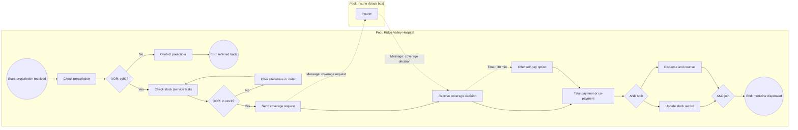

## Introduction

Informal flowcharts are useful for discussion, but they suffer from ambiguity: one analyst's diamond means "decision", another's means "wait for approval", and nobody can say precisely what happens when two branches run at the same time. As organisations began to automate processes with workflow and process engines, they needed a notation that business people could read and that software could interpret without ambiguity. **Business Process Model and Notation (BPMN)**, maintained by the Object Management Group (OMG), is the standard that fills this role. Version 2.0 added a formal meaning for each element and an XML interchange format, so that a diagram drawn by an analyst can be exchanged between tools and, with additional technical detail, executed by a process engine.

This lesson teaches the core BPMN 2.0 vocabulary: **events**, **activities**, **gateways**, **sequence flows**, **pools**, **lanes**, **message flows** and **data objects**. You will learn the behaviour each element implies, using the idea of a *token* moving through the model, and you will build a complete model of a Ghanaian hospital pharmacy process. Practical exercises use Camunda Modeler and Bizagi Modeler, two widely used tools. Because this platform renders diagrams in Mermaid, the diagrams here *approximate* BPMN shapes; in the modelling tools you will use the genuine BPMN symbols.

## Learning Objectives

- Explain the purpose and scope of BPMN 2.0 and its relationship to process execution.
- Identify and describe the main BPMN flow objects: events, activities and gateways, including common subtypes.
- Distinguish sequence flows from message flows and pools from lanes, applying the rules that govern them.
- Apply token semantics to predict the behaviour of exclusive, parallel, inclusive and event-based gateways.
- Construct a correct, readable BPMN collaboration diagram for a realistic process using Camunda Modeler or Bizagi Modeler.

## Prerequisite Knowledge

- The lesson *Process Mapping and Process Documentation*, especially swimlanes and decision points.
- Familiarity with the idea of a process trigger and outcome.

## Key Terminology

- **BPMN**: Business Process Model and Notation, an OMG standard graphical notation for modelling business processes, with defined semantics and an XML interchange format in version 2.0.
- **Event**: Something that happens during a process, drawn as a circle: a start event (thin border), intermediate event (double border) or end event (thick border).
- **Activity**: Work performed in a process, drawn as a rounded rectangle; either a task (atomic) or a sub-process (compound).
- **Gateway**: A diamond that controls how sequence flows diverge and converge, such as exclusive (XOR), parallel (AND), inclusive (OR) and event-based gateways.
- **Sequence flow**: A solid arrow showing the order of flow objects within a single pool.
- **Message flow**: A dashed arrow showing communication between two separate participants (pools).
- **Pool**: A container representing a participant in a collaboration, such as an organisation or an external party.
- **Lane**: A subdivision of a pool, typically representing a role, department or system within that participant.
- **Token**: A conceptual marker used to explain BPMN behaviour; it travels along sequence flows, and gateways create, route or synchronise tokens.

## Detailed Explanation

### BPMN element categories

BPMN elements fall into five broad categories:

1. **Flow objects**: events, activities and gateways, which define behaviour.
2. **Connecting objects**: sequence flows, message flows and associations.
3. **Swimlanes**: pools and lanes.
4. **Data**: data objects, data inputs and outputs, and data stores.
5. **Artefacts**: text annotations and groups, which add information without affecting behaviour.

### Events

Events are circles. Their **border** tells you *when* they occur and their **inner symbol** tells you *what kind* of event it is.

| Position | Border | Meaning |
|---|---|---|
| Start event | Single thin line | Starts the process (creates a token) |
| Intermediate event | Double line | Occurs during the process; may wait for (catch) or send (throw) something |
| End event | Single thick line | Ends a path (consumes a token) |

Common event types include **none** (unspecified), **message** (envelope), **timer** (clock), **error** (lightning bolt), **signal** (triangle), **conditional** (lined page) and **terminate** (filled circle, end only, which ends the whole process instance immediately). A **boundary event** is an intermediate event attached to the edge of an activity: for example, a timer boundary event on "Await insurer approval" that escalates if no answer arrives within two days. Boundary events can be *interrupting* (the activity is cancelled) or *non-interrupting* (drawn with a dashed border; the activity continues).

### Activities

A **task** is a single unit of work. BPMN 2.0 defines task types that are especially important for automation:

- **User task**: performed by a person using software (approve a claim on screen).
- **Manual task**: performed without software (physically pack an order).
- **Service task**: performed automatically by a system (call the stock API).
- **Send task / receive task**: send or wait for a message.
- **Script task**: executed by a script in the process engine.
- **Business rule task**: evaluates business rules, for example a decision table.

A **sub-process** groups activities and can be shown collapsed (with a small plus sign) or expanded. Activities can also carry markers for **loops** and **multi-instance** execution (three parallel or sequential bars), for example "Check each prescription item".

### Gateways

Gateways are diamonds. Their behaviour is easiest to understand through token semantics.

| Gateway | Marker | Splitting behaviour | Merging behaviour |
|---|---|---|---|
| Exclusive (XOR) | X or empty | Token takes exactly one outgoing path whose condition is true | Passes each arriving token through; no waiting |
| Parallel (AND) | + | Token is copied to all outgoing paths | Waits until a token has arrived on every incoming path |
| Inclusive (OR) | O | Token is copied to every path whose condition is true (one or more) | Waits for all paths that were actually activated |
| Event-based | Pentagon in double circle | Waits; the first of several following events to occur determines the path | Not used for merging |

Two practical rules prevent many errors. First, **split and join with the same gateway type**: if you split with a parallel gateway, join with a parallel gateway; merging parallel branches with an exclusive gateway lets tokens pass through separately, so later activities execute more than once. Second, **label exclusive and inclusive branch conditions** clearly ("Stock available", "Stock not available") and include a default flow where appropriate.

### Pools, lanes and message flows

A **pool** represents a participant, such as the hospital, a patient or an insurer. **Lanes** within a pool show who performs which activities inside that participant. The crucial rules are:

- **Sequence flows stay inside a pool.** They may cross lanes within the same pool, but they cannot cross the pool boundary.
- **Message flows connect different pools.** They show communication (a claim, a confirmation) between participants and never connect elements within the same pool.
- An external participant can be shown as a **black-box pool** (collapsed, with no internal detail) when its internal process is unknown or irrelevant.

A diagram with two or more pools exchanging messages is called a **collaboration** diagram.

### Data

**Data objects** (a page with a folded corner) show information produced or used by activities, such as "Prescription" or "Invoice"; **data stores** (a cylinder) show persistent stores such as a pharmacy stock database. They are linked to activities by dotted **associations** and do not affect token flow.

## Theories, Frameworks and Models

### Modelling style guidelines

Silver (2011) and Dumas et al. (2018) offer practical guidelines that make BPMN models easier to read and validate:

1. Use **verb–noun labels** for activities ("Verify prescription") and **state labels** for end events ("Medicine dispensed", "Prescription rejected").
2. Use **explicit start and end events**, with one start event per pool where possible.
3. **Avoid implicit gateways** (multiple arrows leaving an activity without a gateway); make branching explicit.
4. **Model the happy path first** in a straight line, then add exceptions.
5. **Keep models small**: if a level has more than about ten to fifteen activities, introduce sub-processes.
6. **Label every gateway question** ("Insurance valid?") and every outgoing flow.
7. Ensure **every path ends** at an end event and that the model contains no **deadlocks** (a parallel join waiting for a token that will never arrive).

### Descriptive versus executable models

The same notation serves different purposes. A **descriptive model** communicates a process to people and may omit technical detail. An **executable model** adds detail required by a process engine, such as task assignments, form fields, service endpoints and data mappings. Process engines such as Camunda's interpret the BPMN XML and move real tokens through the model, assigning user tasks to work lists and calling services. Bizagi Modeler is widely used to create descriptive models and documentation, and its wider platform also supports automation. The modelling discipline is the same, but executable models must be complete and unambiguous.

## Worked Example

**Illustrative scenario.** *Ridge Valley Hospital*, a hypothetical hospital in Accra, wants to model its outpatient prescription-to-dispensing process, including insurance coverage checks with an insurer.

**Step 1 – Participants.** Pools: *Ridge Valley Hospital* (lanes: Pharmacy assistant, Pharmacist, Cashier) and *Insurer* (black-box pool).

**Step 2 – Trigger and outcomes.** Start event: message start "Prescription received". End events: "Medicine dispensed", "Prescription referred back to prescriber".

**Step 3 – Happy path.** Check prescription (pharmacist, user task) → Check stock (service task) → Request coverage (send task, message flow to insurer) → Receive coverage decision (receive task) → Take payment or co-payment (cashier) → Dispense and counsel (pharmacist).

**Step 4 – Decisions and exceptions.**

- Exclusive gateway "Prescription valid?": *No* → "Contact prescriber" → end event "Prescription referred back".
- Exclusive gateway "Item in stock?": *No* → "Offer alternative or order item".
- Timer boundary event on "Receive coverage decision": if no response in 30 minutes, "Offer self-pay option".
- Parallel gateway: after payment, "Update stock record" (service task) and "Dispense and counsel" run in parallel and are joined by a parallel gateway before the end event.

**Step 5 – Mermaid approximation.** In the diagram below, circles approximate events, rounded boxes are tasks, diamonds are gateways (labelled with their type) and the dashed arrows represent message flows to the insurer pool.

**Step 6 – Validate.** Trace tokens: a valid prescription with stock and timely insurer response produces one token that splits into two at the AND split and rejoins before the end event, so the instance completes exactly once. An invalid prescription ends at "Referred back". No message flow connects activities inside the hospital pool, and no sequence flow crosses into the insurer pool.

## International Case Study

### The standardisation of BPMN

BPMN was first developed by the Business Process Management Initiative (BPMI), which released BPMN 1.0 in 2004. BPMI merged with the Object Management Group in 2005, and the OMG took over maintenance of the standard. BPMN 2.0, formally released by the OMG in 2011, renamed the standard Business Process Model and Notation, defined the meaning of elements more precisely and introduced an XML-based interchange format. A version of BPMN 2.0 was later also published as an international standard, ISO/IEC 19510.

This history matters for practitioners. Because BPMN 2.0 has a shared, standardised meaning and file format, a model created in one tool can, in principle, be opened in another, and process engines from different vendors can execute BPMN models. That interoperability is why BPMN skills transfer across tools such as Camunda Modeler and Bizagi Modeler, and why organisations can treat process models as long-lived assets rather than tool-specific drawings.

## Common Misconceptions

- **"Lanes represent separate organisations."** Lanes subdivide a single participant; separate organisations are separate pools.
- **"Message flows and sequence flows are interchangeable."** Sequence flows order activities within a pool; message flows show communication between pools.
- **"An exclusive gateway can merge parallel branches."** Merging parallel branches with an XOR lets each token pass separately, causing downstream activities to run more than once; use an AND join.
- **"BPMN models must always be executable."** Many BPMN models are descriptive; executable models add technical detail for a process engine.
- **"Every decision in a process needs a gateway."** Gateways route flow; complex decision logic is often better placed in a business rule task or decision table.

## Common Examination Mistakes

- Drawing sequence flows across pool boundaries.
- Omitting start or end events, or leaving paths that never reach an end event.
- Using gateways without labelled conditions on outgoing flows.
- Confusing the inclusive (OR) gateway with the exclusive (XOR) gateway.
- Labelling activities with nouns or system names rather than verb–noun phrases.
- Describing BPMN elements without explaining their behaviour.

## Critical Thinking Questions

1. BPMN aims to be understandable by business people and precise enough for machines. Are these goals in tension? How would you manage the tension on a real project?
2. When should an external participant be modelled as a black-box pool rather than with its internal activities?
3. How could a timer boundary event improve patient experience in a hospital process, and what new risks might automated escalation create?
4. Why might an organisation keep separate descriptive and executable versions of the same process model?

## Practical Exercises

1. **Element identification.** Given the worked example, list every BPMN element used and state its category and behaviour. *Expected output:* a table with at least twelve elements.
2. **Model in Camunda Modeler.** Download Camunda Modeler (see <https://camunda.com/> and the documentation at <https://docs.camunda.io/>) and recreate the worked example using genuine BPMN symbols, including the insurer pool and message flows. *Expected output:* a saved `.bpmn` file and a screenshot; the modeller should show no validation errors.
3. **Model in Bizagi Modeler.** Using Bizagi Modeler (<https://www.bizagi.com/>), model a restaurant order-to-table process with lanes for waiter, kitchen and cashier, including a parallel gateway for preparing food and drinks. *Expected output:* a diagram and an exported documentation report.
4. **Gateway debugging.** Draw a model in which parallel branches are merged with an XOR gateway, trace the tokens and explain what goes wrong, then correct it. *Expected output:* before and after diagrams with a token-trace explanation.
5. **Collaboration diagram.** Model a logistics firm in Tema receiving a delivery booking from a customer and confirming a pickup time, with separate pools for customer and firm. *Expected output:* a collaboration diagram with at least two message flows and no sequence flows crossing pools.

## Key Takeaways

- BPMN 2.0 is the OMG standard for process models that are readable by people and precise enough for tools and engines.
- Events (start, intermediate, end) are circles; activities are rounded rectangles; gateways are diamonds that split and merge tokens.
- Exclusive gateways choose one path, parallel gateways take all paths and synchronise, inclusive gateways take one or more, and event-based gateways choose by the first event to occur.
- Sequence flows stay within a pool; message flows connect pools; lanes subdivide a pool by role.
- Good style uses verb–noun labels, explicit start and end events, matching split and join gateways and small, layered models.

## Further Reading

- Object Management Group. (2011). *Business Process Model and Notation (BPMN), version 2.0*. <https://www.omg.org/spec/BPMN/>
- Silver, B. (2011). *BPMN method and style* (2nd ed.). Cody-Cassidy Press.
- Dumas, M., La Rosa, M., Mendling, J., & Reijers, H. A. (2018). *Fundamentals of business process management* (2nd ed.). Springer.
- Weske, M. (2012). *Business process management: Concepts, languages, architectures* (2nd ed.). Springer.

## Video Resources

- [Camunda Documentation](https://docs.camunda.io/) — Camunda. Official documentation including BPMN guides and instructions for using Camunda Modeler.
- [Bizagi](https://www.bizagi.com/) — Bizagi. Official site for Bizagi Modeler with learning resources on BPMN modelling.
- [OMG BPMN Specification](https://www.omg.org/spec/BPMN/) — Object Management Group. The official specification page for BPMN, including version history.

## Revision Summary

BPMN 2.0 is the OMG's standard process notation, with defined semantics and an XML format that allow models to be exchanged and executed. Events start, interrupt and end flows; activities (tasks and sub-processes) perform work; gateways route tokens (XOR one path, AND all paths with synchronisation, OR one or more, event-based by first event). Pools are participants, lanes are roles; sequence flows stay inside pools and message flows link pools. Model the happy path first and keep models small and labelled.

- Event borders: thin = start, double = intermediate, thick = end.
- Task types: user, manual, service, send, receive, script, business rule.
- Split and join with the same gateway type.
- Never draw sequence flows across pools.
- Descriptive versus executable models; Camunda and Bizagi for practice.
