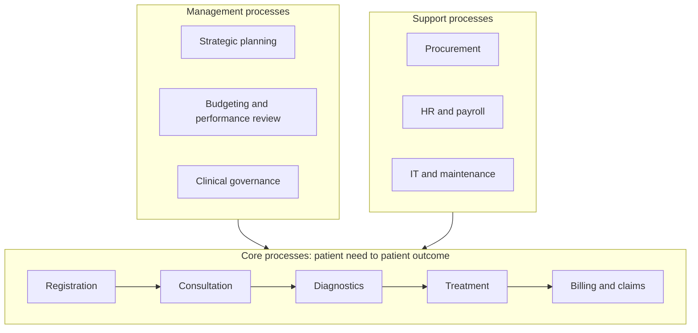

## Introduction

Organisation charts show who reports to whom, but they say almost nothing about how work actually gets done. A customer who orders medicines from a pharmacy wholesaler does not care that sales, credit control, the warehouse and dispatch report to different managers; the customer experiences one thing, the delivery of an order, and judges the organisation on how quickly, accurately and pleasantly that happens. Rummler and Brache (1990) famously described the greatest opportunities for improvement as lying in the "white space" between the boxes on the organisation chart, where work is handed from one department to another.

**Business process management (BPM)** takes this process view seriously. It treats the organisation as a collection of processes that create value for customers, and it provides methods for identifying, discovering, analysing, redesigning, implementing and monitoring those processes. This lesson begins the BPM journey with its first and most strategic phase: understanding what a business process is, building a **process architecture** that shows how an organisation's processes relate to one another, and choosing which processes deserve attention first.

## Learning Objectives

- Define a business process and distinguish it from a function, a task and a project.
- Classify processes as core (operational), support or management processes using appropriate examples.
- Explain the BPM lifecycle and the position of process identification within it.
- Construct a simple multi-level process architecture for an organisation.
- Apply the criteria of strategic importance, health and feasibility to prioritise processes for improvement.

## Prerequisite Knowledge

- The module *Enterprise Systems Foundations*, especially functional silos and cross-functional processes.
- General familiarity with how organisations are divided into departments.

## Key Terminology

- **Business process**: A structured set of related activities, performed by people and systems, that transforms inputs into an output of value to a customer, whether internal or external.
- **Process owner**: The person accountable for the end-to-end performance and improvement of a process, regardless of which departments perform its activities.
- **Core (operational) process**: A process that directly creates value for external customers, such as order-to-cash or patient treatment.
- **Support process**: A process that enables core processes, such as recruitment, IT support or maintenance.
- **Management process**: A process that plans, directs and controls the organisation, such as strategic planning or budgeting.
- **Process architecture**: A structured, multi-level model of an organisation's processes and their relationships, from a high-level landscape down to detailed sub-processes.
- **Process identification**: The BPM phase in which an organisation's processes are delineated, organised into an architecture and prioritised for improvement.
- **BPM lifecycle**: The cycle of process identification, discovery, analysis, redesign, implementation, and monitoring and controlling.

## Detailed Explanation

### What is a business process?

Davenport (1993) described a process as a structured, measured set of activities designed to produce a specified output for a particular customer or market, emphasising that processes have a clear beginning, end, inputs and outputs. Hammer and Champy (1993) similarly defined a process as a collection of activities that takes one or more kinds of input and creates an output of value to the customer. Several features follow from these definitions:

- A process has a **customer**, who may be external (a patient) or internal (a manager receiving a report).
- It has a **trigger** (an event that starts it) and an **outcome** (a result that ends it).
- It usually **crosses functional boundaries**.
- It can be **measured**: time, cost, quality and flexibility.

It is useful to distinguish neighbouring concepts. A **function** is an organisational unit (the finance department). A **task** is a single unit of work (approve an invoice). A **project** is a one-off endeavour with a defined end (implement an ERP). A **process** is repeatable: it runs every time its trigger occurs.

Processes are often named using "X-to-Y" labels that make their start and end explicit, such as **order-to-cash**, **procure-to-pay**, **hire-to-retire**, **record-to-report** and, in healthcare, **admission-to-discharge**. These names encourage end-to-end thinking.

### Classifying processes

| Category | Purpose | Examples in a hospital | Examples in a supermarket |
|---|---|---|---|
| Core | Create value for external customers | Outpatient consultation, admission-to-discharge, laboratory testing | Replenish shelves, sell at checkout, home delivery |
| Support | Enable core processes | Recruitment, equipment maintenance, IT support | Payroll, cleaning, IT support |
| Management | Plan, direct and control | Clinical governance, budgeting, strategy | Category planning, budgeting, performance review |

The same activity can belong to different categories in different organisations. IT support is a support process in a hospital but a core process in an IT outsourcing firm. Classification therefore depends on the organisation's value proposition.

### The BPM lifecycle

Dumas, La Rosa, Mendling and Reijers (2018) describe a BPM lifecycle that structures this and the following lessons:

1. **Process identification**: delineate and prioritise processes.
2. **Process discovery**: document the current (as-is) process.
3. **Process analysis**: identify problems and quantify their impact.
4. **Process redesign**: develop an improved (to-be) process.
5. **Process implementation**: put organisational and technical changes into effect.
6. **Process monitoring and controlling**: measure performance and detect new problems, feeding back into the cycle.

The lifecycle is a cycle, not a project plan: processes degrade as circumstances change, so BPM is an ongoing capability rather than a one-off exercise.

## Theories, Frameworks and Models

### Porter's value chain as a starting point

Porter's (1985) value chain divides activities into primary and support activities, offering a ready-made first level for a process architecture. Primary activities map naturally to core processes, and support activities map to support processes. Its limitation is that it was designed for manufacturing firms; service organisations such as hospitals or logistics providers often need to adapt it.

### Building a process architecture

A process architecture is usually built in levels:

- **Level 0: Process landscape**: the organisation's main process areas, often drawn as management processes along the top, core processes in the middle (flowing from customer need to customer satisfaction) and support processes along the bottom.
- **Level 1: Process groups**: for example, within "Fulfil customer orders": order capture, picking, delivery and invoicing.
- **Level 2: Processes**: individual end-to-end processes with defined triggers and outcomes.
- **Level 3 and below: Sub-processes and tasks**: detailed models used for analysis and automation.

Reference frameworks can accelerate this work. The APQC Process Classification Framework, for example, offers a standard hierarchy of process categories that organisations can adapt rather than starting from a blank page. SCOR, introduced in the previous module, serves the same purpose for supply chains.

### Prioritising processes

Not every process can be improved at once. Dumas et al. (2018) propose evaluating candidate processes against three criteria:

1. **Strategic importance**: how much does the process contribute to strategic objectives and customer value?
2. **Health (dysfunction)**: how poorly is it performing, and how much pain does it cause customers and staff?
3. **Feasibility**: how susceptible is it to improvement, considering politics, culture, resources and dependencies?

A simple scoring matrix makes these judgements explicit and open to challenge.

### Measuring process performance

To judge a process's health, evidence is needed. Dumas et al. (2018) describe four performance dimensions, often drawn as the *Devil's Quadrangle* because improving one dimension frequently worsens another:

- **Time**: cycle time from trigger to outcome, waiting time and processing time.
- **Cost**: cost per case, including labour, materials and rework.
- **Quality**: error rates, customer satisfaction and compliance with rules.
- **Flexibility**: the ability to handle variations, exceptions and changes in volume.

For example, adding a second pharmacist check reduces dispensing errors (quality) but increases cost and time. Stating which dimension matters most for each process, and collecting even simple baseline measures such as a week of timed cases, makes later analysis and redesign far more convincing than opinion alone.

## Worked Example

**Illustrative scenario.** *Ridge Valley Hospital*, a hypothetical private hospital in Accra, wants to choose two processes for improvement this year. Managers score candidates from 1 (low) to 5 (high) on each criterion, where a high "health" score means *high dysfunction*. Weights reflect the management team's priorities: importance 0.4, dysfunction 0.4, feasibility 0.2.

| Process | Importance | Dysfunction | Feasibility | Weighted score |
|---|---|---|---|---|
| Outpatient registration-to-consultation | 5 | 5 | 4 | 0.4×5 + 0.4×5 + 0.2×4 = 4.8 |
| Insurance claims submission | 4 | 5 | 3 | 1.6 + 2.0 + 0.6 = 4.2 |
| Equipment maintenance | 3 | 3 | 4 | 1.2 + 1.2 + 0.8 = 3.2 |
| Staff recruitment | 2 | 3 | 5 | 0.8 + 1.2 + 1.0 = 3.0 |
| Strategic planning | 4 | 2 | 2 | 1.6 + 0.8 + 0.4 = 2.8 |

**Interpretation.** Outpatient registration-to-consultation and insurance claims submission rank highest: both are core to patient experience and revenue, and both are visibly dysfunctional (long queues; rejected or delayed claims). Recruitment is easy to change but less important. The scores do not make the decision; they structure a discussion. Managers should test the scores with evidence such as waiting-time samples and claim rejection records, and appoint a **process owner** for each selected process who is accountable across departmental boundaries.

## International Case Study

### Dell's build-to-order process

Dell became well known in the 1990s for a direct, build-to-order business model in which customers configured computers by telephone or online, and Dell assembled each computer to order rather than building to forecast for retail channels. This is widely discussed in operations and information systems literature as an example of a firm whose competitive advantage rested on an end-to-end core process, from customer order through component procurement and assembly to delivery, supported by close information links with suppliers.

For process identification, the case illustrates two points. First, a firm's most strategically important process is the one that embodies its value proposition: for Dell's direct model, that was order-to-delivery. Second, the process crossed organisational boundaries, including suppliers, so a process architecture had to include external partners. Dell later expanded into retail channels as markets changed, a reminder that process architectures must be revisited when strategy shifts.

## Diagram

## Common Misconceptions

- **"A process is the same as a department."** Departments are organisational units; processes flow across them and usually involve several departments.
- **"Support processes are unimportant."** They may not directly face customers, but failures in procurement or IT can halt core processes.
- **"Process identification means drawing every process in detail."** Identification produces an architecture and priorities; detailed modelling belongs to discovery and only for selected processes.
- **"The process with the worst performance should always be fixed first."** Importance and feasibility also matter; a dysfunctional but unimportant process may not justify investment.

## Common Examination Mistakes

- Giving a definition of a process without identifying a customer, trigger and outcome.
- Classifying processes without justifying the classification against the organisation's value proposition.
- Confusing the BPM lifecycle phases, for example treating analysis and redesign as the same phase.
- Presenting a prioritisation score as an objective answer instead of a structured judgement that requires evidence.
- Ignoring the role of the process owner.

## Critical Thinking Questions

1. Why might department heads resist the appointment of end-to-end process owners, and how can senior management address this?
2. Is the value chain a suitable basis for the process architecture of a Ghanaian hospital? What adaptations would you make?
3. How should an organisation weigh "quick wins" in feasible but less important processes against harder improvements to critical processes?
4. When a firm's strategy changes, as Dell's did, what should happen to its process architecture and priorities?

## Practical Exercises

1. **Name the processes.** For a restaurant, identify at least eight processes using "X-to-Y" names and classify each as core, support or management. *Expected output:* a table with names, triggers, outcomes and categories.
2. **Draw a process landscape.** Produce a Level 0 landscape for a logistics firm in Tema using the management-core-support layout. *Expected output:* a diagram with at least four core, three support and two management processes.
3. **Prioritisation matrix.** Score five processes in an organisation you know on importance, dysfunction and feasibility, choose weights and justify the top two. *Expected output:* a completed matrix and a half-page justification citing evidence you would collect.
4. **Explore modelling tools.** Install or open Bizagi Modeler (<https://www.bizagi.com/>) or Camunda Modeler (see <https://camunda.com/>) and create a simple diagram listing the Level 1 process groups of one core process. *Expected output:* a saved diagram file and a screenshot.

## Key Takeaways

- A business process is a repeatable, measurable, cross-functional set of activities with a trigger, an outcome and a customer.
- Processes are classified as core, support or management according to the organisation's value proposition.
- The BPM lifecycle runs identification, discovery, analysis, redesign, implementation and monitoring, continuously.
- A process architecture organises processes into levels from landscape to tasks; reference frameworks such as the APQC PCF and SCOR help.
- Prioritise using strategic importance, health and feasibility, supported by evidence, and appoint end-to-end process owners.

## Further Reading

- Dumas, M., La Rosa, M., Mendling, J., & Reijers, H. A. (2018). *Fundamentals of business process management* (2nd ed.). Springer.
- Davenport, T. H. (1993). *Process innovation: Reengineering work through information technology*. Harvard Business School Press.
- Rummler, G. A., & Brache, A. P. (1990). *Improving performance: How to manage the white space on the organization chart*. Jossey-Bass.
- Porter, M. E. (1985). *Competitive advantage: Creating and sustaining superior performance*. Free Press.

## Video Resources

- [Camunda](https://camunda.com/): Camunda. Official site with resources introducing process orchestration and BPMN-based process management.
- [Bizagi](https://www.bizagi.com/): Bizagi. Official site for Bizagi Modeler, a process modelling tool, with learning resources on process documentation.

## Revision Summary

A business process is a repeatable, cross-functional set of activities that turns inputs into an output valued by a customer, with a clear trigger and outcome. Processes are core, support or management. BPM follows a continuous lifecycle beginning with process identification, which produces a multi-level process architecture and a prioritised list of processes. Prioritisation weighs strategic importance, health and feasibility, and each chosen process needs an accountable owner.

- Function ≠ task ≠ project ≠ process.
- "X-to-Y" names make start and end explicit.
- BPM lifecycle: identify → discover → analyse → redesign → implement → monitor.
- Architecture levels: landscape → groups → processes → sub-processes and tasks.
- Prioritise on importance, dysfunction and feasibility (Dumas et al., 2018).
