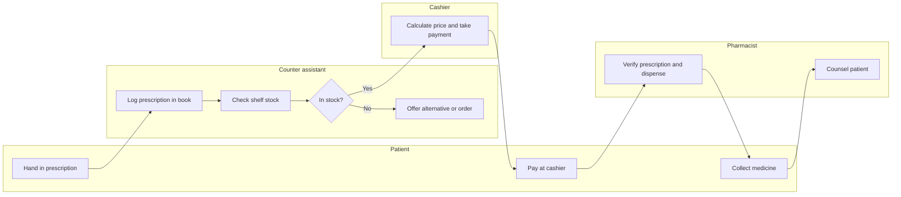

## Introduction

Once an organisation has chosen which processes to improve, it needs an accurate picture of how they work today. This is harder than it sounds. Managers often describe the process as it was designed or as they believe it runs; front-line staff know the workarounds, but each sees only part of the picture; and documents such as procedure manuals may be years out of date. A process map built only from a manager's description can be dangerously misleading, because the problems that matter most usually live in the undocumented hand-offs and exceptions.

This lesson covers **process discovery** and **process documentation**: how to gather information about an as-is process, how to scope it with a **SIPOC** diagram, how to map it with **swimlanes** so that hand-offs between roles are visible, and how to document it so that others can understand, analyse and improve it. These techniques are notation-independent; the next lesson introduces BPMN 2.0, the standard notation that formalises them.

## Learning Objectives

- Compare process discovery methods (interviews, workshops, observation, document analysis and process mining) and select appropriate methods for a situation.
- Construct a SIPOC diagram that scopes a process by suppliers, inputs, process steps, outputs and customers.
- Produce a swimlane process map that shows activities, decisions and hand-offs between roles.
- Prepare structured process documentation, including a RACI matrix and performance measures.
- Evaluate the quality of a process map against criteria of accuracy, completeness and appropriate level of detail.

## Prerequisite Knowledge

- The lesson *Business Processes and Process Identification*, particularly the BPM lifecycle.
- No prior notation knowledge is required.

## Key Terminology

- **Process discovery**: The BPM phase in which information about an existing process is gathered and organised into an as-is model.
- **As-is model**: A representation of how a process currently operates, including its problems and workarounds.
- **SIPOC**: A high-level scoping tool listing a process's Suppliers, Inputs, Process steps, Outputs and Customers.
- **Swimlane diagram**: A process map divided into lanes, each representing a role, department or system, so that responsibilities and hand-offs are visible.
- **Hand-off**: The transfer of work or information from one role or system to another, a frequent source of delay and error.
- **RACI matrix**: A table that shows, for each activity, who is Responsible, Accountable, Consulted and Informed.
- **Process mining**: The analysis of event logs from information systems to discover, check and improve actual process behaviour.
- **Happy path**: The most common, problem-free route through a process, as distinct from exceptions and variants.

## Detailed Explanation

### Discovery methods

Dumas et al. (2018) group discovery methods into evidence-based, interview-based and workshop-based approaches. Each has strengths and blind spots.

| Method | How it works | Strengths | Weaknesses |
|---|---|---|---|
| Document analysis | Review procedures, forms, policies, system screens | Quick, cheap background | Documents may be outdated or idealised |
| Observation | Watch work being performed, possibly following one case end to end | Reveals real practice and workarounds | Time-consuming; people may behave differently when observed |
| Interviews | Talk to participants individually, often role by role | Detailed knowledge of each step | Each person sees only part; needs reconciliation |
| Workshops | Bring participants together to build the map collectively | Resolves conflicts; builds ownership | Dominant voices; scheduling difficulty |
| Process mining | Analyse timestamped event logs from systems | Objective, covers all cases and variants | Only covers steps recorded in systems; needs data preparation |

A robust discovery effort **triangulates**: it combines several methods so that each compensates for the others' weaknesses. For example, interviews build a first draft, observation tests it, and a workshop validates it with all roles present.

### Scoping with SIPOC

Before mapping detail, a SIPOC diagram agrees the process boundary. It forces the team to state where the process starts and ends, who supplies what, and who receives the outputs. A typical SIPOC lists five to seven high-level process steps; detail comes later.

### Mapping with swimlanes

A swimlane map places each activity in the lane of the role that performs it. When the flow crosses from one lane to another, a hand-off occurs. The visual density of lane crossings is itself diagnostic: a process that zigzags between six lanes is likely to suffer waiting time and miscommunication.

**Step-by-step mapping procedure:**

1. **Confirm scope** from the SIPOC: trigger, outcome, customer.
2. **Identify the roles** (people, departments, external parties, systems) and create one lane for each.
3. **List activities** in sequence using verb–noun labels ("Verify prescription", not "Prescription").
4. **Add decisions** where the flow branches, labelling each outgoing path with its condition.
5. **Draw the happy path first**, then add the main exceptions (rework loops, rejections, escalations).
6. **Mark hand-offs, waits and documents** that move between lanes.
7. **Validate** with participants: walk through real recent cases and ask "Is this what happened?".
8. **Annotate pain points** that participants raise, without trying to solve them yet.

### Levels of detail

A frequent error is to map at inconsistent levels: one box says "Process order" while the next says "Click Save". A good map keeps each activity at a similar level of granularity and uses sub-process boxes for detail that belongs in a separate map. The purpose determines the level: a map for executives may have eight steps; a map to configure a workflow system may have fifty.

### Process documentation

A map is only part of good documentation. A complete process description usually includes:

- **Process name, owner, purpose and scope** (trigger, outcome, in and out of scope).
- **SIPOC** summary.
- **Process map** with lanes.
- **Narrative description** of each step, including business rules ("Prescriptions for controlled drugs must be checked by the superintendent pharmacist").
- **RACI matrix** for key activities.
- **Inputs, outputs, forms and systems** used.
- **Performance measures** such as cycle time, error rate and cost per case.
- **Known issues** and their evidence.
- **Version control**: date, author and approval.

## Theories, Frameworks and Models

### Value stream mapping

Rother and Shook (1999) popularised **value stream mapping** in *Learning to See*, drawing on practices developed within Toyota. A value stream map records both material flow and information flow, together with data for each step such as process time, waiting time and inventory between steps. It differs from a swimlane map by emphasising time and flow rather than responsibilities, and it is particularly useful when the goal is to reduce lead time.

### Process mining in brief

Process mining treats the event logs held by enterprise systems as evidence of how processes actually run. A usable event log needs at least three attributes for every recorded event: a **case identifier** (for example the prescription or order number), an **activity name** ("Payment received") and a **timestamp**. From such logs, process mining tools support three kinds of analysis:

1. **Discovery**: automatically constructing a model of the paths cases actually followed, including rare variants.
2. **Conformance checking**: comparing actual behaviour with an intended model to find deviations, such as payments made before approval.
3. **Enhancement**: overlaying measures such as waiting times on the model to reveal bottlenecks.

Process mining is powerful because it covers every case rather than a sample, but it sees only steps recorded in systems. Paper forms, telephone calls and informal conversations remain invisible, so it complements rather than replaces interviews and observation. For organisations with an ERP or hospital system, it is often worth checking early in discovery whether suitable logs exist.

### Process quality criteria

Whatever technique is used, a good process model should be:

- **Syntactically correct**: it follows the rules of its notation.
- **Semantically correct**: it accurately represents reality.
- **Pragmatically useful**: its intended audience can understand and use it.

These three qualities are widely used in the process modelling literature to evaluate models, and they apply equally to informal maps and BPMN diagrams.

## Worked Example

**Illustrative scenario.** *Osu Community Pharmacy* is a hypothetical retail pharmacy in Accra. Customers complain about long waits when collecting prescription medicines.

**SIPOC**

| Suppliers | Inputs | Process | Outputs | Customers |
|---|---|---|---|---|
| Prescribing clinics | Prescription | 1. Receive prescription | Dispensed medicine | Patient |
| Wholesalers | Medicines in stock | 2. Verify prescription | Receipt | Patient's insurer |
| Insurer | Coverage rules | 3. Check stock and price | Counselling advice | Prescriber (if query) |
| Patient | Payment (cash, mobile money, insurance) | 4. Take payment | Stock update | |
| | | 5. Dispense and counsel | | |

**Swimlane map (as-is)**

**Observations from validation.** Walking through ten recent cases showed that (a) the pharmacist verifies the prescription only *after* payment, so a query with the prescriber means refunding the payment; (b) price calculation is manual and repeated by the cashier; (c) the patient crosses lanes four times, queuing at each. These are recorded as pain points for the analysis phase, not fixed yet.

**RACI extract**

| Activity | Counter assistant | Cashier | Pharmacist | Superintendent pharmacist |
|---|---|---|---|---|
| Verify prescription | I | | R | A |
| Take payment | | R | I | A |
| Dispense medicine | | | R | A |
| Counsel patient | | | R | A |

## International Case Study

### Learning to see at Toyota and beyond

Value stream mapping, as described by Rother and Shook (1999), grew out of the material and information flow diagrams used within Toyota's production system. Their book presented a structured way to map a current-state value stream, measure process and waiting times, and design a future-state map with reduced lead time. The technique spread widely from manufacturing into healthcare, logistics and office processes.

The case is relevant here because it shows the value of making *time and information* visible, not just activities. Many organisations discover through such mapping that the time spent actively working on a case is a small fraction of total lead time; most of the time is waiting between steps. That insight motivates the value-added analysis and bottleneck techniques covered in the business process re-engineering module.

## Common Misconceptions

- **"The procedure manual shows how the process works."** Manuals show intended practice; discovery must establish actual practice, including workarounds.
- **"One interview with the manager is enough to map a process."** Managers see an overview; participants in each role hold the detailed knowledge, and views must be reconciled.
- **"A SIPOC is a detailed process map."** SIPOC is a scoping tool with only a handful of high-level steps.
- **"More detail always makes a better map."** The appropriate level of detail depends on the audience and purpose.

## Common Examination Mistakes

- Drawing a flowchart without lanes when the question asks about responsibilities or hand-offs.
- Using noun-only activity labels, or mixing levels of detail within one map.
- Omitting decision conditions on branches.
- Failing to mention validation with participants when describing discovery.
- Confusing the RACI roles, especially "Responsible" and "Accountable".

## Critical Thinking Questions

1. Staff may describe an idealised process in workshops for fear of criticism. How can a facilitator encourage accurate accounts?
2. What parts of a hospital's admission process would process mining miss, and how would you fill the gaps?
3. When is a value stream map more useful than a swimlane diagram, and vice versa?
4. Who should own and maintain process documentation once a project ends, and how can it be kept current?

## Practical Exercises

1. **SIPOC for a restaurant.** Produce a SIPOC for "order-to-table" in a busy Accra restaurant. *Expected output:* a completed five-column table with five to seven process steps.
2. **Swimlane map.** Map the as-is process for receiving a parcel at a courier depot, with at least four lanes and two decision points. *Expected output:* a diagram in a tool such as Bizagi Modeler (<https://www.bizagi.com/>) or on paper, with verb–noun labels and labelled decision branches.
3. **RACI matrix.** For the courier process, assign R, A, C and I for six activities, ensuring exactly one "A" per activity. *Expected output:* a RACI table with a short justification of each accountable role.
4. **Discovery plan.** Plan the discovery of a clinic's outpatient process, specifying which methods you will use, with whom, in what order and how you will triangulate. *Expected output:* a one-page plan.

## Key Takeaways

- Process discovery should triangulate documents, observation, interviews, workshops and, where possible, process mining.
- SIPOC scopes a process before detailed mapping by agreeing suppliers, inputs, steps, outputs and customers.
- Swimlane maps make responsibilities and hand-offs visible; frequent lane crossings signal delay and error risk.
- Good documentation adds narrative, business rules, RACI, measures, known issues and version control to the map.
- Models should be syntactically correct, semantically accurate and pragmatically useful to their audience.

## Further Reading

- Dumas, M., La Rosa, M., Mendling, J., & Reijers, H. A. (2018). *Fundamentals of business process management* (2nd ed.). Springer.
- Rother, M., & Shook, J. (1999). *Learning to see: Value stream mapping to add value and eliminate muda*. Lean Enterprise Institute.
- Rummler, G. A., & Brache, A. P. (1990). *Improving performance: How to manage the white space on the organization chart*. Jossey-Bass.

## Video Resources

- [Bizagi](https://www.bizagi.com/) — Bizagi. Official site for Bizagi Modeler, a free-to-download process mapping and documentation tool.
- [Camunda Documentation](https://docs.camunda.io/) — Camunda. Official documentation including guidance on modelling processes with Camunda Modeler.

## Revision Summary

Process discovery builds an accurate as-is picture by triangulating documents, observation, interviews, workshops and process mining. SIPOC scopes the process; swimlane maps show activities, decisions and hand-offs by role; structured documentation adds rules, RACI, measures and known issues. Value stream mapping emphasises time and information flow. Models should be correct, accurate and useful for their audience.

- Triangulate discovery methods; validate with real cases.
- SIPOC = Suppliers, Inputs, Process, Outputs, Customers.
- Swimlanes expose hand-offs; label activities verb–noun.
- RACI: one Accountable per activity.
- Value stream maps reveal waiting time between steps.
