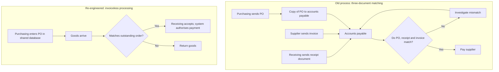

## Introduction

In 1990, Michael Hammer published an article in the *Harvard Business Review* with a deliberately provocative title: "Reengineering work: Don't automate, obliterate". His argument was that organisations had spent heavily on information technology but mostly used it to speed up old ways of working, automating paper-based processes designed for a world without computers. Instead, he urged managers to ask whether each process should exist in its current form at all, and to use the capabilities of IT to design fundamentally new ones. Hammer and Champy's (1993) book *Reengineering the Corporation* turned this argument into a management movement, and **business process re-engineering (BPR)** became one of the most influential, and controversial, management ideas of the 1990s.

This lesson explains what BPR means, the principles Hammer set out, and the related process innovation approach of Davenport. It then contrasts BPR with **continuous improvement** approaches such as kaizen, Lean and Six Sigma, so that you can judge which is appropriate in a given situation. The lesson's international case is the most famous example of all: the re-engineering of accounts payable at Ford, as described by Hammer (1990).

## Learning Objectives

- Explain Hammer and Champy's definition of BPR and the significance of its key words.
- Describe Hammer's (1990) principles of re-engineering and apply them to a process.
- Outline Davenport and Short's (1990) approach to process redesign and the role of IT as an enabler.
- Compare BPR with continuous improvement approaches in terms of scope, pace, risk and change required.
- Evaluate the criticisms of BPR and the conditions under which radical redesign is justified.

## Prerequisite Knowledge

- The module *Business Process Management*, particularly the BPM lifecycle, process mapping and BPMN.
- The lesson *Enterprise Resource Planning (ERP) Systems*, especially procure-to-pay and the three-way match.

## Key Terminology

- **Business process re-engineering (BPR)**: The fundamental rethinking and radical redesign of business processes to achieve dramatic improvements in critical measures of performance such as cost, quality, service and speed (Hammer & Champy, 1993).
- **Process innovation**: Davenport's (1993) term for a radical change in how work is done, enabled by information technology and organisational change, contrasted with incremental process improvement.
- **Continuous improvement**: An approach that seeks many small, incremental improvements to existing processes over time, often led by front-line staff.
- **Kaizen**: A Japanese term for continuous, incremental improvement involving everyone in the organisation.
- **IT enabler**: A capability of information technology, such as shared databases or mobile access, that makes a new process design possible rather than merely faster.
- **Clean-sheet design**: Designing a process from its required outcomes without being constrained by how it currently operates.
- **Case manager**: A single person or small team responsible for handling a complete case from start to finish, replacing a chain of specialists.

## Detailed Explanation

### The definition and its key words

Hammer and Champy (1993) defined re-engineering as the fundamental rethinking and radical redesign of business processes to achieve dramatic improvements in critical, contemporary measures of performance, such as cost, quality, service and speed. Four words carry the meaning:

1. **Fundamental**: re-engineering asks *why* a process is done at all and *why* it is done this way, not merely how to do it faster.
2. **Radical**: it goes to the root, disregarding existing structures and procedures and inventing new ways of working.
3. **Dramatic**: it seeks step-change improvements rather than marginal gains.
4. **Processes**: it focuses on end-to-end processes rather than tasks, jobs or departments.

### Hammer's principles of re-engineering

Hammer (1990) set out a set of principles drawn from the cases he studied. They remain useful design heuristics today.

| Principle | Meaning | Example |
|---|---|---|
| Organise around outcomes, not tasks | Design jobs around an objective or outcome rather than a single step | A case manager handles a loan application end to end |
| Have those who use the output of the process perform the process | Let the people who need a result do the work themselves, with IT support | Departments buy low-value items directly through a catalogue system rather than via purchasing |
| Subsume information-processing work into the real work that produces the information | The people who create information should also process it | The receiving clerk confirms receipt and triggers payment |
| Treat geographically dispersed resources as though they were centralised | Use shared databases and networks to gain the benefits of central coordination with local autonomy | Branches buy against a central contract and shared supplier data |
| Link parallel activities instead of integrating their results | Coordinate parallel work while it happens rather than only at the end | Engineering teams share designs continuously |
| Put the decision point where the work is performed, and build control into the process | Empower workers to decide, with controls embedded in systems | A pharmacist approves a substitution within rules enforced by the system |
| Capture information once and at the source | Record data when and where it is created, and share it electronically | Patient details captured once at registration and used throughout |

### Davenport and Short's approach

Davenport and Short (1990), writing in the same year as Hammer, described the "new industrial engineering" of information technology and business process redesign. They proposed five steps:

1. Develop the business vision and process objectives.
2. Identify the processes to be redesigned.
3. Understand and measure existing processes.
4. Identify IT levers.
5. Design and build a prototype of the new process.

Their emphasis on understanding and measuring existing processes differs from the more extreme clean-sheet rhetoric: they argued that understanding the current process avoids repeating old mistakes and provides a baseline for measuring improvement. Davenport (1993) developed these ideas into *process innovation*, stressing that IT is an enabler, not the goal, and that organisational and human factors are as important as technology.

### BPR versus continuous improvement

| Dimension | Business process re-engineering | Continuous improvement (kaizen, Lean, Six Sigma) |
|---|---|---|
| Starting point | Clean sheet or near clean sheet | Existing process |
| Scale of change | Radical, step change | Incremental |
| Frequency | One-off, periodic | Continuous |
| Leadership | Top-down, executive sponsorship | Bottom-up and middle-out, involving front-line staff |
| Risk | High | Low to moderate |
| Role of IT | Central enabler | Supportive, often minor |
| Cultural demand | Major organisational and job change | Habit of everyday improvement |

The two approaches are complementary rather than mutually exclusive. A common pattern is to re-engineer a process when it is fundamentally unfit for purpose (for example, when a new technology or business model makes the old design obsolete) and then to stabilise and refine the new process through continuous improvement. Six Sigma's DMAIC cycle (define, measure, analyse, improve, control) and Lean's focus on waste are typical continuous improvement methods.

## Theories, Frameworks and Models

### When is BPR appropriate?

Re-engineering is most likely to be justified when:

- performance is far below customer expectations or competitors, so incremental gains will not close the gap;
- a new technology (such as mobile money, shared cloud databases or process automation) makes a fundamentally different design possible;
- the process is strategically important and crosses many functions with heavy hand-offs;
- leadership is willing and able to sponsor significant organisational change.

It is less appropriate when the process is broadly sound, when the organisation lacks the capacity for major change, or when risk tolerance is low.

### Criticisms of BPR

BPR attracted strong criticism. Many re-engineering programmes were associated with large-scale job cuts, so the term became linked with downsizing. Critics argued that the clean-sheet rhetoric ignored organisational knowledge embedded in existing processes and underestimated the human side of change. Davenport himself later argued that re-engineering as widely practised had neglected people. These criticisms are not reasons to abandon radical redesign, but they explain why modern BPM treats re-engineering as one option within a broader process management capability, with explicit attention to change management (covered later in this module).

## Ghanaian Business Application

**Illustrative scenario.** *Accra Central Hospital* is a hypothetical hospital where outpatients currently queue at five separate points: records (to retrieve a paper folder), triage, consultation, cashier and pharmacy. Folders are carried by porters, and payments must be made before the pharmacy will dispense.

Applying Hammer's principles:

- **Capture information once and at the source**: register patients electronically once, linked to a Ghana Card or patient number, so the folder retrieval step and the porter hand-off disappear.
- **Subsume information processing into the real work**: let the consulting clinician enter prescriptions and test orders directly, so that the pharmacy and laboratory receive them electronically.
- **Put the decision point where the work is performed**: allow triage nurses, within protocols, to order routine tests before the consultation.
- **Organise around outcomes**: designate patient flow coordinators responsible for a patient's journey through the visit.
- **Treat dispersed resources as centralised**: share a single patient record across the hospital's satellite clinics.

The resulting design is not a faster version of the old queue sequence but a different process, with fewer stages and electronic flow of orders and payments (including mobile money at the point of consultation). Whether this is BPR or improvement depends on the extent of change: removing paper folders and changing clinical roles is radical for this hospital, so it requires executive sponsorship, staff involvement and careful change management.

## International Case Study

### Ford's accounts payable

Hammer (1990) described how, in the early 1980s, Ford examined its North American accounts payable department, which he reported employed more than 500 people. Ford initially hoped to reduce headcount by around 20 per cent through rationalisation and computerisation. It then discovered that Mazda, in which Ford had an investment, ran its accounts payable with a very small number of people. Even allowing for differences in scale, the gap suggested that the problem lay in the process itself.

In the old process, purchasing sent a purchase order to the supplier and a copy to accounts payable; receiving sent a receipt document to accounts payable when goods arrived; the supplier sent an invoice. Accounts payable clerks had to match the three documents, and much of their time was spent investigating mismatches. Ford's re-engineered design, which Hammer called "invoiceless processing", changed the logic. Purchasing entered orders into an online database. When goods arrived, the receiving clerk checked the database: if the goods matched an outstanding order, the clerk accepted them and the system authorised payment; if not, the goods were returned. Payment was triggered by receipt, not by an invoice. Hammer reported that Ford achieved a 75 per cent reduction in headcount in the function, along with simpler material control and more accurate financial information.

The case illustrates several principles: capture information once at the source, subsume information-processing work into the real work (receiving), and build control into the process. It also shows the importance of questioning rules: the old process assumed payment must follow an invoice, and re-engineering challenged that assumption.

## Diagram

## Common Misconceptions

- **"BPR means automating existing processes."** Hammer's point was the opposite: automating an obsolete process merely makes it obsolete faster. BPR redesigns the process first.
- **"BPR is the same as downsizing."** Job reductions often accompanied BPR, but its purpose is dramatic improvement in performance measures; cost-cutting without redesign is not re-engineering.
- **"BPR and continuous improvement are incompatible."** They are complementary: radical redesign followed by incremental refinement is a common and sensible pattern.
- **"Clean-sheet design means ignoring the current process completely."** Davenport and Short (1990) recommended understanding and measuring the existing process to avoid repeating its mistakes.

## Common Examination Mistakes

- Quoting the definition of BPR without explaining the meaning of "fundamental", "radical", "dramatic" and "processes".
- Listing Hammer's principles without applying them to the scenario.
- Describing the Ford case inaccurately, for example claiming that Ford simply bought faster computers.
- Presenting BPR and continuous improvement as a simple good-versus-bad choice instead of discussing when each fits.
- Ignoring criticisms and the human side of re-engineering in evaluative questions.

## Critical Thinking Questions

1. Hammer's principle "have those who use the output of the process perform the process" can reduce hand-offs. What risks to control does it introduce, and how can systems mitigate them?
2. Mobile money is widely used in Ghana. Which processes in Ghanaian businesses could it enable to be re-engineered rather than merely automated?
3. Is BPR still relevant in an era of cloud ERP and process automation, or has it been absorbed into BPM? Justify your view.
4. Under what conditions would you advise a hospital to choose continuous improvement rather than re-engineering for its outpatient process?

## Practical Exercises

1. **Apply Hammer's principles.** Choose a process you know (for example, student registration or a supermarket's supplier payment). For each of Hammer's seven principles, suggest one redesign idea or explain why it does not apply. *Expected output:* a seven-row table with justified ideas.
2. **Model the Ford redesign.** Using Camunda Modeler (see <https://docs.camunda.io/>) or Bizagi Modeler (<https://www.bizagi.com/>), model the old and new Ford accounts payable processes in BPMN with pools for supplier and Ford and lanes for purchasing, receiving and accounts payable. *Expected output:* two diagrams and a paragraph explaining which hand-offs disappeared.
3. **BPR or continuous improvement?** For three processes in a restaurant, logistics firm or pharmacy, decide whether BPR or continuous improvement is more suitable using the criteria in this lesson. *Expected output:* a justified recommendation for each process.
4. **Explore process automation enablers.** Browse SAP Learning (<https://learning.sap.com/>) for introductory material on procurement in SAP S/4HANA and identify one feature that could support an "invoiceless" or evaluated-receipt style of payment. *Expected output:* a short note describing the feature and the principle it enables.

## Key Takeaways

- BPR is the fundamental rethinking and radical redesign of processes for dramatic improvement (Hammer & Champy, 1993).
- Hammer's (1990) principles include organising around outcomes, capturing information once at the source and building control into the process.
- Davenport and Short (1990) stress understanding existing processes, identifying IT levers and prototyping new designs.
- BPR and continuous improvement are complementary; the choice depends on the performance gap, enabling technology, strategic importance and capacity for change.
- The Ford accounts payable case shows how challenging an assumption (pay on invoice) and sharing data can transform a process.

## Further Reading

- Hammer, M. (1990). Reengineering work: Don't automate, obliterate. *Harvard Business Review, 68*(4), 104–112.
- Hammer, M., & Champy, J. (1993). *Reengineering the corporation: A manifesto for business revolution*. HarperBusiness.
- Davenport, T. H., & Short, J. E. (1990). The new industrial engineering: Information technology and business process redesign. *Sloan Management Review, 31*(4), 11–27.
- Davenport, T. H. (1993). *Process innovation: Reengineering work through information technology*. Harvard Business School Press.

## Video Resources

- [Camunda](https://camunda.com/) — Camunda. Official site with resources on process orchestration and automating redesigned processes.
- [SAP Learning](https://learning.sap.com/) — SAP. Learning journeys showing how standard ERP processes such as procurement are designed and automated.

## Revision Summary

BPR is the fundamental rethinking and radical redesign of business processes to achieve dramatic improvements in measures such as cost, quality, service and speed. Hammer's principles guide redesign: organise around outcomes, let users of output perform the process, merge information processing with real work, treat dispersed resources as centralised, link parallel activities, decide where the work is done and capture information once at source. BPR complements continuous improvement, and Ford's invoiceless processing remains the classic case.

- Key words: fundamental, radical, dramatic, processes.
- "Don't automate, obliterate" (Hammer, 1990).
- Davenport and Short: vision, identify, measure, IT levers, prototype.
- BPR = radical, top-down, high risk; continuous improvement = incremental, bottom-up.
- Ford: payment on receipt against a shared database replaced three-document matching.
