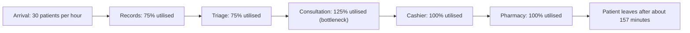
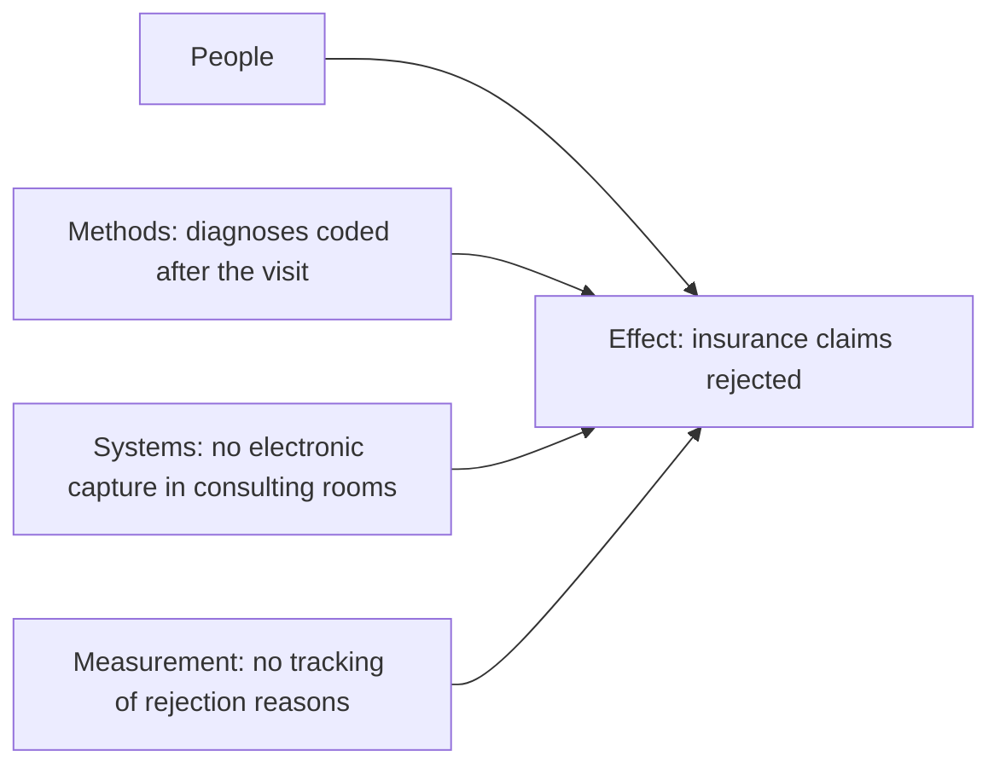

## Introduction

A process map shows what happens; process analysis explains what is wrong with it and how much it matters. Without analysis, redesign becomes a matter of opinion: each manager proposes the change that suits their own department, and the loudest voice wins. With analysis, the organisation can say precisely where time is lost, which steps add no value for the customer, which resource limits the whole process and what the root causes of errors are. That evidence makes the case for change, guides redesign and provides a baseline against which improvement can be measured.

This lesson introduces the core qualitative and quantitative techniques of process analysis. You will classify steps using **value-added analysis**, identify the **seven wastes** described in the Toyota Production System, calculate **cycle time efficiency**, find **bottlenecks** using capacity and utilisation calculations, and trace problems to their **root causes** using the 5 Whys, cause-and-effect diagrams and Pareto analysis. A worked as-is analysis of a Ghanaian hospital outpatient process brings the techniques together.

## Learning Objectives

- Classify process steps as value-adding, business value-adding or non-value-adding and justify each classification.
- Identify the seven wastes in a process and explain their effects.
- Calculate cycle time efficiency, resource utilisation and throughput, and use them to identify a bottleneck.
- Apply the 5 Whys, cause-and-effect diagrams and Pareto analysis to find root causes of process problems.
- Evaluate an as-is process and prioritise inefficiencies for redesign using quantitative evidence.

## Prerequisite Knowledge

- The lessons on process mapping and BPMN modelling in the *Business Process Management* module.
- The lesson *Principles of Business Process Re-engineering*.
- Comfort with simple arithmetic: averages, percentages and ratios.

## Key Terminology

- **Value-adding (VA) step**: A step that the customer would be willing to pay for, because it changes the product or service in a way the customer values.
- **Business value-adding (BVA) step**: A step that the customer does not value directly but which is required for the business to operate, for example legal compliance or necessary control.
- **Non-value-adding (NVA) step**: A step that adds no value for the customer or the business, such as waiting, rework or unnecessary movement.
- **Cycle time**: The total elapsed time from the start to the end of a process for one case, including processing and waiting.
- **Cycle time efficiency**: The ratio of value-adding time to total cycle time, usually expressed as a percentage.
- **Bottleneck**: The resource or step with the least capacity relative to demand, which limits the throughput of the whole process.
- **Utilisation**: The proportion of a resource's available capacity that is used, calculated as demand divided by capacity.
- **Root cause**: The underlying reason for a problem which, if removed, prevents the problem from recurring.
- **Muda**: A Japanese term for waste, meaning any activity that consumes resources without creating value.

## Detailed Explanation

### Qualitative analysis: value-added analysis

Value-added analysis examines each step of the as-is model and asks two questions: *Does the customer value this step?* and *If not, does the business need it?* The answers place each step into one of three categories:

| Category | Test | Examples (pharmacy dispensing) | Redesign aim |
|---|---|---|---|
| Value-adding | Customer would pay for it | Pharmacist dispenses and counsels | Keep; do it better |
| Business value-adding | Required for the business or by regulation | Verifying a prescription; recording a controlled drug | Keep but minimise effort, automate where possible |
| Non-value-adding | Neither | Waiting, re-entering data, walking between counters, correcting errors | Eliminate |

Two cautions apply. First, classification depends on the customer's perspective, so it should be justified rather than assumed. Second, many BVA steps exist because of upstream problems: an inspection step exists because errors occur earlier. Asking *why* a BVA step is needed often reveals a redesign opportunity.

### The seven wastes

Taiichi Ohno, who led the development of the Toyota Production System, described seven types of waste (Ohno, 1988). They were defined for manufacturing but translate readily to services and information work.

| Waste | Manufacturing meaning | Service or information equivalent |
|---|---|---|
| Transport | Unnecessary movement of materials | Passing files between departments; patients sent between buildings |
| Inventory | Excess raw materials or work in progress | Backlogs of unprocessed claims; queues of patients |
| Motion | Unnecessary movement of people | Staff walking to fetch folders or printers |
| Waiting | Idle time between steps | Patients waiting for results; approvals waiting in in-trays |
| Overproduction | Producing more or earlier than needed | Printing reports nobody reads; preparing documents before they are required |
| Over-processing | Doing more work than the customer requires | Multiple approvals for low-value purchases; re-keying data into several systems |
| Defects | Errors requiring rework or scrap | Wrong prescriptions, invoice errors, rejected insurance claims |

The acronym TIMWOOD (transport, inventory, motion, waiting, overproduction, over-processing, defects) is a common memory aid.

### Quantitative analysis: time

The simplest powerful measure is **cycle time efficiency**:

`cycle time efficiency = value-adding time / total cycle time × 100%`

In many service processes the result is strikingly low: most elapsed time is waiting. A low figure points to waiting and hand-offs, not slow work, as the primary target.

**Little's law** links three measures for a stable process: `work in progress = throughput × cycle time`. If a clinic sees 20 patients per hour and the average patient spends 1.5 hours in the clinic, there are on average 20 × 1.5 = 30 patients in the building. Reducing cycle time reduces crowding, not just waiting.

### Quantitative analysis: capacity and bottlenecks

For each resource:

- **Capacity per hour** = number of servers × (60 / average processing minutes per case).
- **Utilisation** = demand per hour / capacity per hour.

The resource with the **highest utilisation** is the bottleneck. When utilisation approaches or exceeds 100%, queues grow rapidly, and even at high but sub-100% utilisation, variability in arrivals and processing times causes long waits.

Goldratt's Theory of Constraints, popularised in *The Goal* (Goldratt & Cox, 1984), proposes five focusing steps: (1) **identify** the constraint; (2) **exploit** it, making sure its capacity is never wasted; (3) **subordinate** everything else to it; (4) **elevate** it by adding capacity; (5) **repeat**, because a new constraint will emerge. An important implication is that improving a non-bottleneck step does not increase overall throughput.

### Root-cause analysis

Symptoms such as "claims are rejected" have causes, and redesigning around symptoms rarely works. Three widely used techniques are:

- **5 Whys**: ask "why?" repeatedly (often about five times) until a cause is reached that can be acted upon.
- **Cause-and-effect (Ishikawa or fishbone) diagram**: group possible causes into categories such as people, methods, materials, machines (systems), measurement and environment.
- **Pareto analysis**: count occurrences of each cause and rank them; typically a small number of causes account for most occurrences, so effort is focused there.

## Worked Example

**Illustrative scenario.** *Accra Central Hospital* (hypothetical) analyses its outpatient process during the morning peak, when 30 patients arrive per hour. Observation of a sample of cases gives the following averages.

| Step | Resource | Servers | Processing time (min) | Average wait before step (min) | Classification |
|---|---|---|---|---|---|
| 1. Retrieve paper folder | Records clerks | 2 | 3 | 20 | NVA |
| 2. Triage (vital signs) | Nurses | 2 | 3 | 15 | VA |
| 3. Consultation | Doctors | 4 | 10 | 45 | VA |
| 4. Pay at cashier | Cashiers | 1 | 2 | 25 | BVA |
| 5. Dispense medicines | Pharmacists | 2 | 4 | 30 | VA |

**Step 1 – Cycle time efficiency.**

- Total processing time = 3 + 3 + 10 + 2 + 4 = 22 minutes.
- Total waiting time = 20 + 15 + 45 + 25 + 30 = 135 minutes.
- Total cycle time = 22 + 135 = 157 minutes.
- Value-adding time = triage 3 + consultation 10 + dispensing 4 = 17 minutes.
- Cycle time efficiency = 17 / 157 × 100% ≈ 10.8%.

Roughly nine-tenths of the patient's time is non-value-adding, and waiting dominates.

**Step 2 – Capacity and utilisation (demand 30 patients per hour).**

| Resource | Capacity per hour | Utilisation |
|---|---|---|
| Records clerks | 2 × 60/3 = 40 | 30/40 = 75% |
| Nurses | 2 × 60/3 = 40 | 75% |
| Doctors | 4 × 60/10 = 24 | 30/24 = 125% |
| Cashier | 1 × 60/2 = 30 | 30/30 = 100% |
| Pharmacists | 2 × 60/4 = 30 | 100% |

**Step 3 – Interpretation.** Doctors are the bottleneck: at 125% utilisation, demand exceeds capacity and the consultation queue will grow throughout the morning. The cashier and pharmacy are at 100%, so any variability creates long queues there too. Adding records clerks would not help throughput. Following the Theory of Constraints, the hospital should first *exploit* doctors' time (for example, by moving folder retrieval and test ordering away from consultation), then *subordinate* other steps (schedule arrivals by appointment slots), and only then *elevate* capacity (add a doctor in the peak).

**Step 4 – Root cause of a related problem.** Insurance claims are often rejected. A 5 Whys sequence: Why rejected? Missing diagnosis codes. Why missing? Doctors write diagnoses on paper and the claims clerk codes them later. Why later? There is no electronic capture at consultation. Why? The registration system does not reach consulting rooms. Root cause: information is not captured once at the source. A Pareto count of rejection reasons over a month would confirm whether this is the dominant cause.

**Step 5 – Prioritised inefficiencies.** (1) Doctor capacity and consultation waiting; (2) folder retrieval, a pure NVA step that could be eliminated with electronic records; (3) the single cashier, a near-bottleneck that could be removed by mobile money payment at registration or consultation; (4) late diagnosis coding causing claim defects.

## International Case Study

### Waste and flow in the Toyota Production System

The Toyota Production System, developed at Toyota in Japan over several decades after the Second World War and described by Ohno (1988), placed the elimination of waste at the centre of operations management. Its practices, including just-in-time production, pull systems using kanban cards and stopping the line when defects appear, were aimed at making problems visible and removing activities that consumed resources without adding value. The system became the foundation of what Western writers later called Lean.

For process analysis, Toyota's contribution is a disciplined way of *seeing* waste. Ohno's seven wastes give analysts a checklist for walking through any process, whether a car assembly line, a hospital ward or an accounts office. The emphasis on making problems visible, rather than hiding them behind inventory or queues, is equally relevant to service organisations, where queues of patients or backlogs of paperwork often conceal underlying inefficiency.

## Diagram

## Common Misconceptions

- **"Speeding up every step will speed up the process."** Only improvements at the bottleneck increase throughput; elsewhere they may simply move the queue.
- **"Business value-adding steps should be eliminated like waste."** BVA steps such as legal verification are necessary, but their effort can be minimised or automated, and the reasons for them questioned.
- **"A resource at 90% utilisation is fine."** With variable arrivals and service times, high utilisation produces long, unstable queues; spare capacity is needed for good service.
- **"The first plausible cause is the root cause."** Root-cause analysis requires repeated questioning and evidence, such as Pareto counts.

## Common Examination Mistakes

- Classifying steps as VA, BVA or NVA without justification from the customer's perspective.
- Calculating cycle time efficiency using processing time for all steps rather than value-adding time only.
- Confusing capacity with demand when computing utilisation.
- Recommending extra staff at a non-bottleneck step.
- Listing wastes generically without linking them to steps in the scenario.

## Critical Thinking Questions

1. Is a hospital patient the only "customer" when classifying steps as value-adding? How might insurers, regulators or clinicians change the classification?
2. Why might staff resist the finding that most of a process's time is waiting, and how should analysts present such results?
3. When is it better to manage demand (for example by appointments) than to add capacity at a bottleneck?
4. What are the limitations of averages in process analysis, and what additional data would you collect?

## Practical Exercises

1. **Value-added classification.** Take a process map from an earlier exercise and classify every step as VA, BVA or NVA. *Expected output:* a table with justification for each step and a count of NVA steps.
2. **Waste walk.** Observe a real service process (a bank queue, a supermarket checkout or a restaurant) and record examples of each of the seven wastes. *Expected output:* a TIMWOOD table with at least one example per waste.
3. **Bottleneck calculation.** A courier depot receives 60 parcels per hour. Sorting has 3 staff at 2 minutes per parcel, weighing has 2 staff at 1.5 minutes, and labelling has 1 machine at 0.8 minutes. Calculate capacity and utilisation for each step and identify the bottleneck. *Expected output:* sorting 90/hour (67%), weighing 80/hour (75%), labelling 75/hour (80%); labelling is the bottleneck, with a recommendation.
4. **Root-cause analysis.** For a problem such as "customers receive wrong deliveries", build a fishbone diagram and a 5 Whys chain. *Expected output:* a diagram with at least three categories and a 5 Whys chain ending in an actionable root cause.
5. **Simulate in a modelling tool.** Bizagi Modeler (<https://www.bizagi.com/>) includes process simulation features. Model the worked example and run a simple simulation with the given times and resources. *Expected output:* a screenshot of simulated resource utilisation and a comparison with the manual calculation.

## Key Takeaways

- Value-added analysis classifies steps as VA, BVA or NVA from the customer's and business's perspective, and targets NVA steps for elimination.
- Ohno's seven wastes (TIMWOOD) give a practical checklist for spotting inefficiency in any process.
- Cycle time efficiency is often very low in service processes because waiting dominates.
- The bottleneck is the resource with the highest utilisation; only improving it raises throughput.
- Root-cause techniques (5 Whys, fishbone, Pareto) prevent redesign around symptoms.

## Further Reading

- Dumas, M., La Rosa, M., Mendling, J., & Reijers, H. A. (2018). *Fundamentals of business process management* (2nd ed.). Springer.
- Ohno, T. (1988). *Toyota production system: Beyond large-scale production*. Productivity Press.
- Goldratt, E. M., & Cox, J. (1984). *The goal: A process of ongoing improvement*. North River Press.
- Rother, M., & Shook, J. (1999). *Learning to see: Value stream mapping to add value and eliminate muda*. Lean Enterprise Institute.

## Video Resources

- [Bizagi](https://www.bizagi.com/) — Bizagi. Official site for Bizagi Modeler, which includes process simulation for analysing time and resources.
- [Camunda Documentation](https://docs.camunda.io/) — Camunda. Official documentation including process monitoring and analysis of running process instances.

## Revision Summary

Process analysis turns maps into evidence. Value-added analysis separates VA, BVA and NVA steps; Ohno's seven wastes reveal transport, inventory, motion, waiting, overproduction, over-processing and defects. Cycle time efficiency (VA time divided by total time) usually exposes waiting as the main problem. Capacity and utilisation calculations locate the bottleneck, which alone governs throughput. Root-cause tools ensure redesign tackles causes, not symptoms.

- VA = customer pays; BVA = business needs; NVA = eliminate.
- TIMWOOD: transport, inventory, motion, waiting, overproduction, over-processing, defects.
- Cycle time efficiency = VA time / total cycle time.
- Utilisation = demand / capacity; highest = bottleneck.
- Theory of Constraints: identify, exploit, subordinate, elevate, repeat.
- 5 Whys, fishbone and Pareto for root causes.
