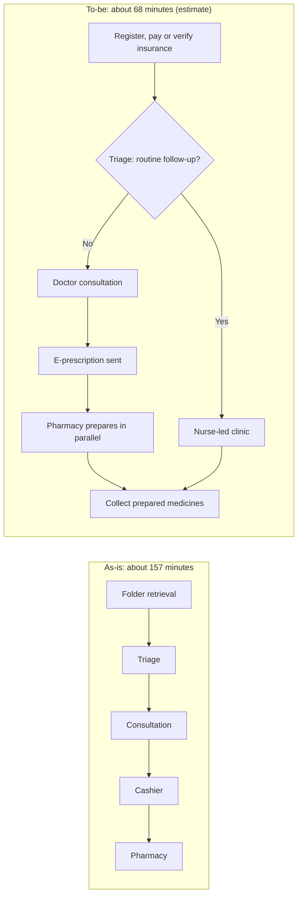

## Introduction

Analysis tells an organisation what is wrong with a process; redesign decides what to do about it. Good redesign is neither guesswork nor blind imitation of another firm's process. It draws on proven redesign patterns, tests alternatives against clear performance objectives and produces a to-be process that can actually be implemented with the people, systems and money available. Yet even an excellent design fails if people do not adopt it. Many re-engineering programmes of the 1990s produced elegant designs that collapsed in implementation because staff did not understand, accept or know how to work in the new way.

This lesson therefore combines two subjects that belong together. The first half covers **process redesign and optimisation**: redesign heuristics, the trade-offs captured by the Devil's Quadrangle, and how to evaluate a to-be design quantitatively. The second half covers **change management**: Lewin's three-stage model, Kotter's eight steps for leading change and Prosci's ADKAR model for individual change. A worked as-is to to-be redesign of a Ghanaian hospital outpatient process, and the international case of Mutual Benefit Life's case manager design, show how design and change must be planned together.

## Learning Objectives

- Apply redesign heuristics such as task elimination, resequencing, parallelism, triage, case management and automation to produce a to-be process.
- Evaluate alternative redesigns against time, cost, quality and flexibility, recognising trade-offs.
- Quantify the expected improvement of a to-be process compared with the as-is baseline.
- Explain Lewin's model, Kotter's eight steps and the ADKAR model, and compare their focus.
- Construct a change management plan that addresses organisational and individual adoption of a redesigned process.

## Prerequisite Knowledge

- The lessons *Principles of Business Process Re-engineering* and *Process Analysis and Identifying Inefficiencies*.
- The ability to read swimlane and BPMN-style process diagrams.

## Key Terminology

- **To-be process**: The redesigned future-state process that an organisation intends to implement.
- **Redesign heuristic**: A proven rule of thumb for improving a process, such as eliminating unnecessary tasks or performing tasks in parallel.
- **Triage**: Dividing cases into categories (for example simple and complex) and routing each through a process suited to it.
- **Case manager**: A single person or team responsible for a whole case, acting as the customer's point of contact and coordinating the work.
- **Process optimisation**: Adjusting a process's parameters, such as staffing, scheduling and rules, to achieve the best performance against objectives.
- **Change management**: The structured approach to helping individuals, teams and organisations move from current to desired ways of working.
- **Kotter's eight steps**: A sequential model for leading organisational change, from establishing urgency to anchoring new approaches in the culture.
- **ADKAR**: Prosci's model of individual change: Awareness, Desire, Knowledge, Ability and Reinforcement.
- **Resistance to change**: Behaviour that slows or prevents adoption of change, often arising from uncertainty, loss of status or lack of skill.

## Detailed Explanation

### Redesign heuristics

Reijers and Limam Mansar (2005) reviewed and evaluated a large set of redesign heuristics drawn from practice and literature. A selection most useful for students is shown below, together with their typical effects.

| Heuristic | Description | Typical effect |
|---|---|---|
| Task elimination | Remove unnecessary tasks, especially NVA steps and redundant checks | Less time and cost; may reduce control |
| Task composition | Combine small tasks into one larger task performed by one person | Fewer hand-offs and set-up time |
| Resequencing | Move tasks to a more suitable point, for example verification before payment | Less rework and waiting |
| Parallelism | Perform independent tasks at the same time | Shorter cycle time; more coordination |
| Triage | Route simple and complex cases through different paths | Faster handling of simple cases |
| Case manager | One person or team responsible for the whole case | Better customer contact and accountability |
| Empowerment | Give front-line staff authority to decide within rules | Fewer escalations and waits |
| Automation | Let systems perform tasks, checks or calculations | Speed and consistency; investment and rigidity |
| Integration with customers or suppliers | Share data or tasks across organisational boundaries | Fewer re-entries and delays |

These heuristics overlap with Hammer's principles from the earlier lesson; they are more fine-grained and easier to apply systematically.

### Evaluating redesigns: the Devil's Quadrangle

Each heuristic affects **time, cost, quality and flexibility** differently, and improvements on one dimension often worsen another. Parallelism may cut time but increase coordination cost; automation may improve consistency (quality) but reduce flexibility to handle unusual cases; a case manager may improve quality and flexibility but cost more per case if case managers are highly skilled. Evaluating alternative to-be designs therefore requires stating objectives explicitly: for an outpatient process, waiting time and patient safety might outweigh cost.

### Optimisation and evaluation methods

A redesign should be evaluated before implementation using:

1. **Recalculation** of cycle time, cycle time efficiency and resource utilisation for the to-be model, using the methods from the previous lesson.
2. **Simulation**, in which a modelling tool generates many cases with variable arrival and processing times to estimate waiting times and utilisation. Bizagi Modeler offers simulation features for this purpose.
3. **Pilots**, in which the new process is trialled in one branch, ward or shift before roll-out.
4. **Defined KPIs** with baseline and target values, so that post-implementation monitoring can confirm benefits.

Optimisation then fine-tunes the design: adjusting staffing by time of day, appointment slot lengths, approval thresholds or automation rules.

## Worked Example

**Illustrative scenario.** *Accra Central Hospital* (hypothetical) uses the as-is analysis from the previous lesson: total cycle time about 157 minutes, cycle time efficiency about 10.8%, doctors at 125% utilisation during the morning peak, and a single cashier at 100%.

**Redesign decisions.**

1. **Task elimination**: replace paper folder retrieval with electronic records accessed by patient number (removes step 1 and its 20-minute wait).
2. **Resequencing and integration**: register and collect payment or verify insurance at arrival, including mobile money, so the separate cashier queue disappears.
3. **Triage**: nurses route routine follow-up visits (for example, repeat prescriptions for stable chronic conditions) to a nurse-led clinic within agreed protocols, reducing demand on doctors.
4. **Parallelism and automation**: doctors send prescriptions electronically, so the pharmacy prepares medicines while the patient walks from the consulting room.
5. **Demand management**: introduce appointment slots to smooth arrivals.

**Expected effects (illustrative estimates to be validated by pilot).** Suppose triage diverts 6 of the 30 hourly patients to the nurse-led clinic. Doctor demand becomes 24 patients per hour against a capacity of 24, so utilisation falls to 100%; adding one doctor during the peak gives capacity 30 and utilisation 80%. With folder retrieval and the cashier queue removed and medicines prepared in advance, the to-be steps for a doctor-seen patient might be registration and payment (3 minutes plus 10 minutes' wait), triage (3 plus 10), consultation (10 plus 20) and collection of prepared medicines (2 plus 10).

- To-be cycle time = (3 + 3 + 10 + 2) processing + (10 + 10 + 20 + 10) waiting = 18 + 50 = 68 minutes.
- Value-adding time = 3 + 10 + 2 = 15 minutes (dispensing time falls because preparation happens in parallel).
- Cycle time efficiency ≈ 15 / 68 × 100% ≈ 22%.

Total time falls from about 157 to about 68 minutes in this estimate. The trade-offs are explicit: the nurse-led clinic requires protocols and training (quality and cost), electronic records require investment, and appointment slots reduce flexibility for walk-in patients. These figures are planning estimates; a pilot and simulation must confirm them.

## Theories, Frameworks and Models

### Lewin's three stages

Kurt Lewin's classic model describes change as **unfreezing** (creating readiness by challenging current beliefs and practices), **changing** (moving to new behaviours, structures and processes) and **refreezing** (stabilising the new state so that it becomes normal). Its simplicity is its strength; critics note that modern organisations rarely "refreeze" for long, which is one reason continuous improvement follows re-engineering.

### Kotter's eight steps

Kotter (1995) analysed why transformation efforts fail and proposed eight steps, developed further in *Leading Change* (Kotter, 1996):

1. **Establish a sense of urgency**: show, with evidence, why the current state is unacceptable (for example, waiting-time data and patient complaints).
2. **Create a guiding coalition**: assemble a powerful team, including clinical leaders, managers and respected front-line staff.
3. **Develop a vision and strategy**: a clear picture of the future ("Every outpatient seen, treated and on their way within about an hour").
4. **Communicate the change vision**: repeatedly, through many channels, with leaders modelling the behaviour.
5. **Empower broad-based action**: remove obstacles such as outdated rules, systems and structures.
6. **Generate short-term wins**: plan visible early successes, such as removing the cashier queue in one clinic.
7. **Consolidate gains and produce more change**: use credibility from early wins to tackle bigger changes.
8. **Anchor new approaches in the culture**: link new behaviours to success, and embed them in recruitment, training and performance management.

Kotter's model is organisational and leadership-focused, and it emphasises sequence: skipping urgency or declaring victory too early are common failure modes he identified.

### ADKAR

Hiatt's (2006) ADKAR model, associated with Prosci, focuses on the **individual**. Organisational change happens only when each affected person moves through five building blocks:

| Element | Question for the individual | Typical interventions |
|---|---|---|
| Awareness | Why is this change needed? | Communication of reasons and evidence |
| Desire | Do I want to participate and support it? | Involvement, addressing "what's in it for me", sponsor engagement |
| Knowledge | Do I know how to change? | Training, guides, process documentation |
| Ability | Can I perform the new way in practice? | Coaching, practice, time to learn, support at go-live |
| Reinforcement | Will the change last? | Recognition, measurement, corrective feedback |

ADKAR is useful diagnostically: if nurses have been trained (knowledge) but are not using the new triage protocol, the barrier may be desire or ability rather than more training.

### Combining the models

Kotter's steps structure what leaders do across the organisation; ADKAR tracks whether each group of individuals is actually changing. A practical plan uses Kotter for the programme timeline and ADKAR to assess and support each stakeholder group, such as doctors, nurses, records clerks and cashiers, whose jobs change in different ways.

## International Case Study

### Mutual Benefit Life's case managers

Hammer (1990) described the re-engineering of life insurance application processing at Mutual Benefit Life, a United States insurer. In the original process, an application passed through a long sequence of steps handled by different specialists in several departments, including credit checking, quoting, rating and underwriting, with many hand-offs and long overall processing times. The re-engineered design replaced this chain with **case managers** who handled an application from receipt to the issuing of a policy, supported by shared databases and expert-system tools that gave a generalist access to the information and guidance previously held by specialists. Specialists remained available for difficult cases.

The case illustrates two points from this lesson. First, it is a direct application of the case manager and task composition heuristics, made possible by IT. Second, it shows why redesign and change management are inseparable: the new design changed job roles fundamentally, replacing narrow specialist jobs with broad, accountable ones. Such changes require new skills (knowledge and ability in ADKAR terms), new performance measures and leadership commitment, otherwise staff revert to familiar patterns.

## Common Misconceptions

- **"A good design will be adopted automatically."** Adoption depends on people's awareness, desire, knowledge and ability; design and change management must be planned together.
- **"Automation is always the best redesign."** Automating a flawed process makes it faster but not better; eliminate and resequence first, then automate.
- **"Kotter and ADKAR are competing models."** Kotter addresses organisational leadership of change; ADKAR addresses individual transition; they are complementary.
- **"Change management means communication and training."** Those are necessary but not sufficient; sponsorship, involvement, removal of obstacles and reinforcement are equally important.
- **"Redesign improves every performance dimension."** The Devil's Quadrangle reminds us that trade-offs are usual and must be chosen deliberately.

## Common Examination Mistakes

- Proposing a to-be process without linking each change to an analysed problem.
- Failing to quantify expected improvement or to acknowledge that estimates need validation.
- Listing Kotter's eight steps without applying them to the scenario's stakeholders.
- Confusing the order of ADKAR elements or treating it as an organisational, not individual, model.
- Ignoring trade-offs, risks and resistance when evaluating a redesign.

## Critical Thinking Questions

1. In the hospital to-be design, nurses take on triage decisions previously made by doctors. What professional and patient-safety concerns arise, and how should they shape the design and the change plan?
2. Kotter emphasises urgency. Can creating urgency backfire, for example by provoking fear of job losses? How would you manage this in a Ghanaian organisation?
3. When would you choose a pilot rather than a full simulation, or both, to evaluate a redesign?
4. The Mutual Benefit Life case relied on generalist case managers. In which Ghanaian service organisations would this design work well, and where would specialist chains remain safer?

## Practical Exercises

1. **Apply redesign heuristics.** For a restaurant order-to-table process, propose at least five changes, each labelled with the heuristic used and its expected effect on time, cost, quality and flexibility. *Expected output:* a table of changes and a Devil's Quadrangle assessment.
2. **To-be BPMN model.** Using Camunda Modeler (see <https://docs.camunda.io/>) or Bizagi Modeler (<https://www.bizagi.com/>), model the hospital to-be process with an exclusive gateway for triage and a parallel gateway for pharmacy preparation. *Expected output:* a BPMN diagram and, in Bizagi, a simulation comparing as-is and to-be cycle times.
3. **Kotter plan.** Write a change plan for introducing electronic records at a pharmacy chain, with one concrete action for each of Kotter's eight steps. *Expected output:* an eight-row table with actions, owners and timing.
4. **ADKAR assessment.** For three stakeholder groups affected by a redesign (for example records clerks, nurses and doctors), assess each ADKAR element on a 1-5 scale and identify the barrier point. *Expected output:* an assessment grid and targeted interventions for each barrier.
5. **Explore implementation support.** Browse SAP Learning (<https://learning.sap.com/>) for material on organisational change or user adoption in enterprise implementations. *Expected output:* a short note relating what you find to Kotter or ADKAR.

## Key Takeaways

- Redesign heuristics (task elimination, resequencing, parallelism, triage, case manager, empowerment, automation, integration) turn analysis into concrete to-be designs.
- Every redesign involves trade-offs across time, cost, quality and flexibility, so objectives must be explicit.
- To-be designs should be quantified, simulated or piloted, and measured against baseline KPIs.
- Kotter's eight steps guide leaders through organisational change; ADKAR tracks each individual's transition.
- Redesign and change management are inseparable, as the Mutual Benefit Life case manager design shows.

## Further Reading

- Reijers, H. A., & Limam Mansar, S. (2005). Best practices in business process redesign: An overview and qualitative evaluation of successful redesign heuristics. *Omega, 33*(4), 283-306.
- Kotter, J. P. (1995). Leading change: Why transformation efforts fail. *Harvard Business Review, 73*(2), 59-67.
- Kotter, J. P. (1996). *Leading change*. Harvard Business School Press.
- Hiatt, J. M. (2006). *ADKAR: A model for change in business, government and our community*. Prosci Learning Center Publications.
- Hammer, M. (1990). Reengineering work: Don't automate, obliterate. *Harvard Business Review, 68*(4), 104-112.

## Video Resources

- [Prosci ADKAR Model](https://www.prosci.com/methodology/adkar): Prosci. Official overview of the ADKAR model of individual change.
- [Kotter Inc.](https://www.kotterinc.com/): Kotter Inc. Official site of the organisation founded by John Kotter, with material on the eight-step change model.
- [Bizagi](https://www.bizagi.com/): Bizagi. Official site for Bizagi Modeler, used to model and simulate as-is and to-be processes.

## Revision Summary

Redesign applies proven heuristics to the problems found in analysis, producing a to-be process whose benefits are quantified, simulated or piloted against baseline KPIs, with trade-offs across time, cost, quality and flexibility made explicit. Adoption requires change management: Lewin's unfreeze-change-refreeze, Kotter's eight leadership steps and ADKAR's five individual building blocks. Mutual Benefit Life shows how a case manager redesign transforms jobs and therefore demands deliberate change support.

- Heuristics: eliminate, compose, resequence, parallelise, triage, case manager, empower, automate.
- Devil's Quadrangle: time, cost, quality, flexibility.
- Evaluate: recalculate, simulate, pilot, set KPIs.
- Kotter: urgency, coalition, vision, communicate, empower, short-term wins, consolidate, anchor.
- ADKAR: Awareness, Desire, Knowledge, Ability, Reinforcement.
