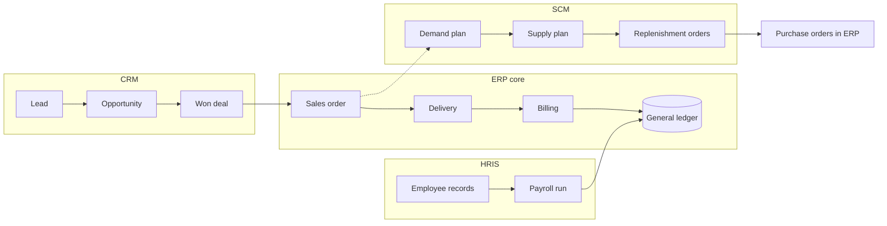

## Introduction

ERP systems concentrate on the internal transactional core of a business: orders, stock, purchases and ledgers. Around that core sit three other families of enterprise application that extend its reach. **Customer relationship management (CRM)** systems look outward to customers, managing marketing, sales pipelines and service. **Supply chain management (SCM)** systems look along the chain of suppliers, manufacturers, distributors and retailers, planning and coordinating the flow of goods. **Human resource information systems (HRIS)** manage the organisation's people, from recruitment to retirement.

Some vendors include all three within their ERP suites; others sell specialist "best-of-breed" products that must be integrated with ERP. This lesson explains what each application family does, the frameworks that shape their design (the CRM types, the SCOR model and the bullwhip effect, and the hire-to-retire cycle), and the integration questions they raise. A well-documented international case, Nike's difficulties with demand-planning software around 2000, shows why planning systems must be implemented with as much care as transactional ones.

## Learning Objectives

- Explain the purpose of CRM, SCM and HRIS and the business processes each supports.
- Distinguish operational, analytical and collaborative CRM.
- Apply the SCOR model and the bullwhip effect to analyse a supply chain information problem.
- Describe the hire-to-retire cycle and the data an HRIS manages.
- Evaluate the integration of CRM, SCM and HRIS with ERP, including the suite versus best-of-breed choice.

## Prerequisite Knowledge

- The lesson *Enterprise Resource Planning (ERP) Systems*, especially order-to-cash and procure-to-pay.
- A basic understanding of marketing, logistics and human resource management functions.

## Key Terminology

- **Customer relationship management (CRM)**: Strategy and supporting systems for acquiring, developing and retaining profitable customer relationships by managing customer interactions and data.
- **Sales pipeline**: The set of sales opportunities at different stages from lead to closed deal, used to forecast and manage sales.
- **Supply chain management (SCM)**: The planning and coordination of flows of materials, information and money among suppliers, producers, distributors and customers.
- **Demand planning**: Forecasting customer demand to drive production, purchasing and distribution decisions.
- **Bullwhip effect**: The amplification of demand variability as orders move upstream from retailers to wholesalers, manufacturers and suppliers.
- **SCOR model**: The Supply Chain Operations Reference model, which describes supply chain processes using standard categories such as plan, source, make, deliver and return.
- **Human resource information system (HRIS)**: A system that records and supports HR processes such as recruitment, employee records, payroll, leave, performance and training.
- **Employee self-service**: HRIS functions that allow employees to view payslips, request leave and update personal details themselves.
- **Best-of-breed**: A strategy of choosing the strongest specialist application for each function and integrating them, rather than taking all modules from one suite.

## Detailed Explanation

### Customer relationship management

CRM is both a business strategy and a technology. The strategy is to treat customers as relationships to be developed over time rather than as a series of separate transactions. The technology captures every interaction (enquiries, visits, orders, complaints, campaign responses) in a shared customer record.

CRM functionality is commonly grouped into three types:

| CRM type | Purpose | Typical functions |
|---|---|---|
| Operational CRM | Automate and support customer-facing work | Sales force automation, lead and opportunity management, marketing campaigns, service tickets, contact centre |
| Analytical CRM | Analyse customer data to improve decisions | Segmentation, customer profitability, churn analysis, campaign effectiveness |
| Collaborative CRM | Coordinate interactions across channels and partners | Shared customer history across branches, social and messaging channels, partner portals |

A key process is **lead-to-order**: a lead is captured, qualified, converted into an opportunity, progressed through pipeline stages and, when won, converted into a sales order. At that point CRM must hand over to ERP, which handles pricing, availability, delivery and billing. Poor integration here is common: sales staff promise prices or dates in CRM that ERP cannot honour.

### Supply chain management

SCM systems support two broad kinds of work. **Supply chain planning** includes demand planning, supply and production planning, inventory optimisation and distribution planning. **Supply chain execution** includes warehouse management, transport management, order fulfilment and tracking. ERP typically handles much of execution; specialist planning tools handle complex optimisation.

The **SCOR model**, originally developed by the Supply Chain Council and now maintained by ASCM, describes supply chains using standard process categories: **Plan** (balance demand and supply), **Source** (procure goods and services), **Make** (transform into finished products), **Deliver** (manage orders, warehousing and transport), **Return** (handle returned products) and **Enable** (manage rules, performance, data and risk). Its value for students is a common vocabulary for mapping and benchmarking supply chain processes.

The **bullwhip effect** (Lee, Padmanabhan & Whang, 1997) explains why information sharing matters. Small changes in consumer demand become larger swings in orders further up the chain because each party forecasts from the orders it receives, batches orders, reacts to price promotions and inflates orders when it fears shortages. Remedies are largely informational: sharing point-of-sale data upstream, reducing order batch sizes, stabilising prices and coordinating replenishment. SCM systems and supplier portals provide the infrastructure for those remedies.

### Human resource information systems

An HRIS supports the **hire-to-retire** cycle:

1. Workforce planning and position management.
2. Recruitment and onboarding (applicant tracking, offer letters, contract creation).
3. Employee records (personal data, qualifications, job history).
4. Time, attendance and leave management.
5. Payroll, including statutory deductions such as income tax and social security contributions.
6. Performance management, training and development.
7. Exit, retirement and final settlement.

HRIS integration with ERP is essential because payroll posts to the general ledger, labour costs feed cost centres and project accounting, and organisational structure determines approval workflows across the entire enterprise. HR data is also highly sensitive personal data, so access control and data protection obligations are especially important.

### Suite versus best-of-breed

| Consideration | Integrated suite | Best-of-breed |
|---|---|---|
| Integration effort | Lower; shared data model | Higher; interfaces and data mapping needed |
| Functional depth | Adequate to good | Often deeper in the specialist area |
| Vendor management | One main vendor | Several contracts and roadmaps |
| User experience | Consistent | Varies by product |
| Flexibility | Constrained by suite roadmap | Can replace one component at a time |

Many organisations take a hybrid approach: a core ERP suite with a specialist CRM or warehouse system where business requirements justify the extra integration effort.

## Theories, Frameworks and Models

### The customer lifecycle

CRM strategy is often framed around a customer lifecycle of **acquisition** (attracting and converting new customers), **development** (increasing the value of the relationship through cross-selling and up-selling) and **retention** (keeping valuable customers and winning back lapsed ones). Buttle and Maklan (2019) argue that CRM technology should serve a deliberate strategy for creating customer value across this lifecycle; deploying software without such a strategy tends to produce an expensive contact database. Analytical CRM informs which customers to acquire, develop or retain, and operational CRM executes those decisions.

### Planning versus execution in SCM

A helpful distinction is between **planning horizons**. Strategic decisions (where to locate warehouses, which suppliers to partner with) look years ahead; tactical planning (monthly demand and supply plans, inventory targets) looks weeks to months ahead; operational execution (today's picking, loading and deliveries) works in hours. Planning tools optimise across many constraints and depend heavily on data quality and assumptions, while execution systems record what actually happens. The two must be connected so that plans reflect reality and execution follows the plan.

### Integration points to examine

When evaluating any CRM, SCM or HRIS proposal, ask four integration questions:

1. **Which system is the master** for each shared entity (customer, product, employee)?
2. **Which events cross the boundary** (won deal, replenishment order, payroll journal) and how quickly must they arrive?
3. **Which integration style** will carry them (API call, messaging, file)?
4. **Who resolves errors** when an interface fails, and how will they know?

These questions turn a vague promise of "integration" into concrete design decisions.

## Ghanaian Business Application

**Illustrative scenario.** *Volta Fresh Supermarkets* is a hypothetical chain of six supermarkets in Accra and Ho, supplied by local farmers, regional distributors and importers.

- **CRM**: a loyalty programme registers customers by phone number. Analytical CRM segments customers by basket size and frequency, allowing targeted promotions sent by SMS. Collaborative CRM ensures that a complaint logged at one branch is visible at every branch.
- **SCM**: fresh produce has short shelf life and volatile supply. Sharing daily point-of-sale data with key suppliers and placing smaller, more frequent orders reduces the bullwhip effect; during festive periods, such as the Christmas season, demand planning uses previous years' sales patterns rather than staff guesswork.
- **HRIS**: shift scheduling for cashiers is linked to forecast footfall; payroll calculates statutory deductions and posts labour costs to each branch's cost centre in the ERP; employee self-service on mobile phones reduces paperwork for leave requests.

**Integration design**: the loyalty identifier is stored in both the POS/ERP and CRM so purchases can be linked to customers; supplier forecasts are shared through a portal; HRIS posts a payroll journal into the ERP ledger each month. Management must also decide whether to buy CRM from the ERP vendor (simpler integration) or a specialist loyalty platform (richer marketing features).

## International Case Study

### Nike and demand-planning software

Around 2000, Nike implemented demand and supply planning software from i2 Technologies as part of a wider programme to modernise its supply chain systems. In early 2001 Nike announced that problems with the new planning system had contributed to production mismatches, with some footwear models overproduced and others in short supply, and it linked these problems to a shortfall in expected results. Nike and i2 publicly disagreed about the causes, with discussion focusing on implementation approach, data, customisation and how the system was put into use.

The case is valuable because it concerns a *planning* system rather than a transactional one. Planning tools generate recommendations from forecasts and models; if inputs, parameters or integration with execution systems are wrong, they can amplify errors across the supply chain, a variant of the bullwhip problem. Nike persisted with its supply chain transformation and later reported improvements. For students, the lesson is that SCM systems require tested data flows, staged roll-out and close involvement of planners who understand the business.

## Diagram

## Common Misconceptions

- **"CRM is just a contact database."** Contact management is a small part; CRM includes pipeline, campaign, service and analytical functions, and it is underpinned by a customer-centred strategy.
- **"The bullwhip effect is caused by poor suppliers."** It arises from the structure of ordering decisions throughout the chain, and it is reduced mainly by information sharing and coordination.
- **"HRIS is only payroll."** Payroll is one part of hire-to-retire, which also includes recruitment, records, time, performance and training.
- **"Best-of-breed always delivers better results."** Specialist depth can be outweighed by integration cost, inconsistent data and vendor management overhead.

## Common Examination Mistakes

- Describing CRM, SCM and HRIS separately without explaining how each integrates with ERP.
- Defining the bullwhip effect without giving its causes or remedies.
- Listing SCOR categories without applying them to the scenario.
- Ignoring data protection when discussing HRIS.
- Treating the Nike case as purely a vendor failure without discussing implementation and data.

## Critical Thinking Questions

1. A supermarket's loyalty data could reveal sensitive personal patterns. What limits should the business place on analytical CRM use?
2. Why might small Ghanaian suppliers be reluctant to share sales data with larger buyers, and how could a buyer build trust?
3. When would a specialist warehouse management system justify the integration burden of a best-of-breed approach?
4. How does the bullwhip effect apply to medicine supply chains during disease outbreaks?

## Practical Exercises

1. **CRM type classification.** List ten CRM features from a vendor's public documentation and classify each as operational, analytical or collaborative. *Expected output:* a classified table with brief justifications.
2. **Bullwhip simulation.** Construct a four-tier table (retailer, wholesaler, distributor, factory) over six weeks in which each tier adds a 20% safety margin to the orders it receives. *Expected output:* a table and a short explanation of how variability grows upstream and what information sharing would change.
3. **SCOR mapping.** Map the supply chain of a pharmacy chain using Plan, Source, Make, Deliver, Return and Enable. *Expected output:* a diagram or table with at least two activities per category.
4. **Explore vendor learning.** Browse SAP Learning (<https://learning.sap.com/>) or Microsoft Learn for Dynamics 365 (<https://learn.microsoft.com/en-us/dynamics365/>) to find introductory material on CRM or supply chain applications. *Expected output:* a half-page note on how the vendor describes integration between CRM or SCM and the ERP core.

## Key Takeaways

- CRM manages customer relationships through operational, analytical and collaborative functions and hands won deals to ERP.
- SCM plans and executes flows across organisations; SCOR provides a standard process vocabulary.
- The bullwhip effect amplifies demand variability upstream and is reduced mainly by sharing information.
- HRIS supports the hire-to-retire cycle and integrates with ERP through payroll postings and organisational structure.
- The suite versus best-of-breed choice trades integration simplicity against specialist depth.

## Further Reading

- Buttle, F., & Maklan, S. (2019). *Customer relationship management: Concepts and technologies* (4th ed.). Routledge.
- Lee, H. L., Padmanabhan, V., & Whang, S. (1997). Information distortion in a supply chain: The bullwhip effect. *Management Science, 43*(4), 546–558.
- Monk, E., & Wagner, B. (2013). *Concepts in enterprise resource planning* (4th ed.). Cengage Learning.

## Video Resources

- [Microsoft Learn: Dynamics 365](https://learn.microsoft.com/en-us/dynamics365/) — Microsoft. Official training and documentation covering CRM, supply chain and finance applications.
- [SAP Learning](https://learning.sap.com/) — SAP. Learning journeys covering SAP's supply chain, customer experience and human capital management applications.

## Revision Summary

CRM, SCM and HRIS extend the ERP core outward to customers, along the supply chain and across the workforce. CRM comprises operational, analytical and collaborative functions; SCM spans planning and execution and can be described using SCOR; the bullwhip effect shows why information sharing matters; HRIS supports hire-to-retire. Each must integrate with ERP, and organisations choose between suites and best-of-breed. Nike's experience shows planning systems need careful implementation.

- CRM: lead → opportunity → won deal → ERP sales order.
- SCOR: Plan, Source, Make, Deliver, Return, Enable.
- Bullwhip: forecasting on orders, batching, promotions, shortage gaming.
- HRIS: hire-to-retire; payroll posts to the ledger.
- Suite = easier integration; best-of-breed = deeper function.
