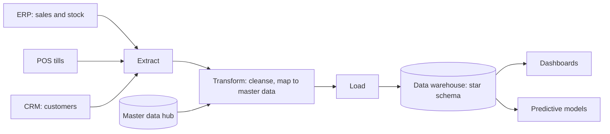
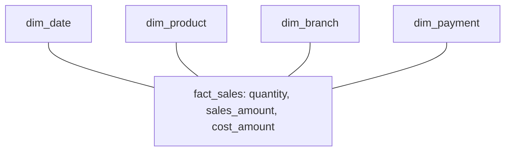

## Introduction

An enterprise system is only as good as its data. ERP, CRM, SCM and HRIS all depend on databases that store millions of transactions and the master records those transactions refer to: customers, products, suppliers, employees and accounts. When master data is duplicated or inaccurate, the consequences spread everywhere: invoices go to the wrong address, stock reports double-count items listed under two codes, and analytics produce confident but misleading conclusions.

This lesson examines the data foundations of enterprise systems. You will distinguish **operational (transactional) databases** from **analytical** stores such as data warehouses, learn why **master data** needs deliberate management and governance, and see how enterprise analytics progresses from describing what happened to recommending what to do. A worked example builds a small dimensional model for a pharmacy chain, and an international case shows how a large retailer turned its transaction data into a shared asset with suppliers.

## Learning Objectives

- Distinguish operational (OLTP) databases from analytical (OLAP) data stores in purpose, design and workload.
- Explain the nature of master data and evaluate approaches to master data management and data governance.
- Describe the stages of data warehousing, including extraction, transformation and loading.
- Design a simple star schema with a fact table and dimension tables for an enterprise analytics requirement.
- Compare descriptive, diagnostic, predictive and prescriptive analytics and apply them to business questions.

## Prerequisite Knowledge

- The lessons on ERP and on CRM, SCM and HRIS in this module.
- Basic familiarity with relational tables, keys and simple SQL `SELECT` statements is helpful.

## Key Terminology

- **Online transaction processing (OLTP)**: Database workloads consisting of many small, concurrent reads and writes that record business transactions, optimised for speed and integrity.
- **Online analytical processing (OLAP)**: Workloads consisting of complex queries that aggregate large volumes of historical data for analysis.
- **Master data**: Core, relatively stable business entities shared across processes and systems, such as customers, products, suppliers, employees and the chart of accounts.
- **Master data management (MDM)**: The processes, governance and technology used to create and maintain a consistent, accurate and authoritative version of master data.
- **Data governance**: The framework of roles, policies, standards and decision rights that ensures data is managed as an asset.
- **Data warehouse**: An integrated, subject-oriented store of historical data from multiple sources, designed for reporting and analysis.
- **ETL**: Extract, transform and load, the process of copying data from source systems, cleaning and restructuring it, and loading it into an analytical store.
- **Star schema**: A dimensional data model with a central fact table of measurements surrounded by dimension tables that describe them.
- **Data steward**: A person accountable for the quality and definition of a particular data domain.

## Detailed Explanation

### Operational versus analytical data

Enterprise applications run on **operational databases**, usually relational, designed to record transactions accurately while many users work simultaneously. These databases are typically *normalised*: each fact is stored once, in a structure that prevents update anomalies. That design is excellent for integrity but awkward for analysis, because answering "sales by region, product category and month for the last three years" may require joining many tables and scanning millions of rows while users are trying to record sales.

**Analytical stores** separate analysis from operations. A **data warehouse** integrates data from ERP, CRM, POS and other sources, keeps history and restructures it for querying. Modern architectures may also include **data lakes**, which store large volumes of raw, varied data (including logs and documents) cheaply for later processing, and combinations sometimes called *lakehouses*.

| Characteristic | Operational (OLTP) | Analytical (OLAP / warehouse) |
|---|---|---|
| Purpose | Run the business | Understand and improve the business |
| Typical query | Record one sale; look up one customer | Aggregate a year's sales by region |
| Data currency | Current | Historical, refreshed periodically or continuously |
| Design | Normalised | Dimensional (star or snowflake) |
| Users | Clerks, applications | Analysts, managers, dashboards |

### Master data and why it fails

Master data differs from transaction data. Transactions (a sale, a payment) are high-volume and time-stamped; master data (the customer, the product) is lower volume, long-lived and referenced by every transaction. Master data fails in predictable ways:

- **Duplicates**: the same supplier created twice with slightly different names, splitting purchase history and enabling duplicate payments.
- **Inconsistent definitions**: sales counts "customer" as a delivery location; finance counts it as a billing entity.
- **Incomplete records**: products lacking batch or expiry attributes, making expiry reporting impossible.
- **Uncontrolled creation**: anyone can create a new product code, so codes proliferate.

**Master data management** addresses these through governance and technology. Common implementation styles include a *registry* (a central index linking records held in different systems), *consolidation* (master data copied into a central hub for analytics), *coexistence* (a central hub and source systems synchronised in both directions) and a *centralised* style (master data created and maintained only in the hub and distributed outwards). Whatever the technology, MDM requires **data owners** and **stewards**, agreed definitions, creation and approval workflows, and quality measures such as completeness and duplicate rates.

### From transactions to analytics

The data warehouse pipeline typically involves:

1. **Extract** data from source systems (ERP sales, CRM customers, HRIS staff).
2. **Transform**: cleanse, standardise codes, apply business rules, map to master data and calculate derived values.
3. **Load** into the warehouse, often into a dimensional model.
4. **Serve** the data to reporting, dashboards and analytical tools.

Some modern platforms load raw data first and transform it inside the analytical platform (ELT). Either way, transformation is where most effort and most business rules sit.

### Types of enterprise analytics

| Type | Question | Example |
|---|---|---|
| Descriptive | What happened? | Monthly sales by branch |
| Diagnostic | Why did it happen? | Drill-down shows a stock-out of a best-selling item at one branch |
| Predictive | What is likely to happen? | Forecast of demand for antimalarials in the rainy season |
| Prescriptive | What should we do? | Recommended reorder quantities that balance stock-out risk and expiry |

Each level depends on the previous ones and on trustworthy data. Organisations that try to jump straight to predictive analytics without reliable descriptive reporting and master data usually struggle.

## Theories, Frameworks and Models

### Dimensional modelling

Kimball and Ross (2013) popularised dimensional modelling for data warehouses. The designer begins with a **business process** (for example retail sales), declares the **grain** (one row per product per sales transaction line), identifies **dimensions** (date, product, store, customer, payment method) and identifies **facts** (quantity, sales amount, cost). The resulting star schema is easy for users to understand and efficient to query.

### Dimensions of data quality

Data quality is commonly assessed along several dimensions, each of which can be measured:

| Dimension | Meaning | Example measure |
|---|---|---|
| Accuracy | Values correctly describe reality | Proportion of supplier bank details verified |
| Completeness | Required attributes are present | Proportion of medicines with expiry data recorded |
| Consistency | Values agree across systems | Customer addresses identical in CRM and ERP |
| Timeliness | Data is available when needed | Hours between a sale and its appearance in the warehouse |
| Validity | Values conform to rules and formats | Phone numbers in a valid format |
| Uniqueness | No unintended duplicates | Duplicate supplier rate |

Measuring a few of these regularly, and reporting them to data owners, turns data quality from a vague complaint into a managed objective.

### Data as a governed asset

Loshin (2009) and the broader data management literature emphasise that MDM is primarily an organisational programme supported by technology. A practical governance model assigns each data domain an accountable owner (for example, the procurement manager for supplier data), one or more stewards who maintain quality day to day, and a governance forum that resolves definitional disputes.

## Worked Example

**Illustrative scenario.** *Asante Health Pharmacy*, a hypothetical five-branch chain in Kumasi, wants to analyse sales and expiry losses.

**Step 1: Choose the process and grain.** Business process: retail sales. Grain: one row per sales line (one product on one receipt).

**Step 2: Identify dimensions.**

- `dim_date` (date, week, month, quarter, year, season flag)
- `dim_product` (product code, generic name, brand, therapeutic category, prescription-only flag)
- `dim_branch` (branch name, town, region)
- `dim_payment` (cash, card, mobile money, insurance)

**Step 3: Identify facts.** `quantity`, `sales_amount`, `cost_amount`, `discount_amount`.

**Step 4: Write an analytical query.** Sales and gross margin by therapeutic category and month:

```sql
SELECT d.year, d.month, p.therapeutic_category,
       SUM(f.sales_amount) AS sales,
       SUM(f.sales_amount - f.cost_amount) AS gross_margin
FROM fact_sales f
JOIN dim_date d ON f.date_key = d.date_key
JOIN dim_product p ON f.product_key = p.product_key
GROUP BY d.year, d.month, p.therapeutic_category
ORDER BY d.year, d.month;
```

**Step 5: Check master data dependencies.** The query is only correct if each product has one key and a correct therapeutic category. The chain discovers that the same paracetamol brand exists under three codes created by different branches. Before trusting the analysis, it appoints a product data steward, merges the duplicates and introduces an approval step for new product codes.

**Step 6: Move up the analytics ladder.** With clean descriptive data, the chain can diagnose which branches have high expiry write-offs and then forecast seasonal demand to reduce them.

## International Case Study

### Walmart's Retail Link

Walmart, the United States-based retailer, developed a system known as Retail Link that gives suppliers access to sales and inventory data for their products in Walmart's stores. Rather than keeping point-of-sale data as a private asset, Walmart shared it with suppliers so that they could monitor sell-through, plan production and support replenishment. The system has been widely discussed in business and information systems literature as an example of using enterprise data to coordinate a supply chain.

Two lessons connect directly to this lesson. First, sharing data depends on consistent master data: product identifiers, store identifiers and dates must mean the same thing for Walmart and every supplier. Second, the case illustrates the link between enterprise analytics and the bullwhip effect discussed in the previous lesson: when upstream partners can see actual consumer demand rather than only the orders they receive, they can plan more accurately.

## Diagram





## Common Misconceptions

- **"A data warehouse is just a backup of the ERP database."** It integrates many sources, restructures data for analysis and keeps history; it is designed for different workloads from the ERP database.
- **"Master data management is a software product you install."** MDM is mainly governance (ownership, definitions, approval workflows) supported by tools.
- **"Normalised designs are always best."** Normalisation suits transactional integrity; dimensional designs suit analysis.
- **"Predictive analytics can compensate for poor data."** Models trained on duplicated or inconsistent data produce misleading predictions.

## Common Examination Mistakes

- Confusing master data with transaction data.
- Drawing a star schema without stating the grain.
- Describing ETL steps without explaining the importance of transformation rules and master data mapping.
- Listing analytics types without linking each to a concrete business question from the scenario.
- Ignoring data governance roles when recommending MDM.

## Critical Thinking Questions

1. Who should own customer master data in a business where sales, finance and customer service all create customer records? Justify your answer.
2. Is it ever acceptable to run analytical queries directly against an ERP's operational database? What risks and safeguards apply?
3. What are the ethical and competitive risks of sharing detailed sales data with suppliers, as in the Retail Link example?
4. How would you measure master data quality, and what targets would be realistic for a hospital's patient records?

## Practical Exercises

1. **Classify data.** For a hospital, list fifteen data items (for example patient name, admission, drug code, payment) and classify each as master or transaction data. *Expected output:* a two-column classification with brief reasons for any borderline cases.
2. **Design a star schema.** For a restaurant chain's orders, declare the grain and list dimensions and facts. *Expected output:* a diagram and a short justification of the grain.
3. **Write an analytical query.** Using your schema, write a SQL query that returns revenue by branch and day of the week. *Expected output:* a syntactically sensible `SELECT` with joins and `GROUP BY`.
4. **Data governance charter.** Draft a one-page charter for product master data at a supermarket. *Expected output:* named roles (owner, steward), creation rules, quality measures and an escalation route.

## Key Takeaways

- Operational databases run the business; analytical stores help understand and improve it.
- Master data is shared, long-lived and referenced by every transaction; its quality determines the quality of every report.
- MDM is primarily governance supported by technology, with owners, stewards and agreed definitions.
- Dimensional modelling begins with the business process and grain, then dimensions and facts.
- Analytics progresses from descriptive to prescriptive, and each step depends on trustworthy data.

## Further Reading

- Kimball, R., & Ross, M. (2013). *The data warehouse toolkit: The definitive guide to dimensional modeling* (3rd ed.). Wiley.
- Loshin, D. (2009). *Master data management*. Morgan Kaufmann.
- Monk, E., & Wagner, B. (2013). *Concepts in enterprise resource planning* (4th ed.). Cengage Learning.

## Video Resources

- [SAP Learning](https://learning.sap.com/): SAP. Learning journeys on SAP data management, analytics and master data topics.
- [Microsoft Learn: Dynamics 365](https://learn.microsoft.com/en-us/dynamics365/): Microsoft. Official documentation including reporting and data management in Dynamics 365 applications.

## Revision Summary

Enterprise systems rest on operational databases optimised for transactions, while data warehouses and lakes support analysis using dimensional designs. Master data (customers, products, suppliers, employees) must be governed through owners, stewards and approval workflows, or every report suffers. ETL moves and transforms data into analytical stores. Analytics progresses from descriptive to diagnostic, predictive and prescriptive. Walmart's Retail Link shows the value of sharing governed data with partners.

- OLTP = normalised, current, many small transactions; OLAP = dimensional, historical, aggregations.
- Master data quality: duplicates, definitions, completeness, controlled creation.
- MDM styles: registry, consolidation, coexistence, centralised.
- Star schema: process → grain → dimensions → facts.
- Analytics ladder: what, why, what next, what to do.
