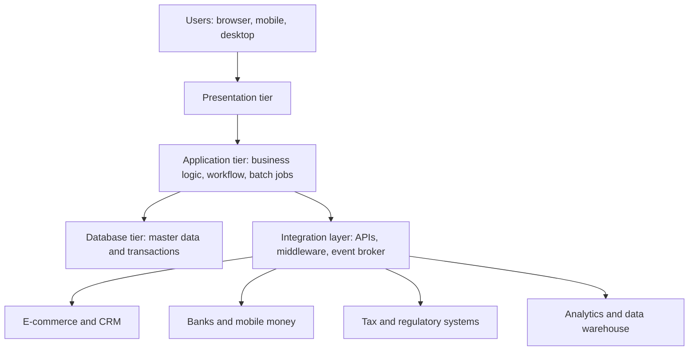

## Introduction

The previous lesson explained what an ERP does for the business: it runs finance, sales, procurement, inventory, production and human resources from shared data. This lesson looks under the bonnet. How is an ERP system actually put together, where does its data live, how does it talk to other systems, and where is it hosted? These questions matter because architecture decisions are expensive to reverse. A business that chooses a heavily customised on-premise system in year one may find itself unable to take vendor upgrades in year five, while a business that moves too quickly to a cloud service may discover that its connectivity and compliance position cannot support it.

You will study ERP as a set of functional modules over a shared database, as a layered (tiered) application, and as one participant in a wider landscape of integrated systems. You will then compare configuration with customisation, and compare on-premise, cloud, software-as-a-service and hybrid deployment. The aim is to equip you to reason about an ERP landscape as an architect would, not merely to name its components.

## Learning Objectives

- Explain how ERP functional modules depend on a shared database and shared master data.
- Describe the presentation, application and database tiers of an ERP and the role of each.
- Compare integration approaches (point-to-point, middleware, API-based and event-driven) at the ERP boundary.
- Distinguish configuration, extension and customisation, and evaluate their effect on upgrades and cost.
- Evaluate on-premise, cloud, SaaS and hybrid deployment for an organisation in a Ghanaian context.

## Prerequisite Knowledge

- The lesson *Enterprise Resource Planning (ERP) Systems*, including modules, order-to-cash and procure-to-pay.
- Basic understanding of databases, networks and client-server computing.

## Key Terminology

- **Shared database**: A single logical data store that all ERP modules read and write, so that one transaction is visible everywhere.
- **Three-tier architecture**: A design that separates the presentation tier (user interface), the application tier (business logic) and the database tier (data storage).
- **Application server**: The software tier that executes business logic, enforces rules and mediates between users and the database.
- **Middleware**: Software that sits between systems and handles messaging, transformation and routing so that they need not connect directly to one another.
- **Enterprise application integration (EAI)**: The practice of linking enterprise applications so they exchange data and coordinate processes.
- **API (application programming interface)**: A defined way for one program to request data or actions from another.
- **Enterprise service bus (ESB)**: A central integration layer that routes and transforms messages between applications.
- **Configuration**: Adjusting the ERP through its built-in settings and parameters, without changing delivered program code.
- **Customisation**: Modifying delivered code or building bespoke programs inside the ERP core.
- **Extension**: Adding functionality outside the core, using supported interfaces, so the standard system remains unmodified.
- **Multi-tenancy**: A cloud design in which many customers share one running software platform while their data stays logically separate.
- **Hybrid deployment**: A mix of on-premise and cloud components, often with part of the ERP in the cloud and part retained locally.

## Detailed Explanation

### Modules over a shared database

An ERP is not one program but a family of functional modules (finance, procurement, sales, inventory, production, human resources) that are designed to work together. What makes them an ERP rather than a bundle of packages is a common data foundation. All modules draw on shared **master data**, such as the customer, supplier, material and chart-of-accounts records, and write **transactions** into the same database. When a warehouse clerk posts a goods receipt, the stock table is updated, the purchase order shows the item as received, and a ledger entry is created by the finance module. There is no overnight interface file and no re-keying.

This shared foundation has architectural consequences. First, data quality is a collective responsibility: a duplicated customer record damages sales, credit control and finance simultaneously. Second, modules cannot be installed in complete isolation, because later modules assume that earlier master data and organisational structures (company codes, plants, cost centres) exist. Third, the database becomes the most critical shared resource, so its performance, backup and security govern the whole business.

### The three tiers

Most ERP products follow a layered pattern that separates responsibilities.

**Presentation tier.** This is what users see: a desktop client, a web browser or a mobile application. It collects input and displays results but holds little business logic. Modern ERPs increasingly offer browser-based role-specific interfaces, which reduces the need to install and maintain software on every computer, a real advantage for organisations with many branches.

**Application tier.** Here the business logic runs: pricing rules, credit checks, three-way matching, workflow approvals, tax calculation and batch jobs such as payment runs. Application servers can be added horizontally to serve more users, and different servers can be dedicated to interactive work, background processing or integration, which improves performance and resilience.

**Database tier.** This stores master data, transactions and configuration. Traditional ERPs run on a relational database management system; some modern products use in-memory column-oriented databases to combine transaction processing and analysis. The database tier is usually the hardest to scale and the most important to protect.

Each tier can be scaled, secured and replaced independently, and network controls between tiers mean users never connect directly to the database.

### Integration at the ERP boundary

No ERP is an island. A typical organisation also uses an e-commerce site, a CRM, a warehouse scanner system, banking and payment interfaces, mobile money platforms, tax or revenue authority systems, and analytics tools. The ERP architecture must therefore define how data flows across its boundary. Four broad approaches exist.

1. **Point-to-point integration.** Each pair of systems is connected directly with a bespoke interface. It is quick for one or two connections, but the number of interfaces grows quickly as systems are added, and every change in one system can break several others.
2. **Middleware or integration platform.** A hub receives messages, transforms formats, routes them and handles errors. Each application connects once to the hub instead of to every other application, which reduces the number of connections and centralises monitoring. The enterprise service bus is a well-known form of this pattern.
3. **API-based integration.** Modern ERPs publish web APIs (commonly REST-style) so that other systems can read or write business objects such as sales orders in a controlled and documented way. APIs support both internal and partner integration and are the preferred route for extensions in cloud ERP.
4. **Event-driven integration.** The ERP publishes events (such as "order created" or "payment posted") to a message broker, and other systems subscribe to the events they care about. This decouples systems in time: a subscriber that is temporarily offline can catch up later.

Hohpe and Woolf (2003) catalogue reusable messaging patterns such as message translators, routers and guaranteed delivery. **Synchronous** calls (the sender waits for a reply) suit queries that need an immediate answer, such as a price lookup, while **asynchronous** messaging suits high-volume or failure-tolerant flows, such as posting thousands of retail sales to the ledger overnight. And any integration must plan for **failure**: what happens to a message that cannot be delivered, and who is alerted?

### Configuration, extension and customisation

ERP packages are built to be adapted, but the manner of adaptation determines long-term cost.

- **Configuration** uses the vendor's own settings: defining organisational units, pricing procedures, approval limits and tax codes. It is supported by the vendor and normally survives upgrades.
- **Extension** adds capability beside the core through published interfaces or a platform for add-ons. The core stays standard, so upgrades are rarely blocked.
- **Customisation** changes delivered code or inserts bespoke code into the core. It can fit a unique process exactly, but each change must be retested and often rewritten at every upgrade, and the knowledge of why it exists tends to leave with its developer.

The architectural rule of thumb is to prefer configuration, then extension, and customise the core only when the process is genuinely differentiating or required by law and no supported alternative exists. This links to Davenport's (1998) warning that an enterprise system carries embedded assumptions about how a business operates, and that forcing the system to match existing habits can be costly while ignoring real differences can be harmful. Cloud ERP strengthens the rule because the vendor upgrades all customers on a regular schedule, so heavy customisation is often technically restricted.

### Deployment models

| Model | Where it runs | Who manages the platform | Typical strengths | Typical concerns |
|---|---|---|---|---|
| On-premise | Organisation's own data centre or server room | Organisation | Maximum control, deep customisation, local data residency | Capital cost, power and cooling, skills, patching and disaster recovery fall on the organisation |
| Hosted / private cloud | Provider's infrastructure, dedicated to one customer | Shared | Offloads hardware, retains much control | Still requires application management and upgrades |
| Public cloud (IaaS) | Organisation's ERP installed on rented cloud infrastructure | Shared (provider manages hardware) | Elastic capacity, no hardware purchase | Organisation still administers the ERP software |
| SaaS | Vendor-operated multi-tenant service | Vendor | Fast start, subscription cost, automatic updates | Limited customisation, dependence on internet and vendor, data residency questions |
| Hybrid | Part cloud, part on-premise | Shared | Gradual migration, keeps sensitive or specialised processes local | Added integration complexity and two operating models |

NIST's definition of cloud computing (Mell & Grance, 2011) distinguishes the service models infrastructure, platform and software as a service, and this vocabulary is useful for placing ERP offerings. The choice is rarely purely technical. It depends on connectivity, the cost of skilled staff, regulatory expectations about data, risk appetite, and how standard the organisation's processes are.

## Theories, Frameworks and Models

**Hub-and-spoke versus mesh.** For n systems, a point-to-point mesh can require up to n(n-1)/2 interfaces, whereas a hub needs about n connections. With 10 systems that is 45 against 10. The calculation is simple, but it explains why growing organisations migrate to an integration platform.

**Total cost of ownership (TCO).** Comparing deployment models requires counting more than licence or subscription fees: infrastructure, staffing, upgrades, integration, training, downtime and exit costs. On-premise often looks cheaper on a price list and dearer once hidden operating costs are included, but the reverse can be true for stable, well-run environments.

## Step-by-Step Guide

Choosing a deployment and integration approach can be structured as follows.

1. **Inventory processes and systems.** List the processes to be supported and the systems the ERP must exchange data with.
2. **Classify processes.** Mark each as commodity (payables, payroll), differentiating, or legally constrained. This drives the configuration versus customisation decision.
3. **Assess constraints.** Examine connectivity reliability, power stability, available IT skills, budget profile (capital versus operating), and regulatory expectations for data handling.
4. **Shortlist deployment options.** Compare SaaS, hosted, public-cloud and on-premise or hybrid options against the constraints and the TCO.
5. **Design integration.** Decide which interfaces use APIs, which require middleware, and which events should be broadcast. Specify error handling and monitoring.
6. **Document governance.** Record who may approve a customisation, how upgrades are tested, and how exit from the vendor would be handled.

## Ghanaian Business Application

**Illustrative scenario.** *Savannah Agro Supplies* (fictional) distributes farm inputs from a head office in Kumasi to eight depots in the northern regions. Its management wants a single view of stock and receivables. Branch internet connections are intermittent, and the IT team has three staff.

A full on-premise ERP would require a server room with stable power and cooling at head office and strong in-house skills to manage the database, backups and upgrades. A SaaS ERP would remove most of that burden, but depots with unreliable links could lose access during outages. A sensible architecture could be a cloud or hosted ERP at the centre with a lightweight offline-capable sales and stock application at each depot that synchronises when connected, reflecting the asynchronous integration approach described above. Mobile money payments from customers would reach the ERP through an API-based or middleware connection to the payment provider, with a reconciliation job to match payments to open invoices. The company would keep customisation low, configuring agricultural pricing and seasonal credit terms through standard settings and building depot screens as extensions.

Customer and employee records are personal data, so provider choice is partly a legal and risk decision: the company must consider where data is stored and how access is controlled.

## International Case Study

**Nestlé's global ERP harmonisation.** Nestlé, the Swiss food and beverage group, undertook a large programme in the late 1990s and early 2000s to standardise its business processes and systems on SAP. The widely reported background was that the company had operated through highly autonomous national and brand units, each with its own systems, processes and local names and prices for the same suppliers and products. Management wanted common procurement and shared data so that the group could negotiate with suppliers as a whole.

Published accounts highlight an organisational lesson rather than a purely technical one. A shared database and common modules only deliver value when master data and processes are actually harmonised. Reports describe how the group had to agree standard definitions of products, suppliers and materials, and how change management was heavy because local units gave up long-standing ways of working. An ERP architecture that centralises data also centralises decisions about data, with human and political costs. Figures on cost and timelines vary between sources, so verify any you meet against primary disclosures.

## Diagram

## Common Misconceptions

- "A shared database means one big table." The database is logically shared but contains many structured tables linked by keys and organisational structures. The correction is that integration comes from common data definitions, not from storing everything together.
- "Cloud ERP means the vendor is responsible for everything." The vendor operates the platform, but the customer remains responsible for its own data quality, user access, process design and compliance obligations.
- "Customisation is always bad." Customisation is risky and costly, but a differentiating or legally required process may justify it. The correction is to require a business case and to prefer extensions outside the core.
- "Three tiers means three servers." Tiers are logical separations. They may run on separate machines, on one machine, or on virtualised or cloud resources.

## Common Examination Mistakes

- Listing modules without explaining the shared database that makes them an ERP.
- Describing the three tiers as physical computers rather than logical layers with distinct responsibilities.
- Confusing configuration (using built-in settings) with customisation (changing code).
- Recommending SaaS or on-premise without referring to the organisation's connectivity, skills, budget and regulatory context.
- Giving integration answers that name technologies but never discuss failure handling, monitoring or data ownership.
- Treating hybrid as a single model rather than a mix that adds integration complexity.

## Critical Thinking Questions

1. A vendor offers a SaaS ERP that allows no changes to the core. Under what circumstances would that restriction be an advantage, and when would it be a serious limitation?
2. How does the choice between synchronous and asynchronous integration affect user experience and business risk for a retailer posting daily sales?
3. Who should own master data in an ERP shared by finance, sales and procurement, and how should disputes be resolved?
4. In what ways does moving from on-premise to SaaS shift risk rather than remove it?

## Practical Exercises

1. Draw a three-tier diagram for a fictional mid-sized Ghanaian distributor, labelling what runs in each tier, where firewalls sit, and where backups are stored. Expected output: a labelled diagram with a one-paragraph justification.
2. Classify ten business processes of a company you know as commodity, differentiating or legally constrained, and decide for each whether to configure, extend or customise. Expected output: a table with a justification for each row.
3. Prepare a one-page deployment recommendation (on-premise, SaaS or hybrid) for the *Savannah Agro Supplies* scenario that addresses connectivity, skills, cost and data protection. Expected output: a structured recommendation with at least three explicit trade-offs.

## Key Takeaways

- An ERP is a family of modules over a shared database and shared master data; integration comes from that shared foundation.
- The presentation, application and database tiers separate responsibilities and let each be scaled, secured and changed independently.
- Integration approaches range from point-to-point to middleware, APIs and events; the right choice depends on the number of systems, volumes and failure tolerance.
- Prefer configuration, then extension, and customise the core only when justified; customisation raises upgrade cost.
- On-premise, hosted, cloud, SaaS and hybrid deployment each shift cost, control and risk, and the best choice depends on the organisation's context.

## Further Reading

- Davenport, T. H. (1998). Putting the enterprise into the enterprise system. *Harvard Business Review, 76*(4), 121-131.
- Hohpe, G., & Woolf, B. (2003). *Enterprise integration patterns: Designing, building, and deploying messaging solutions*. Addison-Wesley.
- Mell, P., & Grance, T. (2011). *The NIST definition of cloud computing* (NIST Special Publication 800-145). National Institute of Standards and Technology. <https://csrc.nist.gov/pubs/sp/800/145/final>

## Video Resources

- [SAP Learning](https://learning.sap.com/): SAP. Official learning portal with free introductory material on SAP enterprise architecture and deployment.
- [Microsoft Learn](https://learn.microsoft.com/en-us/training/): Microsoft. Official training portal with modules on Dynamics 365 and cloud architecture.

## Revision Summary

An ERP is a set of integrated functional modules running over a shared database and shared master data, usually organised in presentation, application and database tiers. It connects to other systems through point-to-point links, middleware, APIs or events, and good designs plan for failure and monitoring. Adaptation should favour configuration and extension over customisation of the core, because customisation increases upgrade cost. Deployment may be on-premise, hosted, public cloud, SaaS or hybrid, and the best choice reflects connectivity, skills, cost and regulatory context.

- Modules are integrated by shared data, so data quality is a collective responsibility.
- Tiers are logical layers, not necessarily separate machines.
- Hub designs reduce interface count compared with a mesh.
- Configure first, extend second, customise last.
- SaaS shifts, rather than removes, responsibility.
- Hybrid adds integration complexity.
