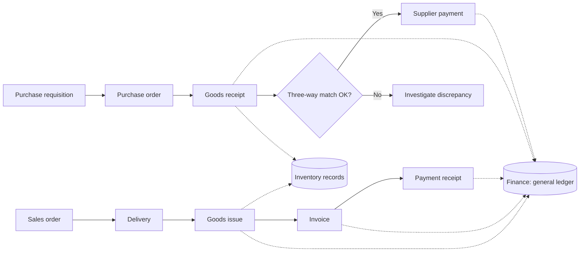

## Introduction

Enterprise resource planning (ERP) systems are the most widely discussed type of enterprise system. They promise that sales, purchasing, inventory, production, finance and human resources can be run from one integrated suite, so that a single transaction updates every relevant record and managers can see the state of the business at any moment. For organisations that have grown on spreadsheets and disconnected packages, that promise is compelling. Yet ERP projects are also notorious for overruns and occasionally for spectacular failures, often because organisations underestimate how much an ERP changes the way people work.

This lesson explains what ERP is, how its modules fit together, and how two of the most important cross-functional processes, **order-to-cash** and **procure-to-pay**, run through an ERP. You will examine the idea of **best-practice processes** embedded in ERP packages and evaluate when an organisation should adapt to the package and when it should customise. The lesson ends with a well-documented international case, Hershey's 1999 ERP go-live, which illustrates how timing and cutover decisions can determine success.

## Learning Objectives

- Define ERP and explain how its integrated modules share data through a common database.
- Describe the main ERP modules and the business functions each supports.
- Trace the order-to-cash and procure-to-pay processes through the documents and postings an ERP creates.
- Evaluate the trade-off between adopting embedded best-practice processes and customising an ERP.
- Analyse the causes of ERP implementation difficulties using a documented case.

## Prerequisite Knowledge

- The module *Enterprise Systems Foundations*, particularly integration and the transaction processing cycle.
- Basic understanding of accounting entries such as receivables, payables and inventory.

## Key Terminology

- **Enterprise resource planning (ERP)**: An integrated software suite that supports an organisation's core processes across finance, supply chain, operations and human resources using a common database.
- **Module**: A functional component of an ERP, such as finance, sales and distribution or materials management, which shares data with other modules.
- **Order-to-cash (O2C)**: The end-to-end process from receiving a customer order to receiving payment.
- **Procure-to-pay (P2P)**: The end-to-end process from identifying a purchasing need to paying the supplier.
- **Three-way match**: A control that compares the purchase order, goods receipt and supplier invoice before payment is approved.
- **Best-practice process**: A standard process design embedded in an ERP package, reflecting the vendor's view of effective practice across many customers.
- **Configuration**: Setting up an ERP using its built-in options and parameters without changing its program code.
- **Customisation**: Changing or extending an ERP's code or adding bespoke programs to meet requirements the standard package does not support.
- **Master data**: Relatively stable reference data (customers, suppliers, materials, chart of accounts) used by many transactions.

## Detailed Explanation

### What ERP does

An ERP system is built around a single logical database and a set of modules that read and write to it. Because modules share data, a transaction recorded in one module automatically has consequences in others. Posting a goods receipt in the inventory module, for example, increases stock quantity and value, updates the purchase order's status and creates an accounting entry, all in one step. This is what distinguishes ERP from a collection of separate packages linked by interfaces.

ERP vendors range from large global suites, such as SAP S/4HANA and Oracle's cloud ERP, through mid-market products such as Microsoft Dynamics 365, to open-source and SME-oriented systems such as Odoo. The principles in this lesson apply across them, although terminology differs.

### Typical ERP modules

| Module | Main functions | Key data |
|---|---|---|
| Financial accounting | General ledger, receivables, payables, assets, financial statements | Chart of accounts, journal entries |
| Management accounting / controlling | Cost centres, product costing, profitability analysis, budgets | Cost centres, internal orders |
| Sales and distribution | Quotations, sales orders, pricing, delivery, billing | Customers, price lists |
| Materials management / procurement | Purchase requisitions, purchase orders, goods receipt, invoice verification | Suppliers, materials |
| Inventory and warehouse | Stock levels, batches, expiry, transfers, stock counts | Storage locations, batches |
| Production planning | Bills of materials, routings, production orders, material requirements planning | Bills of materials, work centres |
| Human capital management | Employee records, payroll, leave, organisational structure | Employees, positions |

In SAP's traditional terminology these appear as modules such as FI (financial accounting), CO (controlling), SD (sales and distribution), MM (materials management) and PP (production planning). Newer products describe them as business areas or applications, but the integration logic is the same.

### Order-to-cash through an ERP

1. **Customer enquiry and quotation** (sales): price determined from master data and pricing rules.
2. **Sales order** (sales): the system checks stock availability and the customer's credit limit.
3. **Delivery and picking** (inventory/warehouse): stock is reserved, picked and packed.
4. **Goods issue** (inventory): stock quantity falls; finance automatically records cost of goods sold and reduces inventory value.
5. **Billing / invoice** (sales and finance): an invoice is created and a receivable posted to the customer's account.
6. **Payment receipt** (finance): incoming payment, for example by bank transfer or mobile money, is matched to the open invoice and the receivable is cleared.

Each step creates a document linked to the previous one, giving a **document flow** that any authorised user can trace from quotation to payment.

### Procure-to-pay through an ERP

1. **Purchase requisition**: a department records a need.
2. **Approval and source selection**: the requisition is approved according to rules and a supplier is selected.
3. **Purchase order**: sent to the supplier; creates a commitment against budget.
4. **Goods receipt**: stock and the goods-received/invoice-received clearing account are updated.
5. **Invoice verification**: the system performs a three-way match of order, receipt and invoice within tolerances.
6. **Payment**: approved invoices are paid in a payment run and the payable is cleared.

The three-way match is a powerful control: it prevents paying for goods never ordered or never received, and it is precisely the control that Ford's famous re-engineering used in a new way (see the module on business process re-engineering).

### Best practice versus customisation

ERP packages embed **best-practice processes**: standard designs the vendor has refined across many customers. Vendors increasingly encourage a **fit-to-standard** approach, for example in SAP's Activate implementation methodology, in which the organisation reviews the standard processes and adopts them unless there is a strong reason not to.

Arguments for adopting standard processes:

- lower implementation cost and risk;
- easier upgrades, especially for cloud ERP where vendors update the software regularly;
- access to proven controls and integration;
- an opportunity to abandon inefficient legacy habits.

Arguments for customisation:

- a process is a genuine source of competitive advantage (Davenport's warning that standardisation can erode differentiation);
- local legal, tax or industry requirements are not supported;
- the standard process conflicts with critical customer relationships.

A useful rule is to **standardise commodity processes** (payroll, accounts payable, general ledger) and **consider differentiation only where it creates real customer or strategic value**. Even then, extensions built outside the core, through configuration, add-ons or APIs, are usually preferable to modifying the core code.

## Theories, Frameworks and Models

### ERP deployment models

The way an ERP is deployed shapes cost, control and the scope for customisation.

| Model | Description | Typical implications |
|---|---|---|
| On-premise | The organisation licenses the software and runs it on its own servers | Maximum control and scope for modification; the organisation bears infrastructure, security and upgrade effort |
| Hosted / private cloud | The software runs on infrastructure managed by a provider, but each customer has its own instance | Less infrastructure work; upgrades still planned per customer |
| Public cloud (SaaS) | Customers share a vendor-operated multi-tenant service and pay a subscription | Rapid deployment and regular vendor updates; customisation largely limited to configuration and extensions |

Cloud ERP strengthens the case for fit-to-standard, because modifications to a shared service are restricted and every vendor release must work with the customer's configuration.

### Two-tier ERP

Large groups sometimes run a **two-tier ERP** strategy: a comprehensive ERP at head office for consolidation and group finance, and a lighter, cheaper ERP in small subsidiaries or branches, integrated so that subsidiary results flow into group reporting. For a multinational with a small Ghanaian subsidiary, this can balance group control against local cost and simplicity, provided master data such as the chart of accounts is aligned across both tiers.

### Why ERP benefits take time

Benefits from ERP rarely appear at go-live. Organisations often experience a temporary dip in performance while users learn new processes and data problems surface; benefits such as faster closing, lower inventory and better visibility typically emerge only after stabilisation and continued process improvement. This is one reason post-implementation evaluation is treated as a distinct stage later in this course.

## Worked Example

**Illustrative scenario.** *Asante Health Pharmacy* is a hypothetical chain of five pharmacies in Kumasi implementing an SME ERP. Trace a sale of 20 boxes of an antimalarial to a clinic on credit, and identify the integration effects.

| Step | ERP document | Module | Automatic effect elsewhere |
|---|---|---|---|
| 1 | Sales order for 20 boxes | Sales | Availability check reserves 20 boxes from a batch with acceptable expiry; credit check against clinic's limit |
| 2 | Delivery note | Inventory | Picking list generated using first-expiry, first-out rule |
| 3 | Goods issue | Inventory | Stock falls by 20; cost of goods sold debited and inventory credited in finance |
| 4 | Invoice | Sales/Finance | Receivable created for the clinic; VAT and levies calculated per configured tax codes |
| 5 | Mobile money receipt | Finance | Receipt matched to invoice by reference; receivable cleared |

**Analysis.** Before the ERP, steps 1 to 5 involved three separate records and a weekly reconciliation. With the ERP, batch and expiry data travel with the stock movement, the finance entries are created automatically, and the managing pharmacist can see outstanding receivables per clinic in real time. The design decision left to the pharmacy is which credit and expiry rules to configure, not how to code the integration.

## International Case Study

### Hershey's 1999 ERP go-live

Hershey Foods, the United States confectionery manufacturer, undertook a major programme in the late 1990s to replace legacy systems with an integrated set of packages: SAP R/3 for core ERP, Manugistics for supply-chain planning and Siebel for customer relationship management. The company switched over to the new systems in mid-1999, using a largely simultaneous cutover of many functions. In the following months Hershey experienced well-publicised problems processing and shipping orders during its peak season for Halloween, and it reported that these difficulties affected sales and earnings.

Analyses of the case commonly highlight several factors: the timing of go-live shortly before the busiest season of the year, the decision to switch on several large, interdependent systems at once, and pressure on the project schedule that is reported to have reduced testing time. Hershey subsequently stabilised the systems. The case teaches that ERP risk lies as much in implementation decisions (scope, sequencing, testing and timing) as in the software itself, a theme explored further in the module on enterprise implementation.

## Diagram

## Common Misconceptions

- **"ERP is an accounting system."** Finance is central, but ERP covers sales, procurement, inventory, production and HR; the value lies in integrating them.
- **"Best-practice processes are always best for every organisation."** They are good, proven defaults; where a process genuinely differentiates the firm, alternatives may be justified.
- **"Configuration and customisation are the same thing."** Configuration uses built-in settings and survives upgrades; customisation changes or adds code and increases cost and upgrade risk.
- **"Once the ERP is live, the project is over."** Stabilisation, continuous improvement, upgrades and user support continue long after go-live.

## Common Examination Mistakes

- Listing ERP modules without explaining how a transaction in one module updates others.
- Omitting the three-way match when describing procure-to-pay.
- Arguing for heavy customisation without weighing upgrade, cost and risk implications.
- Describing the Hershey case only as "a software failure" rather than analysing scope, timing and testing.
- Confusing master data with transaction data.

## Critical Thinking Questions

1. Should a Ghanaian pharmacy chain customise its ERP to support informal credit arrangements with long-standing clinic customers, or redesign those arrangements? What evidence would you need?
2. Cloud ERP vendors update their software frequently. How does this change the balance between best practice and customisation?
3. If Hershey had gone live at a quieter time of year, would the underlying risks have disappeared? Explain.
4. In what sense does an ERP's document flow support auditing and fraud prevention, and what new risks might integration create?

## Practical Exercises

1. **Trace order-to-cash.** Using SAP Learning (<https://learning.sap.com/>), find an introductory learning journey on SAP S/4HANA sales or finance. *Expected output:* a table listing each document in the order-to-cash flow, the module that creates it and its accounting effect.
2. **Design a three-way match rule.** For a hospital buying surgical gloves, specify the tolerances (quantity and price) you would allow before blocking an invoice. *Expected output:* a short rule specification with a justification for each tolerance.
3. **Fit-to-standard assessment.** List eight processes at an organisation you know and classify each as "adopt standard" or "consider differentiation". *Expected output:* a classified list with a one-sentence reason per process.
4. **Explore an SME ERP.** Read the introductory pages of the Odoo documentation (<https://www.odoo.com/documentation/>) for its Sales or Inventory application. *Expected output:* a half-page comparison of how an SME ERP and a large ERP describe the same process.

## Key Takeaways

- ERP integrates core functions through modules that share a common database, so one transaction updates many records.
- Order-to-cash and procure-to-pay are the classic cross-functional ERP processes, each with a traceable document flow.
- The three-way match is a key ERP control in procure-to-pay.
- Adopt standard best-practice processes for commodity activities; consider differentiation only where it creates strategic value, preferably without modifying core code.
- ERP risk lies largely in implementation decisions, as the Hershey case shows.

## Further Reading

- Monk, E., & Wagner, B. (2013). *Concepts in enterprise resource planning* (4th ed.). Cengage Learning.
- Davenport, T. H. (1998). Putting the enterprise into the enterprise system. *Harvard Business Review, 76*(4), 121–131.
- IBM. (n.d.). *What is enterprise resource planning (ERP)?* IBM Think. <https://www.ibm.com/think/topics/enterprise-resource-planning>
- Odoo. (n.d.). *Odoo documentation*. <https://www.odoo.com/documentation/>

## Video Resources

- [SAP Learning](https://learning.sap.com/) — SAP. Free learning journeys introducing SAP S/4HANA business processes, including order-to-cash and procure-to-pay.
- [Microsoft Learn: Dynamics 365](https://learn.microsoft.com/en-us/dynamics365/) — Microsoft. Official documentation and training modules for Microsoft's ERP and CRM applications.

## Revision Summary

ERP systems integrate finance, sales, procurement, inventory, production and HR through modules sharing one database. Order-to-cash runs from sales order through delivery, goods issue and invoice to payment; procure-to-pay runs from requisition through purchase order and goods receipt to a three-way match and payment. Packages embed best-practice processes; adopt them for commodity processes and differentiate selectively. Hershey's 1999 go-live shows that scope, timing and testing drive ERP risk.

- One transaction, many updates: the essence of ERP integration.
- O2C: order → delivery → goods issue → invoice → payment.
- P2P: requisition → PO → goods receipt → three-way match → payment.
- Configuration survives upgrades; customisation adds cost and risk.
- Fit-to-standard: adopt unless there is strategic reason not to.
