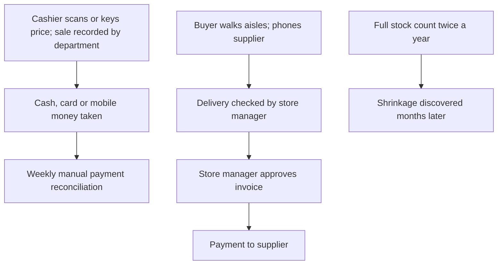
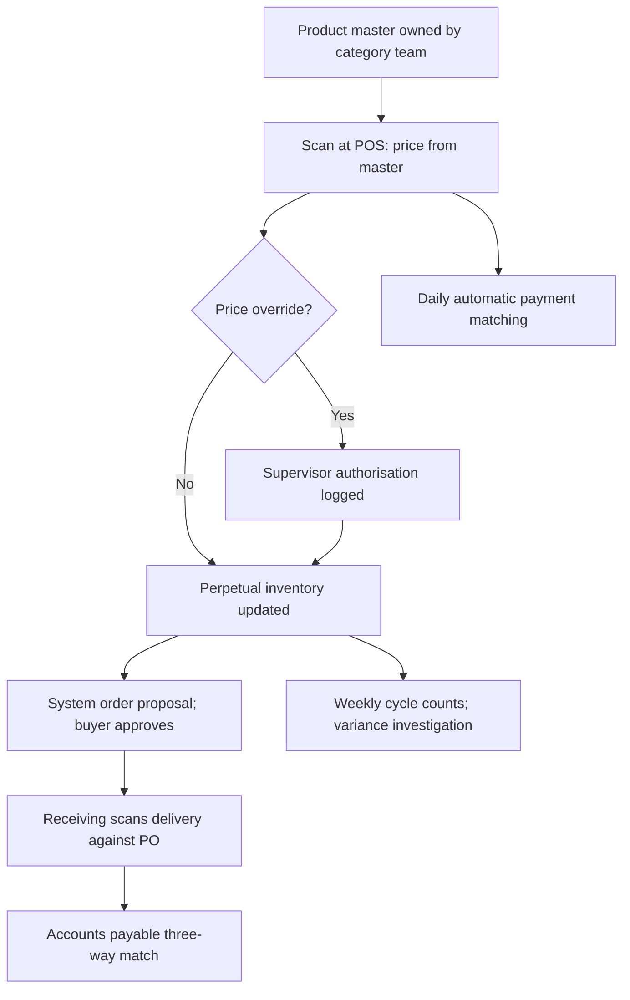
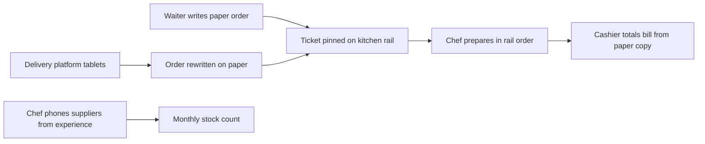
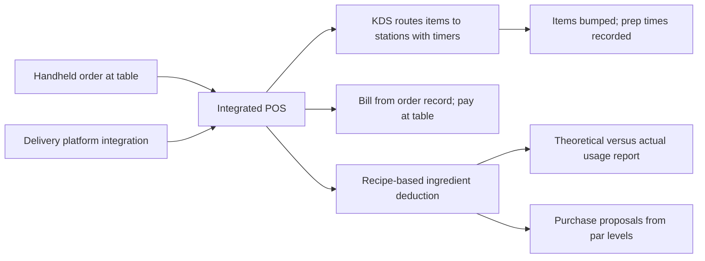

## Introduction

Retail and hospitality businesses live on thin margins and fast-moving stock. A supermarket may carry thousands of product lines, many perishable, sold in high volumes through several tills. A restaurant converts raw ingredients into dishes within minutes, under pressure, while customers wait. In both, the gap between what the system says and what is physically on the shelf or in the kitchen determines profitability: shrinkage, waste, stock-outs and slow service all erode margin.

This lesson applies the six-step case method from the previous lesson to two illustrative Ghanaian businesses: a supermarket with point of sale (POS) and inventory, and a restaurant with ordering and kitchen management. For each you will analyse the as-is process and its weaknesses, compare as-is and to-be diagrams, specify supporting technology, define KPIs, and plan for risks and change. A widely reported international retail failure shows how inventory data quality can undermine an entire market entry.

## Learning Objectives

- Analyse as-is supermarket and restaurant processes to identify shrinkage, waste, delay and control weaknesses.
- Apply redesign principles to create to-be processes integrating POS, inventory, procurement and kitchen operations.
- Specify enterprise technology components such as barcode-based POS, perpetual inventory, recipe-based stock deduction and kitchen display systems.
- Calculate and interpret retail and restaurant KPIs, including shrinkage rate and food cost percentage.
- Evaluate implementation risks and change-management needs in high-pressure frontline environments.

## Prerequisite Knowledge

- The six-step case method from the Pharmacy ERP and Hospital Management Systems lesson.
- KPI calculation (gross margin, stock turnover) from the Business Intelligence lesson.
- Data migration and master data quality concepts.

## Key Terminology

- **Point of sale (POS)**: The system and devices at which sales are recorded and payments taken, ideally integrated with inventory and finance.
- **Perpetual inventory**: An inventory method in which every receipt, sale, transfer and adjustment updates stock records in real time.
- **Shrinkage**: Loss of inventory through theft, damage, spoilage or administrative error, measured as the gap between recorded and physical stock.
- **Cycle counting**: Counting a subset of products regularly, rather than all stock at once, to maintain inventory accuracy.
- **Recipe (bill of materials)**: The list of ingredients and quantities that make up a menu item, used to deduct stock when the item is sold.
- **Kitchen display system (KDS)**: Screens in the kitchen that receive orders from POS or waiter devices, route them to stations and track preparation times.
- **Food cost percentage**: The cost of ingredients used divided by food sales revenue, a core restaurant profitability measure.
- **Product master data**: The authoritative record for each product, including barcode, description, unit of measure, supplier, cost and price.

## Case A: A Supermarket with POS and Inventory (Illustrative scenario)

### As-is process

*Illustrative scenario.* "MarketPlus" is a two-branch supermarket in Accra and Tema. Each branch has five tills running basic cash-register software that records sales by department (for example, "groceries", "toiletries") but not by individual product. Prices are on shelf labels; cashiers sometimes key prices manually when barcodes fail. Stock is counted fully twice a year. Buyers reorder by walking the aisles and calling suppliers. Deliveries are checked against delivery notes by the store manager, who also approves supplier invoices. Mobile money and card payments are reconciled to bank statements by hand weekly.

### Weaknesses

- **No product-level sales data**: buyers cannot see what sells, so slow lines accumulate and popular lines run out.
- **High, invisible shrinkage**: with only twice-yearly counts, losses from theft, spoilage and errors are discovered months later and cannot be traced.
- **Pricing errors**: manual price entry causes under-charging and over-charging, harming margin and trust.
- **Perishables waste**: no expiry tracking for dairy, bakery and produce.
- **Control weakness**: the store manager both receives goods and approves invoices.
- **Slow reconciliation**: weekly manual matching of electronic payments delays the detection of errors.

### Redesigned process

1. A product master is built with a unique barcode, unit of measure, supplier, cost and price for every line, owned by a head office category team.
2. Every sale is scanned at product level; prices come only from the master, and manual price override requires a supervisor's authorisation, which is logged.
3. Perpetual inventory updates with each sale, receipt, transfer and write-off.
4. The system proposes orders from minimum and maximum stock levels and sales velocity; buyers review and approve.
5. Receiving staff scan deliveries against the purchase order; discrepancies are recorded; the three-way match is performed by accounts payable, not the store manager.
6. Cycle counts of high-risk categories (for example, spirits, toiletries, mobile phone vouchers) run weekly; variances above a tolerance are investigated.
7. Electronic payments are matched daily through payment provider interfaces.

### Enabling technology

A retail ERP or POS-plus-ERP combination with product-level POS, barcode scanners and scales, perpetual multi-branch inventory, replenishment, purchasing, accounts payable and BI. Handheld scanners support receiving and cycle counting. GS1 barcodes provide global product identifiers; locally packed goods receive internal codes. Offline POS mode protects trading during network outages.

### Worked KPI example

*Illustrative figures.* After go-live, a cycle count of the toiletries category finds physical stock at cost of GHS 46,500 against a system value of GHS 48,000.

- **Shrinkage** = `48,000 − 46,500 = GHS 1,500`.
- **Shrinkage rate** = `1,500 / 48,000 = 3.1%` of the category's recorded stock value.

Because counts now run weekly by category, the loss can be located in time and place, and investigated (for example, by reviewing voids and price overrides by till). Other KPIs include stock-out rate on top-selling lines, perishables write-off as a share of perishables sales, price override rate per cashier, and inventory record accuracy.

### Risks and change management

The biggest risk is **master data quality**: thousands of products must be set up accurately with correct barcodes, units and prices before go-live. Others include cashier resistance to stricter override controls, queue delays during the first weeks, and supplier non-compliance with barcode standards. Mitigation includes a dedicated data team, a full mock trading day before go-live, extra cashiers and floor supervisors in the first fortnight, and transparent communication that override logging protects honest staff.

## Case B: A Restaurant with Ordering and Kitchen Management (Illustrative scenario)

### As-is process

*Illustrative scenario.* "Chop Bar Royale" is a busy restaurant in Osu, Accra, serving dine-in, takeaway and delivery-platform orders. Waiters write orders on paper pads and carry them to the kitchen, where tickets are pinned to a rail. Delivery orders arrive on a separate tablet for each platform and are re-written onto paper. The cashier totals bills from the paper copies. The chef orders ingredients by phone based on experience, and stock is counted monthly.

### Weaknesses

- **Lost and misread tickets**: handwriting causes wrong dishes and remakes; tickets are lost at peak times.
- **No sequencing**: the kitchen cannot see order age or prioritise; dishes for the same table are not synchronised.
- **Re-keying from delivery tablets**: delays and errors on delivery orders.
- **Unbilled items**: dishes served but not written on the bill leak revenue.
- **No food cost control**: ingredient usage is not linked to sales, so waste and theft are invisible.

### Redesigned process

1. Waiters enter orders on handheld devices at the table; delivery-platform orders flow into the same POS through integrations.
2. The POS routes each item to the right KDS station (grill, soups, drinks), showing order age, table and modifiers, with colour changes when target preparation times are exceeded.
3. The KDS coordinates "fire" timing so dishes for one table are ready together; cooks bump items when complete, recording preparation times.
4. Bills are generated from the order record, so every item ordered is billed; payment by card or mobile money is taken at the table.
5. Each sale deducts ingredients using recipes; the system compares theoretical usage with actual usage from weekly counts.
6. Purchase proposals are generated from par levels and forecast covers, approved by the manager.

### Worked KPI example

*Illustrative figures.* In a week, food sales are GHS 60,000. Opening ingredient stock was GHS 12,000, purchases were GHS 20,000 and closing stock is GHS 11,000.

- **Actual food cost** = `opening + purchases − closing = 12,000 + 20,000 − 11,000 = GHS 21,000`.
- **Actual food cost %** = `21,000 / 60,000 = 35%`.
- Recipe-based **theoretical food cost** for the dishes sold is GHS 18,600, or `18,600 / 60,000 = 31%`.
- **Variance** = `21,000 − 18,600 = GHS 2,400` (4 percentage points), indicating waste, over-portioning, unrecorded staff meals or theft to be investigated.

Other KPIs include average ticket time per station, remake rate, table turn time, and delivery order acceptance-to-dispatch time.

### Risks and change management

Risks include Wi-Fi failures in the kitchen, staff resistance from experienced cooks used to paper, inaccurate recipes that make theoretical cost meaningless, and dependence on delivery-platform integrations that may change. Mitigation includes a resilient local network with a fallback printer, involving the head chef in recipe costing, training during quieter periods, and ADKAR-based coaching that demonstrates how the KDS reduces shouting and remakes.

## Comparing the Two Cases

Although a supermarket and a restaurant look different, the analysis reveals the same underlying pattern:

| Dimension | Supermarket (MarketPlus) | Restaurant (Chop Bar Royale) |
|---|---|---|
| Core data foundation | Product master with barcodes, units and prices | Menu items with accurate recipes and ingredient costs |
| Capture at source | Product-level scanning at the till | Handheld ordering at the table and integrated delivery orders |
| Main control | Override authorisation, cycle counts, independent three-way match | Billing from the order record, theoretical versus actual usage |
| Main performance lever | Replenishment from sales velocity | Station routing and synchronised preparation on the KDS |
| Critical KPI | Shrinkage rate and stock-out rate | Food cost variance and ticket time |
| Main adoption risk | Cashiers and receiving staff under time pressure | Experienced cooks used to paper tickets |

In both cases the technology succeeds only if the data foundation is accurate and frontline staff accept the new routines during peak trading. This is why the redesign begins with master data and recipes, why go-live is planned for a quieter period, and why the change plan concentrates on supervisors who can coach staff on the floor. Students should notice that the controls in each redesign come from process design (who can override, who matches invoices, what is billed from which record), with technology enforcing and recording them.

## International Case Study: Target's Canadian Expansion

Target Corporation, the US retailer, opened its first stores in Canada in 2013, expanding rapidly to well over a hundred locations. Shoppers widely reported empty shelves while distribution centres held excess stock of some lines. Detailed press accounts afterwards described serious problems with supply chain processes and with the quality of product data entered into new enterprise systems, such as incorrect dimensions, units and supplier details, which disrupted replenishment. In January 2015 Target announced that it would close its Canadian operations.

The case shows that in retail, the product master is the foundation of every process in the to-be design: replenishment, receiving, pricing and analytics all fail when item data is wrong. It also shows the danger of opening many stores at once on new systems without stabilising data and processes at a smaller scale first.

## Common Misconceptions

- "A modern POS automatically controls shrinkage." Correction: controls come from process design, including override authorisation, cycle counts and investigation of variances.
- "Recipe-based costing is only for large chains." Correction: even a single restaurant benefits from comparing theoretical and actual food cost.
- "Kitchen display systems simply replace paper." Correction: their value lies in routing, timing, synchronisation and performance data, which paper cannot provide.

## Common Examination Mistakes

- Describing technology features without linking them to diagnosed weaknesses.
- Omitting master data and recipe accuracy as preconditions for the redesign.
- Calculating KPIs without interpreting variances.
- Ignoring frontline staff experience and peak-time pressures in change plans.

## Critical Thinking Questions

1. How far should a supermarket rely on automated replenishment rather than buyers' judgement for fresh produce?
2. Could stricter price-override controls damage customer service? How would you balance control and speed at the till?
3. What does a persistent gap between theoretical and actual food cost tell a restaurant owner, and what would you investigate first?
4. Which lessons from Target Canada apply to a two-branch Ghanaian supermarket?

## Practical Exercises

1. **BPMN in Camunda Modeler or Bizagi Modeler.** Model MarketPlus's to-be receiving process with pools for supplier and supermarket, lanes for receiving clerk and accounts payable, and a gateway for quantity discrepancies. Expected output: a BPMN diagram with message flows and an exception path.
2. **Restaurant redesign.** Produce a table listing each as-is weakness at Chop Bar Royale, the redesign step that addresses it and the KPI that will show improvement. Expected output: a three-column traceability table.
3. **Food cost calculation.** Food sales are GHS 45,000, opening stock GHS 9,000, purchases GHS 16,000, closing stock GHS 8,500 and theoretical cost GHS 14,400. Expected output: actual food cost, actual and theoretical percentages, variance and a short interpretation.
4. **SAP Learning activity.** On SAP Learning, explore free material on retail or inventory management processes. Expected output: a 200-word note on how perpetual inventory and cycle counting are supported.

## Key Takeaways

- In retail and hospitality, process redesign rests on accurate product master and recipe data.
- Product-level POS, perpetual inventory, cycle counts and override controls make shrinkage visible and manageable.
- KDS and integrated ordering remove re-keying, synchronise preparation and generate performance data.
- Comparing theoretical with actual usage is a powerful control on waste and theft.
- Target Canada shows how item data quality failures can undermine an entire operation.

## Further Reading

- Dumas, M., La Rosa, M., Mendling, J., & Reijers, H. A. (2018). *Fundamentals of business process management* (2nd ed.). Springer.
- Monk, E., & Wagner, B. (2013). *Concepts in enterprise resource planning* (4th ed.). Cengage Learning.
- Kimball, R., & Ross, M. (2013). *The data warehouse toolkit: The definitive guide to dimensional modeling* (3rd ed.). Wiley.
- GS1. (n.d.). *GS1 standards*. <https://www.gs1.org/standards>

## Video Resources

- [SAP Learning](https://learning.sap.com/): SAP. Free learning journeys including inventory management and retail processes.
- [Bizagi](https://www.bizagi.com/): Bizagi. Official site for Bizagi Modeler, used for modelling as-is and to-be retail processes.
- [GS1 standards](https://www.gs1.org/standards): GS1. Official overview of barcode and product identification standards used in retail.

## Revision Summary

The illustrative supermarket lacks product-level sales data, has invisible shrinkage, manual pricing and weak receiving controls; the redesign uses a governed product master, product-level scanning, perpetual inventory, system order proposals, scanned receiving with independent three-way match, cycle counts and daily payment matching. The illustrative restaurant suffers from paper tickets, re-keyed delivery orders, unbilled items and no food cost control; the redesign uses handheld ordering, integrated delivery platforms, KDS routing and recipe-based stock deduction.

- Shrinkage rate = (system − physical) / system value.
- Food cost % = ingredient cost used / food sales.
- Theoretical versus actual usage exposes waste and theft.
- Price overrides need authorisation and logging.
- Master data and recipes are preconditions, not afterthoughts.
- Target Canada (2013-2015): item data problems emptied shelves.
