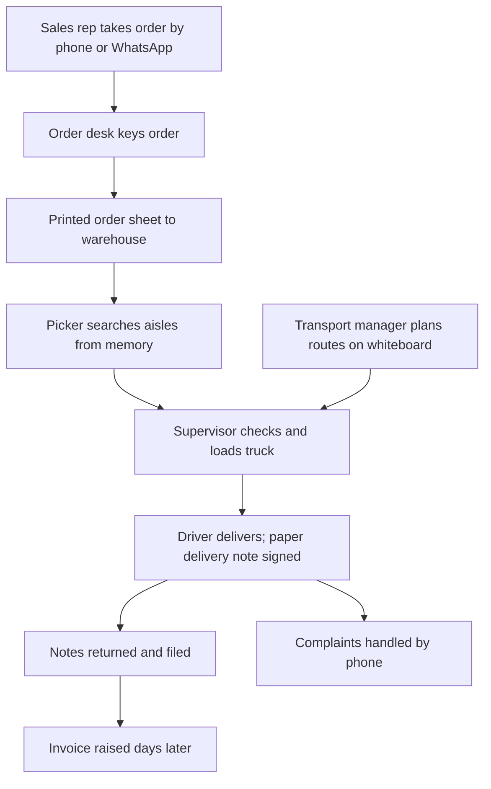
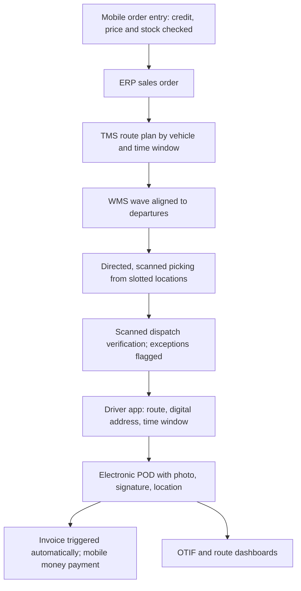

## Introduction

Distribution firms sit between manufacturers or importers and the retailers, pharmacies and hospitals that serve end customers. Their value lies in getting the right goods to the right place at the right time, in the right condition, at the lowest cost. That depends on two tightly linked operations: the **warehouse**, where goods are received, stored, picked and packed, and **transport**, where deliveries are planned, dispatched and confirmed. In both, small inefficiencies multiply across thousands of order lines and hundreds of kilometres each day.

This final case lesson applies the six-step method to an illustrative Ghanaian distribution firm. You will analyse its as-is order fulfilment process, compare as-is and to-be diagrams, specify warehouse management and route planning technology integrated with the ERP, calculate logistics KPIs, and plan for risk and change. A well-documented international failure shows how ambitious warehouse automation combined with a new ERP can threaten an entire business.

## Learning Objectives

- Analyse an as-is order-to-delivery process to identify delays, errors, wasted movement and control weaknesses.
- Explain core warehouse management functions: receiving, putaway, slotting, picking strategies, packing and shipping.
- Apply route planning principles and constraints to redesign delivery operations.
- Calculate and interpret logistics KPIs such as on-time in-full (OTIF), pick accuracy and vehicle utilisation.
- Evaluate risks of combining ERP, warehouse automation and transport systems, drawing on a documented case.

## Prerequisite Knowledge

- The six-step case method used in this module.
- Integration patterns and data migration (Enterprise Implementation module).
- Supply chain management concepts (CRM, SCM and HRIS lesson).

## Key Terminology

- **Warehouse management system (WMS)**: Software that directs and records warehouse operations at the level of individual locations, pallets and tasks.
- **Putaway**: Moving received goods to a storage location, ideally one directed by the system according to rules.
- **Slotting**: Assigning products to storage locations to minimise travel, for example placing fast movers near dispatch.
- **Wave picking**: Grouping many orders into a planned batch (wave) picked together, often aligned with vehicle departure times.
- **Pick accuracy**: The proportion of order lines picked with the correct item and quantity.
- **Transport management system (TMS)**: Software that plans loads and routes, assigns vehicles, tracks deliveries and records proof of delivery.
- **Vehicle routing problem (VRP)**: The optimisation problem of designing delivery routes for a fleet subject to constraints such as capacity, time windows and driver hours.
- **Proof of delivery (POD)**: Evidence that a delivery was received, such as an electronic signature, photograph and timestamp captured on a mobile device.
- **OTIF (on-time in-full)**: The proportion of orders delivered both on time and complete.

## Case: A Distribution Firm (Illustrative scenario)

### As-is process

*Illustrative scenario.* "Kasa Distribution Ltd" distributes packaged foods, beverages and household products from a warehouse in Tema to about 600 retail customers across Greater Accra, Eastern and Central regions. Sales representatives take orders by phone and WhatsApp and pass them to an order desk, which keys them into an accounting package. Printed order sheets go to the warehouse, where pickers walk the aisles from memory to find products. There are no fixed locations; fast and slow movers are mixed. Picked goods are checked by a supervisor and loaded onto trucks. The transport manager plans routes each morning on a whiteboard based on experience. Drivers return with signed paper delivery notes, which are filed and later used to raise invoices. Customer complaints about missing items are handled by phone.

### Weaknesses

- **Re-keying and delay**: orders pass through several hands before reaching the warehouse; errors in keying flow through to picking.
- **Wasted movement**: without slotting or directed picking, pickers travel long distances and search for items.
- **Pick errors**: memory-based picking produces wrong items and short picks, discovered only by customers.
- **Inefficient routes**: whiteboard planning ignores time windows, traffic patterns and vehicle capacity, causing overtime and partially empty trucks.
- **Slow cash cycle**: invoices are raised only after paper delivery notes return, delaying collection.
- **No visibility**: neither customers nor sales staff know where an order is; disputes rely on paper.
- **Stock inaccuracy**: unrecorded movements and the absence of locations make system stock unreliable.

### Redesigned process

The redesign integrates three systems around a single order record:

1. **Order capture at source.** Sales representatives enter orders on a mobile app linked to the ERP, which checks credit limits, prices and available-to-promise stock in real time; key customers may order through a web portal.
2. **Wave planning.** Orders are grouped into waves aligned with planned vehicle departures. The TMS proposes routes first, so that picking sequence matches loading sequence (last drop loaded first).
3. **Directed picking.** The WMS sends pick tasks to handheld scanners, directing pickers along an optimised path through slotted locations. Scanning each item and location confirms accuracy.
4. **Packing and shipping.** Scanned verification at the dispatch dock replaces manual supervisor checking for most orders; exceptions are flagged.
5. **Route execution.** Drivers follow routes on a mobile app with digital addresses and customer time windows. Electronic POD (signature, photograph, timestamp and location) is captured at each drop; short deliveries or refusals are recorded with reasons.
6. **Invoice on delivery.** Confirmed POD triggers the invoice immediately in the ERP, and customers can pay by mobile money linked to the invoice reference.
7. **Continuous improvement.** BI dashboards show OTIF, pick accuracy and route performance; slotting is reviewed monthly using sales velocity.

### Warehouse management in more depth

| WMS function | As-is practice | To-be practice | Benefit |
|---|---|---|---|
| Receiving | Count against delivery note | Scan against advance shipping notice or purchase order; record batches | Accurate stock from arrival |
| Putaway | Wherever there is space | System-directed to slotted location | Findable stock, less travel |
| Slotting | None | Fast movers near dispatch; heavy items low | Shorter pick paths, safer handling |
| Picking | Paper sheet, memory | Wave picking on scanners with path optimisation | Higher productivity and accuracy |
| Inventory control | Annual count | Cycle counts by location | Reliable available-to-promise |
| Shipping | Supervisor visual check | Scanned load verification by route sequence | Fewer short and wrong deliveries |

### Route planning in more depth

Route planning is a form of the vehicle routing problem. Exact optimisation is computationally hard for large instances, so TMS products use heuristics to find good routes quickly. The value comes from respecting **constraints** that whiteboard planning struggles to handle simultaneously: vehicle weight and volume capacity, customer receiving hours, driver working hours, road restrictions, and expected traffic at different times of day. In Ghanaian cities, digital addresses such as those from the GhanaPostGPS system can reduce time spent finding customers, and historic delivery-time data improves estimates of time per drop.

## Worked Example: Logistics KPIs

*Illustrative figures for one month after go-live.*

| Measure | Value |
|---|---|
| Orders delivered | 4,000 |
| Orders delivered on time | 3,680 |
| Orders delivered in full | 3,800 |
| Orders delivered both on time and in full | 3,560 |
| Order lines picked | 52,000 |
| Order lines picked correctly | 51,480 |
| Vehicle capacity available on trips (tonnes) | 1,500 |
| Tonnes actually carried | 1,170 |

- **On-time rate** = `3,680 / 4,000 = 92%`.
- **In-full rate** = `3,800 / 4,000 = 95%`.
- **OTIF** = `3,560 / 4,000 = 89%`. OTIF must be counted from orders meeting *both* conditions; multiplying the separate rates (`0.92 × 0.95 ≈ 87.4%`) gives the wrong answer, because failures overlap.
- **Pick accuracy** = `51,480 / 52,000 = 99.0%`.
- **Vehicle utilisation (weight)** = `1,170 / 1,500 = 78%`.

**Interpretation.** OTIF is limited more by lateness than by incompleteness, which points first to route planning and loading delays. A 1% pick error rate still means 520 wrong lines a month, each potentially a complaint or credit note, so scanning discipline and slotting deserve attention. Utilisation of 78% suggests scope to consolidate routes, but only if time windows allow. Each KPI needs a baseline from before go-live to show improvement.

## Supporting Enterprise Technology

- **ERP**: customers, products, pricing, credit control, sales orders, invoicing, accounts receivable and finance.
- **WMS**: integrated with the ERP, either as an ERP module or a specialist product, with handheld scanners and label printers.
- **TMS and driver app**: route planning, dispatch, tracking and electronic POD on rugged smartphones.
- **Integration**: API-based exchange of orders, stock, shipments and POD between ERP, WMS and TMS, with monitored error queues; mobile money integration for collections.
- **BI**: dashboards for OTIF, pick accuracy, cost per drop and customer service.
- **Security**: role-based access separating credit limit changes, order entry, dispatch and cash posting; drivers cannot alter invoice values.

## Risks and Change Management

| Risk | Mitigation |
|---|---|
| Inaccurate stock and location data at go-live | Full count and location labelling before cut-over; cycle counts thereafter |
| Integration failures between ERP, WMS and TMS | End-to-end integration and volume testing; monitored error queues |
| Picker and driver resistance to scanning and tracking | Involve supervisors in design; explain how scanning removes blame for errors; incentives tied to team accuracy |
| Over-reliance on algorithms ignoring local knowledge | Let transport planners adjust routes; feed driver feedback into time-per-drop data |
| Peak-season disruption | Go live in a low season, pilot one route cluster first |
| Device loss or connectivity gaps on routes | Offline-capable apps with later synchronisation; device management |

Kotter's model provides the change structure: create urgency using complaint and credit-note data; form a coalition of warehouse, transport, sales and finance leaders; communicate a vision of "every order right, first time"; remove obstacles such as poor shelving labels; and generate short-term wins by publicising improved OTIF on the pilot route cluster. ADKAR guides individual coaching of pickers and drivers, many of whom will be using handheld devices at work for the first time.

## International Case Study: FoxMeyer Drug

FoxMeyer Drug was a large US pharmaceutical distributor. In the mid-1990s it undertook an ambitious programme combining an SAP R/3 ERP implementation with highly automated warehouse systems, intended to improve efficiency and support growth on thin margins. The project encountered serious difficulties, including problems integrating the ERP with warehouse automation and handling the company's very high order volumes, and the expected benefits did not materialise. FoxMeyer filed for bankruptcy in 1996. The bankruptcy trustee later brought lawsuits against SAP and the consulting firm involved, which were eventually settled.

The case is widely taught alongside Hershey as a cautionary tale. Its lessons for distribution firms are direct: integrating ERP, WMS and automation is technically demanding and must be proven under realistic volumes; projects justified by aggressive savings assumptions leave no margin for error; and changing warehouse technology and core business systems at the same time multiplies risk. A phased approach, piloting one warehouse or route cluster first, is far safer.

## Common Misconceptions

- "Route optimisation software will always find the best route." Correction: it finds good routes within the constraints and data it is given; poor address data or unrealistic time-per-drop estimates produce poor plans.
- "OTIF equals the on-time rate multiplied by the in-full rate." Correction: OTIF must count orders meeting both conditions, because failures overlap.
- "Scanning slows pickers down." Correction: directed, scanned picking usually reduces search time and rework, although it may feel slower at first.
- "Warehouse automation is the first step to efficiency." Correction: accurate locations, slotting and process discipline come first; automating chaos amplifies it.

## Common Examination Mistakes

- Describing a WMS or TMS without linking functions to diagnosed weaknesses.
- Calculating OTIF incorrectly or presenting KPIs without baselines or interpretation.
- Omitting integration between ERP, WMS and TMS.
- Ignoring the human side of tracking technology for drivers and pickers.
- Embellishing the FoxMeyer case with figures that cannot be verified.

## Critical Thinking Questions

1. Should Kasa Distribution buy a WMS module from its ERP vendor or a specialist WMS? What criteria would you use?
2. How might GPS tracking of drivers affect trust and morale, and how should it be governed?
3. When does warehouse automation (conveyors, sorters) become justified for a distributor in Ghana?
4. What would you need to see in testing before approving a combined ERP and WMS go-live?

## Practical Exercises

1. **BPMN as-is and to-be.** In Camunda Modeler or Bizagi Modeler, model Kasa's as-is order-to-delivery process and the to-be process with pools for customer, distributor and driver. Expected output: two BPMN diagrams with lanes, a gateway for short deliveries and a message flow for POD.
2. **KPI calculation.** For a month with 3,000 orders, 2,790 on time, 2,850 in full and 2,700 both, calculate on-time, in-full and OTIF rates. Expected output: the three rates and a sentence explaining whether OTIF differs from the product of the other two rates, and why.
3. **Slotting analysis.** Given a list of 20 products with monthly picks, rank them and propose an ABC slotting plan. Expected output: a table classifying products as A, B or C with proposed zones and a justification.
4. **SAP Learning activity.** On SAP Learning, explore free material on warehouse management or transportation management in SAP S/4HANA. Expected output: a 250-word note mapping vendor functions to the redesigned process steps in this lesson.

## Key Takeaways

- Distribution performance depends on integrated order capture, warehouse execution and transport planning around one order record.
- WMS functions (receiving, putaway, slotting, directed picking, cycle counting, scanned shipping) target specific weaknesses.
- Route planning tools are only as good as their constraints and data, including addresses and time-per-drop.
- OTIF counts orders meeting both conditions; interpret KPIs together and against baselines.
- FoxMeyer shows the danger of combining a new ERP and warehouse automation without proving them at scale.

## Further Reading

- Monk, E., & Wagner, B. (2013). *Concepts in enterprise resource planning* (4th ed.). Cengage Learning.
- Dumas, M., La Rosa, M., Mendling, J., & Reijers, H. A. (2018). *Fundamentals of business process management* (2nd ed.). Springer.
- Scott, J. E., & Vessey, I. (2002). Managing risks in enterprise systems implementations. *Communications of the ACM, 45*(4), 74-81.
- Kotter, J. P. (1996). *Leading change*. Harvard Business School Press.

## Video Resources

- [SAP Learning](https://learning.sap.com/): SAP. Free learning journeys including warehouse and transportation management topics.
- [Microsoft Learn: Dynamics 365 training](https://learn.microsoft.com/training/dynamics365/): Microsoft. Self-paced modules including warehouse management and supply chain processes.
- [Camunda documentation](https://docs.camunda.io/): Camunda. Official guides for modelling cross-organisational processes with pools and message flows.

## Revision Summary

The illustrative distributor suffers from re-keyed orders, memory-based picking, whiteboard routing, paper delivery notes and delayed invoicing. The redesign captures orders at source with real-time checks, plans routes and waves together, directs scanned picking from slotted locations, verifies loads, captures electronic proof of delivery and invoices on delivery, all integrated through APIs and measured on BI dashboards. KPIs include OTIF, pick accuracy and vehicle utilisation; risks centre on data accuracy, integration and frontline adoption.

- WMS: receive, put away, slot, pick, count, ship.
- TMS: plan routes under capacity, time-window and driver-hour constraints.
- OTIF = orders both on time and in full / total orders.
- Electronic POD triggers invoicing and shortens the cash cycle.
- Pilot one route cluster or warehouse first.
- FoxMeyer (1996 bankruptcy): ERP plus warehouse automation at once.
