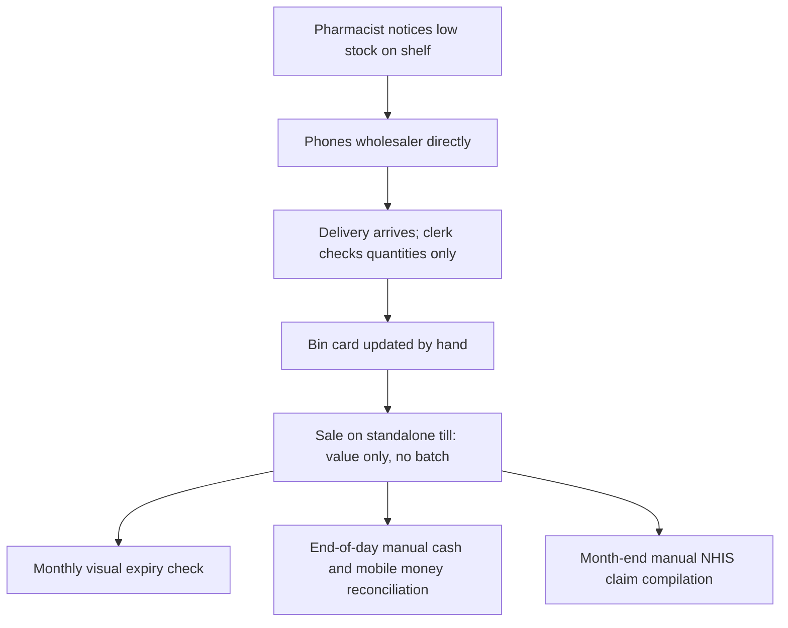
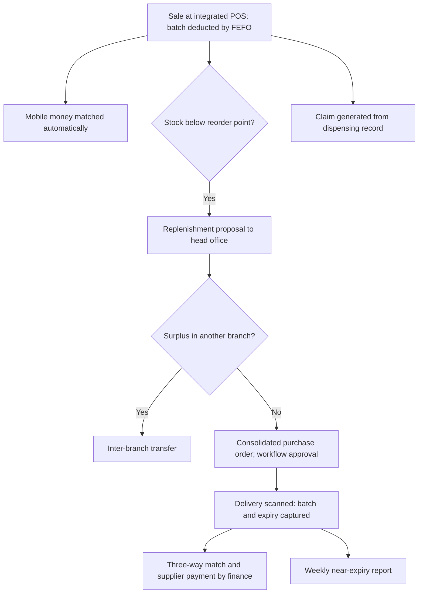
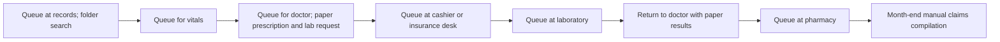
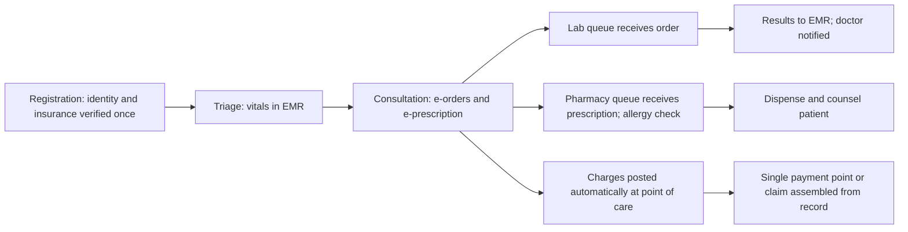

## Introduction

Healthcare is one of the most demanding settings for enterprise systems. Medicines carry batch numbers and expiry dates, controlled drugs need strict accountability, patients move between registration, consultation, laboratory, pharmacy and billing, and insurance claims must be supported by accurate clinical and dispensing records. Errors are not merely costly; they can harm patients. At the same time, many healthcare organisations still rely on paper folders, standalone tills and spreadsheets that cannot share information.

This lesson applies everything in the course to two illustrative Ghanaian organisations: a retail pharmacy chain and a private hospital. For each, you will examine the current (as-is) process and its weaknesses, compare as-is and to-be process diagrams, specify the supporting enterprise technology, define KPIs, and plan for risks and change management. The lesson closes with a large, well-documented international programme that shows what happens when technology ambition outruns organisational readiness.

## Learning Objectives

- Analyse as-is pharmacy and hospital processes to identify waste, delays, control weaknesses and patient-safety risks.
- Apply process redesign principles to produce to-be processes supported by integrated enterprise systems.
- Specify enterprise technology components, including batch and expiry management, electronic prescribing and claims integration.
- Design KPIs with baselines and targets to evaluate the redesigned processes.
- Evaluate implementation risks and propose change-management actions grounded in recognised models.

## Prerequisite Knowledge

- Process analysis, value-added analysis and BPMN modelling (earlier modules).
- Implementation strategy, data migration, testing and training (Enterprise Implementation module).
- Segregation of duties and role-based access (Enterprise Security lesson).

## Key Terminology

- **FEFO (first expired, first out)**: A stock-rotation rule that issues the batch with the earliest expiry date first, reducing expired stock write-offs.
- **Batch traceability**: The ability to trace which batch of a product was received from which supplier and dispensed to which patient or sale, essential for recalls.
- **Electronic prescribing (e-prescribing)**: Creating prescriptions electronically in a clinical system and transmitting them directly to the pharmacy queue.
- **Electronic medical record (EMR)**: A digital record of a patient's clinical information within one organisation.
- **Hospital management system (HMS)**: An integrated enterprise system covering patient administration, clinical workflows, pharmacy, laboratory, billing and reporting.
- **Claims integration**: Generating insurance claims directly from registration, clinical and dispensing records rather than re-keying them.
- **Interoperability**: The ability of different health information systems to exchange and use data, often using standards such as HL7 FHIR.
- **Revenue leakage**: Services or items provided but not billed or not claimed, through omission or error.

## Analytical Approach

Each case is analysed with the same six-step method, which you should reuse in examinations:

1. **Describe the as-is process**: actors, steps, hand-offs, documents and systems.
2. **Diagnose weaknesses**: non-value-adding steps, waiting, rework, information gaps, control weaknesses and risks to customers or patients.
3. **Redesign the process**: apply principles such as capturing data once at source, moving decisions to the point of work, removing unnecessary hand-offs and running steps in parallel.
4. **Specify enabling technology**: the enterprise system modules, integrations and devices required.
5. **Define KPIs**: baseline, target, owner and data source for each.
6. **Plan for risks and change**: technical, data, people and regulatory risks, with mitigation and a change-management approach (for example Kotter's eight steps or ADKAR).

Technology appears at step four, not step one. The redesign should be justified first; the system is then chosen to enable it.

## Case A: A Pharmacy Chain (Illustrative scenario)

### As-is process

*Illustrative scenario.* "HealWell Pharmacy" has a head office in Accra and ten branches. Each branch uses a standalone till that records sales value but not batches. Stock is tracked on paper bin cards. When a pharmacist notices low stock, the branch phones a wholesaler directly and places an order. On delivery, a clerk checks quantities against the delivery note and files it. Expiry dates are checked visually during a monthly shelf walk. Cash and mobile money takings are reconciled by hand at close of day, and National Health Insurance Scheme (NHIS) claims for covered medicines are compiled manually from prescription copies at month-end.

### Weaknesses

- **No central visibility**: head office cannot see stock or sales by branch in time to act, so one branch runs out while another holds surplus.
- **Fragmented purchasing**: branches buy independently, losing volume discounts and creating inconsistent prices.
- **Expiry losses and patient-safety risk**: without batch and expiry data, short-dated stock is not issued first and expired items may remain on shelves.
- **No traceability**: a supplier recall cannot be traced to branches or sales.
- **Control weaknesses**: the same person orders, receives and pays small suppliers; manual reconciliation of mobile money is slow and error-prone.
- **Claim rejections and leakage**: manual claim compilation produces transcription errors and missed claims.

### Redesigned process

The to-be process captures data once, at source, and lets the system drive replenishment:

1. Every sale at the integrated point of sale deducts stock by batch using FEFO, and records the payment method; mobile money confirmations are matched automatically through the payment aggregator's interface.
2. When branch stock falls below a reorder point (calculated from sales history and lead time), the system raises a replenishment proposal. Head office procurement consolidates proposals into supplier purchase orders, or transfers surplus stock between branches.
3. Purchase orders above a threshold are approved through workflow by the procurement manager, separating ordering from approval.
4. On delivery, the clerk scans barcodes and records batch numbers and expiry dates; the system rejects short-dated stock below a configured shelf-life threshold and records the three-way match for accounts payable.
5. The system produces a weekly near-expiry report so that short-dated stock can be moved or returned before it expires.
6. Claims are generated from dispensing records, validated against scheme rules and submitted electronically where the scheme's interfaces allow.

### Enabling technology

- A retail pharmacy ERP or general ERP with batch and expiry management, multi-location inventory, central procurement and finance.
- Integrated POS terminals with offline mode, barcode scanners and receipt printers.
- Payment integration with mobile money aggregators and banks.
- Workflow for purchase approval; role-based access separating ordering, receiving and payment; restricted access and registers for controlled medicines.
- A BI dashboard showing sales, margin, stock cover and near-expiry value by branch.

### KPIs

| KPI | Definition | Purpose |
|---|---|---|
| Stock-out rate | Share of requested items unavailable at the point of sale | Service and patient access |
| Expired stock value | Value of stock written off as expired per month | Waste and safety |
| Inventory record accuracy | Share of cycle counts matching system quantities | Data reliability |
| Days of inventory | 365 divided by stock turnover | Working capital |
| Claim rejection rate | Share of submitted claims rejected | Revenue protection |
| Daily reconciliation time | Staff time to close takings per branch | Efficiency |

Baselines should be measured for at least two months before go-live.

### Risks and change management

Key risks include poor-quality product master data (duplicate items, inconsistent units), connectivity failures at branches, pharmacists' resistance to scanning during busy periods, and over-centralisation that ignores local demand. Mitigation includes cleansing the product master before migration, offline POS, a pilot branch followed by waves, and involving senior pharmacists as super-users. Using Kotter's model, leaders would build urgency around patient safety and expired stock losses, form a guiding coalition of pharmacists and finance, communicate the vision repeatedly, and celebrate short-term wins such as a fall in expiry write-offs at the pilot branch.

## Case B: A Private Hospital (Illustrative scenario)

### As-is process

*Illustrative scenario.* "Adepa Hospital", a 120-bed private hospital in Kumasi, runs outpatient clinics on paper. A patient queues at records, where a clerk searches for a paper folder or creates a new one. The patient then waits for a nurse to take vital signs, then for a doctor, who writes a paper prescription and laboratory request. The patient walks to the cashier to pay or to have insurance details checked, then to the laboratory, then back to the doctor with results, and finally to the pharmacy. Billing and insurance claims are compiled from paper records by the accounts office.

### Weaknesses

- **Long waits and repeated queuing**: patients queue at every hand-off, and folders are frequently misplaced.
- **Information gaps**: doctors may not see previous results or allergies; handwriting causes dispensing risk.
- **Revenue leakage**: services provided are not always captured for billing; insurance claims are delayed or rejected.
- **No management information**: clinic waiting times, doctor workload and bed occupancy are unknown.

### Redesigned process

1. Registration captures identity and insurance details once, and verifies cover electronically where available; the patient receives a unique hospital number and a queue ticket.
2. Nurses record vital signs directly in the EMR at triage, so the doctor sees them immediately along with history and allergies.
3. The doctor orders tests and prescribes electronically. Lab orders and prescriptions appear instantly in the laboratory and pharmacy queues, with drug-allergy alerts.
4. Charges are created automatically for each service at the point of care. Self-paying patients pay once, at a single point, by cash, card or mobile money; insured patients' claims are assembled from the record.
5. Results flow back into the EMR and notify the doctor; the pharmacy prepares medicines while the patient completes the visit.

### Enabling technology

An integrated HMS with patient administration, EMR, order communications, laboratory and pharmacy modules, billing and claims, linked to the hospital's ERP for finance, procurement and HR. Interoperability standards such as HL7 FHIR ease future exchange with laboratories, insurers and other providers. Role-based access must ensure that only clinicians view clinical notes, and personal health data must be protected in line with the Data Protection Act, 2012 (Act 843).

### KPIs, risks and change management

Useful KPIs are outpatient waiting time from registration to consultation, total visit time, prescription turnaround, claim rejection rate, unbilled services, and the proportion of consultations with complete electronic records. The main risks are clinician resistance to typing during consultations, slow systems at peak, insufficient devices in clinics, and patient-safety errors during the transition. Mitigation includes clinician champions, performance testing at the morning peak, paper fallback procedures, phased roll-out by department, and ADKAR-based training that explains to clinicians *why* structured data improves safety before teaching *how* to use screens.

## International Case Study: England's National Programme for IT

The National Programme for IT (NPfIT) in the National Health Service in England was launched in 2002 with the aim of creating national electronic care records and related systems across the health service. It was one of the largest civilian IT programmes attempted. Large contracts were let to suppliers for regions of the country. The programme was heavily criticised in reports by the National Audit Office and parliamentary committees, notably over delays in delivering care record systems and weak engagement with clinicians and local organisations. In 2011 the government announced that the programme would be dismantled, while some components continued under other arrangements.

For this lesson, the case reinforces the six-step method: technology was procured centrally before many local processes and clinical needs were understood, and change management with clinicians was widely seen as inadequate. Healthcare process redesign must begin with the people who deliver care.

## Common Misconceptions

- "A hospital system mainly speeds up billing." Correction: its greatest value is clinical: complete records, safer prescribing and coordinated care, with billing benefits as a by-product.
- "Centralising pharmacy purchasing always reduces stock." Correction: without accurate branch data and sensible reorder points, centralisation can increase stock-outs; data quality comes first.
- "Paper fallback procedures are a sign of a weak system." Correction: fallback procedures are an essential control for continuity of care during outages.

## Common Examination Mistakes

- Starting with a product name instead of analysing the as-is process.
- Listing weaknesses without linking each to a specific redesign step.
- Proposing KPIs without definitions or baselines.
- Ignoring patient safety, data protection and clinician engagement.
- Inventing facts or figures about real health programmes.

## Critical Thinking Questions

1. Which is harder to change in a hospital: the technology or clinical working practices? Justify your answer.
2. How should a pharmacy chain balance central purchasing efficiency against branch pharmacists' knowledge of local demand?
3. What would you need to see before agreeing that the hospital's redesign has improved patient experience?
4. To what extent do the lessons of NPfIT apply to a single private hospital?

## Practical Exercises

1. **BPMN as-is and to-be in Bizagi Modeler or Camunda Modeler.** Model HealWell's as-is replenishment process and the to-be process with pools for branch, head office procurement and supplier. Expected output: two BPMN diagrams with lanes, gateways and message flows, and a table of removed or changed steps.
2. **Hospital value-added analysis.** Classify each step of Adepa's as-is outpatient process as value-adding, business value-adding or non-value-adding. Expected output: a table with an estimate of waiting steps removed by the redesign.
3. **KPI plan.** Prepare KPI definition cards for four KPIs for either case. Expected output: cards with formula, data source, baseline method, target, owner and frequency.
4. **SAP Learning activity.** On SAP Learning, explore free material on batch management or inventory management in SAP S/4HANA. Expected output: a 250-word note explaining how batch and expiry data would support FEFO and recalls at HealWell.

## Key Takeaways

- Analyse as-is, diagnose, redesign, then specify technology, KPIs, risks and change management, in that order.
- Pharmacy redesign centres on batch-level data, FEFO, central replenishment, payment integration and claims from dispensing records.
- Hospital redesign centres on capturing data once, electronic orders and prescriptions, point-of-care charging and parallel working.
- Patient safety, data protection and clinician engagement are non-negotiable design criteria.
- NPfIT shows the danger of procuring technology centrally ahead of local process understanding.

## Further Reading

- Dumas, M., La Rosa, M., Mendling, J., & Reijers, H. A. (2018). *Fundamentals of business process management* (2nd ed.). Springer.
- Monk, E., & Wagner, B. (2013). *Concepts in enterprise resource planning* (4th ed.). Cengage Learning.
- Kotter, J. P. (1996). *Leading change*. Harvard Business School Press.
- Hammer, M., & Champy, J. (1993). *Reengineering the corporation: A manifesto for business revolution*. HarperBusiness.
- HL7 International. (n.d.). *FHIR specification*. <https://hl7.org/fhir/>

## Video Resources

- [SAP Learning](https://learning.sap.com/) — SAP. Free learning journeys including inventory and batch management in SAP S/4HANA.
- [Camunda documentation](https://docs.camunda.io/) — Camunda. Official guides for modelling as-is and to-be processes in BPMN.
- [HL7 FHIR](https://hl7.org/fhir/) — HL7 International. Official specification and introductory material for the FHIR healthcare interoperability standard.

## Revision Summary

Healthcare process redesign starts with the as-is process and its weaknesses, not with technology. The illustrative pharmacy chain suffers from fragmented purchasing, no batch or expiry data, weak controls and manual claims; the redesign uses integrated POS with FEFO, central replenishment, workflow approval, scanned deliveries and claims from dispensing records. The illustrative hospital suffers from repeated queuing, paper records and revenue leakage; the redesign captures data once, uses electronic orders and prescriptions and posts charges at the point of care. KPIs, risks and change management complete each analysis.

- Six steps: describe, diagnose, redesign, enable, measure, manage change.
- FEFO plus batch traceability reduce expiry losses and support recalls.
- E-prescribing removes handwriting risk and enables parallel pharmacy preparation.
- Point-of-care charging reduces revenue leakage.
- Clinician engagement is a critical success factor.
- NPfIT (2002–2011): central procurement ahead of local readiness.
