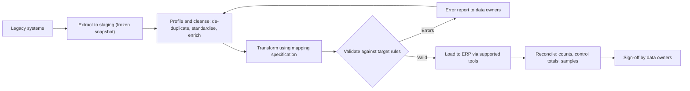

## Introduction

An enterprise system is only as trustworthy as the data inside it. On go-live day, users will judge the new system by whether customer balances are right, whether stock on the screen matches stock on the shelf, and whether suppliers are paid correctly. All of those depend on data that has been extracted from legacy systems, cleaned, transformed and loaded. Data migration is consistently underestimated because it looks like a technical copying exercise; in reality it forces the organisation to confront years of duplicated, incomplete and inconsistent records.

Equally, no ERP stands alone. It must exchange data with point-of-sale terminals, banking and mobile money platforms, e-commerce sites, tax systems, logistics partners and analytics tools. This lesson covers both halves of the problem: moving data *into* the new system safely, and connecting the new system *to* everything around it.

## Learning Objectives

- Explain the stages of an extract-transform-load (ETL) data migration and the roles responsible for each.
- Apply data cleansing techniques, including profiling, de-duplication, standardisation and enrichment, to legacy master data.
- Design reconciliation controls (record counts, control totals and sample checks) and interpret discrepancies.
- Compare integration patterns such as point-to-point, hub-and-spoke, enterprise service bus, API-led and event-driven integration.
- Evaluate migration and integration risks using a real-world failure.

## Prerequisite Knowledge

- Understanding of master data and transactional data from the Enterprise Databases and Analytics lesson.
- Familiarity with APIs and middleware from the Enterprise Architecture and Integration lesson.
- Basic knowledge of relational tables and keys.

## Key Terminology

- **Data migration**: The one-time (or few-time) transfer of data from legacy systems into a new system, including its transformation into the new system's structures.
- **ETL (extract, transform, load)**: The sequence of extracting data from sources, transforming it into the target format and rules, and loading it into the target system.
- **Data profiling**: Statistical examination of source data to discover patterns, null rates, duplicates and invalid values before cleansing.
- **Data cleansing**: Correcting, standardising, de-duplicating and enriching data so it meets the target system's quality rules.
- **Mapping specification**: A document defining, field by field, how each source attribute becomes a target attribute, including transformation rules and default values.
- **Reconciliation**: Proving that migrated data is complete and accurate by comparing record counts, control totals and samples between source and target.
- **Open items**: Transactions not yet complete at cut-over, such as unpaid invoices or undelivered purchase orders, which must be migrated as live balances.
- **Integration pattern**: A reusable approach to connecting systems, such as point-to-point, hub-and-spoke or publish-subscribe messaging.
- **Idempotency**: The property of an interface whereby processing the same message twice produces the same result as processing it once, preventing duplicate postings.

## The Data Migration Life Cycle

### What to migrate

The first decision is scope. Most projects migrate:

- **Master data**: customers, suppliers, products, chart of accounts, employees, bills of materials, price lists.
- **Open items and balances**: open receivables and payables, open orders, stock on hand by location and batch, general ledger opening balances.
- **Limited history**: sometimes one or two years of summarised history for reporting.

Full transactional history is rarely migrated, because it multiplies effort and risk. Instead the legacy system is archived in read-only form for enquiry and audit. A clear **data retention decision** prevents months of argument later.

### Stages

1. **Profile** the source data to quantify problems: duplicate customers, missing tax identifiers, products with no unit of measure, negative stock.
2. **Define quality rules and mapping** with business data owners, not only IT staff. Each target field needs a source, a transformation rule and an owner.
3. **Cleanse at source where possible.** Correcting data in the legacy system means corrected records flow into every trial migration.
4. **Extract** data into a staging area, frozen at an agreed time.
5. **Transform** by applying mappings, code conversions (for example, old product categories to new ones), unit-of-measure conversions and default values.
6. **Validate** against target rules before loading, producing an error report for business correction.
7. **Load** using the vendor's supported tools and interfaces so that business logic and validations in the target are respected.
8. **Reconcile** counts, totals and samples, and obtain formal sign-off from data owners.
9. **Rehearse.** Run several full trial migrations ("mock loads") before cut-over, timing each one, so that the final load fits inside the cut-over window.

### Cleansing techniques

| Problem found in profiling | Technique | Example |
|---|---|---|
| Duplicate records | Matching and merging using fuzzy rules on name, phone and address | "Kofi Mensah Enterprise" and "Kofi Mensah Ent." with the same phone number merged |
| Inconsistent formats | Standardisation | Phone numbers converted to one international format |
| Missing mandatory values | Enrichment from other sources or business follow-up | Missing tax identifiers collected from customers before cut-over |
| Invalid codes | Code mapping tables | Old unit "CTN" mapped to new unit "Carton" |
| Obsolete records | Archival rules | Customers with no activity for several years not migrated |

## Worked Example: Reconciling a Customer Migration

*Illustrative scenario.* A wholesale company in Takoradi migrates customer master data and open receivables. The control report after the final mock load is:

| Control | Legacy source | After cleansing | Loaded to ERP | Difference |
|---|---|---|---|---|
| Customer records | 12,480 | 11,950 | 11,915 | 35 |
| Open invoices | 8,204 | 8,204 | 8,151 | 53 |
| Total open receivables (GHS) | 4,862,350.00 | 4,862,350.00 | 4,858,100.00 | 4,250.00 |

**Step 1: explain the cleansing difference.** 12,480 − 11,950 = 530 records removed. The cleansing log must show that all 530 were duplicates merged into surviving records, and that their open invoices were reassigned to the survivors. Because the receivables total did not change between the source and cleansed columns, the merge preserved value.

**Step 2: explain the load difference.** 11,950 − 11,915 = 35 customers rejected by the ERP's validation, for example because a mandatory region code was blank. Those 35 customers own 53 open invoices worth 4,250.00. The analyst confirms this by summing the rejected invoices in the error file: if they total exactly 4,250.00, the difference is fully explained.

**Step 3: decide.** The 35 records are corrected and reloaded before cut-over, and the reconciliation is re-run until all differences are zero or explicitly explained and accepted by the finance controller. A **sample check** follows: the controller selects, say, 30 random customers and compares balances, credit limits and contact details on screen against legacy reports.

The principle is that *every* difference must be either eliminated or explained and signed off. An unexplained difference, however small, suggests a mapping error that may affect other records.

## Integration Patterns

Integration connects the ERP to surrounding applications. Hohpe and Woolf (2003) catalogued many messaging patterns; at the architectural level the main options are:

| Pattern | How it works | Strengths | Weaknesses | Typical use |
|---|---|---|---|---|
| Point-to-point | Each pair of systems has its own custom interface | Quick for one or two links | Number of links grows rapidly; brittle "spaghetti" | Small firms with few systems |
| File-based batch | Systems exchange files on a schedule | Simple, robust, tolerant of downtime | Data is only as fresh as the last batch | Nightly bank statement import |
| Hub-and-spoke or enterprise service bus (ESB) | A central middleware routes and transforms messages | Central monitoring, reuse of transformations | Hub can become a bottleneck and single point of failure | Large organisations with many systems |
| API-led | Systems expose documented, versioned APIs (often REST) | Reusable, real-time, suits cloud and mobile | Needs API governance and security | E-commerce site checking ERP stock |
| Event-driven (publish-subscribe) | Systems publish events; interested systems subscribe | Loose coupling, scalable, near real-time | Harder to trace end-to-end; eventual consistency | "Goods received" event updating several systems |
| Integration platform as a service (iPaaS) | Cloud-hosted middleware with pre-built connectors | Fast for common SaaS connections | Subscription cost, vendor dependence | Linking cloud ERP with cloud CRM |

With `n` systems, fully connected point-to-point integration can require up to `n × (n − 1) / 2` links: 6 for four systems, but 45 for ten. A hub reduces that to `n` connections, which is the essential argument for middleware.

### Design considerations

- **Synchronous or asynchronous?** A cashier waiting for a payment confirmation needs a synchronous response; posting the day's sales to the general ledger can be asynchronous.
- **Error handling.** Every interface needs retry rules, a queue for failed messages and a named person who monitors it.
- **Idempotency and sequencing.** If a mobile money confirmation is received twice, the invoice must not be paid twice.
- **Security.** Authenticate every call, encrypt data in transit and log access.
- **Ownership of master data.** Decide which system is the "system of record" for each entity, so that customer data is not edited in three places.

## Ghanaian Business Application

*Illustrative scenario.* A mid-sized supermarket group in Accra replaces separate branch inventory systems with a cloud ERP. Migration challenges include product codes that differ by branch for the same item, products recorded in mixed units (single, pack, carton), and supplier records lacking tax identification numbers. The team creates a single product master keyed on the GS1 barcode where one exists, with an internal code for loose and locally packaged goods, and runs three mock loads timed against a planned Saturday-night cut-over.

Integration requirements include branch point-of-sale terminals posting sales to the ERP in near real time (with local storage when connectivity drops, synchronised later), mobile money payment confirmations received through an aggregator's API and matched to transactions, nightly bank statement files for reconciliation, and supplier price-list uploads. An API-led design with a small integration layer is chosen so that a future e-commerce site can reuse the same stock and price APIs.

## International Case Study: TSB's 2018 Platform Migration

In April 2018 the UK bank TSB migrated its customer accounts from systems operated by its former parent, Lloyds Banking Group, to a new platform built for it by its new owner, Banco Sabadell. The migration was carried out over a single weekend. In the days that followed, many customers were unable to access online and mobile banking or saw incorrect information, and the disruption continued for an extended period. TSB's chief executive later stood down, an independent review was commissioned, and UK regulators subsequently fined the bank in connection with the failings.

For students of enterprise implementation, the case shows that a single-event migration of a large, complex data estate concentrates risk; that readiness evidence (testing results, performance under real load, the capability of suppliers) must be independently challenged before a go decision; and that a credible fallback plan is essential. It also illustrates that migration success is measured by customers' experience after cut-over, not by whether the data was technically copied.

## Diagram

## Common Misconceptions

- "Data migration is an IT task." Correction: business data owners must define quality rules, correct errors and sign off reconciliations; IT provides tools and execution.
- "We should migrate all historical transactions so nothing is lost." Correction: migrating full history multiplies cost and risk; archiving the legacy system for enquiry usually meets audit and reporting needs.
- "If record counts match, the migration is correct." Correction: counts can match while values are wrong; control totals and sample checks are also needed.
- "An enterprise service bus is always better than point-to-point." Correction: for a firm with two or three systems, middleware may add cost and complexity without benefit.

## Common Examination Mistakes

- Listing ETL stages without explaining cleansing, validation and reconciliation.
- Treating reconciliation as a single count comparison.
- Recommending an integration pattern without linking it to the number of systems, latency needs and error handling.
- Forgetting open items and balances when scoping migration.
- Describing a real case such as TSB with invented figures rather than the well-documented facts.

## Critical Thinking Questions

1. Should poor-quality legacy data be cleansed before migration, during transformation, or after go-live? What are the trade-offs?
2. How would you decide which system is the system of record for customer data when both the ERP and a CRM can edit it?
3. Is a single-weekend migration ever justified for a large organisation? What evidence would you require before approving it?
4. How does event-driven integration change the way auditors should trace a transaction?

## Practical Exercises

1. **Mapping specification.** For a product master with ten legacy fields, write a mapping specification to a target ERP structure, including at least three transformation rules and one default value. Expected output: a table with source field, target field, rule, owner and validation.
2. **Reconciliation.** Using the worked example, suppose the error file of rejected invoices totals 3,900.00 rather than 4,250.00. Expected output: a short explanation of what this implies and the investigation steps you would take.
3. **BPMN cut-over model.** In Camunda Modeler, model the migration rehearsal process from "freeze legacy data" to "sign-off", including a loop back for errors and a timer event for the cut-over deadline. Expected output: a BPMN diagram with an exclusive gateway, a loop and a boundary timer event.
4. **SAP Learning activity.** On SAP Learning, search for free material on data migration to SAP S/4HANA. Expected output: a 250-word summary of the vendor-supported migration approach and how it relates to the ETL stages in this lesson.

## Key Takeaways

- Migrate master data, open items and balances; archive most history.
- Cleanse at source, rehearse with mock loads and time them against the cut-over window.
- Reconcile with counts, control totals and samples; every difference must be eliminated or explained and signed off.
- Choose integration patterns by number of systems, latency, error handling and governance needs.
- Define a system of record for each master data entity.

## Further Reading

- Hohpe, G., & Woolf, B. (2003). *Enterprise integration patterns: Designing, building, and deploying messaging solutions*. Addison-Wesley.
- Monk, E., & Wagner, B. (2013). *Concepts in enterprise resource planning* (4th ed.). Cengage Learning.
- Kimball, R., & Ross, M. (2013). *The data warehouse toolkit: The definitive guide to dimensional modeling* (3rd ed.). Wiley.
- Markus, M. L., & Tanis, C. (2000). The enterprise systems experience: From adoption to success. In R. W. Zmud (Ed.), *Framing the domains of IT management: Projecting the future through the past*. Pinnaflex Educational Resources.

## Video Resources

- [SAP Learning](https://learning.sap.com/) — SAP. Free learning journeys including material on data migration and integration for SAP S/4HANA.
- [Microsoft Learn: Power Automate documentation](https://learn.microsoft.com/power-automate/) — Microsoft. Official guidance on connectors and automated data flows between business applications.
- [Camunda documentation](https://docs.camunda.io/) — Camunda. Guides to modelling and orchestrating processes that span several systems.

## Revision Summary

Data migration moves master data, open items and balances into the new system through extract, profile, cleanse, transform, validate, load and reconcile, rehearsed in several mock loads. Reconciliation uses record counts, control totals and samples, and every difference must be explained and signed off by business owners. Integration connects the ERP with surrounding systems through patterns ranging from point-to-point and batch files to hubs, APIs and events; the right choice depends on scale, latency and governance.

- Profile first; cleanse at source where possible.
- Counts plus control totals plus samples prove completeness and accuracy.
- Point-to-point links grow as n(n − 1)/2; hubs reduce this to n.
- Design interfaces for errors, retries and idempotency.
- Decide the system of record for each master data entity.
- TSB (2018): single-weekend migration with severe customer impact.
