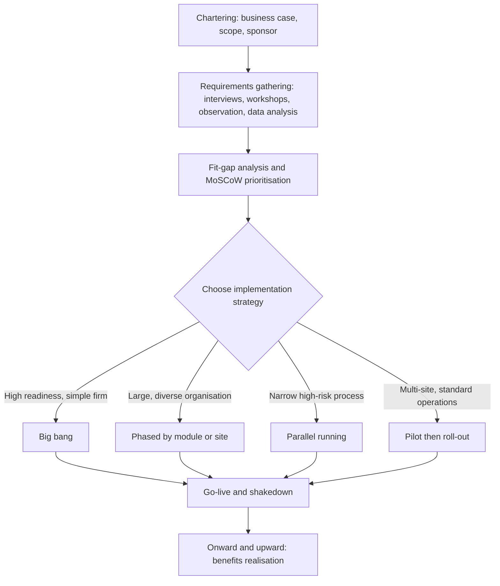

## Introduction

Buying an enterprise resource planning (ERP) system is the easy part. Putting it to work across finance, procurement, inventory, sales and human resources, while the business keeps trading, is where most of the risk lies. Two early decisions shape almost everything that follows: *how* the new system will replace the old ways of working (the implementation strategy), and *what* the system must actually do (the requirements). A poor strategy can expose the whole business to a single point of failure on go-live day; poor requirements can produce a technically successful project that nobody can use.

This lesson treats implementation as a managed organisational change rather than a software installation. You will compare the classic implementation strategies, learn when each is defensible, and then work through the techniques analysts use to elicit, document, prioritise and validate requirements. The lesson closes with a famous international failure and an illustrative Ghanaian scenario so that you can practise justifying a strategy with evidence rather than preference.

## Learning Objectives

- Explain the phases of the enterprise systems life cycle and the decisions made in each.
- Compare big bang, phased (by module and by site), parallel and pilot implementation strategies using explicit criteria such as risk, cost, time and organisational readiness.
- Apply requirements-gathering techniques, including interviews, workshops, observation, document analysis and prototyping, to an enterprise system project.
- Construct prioritised, testable requirements using MoSCoW and a fit-gap analysis.
- Evaluate an implementation plan for risks arising from timing, scope and readiness.

## Prerequisite Knowledge

- Familiarity with ERP modules and best-practice processes (Enterprise Applications module).
- Basic understanding of process mapping and BPMN from the Business Process Management module.
- Awareness of change-management models such as Kotter's eight steps.

## Key Terminology

- **Implementation strategy**: The approach used to move an organisation from its legacy systems and processes to the new enterprise system, for example big bang or phased.
- **Big bang**: A strategy in which all modules and all sites switch to the new system at a single cut-over point.
- **Phased roll-out**: A strategy in which the system is introduced incrementally, by module, by business unit or by geography.
- **Parallel running**: Operating the legacy and new systems side by side for a period and comparing outputs before retiring the old system.
- **Pilot implementation**: Deploying the full system at one site or unit first, learning from it, then rolling it out elsewhere.
- **Functional requirement**: A statement of what the system must do, such as "record a goods receipt against a purchase order".
- **Non-functional requirement**: A statement of a quality the system must have, such as availability, response time, security or usability.
- **Fit-gap analysis**: A structured comparison of required processes against the standard capability of a package, classifying each as fit, configurable, gap requiring workaround, or gap requiring development.
- **Requirements traceability matrix (RTM)**: A table linking each requirement to its source, priority, design element and test case.
- **MoSCoW**: A prioritisation scheme classifying requirements as Must have, Should have, Could have or Won't have this time.

## The Enterprise Systems Life Cycle

Markus and Tanis (2000) describe the enterprise systems experience as a sequence of phases, each with its own typical problems. A useful adaptation for planning purposes is:

1. **Chartering**: the business case, scope, budget, sponsor and high-level strategy are agreed. Problems here (unrealistic expectations, weak sponsorship) are inherited by every later phase.
2. **Project (configuration and roll-out)**: requirements are gathered, the package is configured, data is migrated, the system is tested and users are trained, ending at go-live.
3. **Shakedown**: the period from go-live until "normal operation" is reached. Performance typically dips as staff learn new procedures and defects surface.
4. **Onward and upward**: the organisation stabilises, realises benefits, and plans upgrades and extensions.

The value of this model is that it reminds project teams that success at go-live is not the same as business success. A project can be on time and on budget and still fail in shakedown if process changes were not understood. The implementation strategy is essentially a decision about how much shakedown risk the organisation will accept at once.

## Comparing Implementation Strategies

### Big bang

All modules go live together on a single date, usually after a weekend or holiday cut-over. Benefits are realised quickly, there is no need to build temporary interfaces between old and new systems, and the organisation moves to one version of the truth at once. The disadvantage is concentration of risk: if order-to-cash fails on Monday, there is no legacy system to fall back on without a costly rollback.

### Phased roll-out

The system is introduced in stages. A *module-phased* approach might start with finance and procurement, then add inventory and sales. A *site-phased* approach might start with the head office, then regional branches. Phasing spreads the learning load and allows lessons from early phases to improve later ones. The price is a longer programme, and the need for temporary "bridge" interfaces so that, say, a new finance module can receive transactions from a legacy sales system.

### Parallel running

Both systems process the same transactions for a period, and outputs (trial balances, stock valuations, payroll totals) are reconciled. Parallel running provides the strongest fallback, but it doubles the workload for staff who must key data twice, and differences between the systems are often due to legitimate process redesign rather than errors, which makes reconciliation hard to interpret. It is most defensible for narrow, high-consequence processes such as payroll.

### Pilot

A complete version of the system goes live at one representative site. The pilot tests both the software and the training and support model in real conditions. Pilots work well for multi-branch businesses with similar operations, such as a pharmacy or supermarket chain.

| Criterion | Big bang | Phased (module or site) | Parallel | Pilot then roll-out |
|---|---|---|---|---|
| Speed to full benefit | Fastest | Slow | Medium | Medium |
| Concentration of risk | Very high | Low to medium | Low | Medium (contained to pilot) |
| Temporary interfaces needed | None | Many | Few | Some, during roll-out |
| Staff workload | Intense peak | Spread out | Very high (double entry) | High at pilot site |
| Fallback options | Weak | Good | Strong | Good for later sites |
| Best suited to | Small, simple, highly integrated firms; strong readiness | Large, diverse organisations | Narrow, high-risk processes such as payroll | Multi-site firms with standardised operations |

In practice organisations frequently combine strategies: a pilot branch, then site-phased roll-out, with parallel running only for payroll.

### Choosing a strategy: a decision procedure

1. **Assess integration density.** If inventory, sales and finance are tightly coupled, phasing by module needs many bridges; big bang or pilot may be cleaner.
2. **Assess organisational readiness.** Count trained super-users, the stability of master data and the maturity of IT support. Low readiness argues against big bang.
3. **Map the business calendar.** Never schedule cut-over near peak trading, financial year-end or statutory reporting deadlines.
4. **Quantify the cost of failure.** Estimate revenue at risk per day of disruption; high values justify the cost of pilots or parallel running.
5. **Agree rollback criteria in advance.** Define the conditions under which the team will revert, and test the rollback procedure.

## Requirements Gathering

Requirements describe the future state the system must support. In package implementations, the aim is not to specify software from scratch but to decide how far the organisation will adopt the package's built-in processes and where genuine gaps exist.

### Techniques

| Technique | What it produces | Strengths | Limitations |
|---|---|---|---|
| Structured interviews | Detailed individual perspectives | Depth, confidentiality | Time-consuming; tells you what people say they do |
| Facilitated workshops (for example joint application design) | Agreed cross-functional process designs | Builds consensus, resolves hand-off conflicts | Dominant voices; needs skilled facilitation |
| Observation and job shadowing | Actual work practices, workarounds | Reveals tacit knowledge | Observer effect; limited sample |
| Document and data analysis | Forms, reports, transaction volumes | Objective evidence, sizing data | Documents may be out of date |
| Questionnaires | Broad view across many sites | Scale, comparability | Shallow; low response rates |
| Prototyping and conference-room pilots | Feedback on configured screens and flows | Concrete, exposes misunderstandings early | Users may fixate on cosmetic issues |
| Process mining of event logs | Evidence-based as-is process variants | Objective, quantifies variation | Needs clean event data |

Good practice triangulates: workshops propose the future design, observation and data analysis check it against reality, and conference-room pilots validate it on the configured system.

### Writing good requirements

Each requirement should be **atomic** (one need per statement), **testable** (a tester can say pass or fail), **traceable** (linked to a source and an owner) and **solution-neutral** where possible. Compare "the system should be user-friendly" (untestable) with "a trained cashier must complete a three-item sale with mobile money payment in under 60 seconds" (testable).

## Worked Example: Fit-Gap and MoSCoW for a Distributor

*Illustrative scenario.* A Kumasi-based distributor of building materials is implementing a mid-market ERP. Workshops have produced the requirements below. The analyst classifies each against the package's standard capability and assigns a MoSCoW priority.

| ID | Requirement | Source | Fit-gap result | MoSCoW | Treatment |
|---|---|---|---|---|---|
| R01 | Record customer orders with credit-limit checking | Sales workshop | Fit (standard) | Must | Configure credit rules |
| R02 | Accept mobile money payments and match them to invoices | Finance interviews | Gap (needs integration) | Must | Build interface to payment aggregator |
| R03 | Print invoices with legally required tax details | Document analysis | Configurable | Must | Configure output form |
| R04 | Track deliveries with digital address of the site | Logistics observation | Gap (minor) | Should | Add custom field |
| R05 | Commission calculation for sales agents using a bespoke formula | Sales manager interview | Gap (development) | Could | Defer; calculate in spreadsheet initially |
| R06 | Replicate the legacy system's green-screen menu layout | User questionnaire | Gap | Won't | Reject; train users on new layout |

The analysis gives the steering committee a defensible scope. Three Must requirements are fits or configurations; one Must gap (R02) is a genuine integration need and goes into the integration plan; R05 is deferred to protect the timeline; and R06 is rejected because it would customise the package to preserve a legacy habit rather than a business need. A simple metric is the **fit rate**: here, two of six requirements are standard fits and one more is configurable, so half of the requirements are met without gaps. Each row then enters the requirements traceability matrix, gaining a design reference and a test case.

## Ghanaian Business Application

*Illustrative scenario.* A pharmacy chain with a head office in Accra and twelve branches across Greater Accra, Ashanti and the Western Region plans to replace branch-level spreadsheets and a standalone accounting package with an integrated ERP covering procurement, inventory with batch and expiry tracking, point of sale and finance.

A big bang across all thirteen locations would be risky: branch staff have varied computer literacy, connectivity outside major towns can be intermittent, and dispensing errors carry patient-safety consequences. A defensible recommendation is a **pilot then site-phased** strategy: go live first at one busy Accra branch close to head office support, stabilise for several weeks, then roll out in waves of three or four branches. Finance and procurement go live at head office with the pilot, so that central purchasing is consistent from the start. Cut-over dates avoid month-end and the December festive trading period.

Requirements gathering combines branch observation (to see how pharmacists actually check expiry dates and handle prescriptions), workshops with procurement and finance, document analysis of supplier invoices and National Health Insurance claim forms, and a conference-room pilot in which pharmacists process realistic transactions on the configured system. Non-functional requirements receive explicit attention: offline capability for point of sale during network outages, role-based access to controlled medicines, and protection of patient data consistent with Ghana's Data Protection Act, 2012 (Act 843).

## International Case Study: Hershey's 1999 ERP Go-Live

The Hershey Foods Corporation in the United States implemented an integrated set of enterprise applications in the late 1990s, including SAP R/3 for core ERP, together with supply chain planning and customer relationship management software from other vendors. It is widely reported that the project schedule was compressed and that the company chose to switch over many functions together in July 1999. That timing placed the shakedown period directly before Hershey's busiest trading season, Halloween. The company subsequently experienced serious order-processing and shipment problems, and publicly attributed disappointing results in the second half of 1999 partly to these difficulties.

The lessons for strategy selection are clear. First, the business calendar should constrain the go-live date, not the other way round. Second, a combined go-live of tightly integrated order, warehouse and planning functions concentrates shakedown risk exactly where errors are most visible to customers. Third, compressing testing to meet a date removes the evidence on which a go or no-go decision should rest. A phased or pilot approach, or simply a go-live after the peak season, would have reduced exposure.

## Diagram

## Common Misconceptions

- "Big bang is always reckless." Correction: for a small, well-prepared organisation with highly integrated processes, big bang can be the lowest-risk option because it avoids fragile temporary interfaces.
- "Parallel running is the safest strategy, so it should always be used." Correction: parallel running doubles workload, is hard to reconcile when processes have been redesigned, and is usually justified only for narrow, high-consequence processes.
- "Requirements gathering means asking users what they want." Correction: users describe current practice and preferences; analysts must also observe, analyse data and challenge requirements against business objectives and package best practice.
- "Every gap should be closed by customisation." Correction: many gaps are better closed by changing the process, using configuration, or deferring the requirement; custom code raises upgrade and support costs.

## Common Examination Mistakes

- Describing strategies without comparing them against explicit criteria or recommending one for the case given.
- Recommending big bang or phased roll-out without reference to the organisation's calendar, readiness or integration density.
- Writing vague requirements such as "fast" or "easy to use" instead of measurable statements.
- Confusing functional and non-functional requirements.
- Ignoring the shakedown phase and treating go-live as the end of the project.

## Critical Thinking Questions

1. Under what conditions might a pilot site give misleading evidence about how the rest of the organisation will cope with a new ERP?
2. Is the high concentration of risk in a big bang implementation offset by the avoidance of temporary interfaces? How would you assess this trade-off for a specific firm?
3. How should an analyst respond when a senior manager insists that a "Won't have" requirement is essential?
4. To what extent does adopting a package's best-practice processes reduce an organisation's ability to differentiate itself from competitors?

## Practical Exercises

1. **Strategy recommendation.** For the illustrative pharmacy chain above, write a one-page memo to the steering committee recommending an implementation strategy. Expected output: a memo that scores at least three strategies against five criteria in a table and justifies the recommendation with reference to readiness, calendar and risk.
2. **BPMN in Camunda Modeler or Bizagi Modeler.** Model the future-state "receive supplier delivery" process for the pharmacy chain, including batch and expiry capture and a gateway for rejecting short-dated stock. Expected output: a BPMN 2.0 diagram with at least two lanes (store clerk, pharmacist), one exclusive gateway and a message flow to the supplier pool, exported as an image.
3. **Requirements traceability.** Write ten requirements for the pharmacy chain's point-of-sale process (at least three non-functional), classify each with MoSCoW and fit-gap, and add a test case reference. Expected output: a completed requirements traceability matrix.
4. **SAP Learning activity.** Create a free account on SAP Learning and complete an introductory learning journey on SAP S/4HANA or SAP Activate. Expected output: a 300-word reflection explaining how the vendor's recommended phases compare with the Markus and Tanis life cycle.

## Key Takeaways

- Implementation strategy is a decision about how much risk to concentrate at one go-live.
- Big bang, phased, parallel and pilot approaches each suit different contexts; hybrid strategies are common.
- The business calendar, organisational readiness and integration density should drive the choice.
- Requirements must be atomic, testable, traceable and prioritised; fit-gap analysis favours process change and configuration over custom code.
- Success at go-live is not success: plan explicitly for shakedown.

## Further Reading

- Markus, M. L., & Tanis, C. (2000). The enterprise systems experience: From adoption to success. In R. W. Zmud (Ed.), *Framing the domains of IT management: Projecting the future through the past*. Pinnaflex Educational Resources.
- Monk, E., & Wagner, B. (2013). *Concepts in enterprise resource planning* (4th ed.). Cengage Learning.
- Davenport, T. H. (1998). Putting the enterprise into the enterprise system. *Harvard Business Review, 76*(4), 121-131.
- Nah, F. F.-H., Lau, J. L.-S., & Kuang, J. (2001). Critical factors for successful implementation of enterprise systems. *Business Process Management Journal, 7*(3), 285-296.
- Dumas, M., La Rosa, M., Mendling, J., & Reijers, H. A. (2018). *Fundamentals of business process management* (2nd ed.). Springer.

## Video Resources

- [SAP Learning](https://learning.sap.com/): SAP. Free learning journeys, including introductions to SAP S/4HANA and the SAP Activate implementation methodology.
- [Microsoft Learn: Dynamics 365 training](https://learn.microsoft.com/training/dynamics365/): Microsoft. Self-paced modules on implementing and using Dynamics 365 business applications.
- [Camunda documentation](https://docs.camunda.io/): Camunda. Official guides to the Camunda Modeler for BPMN process modelling.

## Revision Summary

Implementation strategy and requirements gathering are the two early decisions that most shape ERP outcomes. Strategies range from big bang (fast but risky) through phased and pilot roll-outs (slower, contained risk) to parallel running (strong fallback, heavy workload). Choose using readiness, integration density, the business calendar and the cost of failure. Requirements should be gathered by triangulating interviews, workshops, observation, data analysis and prototyping, then prioritised with MoSCoW and tested against the package with fit-gap analysis.

- Markus and Tanis phases: chartering, project, shakedown, onward and upward.
- Big bang: no bridges, high risk; phased: many bridges, low risk.
- Parallel running suits narrow, high-consequence processes such as payroll.
- Good requirements are atomic, testable, traceable and prioritised.
- Prefer process change and configuration over customisation.
- Hershey (1999): go-live timing collided with peak season.
