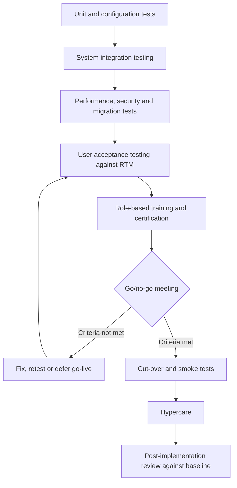

## Introduction

The final stretch of an enterprise implementation is where plans meet reality. The system must be proven to work (testing), people must be able to use it (training), the organisation must switch over without losing control of its operations (deployment and cut-over), and the investment must be shown to deliver what the business case promised (post-implementation evaluation). Each of these activities is often squeezed when earlier phases overrun, which is exactly why failures cluster around go-live.

This lesson gives you practical tools for each activity: a map of test types and who owns them, a role-based training design, a cut-over runbook with go/no-go criteria, and a set of post-implementation review metrics with a worked calculation. Throughout, the emphasis is on evidence: a go-live decision should rest on test results and readiness measures, not optimism.

## Learning Objectives

- Distinguish the main test types used in enterprise implementations and identify who owns each.
- Design a role-based training plan using super-users, sandboxes and train-the-trainer approaches.
- Construct a cut-over plan with a timeline, go/no-go criteria and a rollback procedure.
- Apply post-implementation review metrics to evaluate whether an implementation achieved its objectives.
- Evaluate a real deployment failure in terms of testing, training and readiness.

## Prerequisite Knowledge

- Implementation strategies and requirements traceability (earlier lessons in this module).
- Data migration and reconciliation concepts.
- Change-management models (Kotter, ADKAR) from the Business Process Re-engineering module.

## Key Terminology

- **User acceptance testing (UAT)**: Testing by business users, using realistic scenarios and data, to confirm that the system supports their processes and meets agreed requirements.
- **Regression testing**: Re-running previously passed tests after a change to confirm that nothing that worked before has broken.
- **Performance (load) testing**: Testing that the system meets response-time and throughput requirements under expected and peak volumes.
- **Super-user**: A business staff member given advanced training who supports colleagues, tests the system and acts as a link between users and the project team.
- **Cut-over**: The planned set of activities that moves the organisation from legacy systems to the new system, including final data loads and switching off old processes.
- **Go/no-go criteria**: Pre-agreed, measurable conditions that must be met before the decision to go live is taken.
- **Hypercare**: An intensive support period immediately after go-live, with extra staffing and rapid defect resolution.
- **Post-implementation review (PIR)**: A structured evaluation, typically several months after go-live, comparing actual outcomes with the business case and capturing lessons learned.
- **Defect severity**: A classification of defects by business impact, for example critical (stops a core process), high, medium and low.

## Testing an Enterprise System

Testing proceeds from small components to whole business scenarios, and responsibility shifts from technical teams to business users.

| Test type | Purpose | Typical owner | Example |
|---|---|---|---|
| Unit testing | Check individual configurations, reports, interfaces or custom code | Developers, configurators | A custom invoice form prints tax fields correctly |
| Integration (system integration) testing | Check end-to-end flows across modules and interfaces | Project test team | Sales order to delivery to invoice to mobile money payment to ledger posting |
| Data migration testing | Check that migrated data loads and reconciles | Data team with data owners | Mock load reconciles customer balances to zero difference |
| Performance and load testing | Check speed and capacity at peak | Technical team | 40 tills processing simultaneous sales on a festive Saturday |
| Security and authorisation testing | Check roles, segregation of duties and access controls | Security team, internal audit | A cashier cannot approve their own refund |
| User acceptance testing | Confirm the system supports business processes | Business users and super-users | Pharmacists process realistic prescriptions end to end |
| Regression testing | Confirm fixes have not broken earlier work | Test team, often automated | Re-run payment scenarios after an interface fix |
| Operational acceptance testing | Confirm backups, monitoring, batch jobs and support procedures work | IT operations | Restore from backup within the agreed time |

### Designing UAT

UAT should be driven by the requirements traceability matrix: every Must requirement maps to at least one test scenario. Scenarios should be written as business stories ("a customer returns a damaged item bought with mobile money and receives a refund") with expected results, test data and a pass/fail column. Defects are logged with a severity, an owner and a target resolution date.

**UAT exit criteria** are agreed before testing starts, for example: 100% of critical scenarios executed and passed; no open critical defects; no more than an agreed small number of open high-severity defects, each with an approved workaround; and sign-off by each process owner.

## Training Users

Training is not a single classroom event the week before go-live. Effective programmes are:

- **Role-based.** A cashier, a stores clerk and an accounts payable officer need different content. Map each role to the transactions it performs and train those, using the organisation's own processes and data.
- **Timed close to go-live.** Training delivered months early decays before use; training delivered the day before leaves no time to practise.
- **Hands-on.** Learners need a training environment (sandbox) loaded with realistic data where mistakes are harmless.
- **Cascaded through super-users.** A train-the-trainer approach develops super-users who then train colleagues and provide floor support during hypercare.
- **Supported by job aids.** Short step-by-step guides, screen recordings and quick-reference cards for less frequent tasks.
- **Measured.** Use short practical assessments: can the learner complete their core transactions unaided? Track the proportion of users certified per role as a go/no-go criterion.

Training also addresses the *why*, not only the *how*. Users who understand that an integrated system makes their data visible to downstream colleagues are more likely to enter it accurately, which is central to the "Knowledge" and "Ability" elements of the ADKAR model.

## Deployment and Cut-Over Planning

A cut-over plan (or runbook) lists every activity, its owner, its start time, its duration and its dependencies, from the final weeks before go-live to the first days after. A simplified plan for a weekend cut-over is:

| Time | Activity | Owner |
|---|---|---|
| T − 4 weeks | Final mock load and timed dress rehearsal of cut-over | Data lead |
| T − 2 weeks | UAT sign-off; training certification reviewed | Process owners |
| T − 1 week | Freeze configuration changes; confirm support rota for hypercare | Project manager |
| Friday 18:00 | Stop legacy transactions; count stock; print legacy control reports | Operations, finance |
| Friday 20:00 – Saturday 14:00 | Extract, transform, load master data, balances and open items | Data team |
| Saturday 14:00 – 20:00 | Reconcile and obtain data-owner sign-off | Finance controller |
| Saturday 21:00 | Go/no-go meeting | Steering committee |
| Sunday | Smoke tests: one transaction per key process; enable user access | Super-users |
| Monday 07:00 | Go-live; hypercare desk opens | Support lead |

### Go/no-go criteria

Examples include: UAT exit criteria met; reconciliation differences zero or signed off; performance test passed at peak volume; at least an agreed proportion of users certified in each critical role; hypercare staffing confirmed; and rollback procedure tested. The criteria must be decided weeks in advance so that the go/no-go meeting is an evidence review, not a negotiation.

### Rollback

A rollback plan states the latest point at which reverting is possible, the steps to restore legacy systems, and who decides. Once new transactions have been entered, rollback becomes much harder, so the decision point is usually before user access is enabled.

### Hypercare

During hypercare, a support desk triages issues by severity, super-users provide floor support, and daily stand-ups review defect counts and backlogs (for example, unprocessed orders or unmatched payments). Hypercare ends when agreed stability criteria are met.

## Post-Implementation Evaluation

A post-implementation review assesses whether the system is delivering value and what the organisation has learned. It typically considers four perspectives: **project performance** (time, budget, scope); **system quality** (availability, response time, defect trends); **use and user satisfaction** (adoption, workarounds, survey results); and **business benefits** (process KPIs against baseline).

### Worked example: process KPIs against baseline

*Illustrative scenario.* A distribution company measured these KPIs before go-live and six months after:

| KPI | Baseline | Target | Six months after | Change |
|---|---|---|---|---|
| Order-to-delivery cycle time (days) | 4.0 | 2.5 | 3.0 | −25% |
| Order accuracy (orders delivered without error) | 91% | 98% | 97% | +6 points |
| Days to close monthly accounts | 12 | 5 | 6 | −50% |
| Inventory record accuracy (cycle counts matching system) | 82% | 97% | 95% | +13 points |
| Help-desk tickets per 100 users per week | — | < 5 | 7 | above target |

The cycle-time change is `(3.0 − 4.0) / 4.0 = −25%`; the close-time change is `(6 − 12) / 12 = −50%`. Interpreting the table, the system has delivered substantial improvement, but most KPIs remain short of target and the help-desk volume indicates continuing usability or training problems. A sound PIR would investigate root causes (for example, by analysing ticket categories), recommend targeted retraining or configuration changes, and set a date for re-measurement. Without a baseline measured *before* go-live, none of these conclusions would be possible, which is why baselining belongs in the chartering phase.

## Ghanaian Business Application

*Illustrative scenario.* A private hospital group in Kumasi is deploying a new hospital management system with integrated pharmacy, billing and insurance claims. Testing includes integration scenarios from patient registration through consultation, prescription, dispensing and claim submission for National Health Insurance Scheme patients; performance testing at the morning outpatient peak; and authorisation testing to ensure only clinicians can view clinical notes. Training is role-based (records clerks, nurses, doctors, pharmacists, billing officers), uses a sandbox with fictitious patient records, and is delivered in short sessions fitted around shift patterns. Cut-over is planned for a weekend with reduced outpatient activity, paper fallback forms are prepared for emergencies, and super-users wear identifiable tabards during a two-week hypercare period. The PIR compares outpatient waiting times, claim rejection rates and billing leakage against baselines measured in the three months before go-live.

## International Case Study: Heathrow Terminal 5 Opening (2008)

When Heathrow's Terminal 5 opened in March 2008, problems with the new baggage-handling system and its operation led to large numbers of cancelled flights and a backlog of delayed bags in the first days. A subsequent inquiry by the UK House of Commons Transport Committee examined the opening, and commentary identified issues including staff familiarisation with the new building and systems, and the extent of end-to-end testing under realistic operating conditions.

The case shows that technical testing alone is insufficient: operational readiness depends on people, procedures and the system working together at full load. Rehearsals with real staff, realistic volumes and the actual working environment are part of testing, and go/no-go criteria should include evidence of operational readiness as well as software quality.

## Diagram

## Common Misconceptions

- "UAT is where testers find bugs." Correction: UAT confirms business fitness; most technical defects should already have been found in unit and integration testing.
- "A go-live date, once announced, must be met." Correction: a well-governed project lets pre-agreed criteria decide; deferring is often cheaper than a failed go-live.
- "Training is finished once everyone has attended a session." Correction: attendance is not competence; certification, floor support and refresher training are needed.
- "The project ends at go-live." Correction: hypercare, stabilisation and post-implementation review are where benefits are secured and measured.

## Common Examination Mistakes

- Listing test types without stating their purpose or owner.
- Proposing go/no-go criteria that are not measurable.
- Omitting rollback and hypercare from deployment plans.
- Evaluating success only in terms of time and budget, ignoring business KPIs and user adoption.
- Claiming benefits without reference to a pre-implementation baseline.

## Critical Thinking Questions

1. Who should chair the go/no-go meeting, and how can the organisation protect the decision from schedule pressure?
2. How would you measure whether training has been effective, rather than merely delivered?
3. If a PIR shows benefits below target, how would you distinguish system problems from process or people problems?
4. To what extent can automated regression testing reduce the risk of upgrades in a cloud ERP with frequent vendor releases?

## Practical Exercises

1. **UAT script.** Write five UAT scenarios for a pharmacy point-of-sale process, each with preconditions, steps, test data, expected result and a requirement reference. Expected output: a UAT script table ready for execution.
2. **Cut-over runbook in BPMN.** In Bizagi Modeler or Camunda Modeler, model the cut-over weekend from "stop legacy transactions" to "go-live", including the go/no-go gateway and the rollback path. Expected output: a BPMN diagram with lanes for data team, finance, steering committee and super-users.
3. **PIR analysis.** Add two further KPIs to the worked example (for example, supplier payment on time and stock-outs per month), with baseline, target and actual values of your choice. Expected output: calculated changes and a 200-word evaluation with recommendations.
4. **SAP Learning activity.** On SAP Learning, find free material describing SAP Activate's deploy and run phases. Expected output: a comparison table showing how its deploy activities map to the cut-over plan in this lesson.

## Key Takeaways

- Test from unit to integration to UAT, with performance, security, migration and operational tests alongside.
- UAT is driven by the requirements traceability matrix and closed by pre-agreed exit criteria.
- Training should be role-based, hands-on, timed close to go-live and verified by certification.
- Cut-over needs a timed runbook, measurable go/no-go criteria, a rollback plan and hypercare.
- Post-implementation review compares KPIs with a pre-go-live baseline and drives continuous improvement.

## Further Reading

- Markus, M. L., & Tanis, C. (2000). The enterprise systems experience: From adoption to success. In R. W. Zmud (Ed.), *Framing the domains of IT management: Projecting the future through the past*. Pinnaflex Educational Resources.
- Monk, E., & Wagner, B. (2013). *Concepts in enterprise resource planning* (4th ed.). Cengage Learning.
- Kotter, J. P. (1996). *Leading change*. Harvard Business School Press.
- Nah, F. F.-H., Lau, J. L.-S., & Kuang, J. (2001). Critical factors for successful implementation of enterprise systems. *Business Process Management Journal, 7*(3), 285–296.

## Video Resources

- [SAP Learning](https://learning.sap.com/) — SAP. Free learning journeys including the SAP Activate methodology's deploy and run phases.
- [Microsoft Learn: Dynamics 365 training](https://learn.microsoft.com/training/dynamics365/) — Microsoft. Self-paced modules including implementation guidance and testing for business applications.
- [Bizagi](https://www.bizagi.com/) — Bizagi. Official site for Bizagi Modeler, used for BPMN modelling exercises such as cut-over processes.

## Revision Summary

Testing, training, deployment and evaluation turn a configured system into working business capability. Testing moves from unit and integration tests to UAT driven by the requirements traceability matrix, supported by performance, security, migration and operational tests. Training is role-based, hands-on and certified, cascaded through super-users. Cut-over follows a timed runbook with measurable go/no-go criteria, a rollback plan and hypercare. Post-implementation review measures KPIs against a baseline and captures lessons.

- UAT exit: critical scenarios passed, no open critical defects, owner sign-off.
- Regression testing after every fix or upgrade.
- Attendance is not competence; certify users by role.
- Go/no-go criteria are agreed weeks in advance.
- Baselines must be captured before go-live.
- Heathrow T5 (2008): operational readiness matters as much as software.
