## Introduction

Choosing an enterprise system is one of the largest and least reversible technology decisions an organisation makes. The chosen package will shape processes, skills, data structures and supplier relationships for a decade or more. Yet selections are often driven by an impressive demonstration, a senior manager's prior experience or the lowest headline licence price. None of these is a sound basis for a commitment of that scale.

This lesson presents vendor selection as a disciplined, evidence-based procedure. You will learn the stages of a selection, how to design weighted scoring criteria that reflect business priorities, how to test whether the result is robust, and how to calculate total cost of ownership (TCO) so that options with very different cost profiles, such as on-premise licences and cloud subscriptions, can be compared fairly.

## Learning Objectives

- Explain the stages of a structured enterprise software selection from long list to contract.
- Design weighted evaluation criteria that reflect an organisation's strategic and operational priorities.
- Apply a weighted scoring model to compare vendors and perform sensitivity analysis on the weights.
- Calculate and interpret a five-year total cost of ownership for alternative deployment options.
- Evaluate contractual and relationship factors, including service levels, exit terms and local implementation support.

## Prerequisite Knowledge

- Understanding of ERP modules and of fit-gap analysis from the previous lesson.
- Basic spreadsheet skills (multiplication, summation).
- Awareness of the differences between on-premise and cloud deployment.

## Key Terminology

- **Request for information (RFI)**: An early, lightweight document asking vendors to describe their products and capabilities so that a long list can be reduced.
- **Request for proposal (RFP)**: A formal document setting out requirements, evaluation criteria and commercial terms, to which shortlisted vendors respond with detailed proposals.
- **Scripted demonstration**: A demonstration in which each vendor must run the buyer's own scenarios and data, rather than a generic sales presentation.
- **Weighted scoring model**: A decision tool in which each criterion receives a weight reflecting its importance, each option is scored against each criterion, and weighted scores are summed.
- **Sensitivity analysis**: Testing whether the ranking of options changes when weights or scores are varied within plausible ranges.
- **Total cost of ownership (TCO)**: The full cost of acquiring, implementing, operating, supporting and eventually exiting a system over a defined period.
- **Service level agreement (SLA)**: A contractual commitment specifying measurable service standards such as availability and response times, with remedies for failure.
- **Vendor lock-in**: Dependence on a supplier that makes switching costly because of proprietary data formats, customisations or contractual terms.

## The Selection Process

A structured selection reduces the influence of bias and sales pressure by fixing the criteria before vendors are met.

1. **Confirm the business case and scope.** Restate objectives (for example, a single view of stock across branches) and the modules in scope.
2. **Agree requirements and criteria.** Use the prioritised requirements from requirements gathering. Agree evaluation criteria and their weights with the steering committee *before* contacting vendors.
3. **Market scan and RFI.** Identify a long list of perhaps eight to twelve candidate products, including vendors' local partners. Use RFI responses to eliminate products that clearly do not fit size, sector or budget.
4. **RFP to a short list.** Issue the RFP to three to five vendors. Require responses to each Must requirement in a fixed format (standard, configurable, third-party add-on, custom development).
5. **Scripted demonstrations.** Give each vendor the same scenarios, for example "receive a delivery with two batches of different expiry dates, then sell from the earlier batch". Score live, using the agreed sheet.
6. **Reference checks and site visits.** Speak to customers of similar size and sector, ideally ones the vendor did not choose for you.
7. **Proof of concept (optional).** For high-risk gaps such as a mobile money integration, ask the leading vendor to prove feasibility.
8. **Commercial negotiation and due diligence.** Assess financial stability, product roadmap, partner capacity and contract terms.
9. **Recommendation and contract.** Present scores, TCO and risks to the decision-makers.

Selecting the **implementation partner** deserves equal attention. Many failures attributed to software are, on investigation, failures of the integrator's capacity, methodology or knowledge of the client's industry.

## Theories, Frameworks and Models

### Multi-criteria decision analysis

Weighted scoring is a simple form of multi-criteria decision analysis. Its strengths are transparency and the ability to combine dissimilar factors. Its weaknesses are well known: weights are subjective; scores on a 1-5 scale imply false precision; and a high score on one criterion can compensate for a fatal weakness on another. Good practice therefore combines weighted scoring with **knock-out criteria** (any vendor failing a Must requirement is excluded regardless of total score) and with sensitivity analysis.

### Cost-benefit and TCO thinking

Headline licence price is typically a minority of lifetime cost. TCO models classify costs as acquisition (licences, hardware), implementation (consulting, data migration, training, internal backfill), operation (maintenance, subscriptions, hosting, support staff) and change (upgrades, enhancements, exit). Benefits are assessed separately, often in the business case, and the two are combined in measures such as payback period or net present value.

### Fit and misfit

Package selection is fundamentally about fit between organisational processes and the package's embedded processes. Davenport (1998) argued that an enterprise system imposes its own logic on a company's strategy, culture and organisation. A low-fit package forces either extensive customisation or radical process change; both are costly, and organisations should know which they are choosing.

## Worked Example: Weighted Scoring with Sensitivity Analysis

*Illustrative scenario.* A Tema-based distribution company has short-listed three ERP products, labelled A, B and C. All three pass the knock-out criteria. The steering committee agreed the weights below before the demonstrations; each product is scored from 1 (poor) to 5 (excellent).

| Criterion | Weight | A score | A weighted | B score | B weighted | C score | C weighted |
|---|---|---|---|---|---|---|---|
| Functional fit to requirements | 0.30 | 4 | 1.20 | 5 | 1.50 | 3 | 0.90 |
| Five-year TCO (cheaper scores higher) | 0.20 | 3 | 0.60 | 2 | 0.40 | 5 | 1.00 |
| Vendor viability and local support | 0.15 | 4 | 0.60 | 3 | 0.45 | 3 | 0.45 |
| Technical architecture and integration | 0.15 | 4 | 0.60 | 4 | 0.60 | 3 | 0.45 |
| Usability | 0.10 | 3 | 0.30 | 4 | 0.40 | 4 | 0.40 |
| Implementation partner capability | 0.10 | 4 | 0.40 | 3 | 0.30 | 3 | 0.30 |
| **Total** | **1.00** | | **3.70** | | **3.65** | | **3.50** |

Each weighted score is `weight × score`; for example, product A's functional fit is `0.30 × 4 = 1.20`. Product A ranks first, but the margin over B is only 0.05, which is well within the uncertainty of subjective 1-5 scores.

**Sensitivity test.** Suppose the finance director argues that cost should weigh 0.30 and functional fit 0.20. Recalculating:

- A: `0.20×4 + 0.30×3 + 0.15×4 + 0.15×4 + 0.10×3 + 0.10×4 = 0.80 + 0.90 + 0.60 + 0.60 + 0.30 + 0.40 = 3.60`
- B: `0.20×5 + 0.30×2 + 0.60 + 0.60 + 0.40 + 0.30` (other criteria unchanged) `= 1.00 + 0.60 + 0.45 + 0.60 + 0.40 + 0.30 = 3.35`
- C: `0.20×3 + 0.30×5 + 0.45 + 0.45 + 0.40 + 0.30 = 0.60 + 1.50 + 0.45 + 0.45 + 0.40 + 0.30 = 3.70`

The ranking now changes: C leads. **Interpretation:** the decision hinges on how the organisation trades functional fit against cost. That is a strategic question for the steering committee, not an arithmetic one. The analyst's job is to make the trade-off explicit and to explore whether C's lower fit could be compensated by process change, or whether A's better fit justifies the extra cost.

## Worked Example: Five-Year Total Cost of Ownership

*Illustrative scenario.* The same company compares an on-premise deployment (perpetual licence) with a cloud subscription. All figures are hypothetical, in Ghana cedis (GHS), undiscounted.

| Cost element | On-premise (5 years) | Cloud subscription (5 years) |
|---|---|---|
| Licences (one-off) | 600,000 | n/a |
| Annual maintenance (20% of licence × 5) | 600,000 | n/a |
| Subscription (300,000 × 5) | n/a | 1,500,000 |
| Servers, storage, backup hardware | 250,000 | n/a |
| Implementation services | 500,000 | 400,000 |
| Internal IT support staff (150,000 or 80,000 per year × 5) | 750,000 | 400,000 |
| Training | 80,000 | 80,000 |
| Major upgrade in year 4 | 150,000 | included |
| Additional connectivity and redundancy (60,000 × 5) | n/a | 300,000 |
| **Five-year TCO** | **2,930,000** | **2,680,000** |

Year-one cash outlay differs even more sharply: on-premise requires `600,000 + 120,000 + 250,000 + 500,000 + 150,000 + 80,000 = 1,700,000`, while cloud requires `300,000 + 400,000 + 80,000 + 80,000 + 60,000 = 920,000`.

**Interpretation.** Over five years cloud is cheaper by 250,000, and it shifts spending from capital to operating expenditure. However, the conclusion is sensitive to assumptions: if the subscription price rises each year, if the vendor prices in US dollars and the cedi weakens, or if the system is retained for ten years, the on-premise option may become cheaper. A rigorous analysis would discount cash flows to present value, model currency exposure, and add exit costs such as data extraction at contract end.

## Ghanaian Business Application

Selection criteria for Ghanaian organisations often need local emphasis:

- **Local partner capacity.** A strong global product with no experienced partner in Ghana may be riskier than a regional product with a capable Accra-based integrator.
- **Localisation.** Statutory reporting, value added tax and payroll deductions must be supported, and changes in tax rules must be deliverable quickly.
- **Payment integration.** Native or proven connectors to mobile money and local bank payment platforms are increasingly a Must requirement.
- **Currency and pricing.** Contracts priced in foreign currency expose the buyer to exchange-rate movements; this belongs in TCO sensitivity analysis.
- **Infrastructure resilience.** Cloud options must be assessed against connectivity at every site, including backup links and offline modes.
- **Data protection.** Where personal data is processed, the buyer must be satisfied that the vendor's arrangements are consistent with the Data Protection Act, 2012 (Act 843).

## International Case Study: Lidl and the Cost of Misfit

In 2018 the German discount retailer Lidl announced that it was stopping a multi-year project to replace its in-house merchandise management system with a solution based on SAP software, and would return to developing its own system. The project had been running for several years. Press reports at the time suggested that a significant difficulty was Lidl's long-established practice of valuing inventory on purchase prices, whereas the standard package logic was oriented to retail prices, so that adapting the software required substantial customisation.

The case illustrates why functional fit and the cost of closing gaps belong at the centre of a selection. When a package's core logic conflicts with a deeply embedded business practice, the organisation faces a stark choice: change the practice or customise the package heavily. If neither choice is made consciously during selection, the conflict tends to surface later, when sunk costs are high.

## Diagram

```mermaid
flowchart LR
    A["Business case and scope"] --> B["Criteria and weights agreed"]
    B --> C["Market scan and RFI: long list"]
    C --> D["RFP: short list of 3 to 5"]
    D --> E["Scripted demonstrations scored live"]
    E --> F["Reference checks and proof of concept"]
    F --> G["Weighted scoring, knock-outs, sensitivity"]
    G --> H["Five-year TCO and risk assessment"]
    H --> I["Negotiation: SLA, exit terms, pricing"]
    I --> J["Recommendation and contract"]
```

## Common Misconceptions

- "The vendor with the highest total score must be chosen." Correction: small differences in subjective scores are not meaningful; sensitivity analysis, knock-out criteria and risk judgement should inform the final decision.
- "Cloud ERP is always cheaper." Correction: cloud usually reduces upfront cost, but over a long horizon recurring subscriptions, price increases and currency exposure can make it more expensive.
- "Licence price is the main cost." Correction: implementation, internal staff time, training, support and upgrades usually exceed the licence cost over the life of the system.
- "Weights can be adjusted after demonstrations to reflect what we learned." Correction: changing weights after seeing vendors invites bias towards a favoured product; weights should be fixed in advance and sensitivity tested instead.

## Common Examination Mistakes

- Presenting a weighted scoring table without showing how weighted scores were calculated.
- Using weights that do not sum to 1 (or 100%).
- Comparing licence prices rather than total cost of ownership over the same time horizon.
- Ignoring the implementation partner and local support in the evaluation.
- Recommending a vendor without discussing the robustness of the result or its risks.

## Critical Thinking Questions

1. How could a buyer reduce the influence of an impressive but unrepresentative sales demonstration?
2. Should TCO be included as a weighted criterion in the scoring model, or kept separate and compared against the score? Justify your view.
3. When might a lower-fit but lower-cost package be the better strategic choice?
4. What contractual terms would most protect a mid-sized Ghanaian firm against vendor lock-in?

## Practical Exercises

1. **Weighted scoring model.** Build the weighted scoring table from this lesson in a spreadsheet using formulas, then add a fourth vendor with scores of your choice. Expected output: a spreadsheet in which changing any weight updates totals automatically, plus a note on which weight changes alter the ranking.
2. **TCO extension.** Extend the TCO example to ten years, assuming the subscription rises by 5% a year from year two and the on-premise system needs a second major upgrade in year eight costing 200,000. Expected output: a ten-year table and a 150-word interpretation stating which option is cheaper and why.
3. **Scripted demonstration in BPMN.** In Bizagi Modeler or Camunda Modeler, model one demonstration scenario (for example, "return of damaged goods to a supplier with credit note") that every vendor must run. Expected output: a BPMN diagram plus a scoring sheet listing what evaluators should observe at each task.
4. **SAP Learning activity.** On SAP Learning, review the free introductory material on SAP's cloud ERP offerings. Expected output: a list of five questions you would ask any vendor during scripted demonstrations, based on what you learned.

## Key Takeaways

- Fix criteria and weights before meeting vendors, and use knock-out criteria for Must requirements.
- Weighted scoring makes trade-offs transparent but is sensitive to subjective weights; always test sensitivity.
- TCO, not licence price, is the correct basis for cost comparison, and it depends heavily on time horizon and assumptions.
- Evaluate the implementation partner and local support as seriously as the software.
- Misfit between package logic and core business practice is a major hidden cost.

## Further Reading

- Monk, E., & Wagner, B. (2013). *Concepts in enterprise resource planning* (4th ed.). Cengage Learning.
- Davenport, T. H. (1998). Putting the enterprise into the enterprise system. *Harvard Business Review, 76*(4), 121-131.
- Markus, M. L., & Tanis, C. (2000). The enterprise systems experience: From adoption to success. In R. W. Zmud (Ed.), *Framing the domains of IT management: Projecting the future through the past*. Pinnaflex Educational Resources.
- Mell, P., & Grance, T. (2011). *The NIST definition of cloud computing* (NIST Special Publication 800-145). National Institute of Standards and Technology. <https://doi.org/10.6028/NIST.SP.800-145>

## Video Resources

- [SAP Learning](https://learning.sap.com/): SAP. Free learning journeys introducing SAP's ERP products and deployment options.
- [Oracle University](https://education.oracle.com/): Oracle. Official training portal with introductory material on Oracle's cloud ERP applications.
- [Microsoft Learn: Dynamics 365 training](https://learn.microsoft.com/training/dynamics365/): Microsoft. Self-paced modules describing Dynamics 365 finance and operations capabilities.

## Revision Summary

Vendor selection should be a structured, evidence-based process: agree requirements, criteria and weights first; move from long list (RFI) to short list (RFP); require scripted demonstrations; check references; and negotiate with due diligence. Weighted scoring combines dissimilar criteria transparently but must be supported by knock-out criteria and sensitivity analysis. TCO captures acquisition, implementation, operation and change costs over a fixed horizon and often reverses conclusions drawn from licence price alone.

- Weighted score = sum of weight × score; weights sum to 1.
- Small score differences are not decisive; test sensitivity.
- TCO includes internal staff, training, upgrades and exit costs.
- Cloud lowers upfront cost; long horizons and currency risk can reverse the advantage.
- Choose the implementation partner as carefully as the product.
- Lidl (2018): misfit with a core valuation practice proved decisive.
