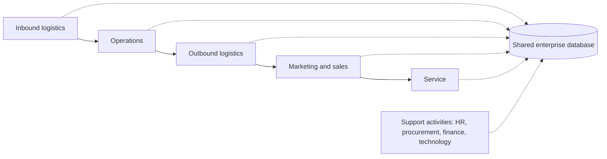
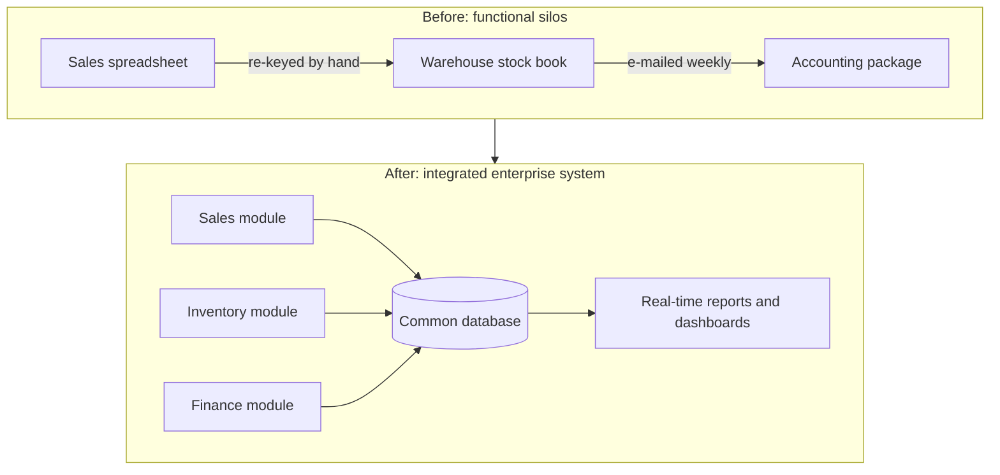

## Introduction

Walk into a medium-sized Ghanaian distributor and you will often find a familiar picture: the sales team keeps orders in one package, the warehouse keeps stock on spreadsheets, accounts uses a separate accounting program, and the managing director receives a weekly report that someone assembles by hand from all three. Each system works reasonably well for its own department, yet the organisation as a whole struggles to answer simple questions such as "How much stock do we really have?" or "Which customers are profitable?". The problem is not a lack of technology; it is a lack of *integration*.

This lesson introduces the idea of an **enterprise system**: a packaged, organisation-wide information system built around a shared database and a set of integrated business processes. You will compare enterprise systems with the broader family of business information systems, examine why functional silos form and why they are costly, and consider the argument, made forcefully by Davenport (1998), that an enterprise system is as much a business decision as a technical one. These ideas are the foundation for every later module in CSIT 603, from ERP selection to business process re-engineering.

## Learning Objectives

- Define an enterprise system and distinguish it from departmental and stand-alone business information systems.
- Explain how functional silos develop and analyse their consequences for data quality, customer service and decision-making.
- Compare the main categories of business information system (TPS, MIS, DSS, executive and collaborative systems) in terms of users, inputs and outputs.
- Evaluate the strategic benefits and risks of adopting an integrated enterprise system.
- Apply the concepts to diagnose integration problems in a Ghanaian organisation.

## Prerequisite Knowledge

- None beyond a general understanding of how businesses are organised into departments such as sales, finance, procurement and human resources.
- Helpful but not essential: basic familiarity with databases and spreadsheets.

## Key Terminology

- **Business information system**: Any combination of people, processes, data and technology that collects, processes, stores and distributes information to support an organisation's operations, management or decision-making.
- **Enterprise system**: A packaged, organisation-wide application suite, built on a common database, that supports and integrates core business processes across functional boundaries. ERP is the best-known type.
- **Functional silo**: A department or function whose processes, data and systems are isolated from others, so that information does not flow freely across the organisation.
- **Integration**: The linking of data, processes and applications so that an event recorded once (for example, a sale) is immediately available to every function that needs it.
- **Single source of truth**: The principle that each data item has one authoritative, maintained version that all users and systems rely on.
- **Cross-functional process**: A process, such as order-to-cash, that starts in one function and finishes in another, crossing several departments.
- **Packaged software**: Commercial software designed for many organisations and configured, rather than written from scratch, for each customer.
- **Legacy system**: An older system that remains in use because it supports important work, even though it may be hard to maintain or integrate.

## Detailed Explanation

### From data processing to enterprise systems

Organisations first used computers to automate high-volume clerical work such as payroll and invoicing. Each application was built for a single department and stored its own data. As more applications appeared, organisations accumulated dozens of separate systems, each with its own copy of customer, product and employee data. This pattern is sometimes called *islands of automation*.

Enterprise systems emerged as an answer to that fragmentation. Rather than building separate programs for each function, a vendor provides a single suite of modules (finance, sales, procurement, inventory, production, human resources) that share one database and are designed to work together. When a sales clerk records an order, the inventory module can reserve stock, the finance module can check the customer's credit limit and, after delivery, the system can post revenue and a receivable without anyone re-keying data.

### Business information systems: the wider family

Enterprise systems sit within a broader family of business information systems. It is useful to classify these by the level of the organisation they serve and the kind of decision they support.

| System type | Main users | Typical inputs | Typical outputs | Example |
|---|---|---|---|---|
| Transaction processing system (TPS) | Operational staff | Sales, receipts, payments, deliveries | Updated records, receipts, detailed lists | Supermarket point-of-sale |
| Management information system (MIS) | Middle managers | Summarised TPS data | Periodic and exception reports | Weekly branch sales report |
| Decision support system (DSS) | Analysts and managers | TPS data plus models and external data | Scenario analyses, forecasts | Delivery route optimisation |
| Executive information system / dashboard | Senior executives | Aggregated internal and external data | Key indicators, drill-down views | Group performance dashboard |
| Collaboration and office systems | Everyone | Documents, messages | Shared files, workflows | Email, shared drives, chat |

An enterprise system typically performs the TPS role across many functions at once and supplies the data on which MIS reporting, dashboards and analytics depend. It is therefore *horizontal* (spanning functions) as well as *vertical* (supporting several organisational levels).

### How functional silos form

Silos are rarely designed. They grow because departments buy or build systems to solve their own urgent problems, because budgets are allocated by department, and because managers are rewarded for departmental rather than organisation-wide performance. Over time the organisation's information architecture comes to mirror its organisation chart.

The costs of silos are predictable:

1. **Duplicate and inconsistent data**: the same customer appears under three spellings in three systems, each with a different address.
2. **Manual re-keying**: staff spend time copying data between systems, introducing errors and delay.
3. **Slow cross-functional processes**: an order waits while sales e-mails the warehouse and the warehouse telephones accounts.
4. **Poor visibility**: managers cannot see the end-to-end state of an order, a patient or a shipment.
5. **Conflicting reports**: finance and sales present different revenue figures at the same meeting, and time is spent arguing about whose numbers are right.

### What integration changes

Integration does not merely save typing. It changes *who can know what, and when*. When stock levels are updated in real time, sales staff can promise delivery dates confidently. When procurement, receiving and accounts payable share the same purchase order record, invoice matching can be automated. When patient registration and billing share data, a hospital can reduce lost charges. Integration also enforces discipline: an enterprise system will often refuse to post a goods receipt without a valid purchase order, which reduces fraud but also removes informal workarounds staff may have relied on.

## Theories, Frameworks and Models

### Davenport's view of the enterprise system

Davenport (1998) argued that an enterprise system imposes its own logic on a company's strategy, organisation and culture. Because the software embodies the vendor's assumptions about how processes should work, adopting it forces choices: an organisation can adapt its processes to the package, or customise the package at significant cost and risk. Davenport's central advice was that managers should first decide what kind of organisation they want to be, then use the enterprise system to support that vision, rather than letting the technology make the decision by default. This remains one of the most useful lenses for evaluating any enterprise system project.

### Porter's value chain as an integration map

Porter's (1985) value chain divides a firm's activities into **primary activities** (inbound logistics, operations, outbound logistics, marketing and sales, service) and **support activities** (firm infrastructure, human resource management, technology development, procurement). Porter emphasised that competitive advantage often comes from the *linkages* between activities, not just from each activity in isolation. Enterprise systems are, in effect, technology for managing those linkages: they connect procurement to inbound logistics, operations to sales and every activity to finance.

The dotted lines show the integration idea: each activity reads and writes the same data instead of keeping private copies.

### A simple maturity view

It can be helpful to picture integration as a progression: (1) stand-alone departmental systems; (2) point-to-point interfaces between selected systems; (3) an integrated enterprise suite for core processes; (4) an enterprise suite extended to customers, suppliers and partners. Organisations do not need to reach the final stage to benefit, and many deliberately keep specialist systems where they add value, connected through well-managed interfaces.

## Ghanaian Business Application

**Illustrative scenario.** *Adom Pharma Distributors* is a hypothetical wholesale pharmaceutical distributor with a warehouse in Tema and sales representatives covering Accra, Kumasi and Takoradi. It currently runs:

- a desktop accounting package used only by the finance office;
- a spreadsheet stock register maintained by the warehouse supervisor;
- order books and WhatsApp messages used by sales representatives;
- a separate payroll spreadsheet.

Symptoms reported by managers include representatives promising products that are out of stock, expired batches discovered only during physical counts, and month-end close taking more than a week because receipts and invoices must be reconciled manually.

**Diagnosis using this lesson's concepts.** The problems are classic silo effects: duplicate product and customer data, manual re-keying between sales and accounts, no shared view of stock by batch and expiry date, and no cross-functional visibility of an order. An integrated system with sales, inventory (including batch and expiry tracking), procurement and finance modules would allow a representative to check available stock on a phone, reserve it, and trigger an invoice on dispatch. The distributor must still make Davenport's strategic choice: should it adopt the package's standard order-to-cash process, or insist on replicating its current informal credit arrangements with long-standing pharmacy customers? The second option preserves relationships but may require costly customisation and weaken controls.

## International Case Study

### FoxMeyer Drug and the risks of enterprise ambition

FoxMeyer Drug was a large United States pharmaceutical distributor. In the mid-1990s it undertook an ambitious programme that combined an SAP R/3 enterprise system with a new automated warehouse, intending to handle very high order volumes efficiently and to support growth through new customer contracts. The project encountered serious difficulties, including problems with the system's ability to process the required transaction volumes and with the warehouse automation. FoxMeyer filed for bankruptcy in 1996, and the bankruptcy trustee later brought legal claims against SAP and the implementation consultants, which were contested and eventually settled.

The case is widely taught because it shows that enterprise systems are strategic bets. Commentators have drawn several lessons: the scope combined two high-risk changes at once; business expectations (such as the savings needed to justify low-margin contracts) depended on the system working perfectly from the start; and technical capacity was not proven at realistic volumes before go-live. For students, the point is not that ERP is dangerous, but that integration magnifies both benefits and failures: when every function depends on one system, a weakness in that system affects the whole enterprise.

## Diagram

## Common Misconceptions

- **"An enterprise system is just a big accounting package."** Finance is only one module; the defining feature is cross-functional integration of processes and data on a shared database.
- **"Buying an ERP automatically removes silos."** Silos are organisational as well as technical. If departments keep their own spreadsheets, incentives and approval habits, the new system will simply be used in silo fashion.
- **"Integration means every system must come from one vendor."** Many organisations integrate a core suite with best-of-breed specialist systems through interfaces and middleware.
- **"More integration is always better."** Tight integration increases dependence and the cost of change; the right level depends on strategy, scale and risk appetite.

## Common Examination Mistakes

- Listing types of information system without explaining how they relate to one another or to the organisational level they serve.
- Describing silos only as a technology problem and ignoring budgets, incentives and organisational structure.
- Treating FoxMeyer (or any failure case) as proof that ERP "does not work" instead of analysing the specific causes.
- Using "enterprise system" and "ERP" interchangeably without noting that CRM, SCM and HRIS can also be enterprise-wide.
- Failing to apply concepts to the scenario in the question; generic answers score poorly at postgraduate level.

## Critical Thinking Questions

1. Davenport (1998) suggests that an enterprise system can push a company towards generic processes. Under what circumstances might adopting a vendor's standard process actually *strengthen* a firm's competitive position?
2. If functional silos are partly caused by departmental budgets and performance targets, what non-technical changes should accompany an enterprise system implementation?
3. Is it possible for a small Ghanaian business to be "too integrated"? Justify your answer with an example.
4. How might mobile money, which is widely used in Ghana, change the data that a retailer's enterprise system needs to capture and reconcile?

## Practical Exercises

1. **Silo audit.** Choose an organisation you know (your employer, a family business or a service you use). List every system or spreadsheet that holds customer, product or staff data. *Expected output:* a table of systems, the data each holds, who maintains it and where data is re-keyed between systems.
2. **Classification exercise.** For the illustrative Adom Pharma scenario, classify each existing tool as TPS, MIS, DSS or collaboration system. *Expected output:* a completed classification with one sentence of justification per tool.
3. **Explore an ERP's module structure.** Visit SAP Learning (<https://learning.sap.com/>) and browse the introductory learning journeys for SAP S/4HANA. *Expected output:* a half-page note listing the main functional areas the product covers and one way they share data.
4. **Value-chain mapping.** Draw Porter's value chain for a supermarket and mark where data currently crosses between activities. *Expected output:* a diagram with at least five labelled linkages and a note on which ones would benefit most from integration.

## Key Takeaways

- An enterprise system is a packaged, cross-functional suite built on a shared database; its defining value is integration.
- Functional silos arise from organisational structures and incentives as well as from technology choices, and they cause duplicate data, delays and conflicting reports.
- Business information systems can be classified by organisational level; enterprise systems provide the transaction data that management reporting and analytics depend upon.
- Davenport (1998) reminds managers that enterprise systems embody business logic and should follow, not dictate, strategy.
- Integration magnifies both benefits and risks, as the FoxMeyer case illustrates.

## Further Reading

- Davenport, T. H. (1998). Putting the enterprise into the enterprise system. *Harvard Business Review, 76*(4), 121-131.
- Monk, E., & Wagner, B. (2013). *Concepts in enterprise resource planning* (4th ed.). Cengage Learning.
- Porter, M. E. (1985). *Competitive advantage: Creating and sustaining superior performance*. Free Press.
- IBM. (n.d.). *What is enterprise resource planning (ERP)?* IBM Think. <https://www.ibm.com/think/topics/enterprise-resource-planning>

## Video Resources

- [SAP Learning](https://learning.sap.com/): SAP. Free learning journeys and videos introducing SAP S/4HANA and integrated enterprise processes.
- [What is ERP? (IBM Think)](https://www.ibm.com/think/topics/enterprise-resource-planning): IBM. An overview page explaining ERP concepts, with links to related IBM explainer media.

## Revision Summary

Enterprise systems are integrated, packaged suites that share one database across functions, replacing the islands of automation that produce functional silos. They perform transaction processing across the organisation and feed management reporting and analytics. Silos are caused by structure and incentives as well as technology, so removing them requires organisational change. Davenport (1998) warns that enterprise systems carry their own business logic, and FoxMeyer shows that integration magnifies risk.

- Enterprise system = cross-functional + shared database + packaged processes.
- Silos cause duplicate data, re-keying, delays and conflicting reports.
- TPS → MIS → DSS → executive dashboards: each level depends on good transaction data.
- Porter's value chain: advantage lies in the linkages that enterprise systems support.
- Strategy should drive the system, not the reverse (Davenport, 1998).
- Integration amplifies both benefits and failures (FoxMeyer).
