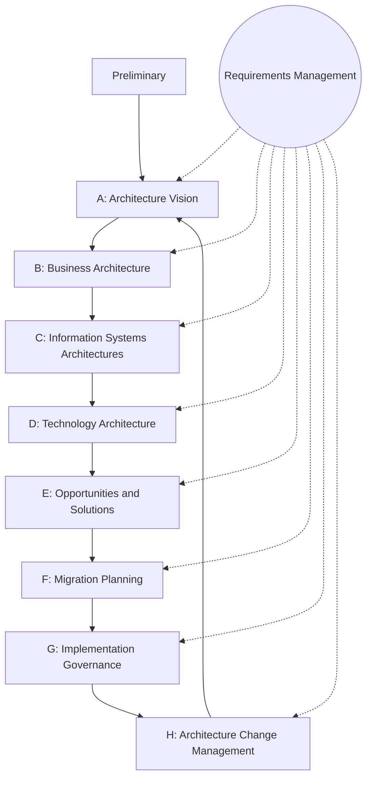
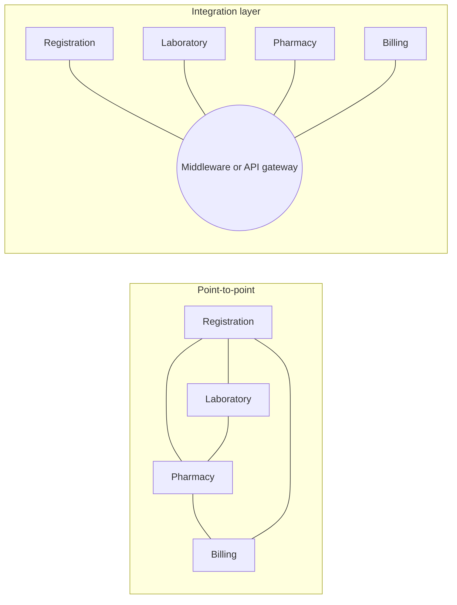

## Introduction

As organisations grow, their information systems tend to grow by accretion: a new billing system here, a mobile app there, a reporting tool bought by one department and a cloud service adopted by another. Each decision may be sensible on its own, yet the result can be a tangled estate in which nobody can say which system holds the authoritative customer record, why data must be exported and imported three times a day, or what will break if one application is replaced. **Enterprise architecture (EA)** is the discipline that tries to bring order to this complexity by describing how the business, its information, its applications and its technology fit together, and by planning how that picture should change over time.

**Enterprise integration** is the practical counterpart: the techniques by which separate applications exchange data and coordinate work. This lesson introduces EA at an overview level, including the structure of The Open Group Architecture Framework (TOGAF) and its Architecture Development Method (ADM), and then examines the main integration styles, middleware and application programming interfaces (APIs). The aim is to equip you to read an architecture diagram critically and to argue for an integration approach that suits a given organisation.

## Learning Objectives

- Explain the purpose and value of enterprise architecture and distinguish its business, data, application and technology domains.
- Outline the phases of the TOGAF Architecture Development Method and the role of requirements management.
- Compare integration styles, including file transfer, shared database, remote procedure invocation and messaging.
- Evaluate point-to-point, hub-and-spoke, enterprise service bus and API-led integration for a given scenario.
- Apply baseline and target architecture thinking to plan integration for a Ghanaian organisation.

## Prerequisite Knowledge

- The lessons *Enterprise Systems and Business Information Systems* and *Organisational Information Flows*.
- A basic idea of what a database and a web service are; no programming is required.

## Key Terminology

- **Enterprise architecture (EA)**: A structured description of an organisation's business processes, information, applications and technology, and of the principles and plans that govern how they evolve.
- **Architecture domain**: One perspective on the enterprise; TOGAF uses business, data, application and technology architecture.
- **Baseline architecture**: The current state of the architecture ("as-is").
- **Target architecture**: The desired future state ("to-be") that the organisation intends to move towards.
- **Gap analysis**: A comparison of baseline and target architectures that identifies what must be added, changed or removed.
- **TOGAF ADM**: The Architecture Development Method of The Open Group Architecture Framework, an iterative cycle of phases for developing and governing enterprise architecture.
- **Middleware**: Software that sits between applications and enables them to communicate and exchange data, for example message brokers and integration platforms.
- **Application programming interface (API)**: A defined, documented way for one software component to request data or services from another, commonly over HTTP in web-based systems.
- **Enterprise service bus (ESB)**: An integration architecture in which applications connect to a shared messaging and transformation layer rather than directly to each other.

## Detailed Explanation

### Why enterprise architecture?

EA exists to connect strategy with technology. Without it, IT investment decisions are taken project by project, and the cumulative effect is duplication, incompatibility and rising maintenance cost. With it, an organisation can ask questions such as: Which capabilities does our strategy require? Which applications currently support them? Where do we have three systems doing the same job? What is the sequence of projects that moves us from today's estate to the one we want?

EA is commonly organised into four domains:

| Domain | Describes | Example artefacts |
|---|---|---|
| Business architecture | Strategy, capabilities, organisation, business processes | Capability map, process landscape, organisation chart |
| Data architecture | Main data entities, ownership, flows and quality | Conceptual data model, data ownership matrix |
| Application architecture | Applications, their functions and interactions | Application portfolio, interface diagram |
| Technology architecture | Infrastructure, networks, platforms, hosting | Deployment diagram, cloud and network standards |

A key insight is that the domains are layered: technology serves applications, applications manage data, and all three exist to support business capabilities. EA work that starts with technology and works upward often produces elegant infrastructure that the business does not need.

### Frameworks: Zachman and TOGAF in brief

Zachman (1987) proposed one of the earliest frameworks, a matrix that classifies architecture descriptions by *perspective* (from planner and owner down to builder and subcontractor) and by *interrogative* (what, how, where, who, when, why). It is a taxonomy for organising descriptions rather than a method for producing them.

TOGAF, maintained by The Open Group, is both a framework and a method. Its best-known element is the **Architecture Development Method (ADM)**, an iterative cycle:

1. **Preliminary**: establish the architecture capability, principles and governance.
2. **Phase A: Architecture Vision**: define scope, stakeholders, business goals and a high-level vision; obtain approval.
3. **Phase B: Business Architecture**: describe baseline and target business architecture.
4. **Phase C: Information Systems Architectures**: describe baseline and target data and application architectures.
5. **Phase D: Technology Architecture**: describe baseline and target technology architecture.
6. **Phase E: Opportunities and Solutions**: identify projects and work packages that close the gaps.
7. **Phase F: Migration Planning**: sequence the work into a prioritised roadmap of transition architectures.
8. **Phase G: Implementation Governance**: ensure delivery projects conform to the target architecture.
9. **Phase H: Architecture Change Management**: monitor changes in business and technology and decide when a new cycle is needed.

**Requirements Management** sits at the centre of the cycle and is continuous: requirements are captured, stored and fed into every phase. In each of phases B to D, the architect performs a gap analysis between baseline and target. TOGAF stresses that the ADM should be tailored; a small organisation would not produce every artefact the full standard describes.

### Enterprise integration styles

Hohpe and Woolf (2004) describe four fundamental styles of application integration:

1. **File transfer**: one application exports a file (for example a CSV) that another imports. Simple and widely supported, but data is only as current as the last file, and errors are often discovered late.
2. **Shared database**: applications read and write a common database. Data is consistent and current, but applications become tightly coupled to one schema, making change difficult. Integrated ERP suites use this style internally.
3. **Remote procedure invocation**: one application calls a function exposed by another and waits for a response. Modern web APIs (for example REST over HTTP) are the most common form. Calls are immediate, but the caller depends on the other system being available.
4. **Messaging**: applications exchange messages through a message broker or queue. The sender does not need to wait; the broker stores and forwards messages reliably. This decouples systems in time and supports high volumes, at the cost of more infrastructure and more complex error handling.

### Integration topologies

- **Point-to-point**: each pair of systems that must communicate has its own interface. With `n` systems, the number of possible interfaces is `n × (n − 1) / 2`; ten systems could need up to 45 interfaces. This "spaghetti" becomes fragile and expensive to change.
- **Hub-and-spoke / ESB**: systems connect to a central integration layer that routes, transforms and monitors messages. Ten systems need only ten connections to the hub, but the hub becomes critical infrastructure that must be well governed.
- **API-led integration**: systems expose and consume well-documented APIs, often managed by an API gateway that handles security, rate limiting and monitoring. This suits cloud services and mobile applications and encourages reuse.
- **Integration platform as a service (iPaaS)**: cloud-hosted middleware offering prebuilt connectors to common applications, useful for organisations with limited in-house integration skills.

In practice most organisations use a mix. A nightly file transfer to a bank may coexist with real-time APIs to a mobile money provider and messaging between a warehouse system and the ERP.

## Ghanaian Business Application

**Illustrative scenario.** *Ridge Valley Hospital* is a hypothetical private hospital in Accra. Its baseline application architecture includes a patient registration system, a separate laboratory information system, a pharmacy stock package, an accounting package and spreadsheets used to prepare National Health Insurance Scheme (NHIS) claims. Results are printed in the laboratory and carried to wards; pharmacy dispensing is not linked to billing, so some medicines are dispensed but never charged; claims preparation takes days each month.

**Applying ADM thinking (tailored and simplified):**

- *Architecture vision*: "Every patient encounter is recorded once and flows automatically to clinical, pharmacy, billing and claims processes."
- *Business architecture gap*: no defined end-to-end "patient visit to payment" process; responsibilities for charge capture are unclear.
- *Data architecture gap*: no single patient identifier shared by all systems; medicine codes differ between pharmacy and billing.
- *Application architecture gap*: no interfaces between laboratory, pharmacy and billing.
- *Opportunities and solutions*: introduce a master patient index; replace point-to-point exports with an integration layer; use APIs for laboratory result delivery and messaging for dispensing-to-billing events.
- *Migration planning*: phase 1, patient index and dispensing-to-billing integration (quick financial benefit); phase 2, laboratory integration; phase 3, automated claims preparation.

The architecture work does not choose products first; it clarifies capabilities, data ownership and gaps, so that later vendor selection is better informed.

## International Case Study

### United States federal enterprise architecture

Enterprise architecture gained formal status in the United States public sector through the Clinger-Cohen Act of 1996, which required federal agency chief information officers to develop and maintain an information technology architecture. The Office of Management and Budget subsequently promoted a Federal Enterprise Architecture approach intended to help agencies describe their business functions, data, applications and technology consistently and to identify duplicated investments across government. The experience has been widely discussed: EA programmes produced extensive documentation, but commentators and government reviews repeatedly noted that value depended on whether architecture actually influenced investment decisions rather than becoming a compliance exercise.

TOGAF's own history is also instructive. The Open Group first published TOGAF in the mid-1990s, drawing on the US Department of Defense's Technical Architecture Framework for Information Management (TAFIM). Both stories carry the same lesson for students: an architecture framework is valuable only when it is tailored to the organisation and connected to real decisions about money, projects and priorities.

## Diagram

## Common Misconceptions

- **"Enterprise architecture is about IT infrastructure."** EA begins with business architecture; technology is only one of four domains and exists to serve business capabilities.
- **"Following TOGAF means producing every deliverable in the standard."** TOGAF explicitly expects tailoring; producing documents that nobody uses is a sign of poor EA practice.
- **"APIs make integration simple."** APIs standardise access, but organisations still need agreed data definitions, security, versioning, monitoring and error handling.
- **"A shared database is always the best integration method."** It ensures consistency but tightly couples applications; it suits a single suite better than independently evolving systems.

## Common Examination Mistakes

- Listing the ADM phases without explaining what happens in them or the central role of requirements management.
- Confusing Zachman (a classification taxonomy) with TOGAF (a framework with a method).
- Recommending an ESB or API platform for a very small organisation without considering cost and skills.
- Ignoring data issues, such as shared identifiers and codes, when proposing integration.
- Failing to use baseline, target and gap analysis language when the question asks for an architecture plan.

## Critical Thinking Questions

1. Why might enterprise architecture programmes become "documentation exercises", and what governance mechanisms prevent this?
2. For a three-branch pharmacy chain, is a formal EA framework worth the effort? What minimum EA practices would you recommend?
3. Messaging decouples systems in time. In which hospital processes would that be beneficial, and in which could delayed delivery be dangerous?
4. How does the growth of cloud software-as-a-service applications change the integration problem for Ghanaian SMEs?

## Practical Exercises

1. **Interface count.** An organisation has 8 applications that each need to exchange data with every other. Calculate the maximum number of point-to-point interfaces and the number of connections needed with a hub. *Expected output:* `8 × 7 / 2 = 28` interfaces versus 8 hub connections, with a paragraph on the maintenance implications.
2. **Baseline and target sketch.** For an organisation you know, draw a baseline application diagram showing systems and data flows, then a target diagram. *Expected output:* two diagrams and a gap list of at least five items classified as add, change or remove.
3. **ADM tailoring note.** Write a one-page plan describing which ADM phases and artefacts you would use for the Ridge Valley Hospital scenario and which you would omit. *Expected output:* a justified table of phases, artefacts and reasons.
4. **Explore process orchestration and APIs.** Read the introductory sections of the Camunda documentation (<https://docs.camunda.io/>) on how a process engine calls external services. *Expected output:* a short explanation of how a process model can coordinate several systems through APIs.

## Key Takeaways

- Enterprise architecture links strategy to technology through business, data, application and technology domains.
- TOGAF's ADM is an iterative, tailorable cycle from vision to change management, with requirements management at the centre and gap analysis in phases B to D.
- The four classic integration styles are file transfer, shared database, remote procedure invocation and messaging.
- Point-to-point integration scales poorly; hubs, ESBs and API-led approaches reduce complexity but need governance.
- Architecture is valuable only when it shapes real investment and project decisions.

## Further Reading

- The Open Group. (n.d.). *The TOGAF Standard*. <https://www.opengroup.org/togaf>
- Zachman, J. A. (1987). A framework for information systems architecture. *IBM Systems Journal, 26*(3), 276-292.
- Hohpe, G., & Woolf, B. (2004). *Enterprise integration patterns: Designing, building, and deploying messaging solutions*. Addison-Wesley.
- Camunda. (n.d.). *Camunda documentation*. <https://docs.camunda.io/>

## Video Resources

- [The TOGAF Standard](https://www.opengroup.org/togaf): The Open Group. Official home of TOGAF with overview material and links to learning resources.
- [Camunda Documentation](https://docs.camunda.io/): Camunda. Official guides explaining how process orchestration connects systems through APIs and connectors.

## Revision Summary

Enterprise architecture describes how business, data, applications and technology fit together and plans their evolution from a baseline to a target state. TOGAF's ADM provides a tailorable cycle of phases, with requirements management at the centre. Integration connects applications through file transfer, shared databases, remote calls (APIs) or messaging, arranged point-to-point or through hubs and API gateways. Value comes from linking architecture to real decisions.

- Four EA domains: business, data, application, technology.
- ADM: Preliminary, A-H, requirements management at the centre.
- Baseline + target + gap analysis = the core architecture reasoning.
- Integration styles: file, shared database, RPC/API, messaging.
- Point-to-point grows as `n(n−1)/2`; hubs reduce connections but need governance.
